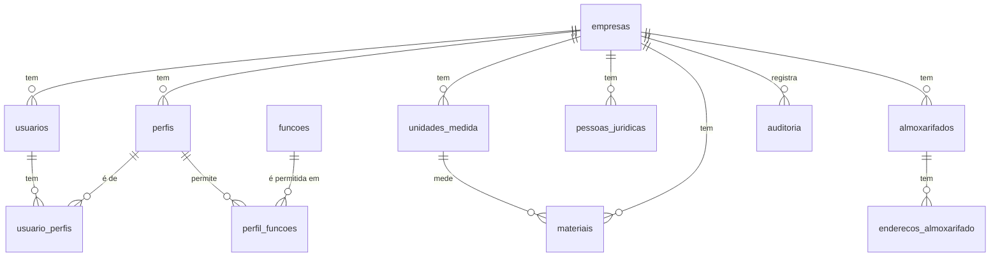

# Modelo de dados, migração 1

Schema `ilab`. Todas as tabelas têm `empresa_id` (direto ou pela tabela-mãe) e regras de acesso por linha. Diagrama:

## Tabelas

| Tabela | Para que serve | Falha do legado que resolve |
|---|---|---|
| `empresas` | O cliente (inquilino) do SaaS | O legado era instalado por cliente; aqui um ambiente atende várias empresas, isoladas |
| `usuarios` | Pessoas com acesso; o `id` é o do login do Supabase | Usuários e perfis copiados entre Principal e Estoque (`01-telas-repetidas.md`) |
| `perfis`, `perfil_funcoes`, `usuario_perfis` | Quem pode o quê (função e ação) | Perfil sem histórico no Estoque; função ligada à configuração errada (DV-EST-076) |
| `funcoes` | Catálogo das telas e rotinas controladas | Função inexistente no cadastro derrubava a tela para todos (DV-CQ-046) |
| `unidades_medida` | **Um só cadastro** de unidades | Três telas de unidade de medida em módulos diferentes |
| `pessoas_juridicas` | Fornecedores, fabricantes, transportadoras, clientes e laboratórios, com CNPJ válido e único | Cópias da pessoa jurídica por módulo |
| `almoxarifados`, `enderecos_almoxarifado` | Estrutura de armazenagem (quarentena, aprovado, reprovado, produção...) | Endereçamento que "finalizava com sucesso" e não gravava (DV-EST-016) |
| `materiais` | Insumos, embalagens e produtos, com unidade, controle de lote, exigência de análise e prazo de reteste | Vínculo frágil entre insumo da Produção e item do Estoque (regra de um item por insumo, mensagem genérica) |
| `auditoria` | Quem, o quê, quando, valor anterior e novo, motivo (quando informado). Só leitura e imutável | Trilha de auditoria por tela, sem garantia; RDC 658 art. 125 |

## Regras que o banco impõe

- Uma empresa nunca lê nem grava dados de outra, e o `empresa_id` de um registro não muda.
- Sigla de unidade, código de almoxarifado e de material, e CNPJ são únicos **dentro da empresa**.
- O CNPJ tem 14 dígitos; o tipo de pessoa jurídica, o de almoxarifado e o de material vêm de listas fechadas.
- Cadastros não são apagados: inativa-se, e a auditoria guarda o histórico.
- A auditoria não aceita alteração, exclusão nem esvaziamento, nem pelo dono do banco.
- Visitante sem login não vê nada.
