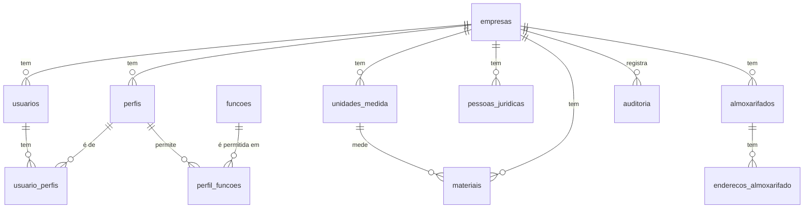
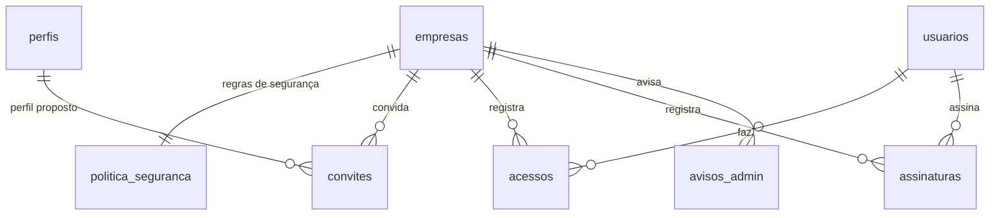

# Modelo de dados, migração 1

Schema `ilab`. Todas as tabelas têm `empresa_id` (direto ou pela tabela-mãe) e regras de acesso por linha. Diagrama:

## Tabelas

| Tabela | Para que serve | Falha do legado que resolve |
|---|---|---|
| `empresas` | O cliente (inquilino) do SaaS | O legado era instalado por cliente; aqui um ambiente atende várias empresas, isoladas |
| `usuarios` | Pessoas com acesso; o `id` é o do login do Supabase | Usuários e perfis copiados entre Principal e Estoque (`01-telas-repetidas.md`) |
| `perfis`, `perfil_funcoes`, `usuario_perfis` | Quem pode o quê (função e ação) | Perfil sem histórico no Estoque; função ligada à configuração errada (DV-EST-076) |
| `funcoes` | Catálogo das telas e rotinas controladas | Função inexistente no cadastro derrubava a tela para todos (DV-CQ-046) |
| `unidades_medida` | **Um só cadastro** de unidades | Três telas de unidade de medida em módulos diferentes |
| `pessoas_juridicas` | Fornecedores, fabricantes, transportadoras, clientes e laboratórios, com CNPJ válido e único | Cópias da pessoa jurídica por módulo |
| `almoxarifados`, `enderecos_almoxarifado` | Estrutura de armazenagem (quarentena, aprovado, reprovado, produção...) | Endereçamento que "finalizava com sucesso" e não gravava (DV-EST-016) |
| `materiais` | Insumos, embalagens e produtos, com unidade, controle de lote, exigência de análise e prazo de reteste | Vínculo frágil entre insumo da Produção e item do Estoque (regra de um item por insumo, mensagem genérica) |
| `auditoria` | Quem, o quê, quando, valor anterior e novo, motivo (quando informado). Só leitura e imutável | Trilha de auditoria por tela, sem garantia; RDC 658 art. 125 |

## Regras que o banco impõe

- Uma empresa nunca lê nem grava dados de outra, e o `empresa_id` de um registro não muda.
- Sigla de unidade, código de almoxarifado e de material, e CNPJ são únicos **dentro da empresa**.
- O CNPJ tem 14 dígitos; o tipo de pessoa jurídica, o de almoxarifado e o de material vêm de listas fechadas.
- Cadastros não são apagados: inativa-se, e a auditoria guarda o histórico.
- A auditoria não aceita alteração, exclusão nem esvaziamento, nem pelo dono do banco.
- Visitante sem login não vê nada.

## Migração 3: login e segurança

Arquivo `migracoes/20261105090000_login_seguranca.sql`. **Ainda não aplicada no Supabase** (só testada; ver `execucao/2026-11-05-migracao-3/resultado.md`). Desenho em `../docs/seguranca-e-acesso.md`.

### Tabelas novas

| Tabela | Para que serve | Falha do legado ou do teste que resolve |
|---|---|---|
| `politica_seguranca` | Uma linha por empresa: senha mínima (12), validade da senha (desligada), inatividade (10 min), tentativas e janela (5 em 15 min), bloqueio (15 min), validade do convite (48 h), duas etapas para quem aprova (sim) e para administradores (não, a validar) | Regras fixas no código no legado (SEG-PRI-11 e 12) |
| `convites` | Convite com **resumo do token** (nunca o token), validade, uso único, quem convidou, perfil proposto, cancelamento | SEG-PRI-09: senha provisória previsível e visível |
| `acessos` | Entradas, falhas, bloqueios, trocas e redefinições de senha, assinaturas; quem, quando, resultado, IP e navegador como texto. **Sem campo de senha.** Imutável | SEG-PRI-02: senha digitada gravada no registro de acessos |
| `avisos_admin` | Aviso ao administrador (hoje: bloqueio por tentativas). O envio por e-mail é do servidor | SEG-PRI-12 |
| `assinaturas` | Quem assinou (sempre o usuário autenticado), significado (autor, revisor, aprovador, reprovador, liberador, anulador), hora do servidor, motivo, segundo fator, registro assinado. Imutável | Aprovações sem assinatura no legado (Guia 33, 9.3.2.3) |
| `parametros_plataforma` | Valores da plataforma que não ficam no código: `dias_teste` (365, provisório) e `dias_carencia` (6, provisório) | `docs/antes-de-lancar.md` |

### Campos novos

- `empresas`: `situacao_acesso` (teste, ativa, em carência, suspensa) e `teste_ate`. A situação **efetiva** é calculada pelas datas: passado o teste, entra em carência (só leitura) e depois suspensa (sem acesso).
- `usuarios`: `senha_a_trocar` (a sessão inteira é recusada até trocar), `senha_alterada_em` (para a validade da senha, se a empresa ligar) e `bloqueado_ate`.

### Regras que o banco passa a impor

- **Toda gravação confere função e ação no servidor.** Só 7 tabelas aceitam gravação direta pela API (cadastros, perfis e o nome do usuário). Ligar e desligar usuário, perfis de usuário, permissões de perfil, política, convites, acessos e assinaturas só mudam por funções que conferem a permissão, exigem motivo (quando é decisão) e deixam antes e depois na auditoria.
- **Quem elaborou não revisa, aprova, reprova, libera nem anula o próprio registro** (elaborou = criou o registro ou o assinou como autor).
- **Assinatura:** confere a senha de novo no servidor; quem aprova precisa do segundo fator; senha errada vira falha no registro de acessos e conta para o bloqueio.
- **Inativar usuário (por qualquer caminho) encerra as sessões na hora.** Ninguém inativa nem muda o perfil de si mesmo.
- **Bloqueio:** a 5ª falha em 15 minutos bloqueia por 15 minutos, avisa o administrador e recusa tudo da pessoa até o fim do bloqueio ou o desbloqueio com motivo.
- **Listas sem limite:** `listar_perfis` e `listar_usuarios` devolvem tudo; `vinculos_do_usuario` mostra o vínculo gravado mesmo de perfil inativo.
- **Quem executa o quê:** o visitante só consulta o estado de um convite; quem está logado chama as funções da pessoa (conferindo a permissão); `registrar_acesso`, `bloquear_por_tentativas` e `registrar_troca_de_senha` são só do servidor (chave de serviço).

### Funções novas (schema `ilab`)

`meu_estado`, `listar_perfis`, `vinculos_do_usuario`, `listar_usuarios`, `criar_convite`, `cancelar_convite`, `consultar_convite`, `aceitar_convite`, `inativar_usuario`, `reativar_usuario`, `trocar_perfil_usuario`, `exigir_troca_de_senha`, `desbloquear_usuario`, `marcar_aviso_lido`, `definir_permissao_perfil`, `definir_situacao_perfil`, `alterar_politica_seguranca`, `assinar_registro`, `registrar_acesso`, `bloquear_por_tentativas`, `registrar_troca_de_senha` (e `minhas_permissoes`, que passou a devolver vazio para quem não pode usar o sistema).

### Funções de catálogo novas

`acesso.registro_acessos`, `acesso.politica_seguranca`, `assinatura.consulta` e uma por significado de assinatura (`assinatura.autor`, `.revisor`, `.aprovador`, `.reprovador`, `.liberador`, `.anulador`).

### Perfis

O Administrador criado com a empresa tem tudo **menos** assinar aprovações (regra de ouro, a validar). `ilab_interno.criar_perfis_de_teste(empresa)` cria os 22 perfis de teste (prefixo `T-`), um por papel da matriz proposta; **só para dados de teste**. Por enquanto só têm as funções de cadastro, acesso e assinatura: as funções da cadeia do lote entram com a migração 2.

## Base de conhecimento, etapa 1 (migração 15, não aplicada)

| Tabela | Para que serve |
|---|---|
| `kb_documentos` | Um documento da base: título, legenda opcional, tipo (norma, regra de negócio, especificação, fluxo, guia, outro), origem (ANVISA, legado, upload próprio, outro), confidencialidade (público, interno, confidencial), data da fonte, identificação oficial (por exemplo "RDC 658/2022"), data da consulta e situação lida (vigente, revogada, alterada, não verificada). Situação do cadastro: ativo, inativo ou excluído. |
| `kb_documento_versoes` | Cada arquivo enviado do documento: número da versão (dado pelo banco), caminho no Storage, nome original, tipo (txt, docx, pdf), tamanho (até 50 MB) e checksum SHA-256. **Nunca se altera nem se apaga.** A versão atual é a de maior número. |

Regras: escrita só pelas funções `ilab.kb_criar_documento`, `ilab.kb_nova_versao`, `ilab.alterar_cadastro` e `ilab.mudar_situacao`; documento da ANVISA exige a data da consulta; confidencial só para a função `kb.documentos_confidenciais`; o arquivo fica no bucket privado `kb-documentos`, no caminho `empresa/documento/versão.extensão`. `ilab.kb_arquivo_ja_existe(checksum)` avisa de arquivo repetido.

