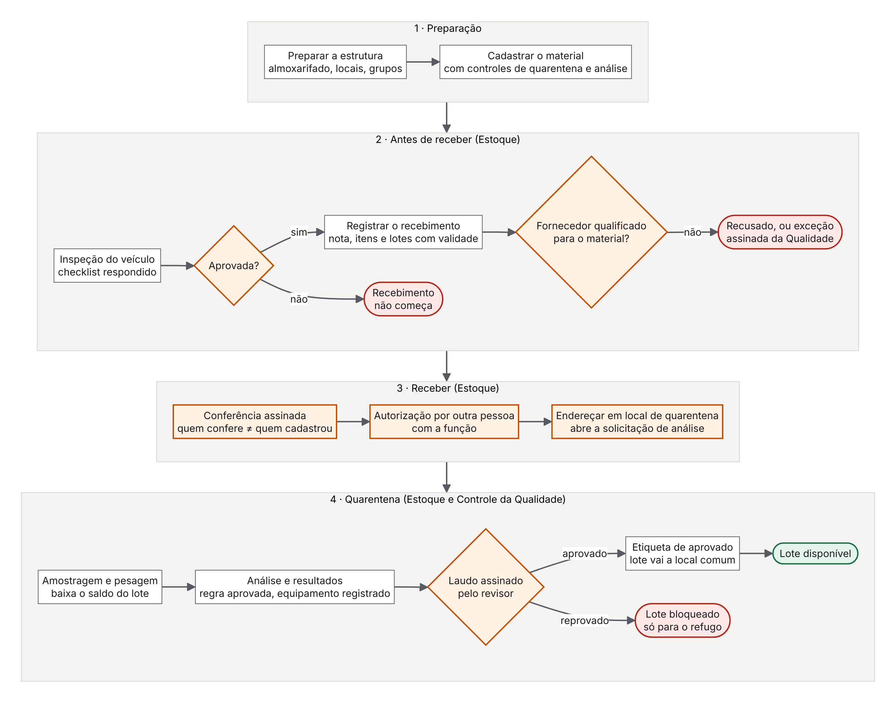
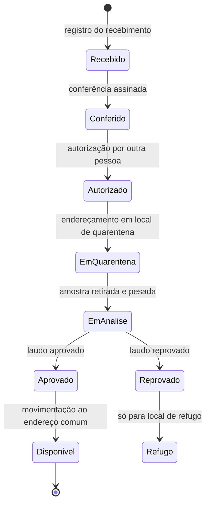

# Passo 3, fluxo 1: receber a matéria-prima, colocá-la em quarentena e liberá-la

*Como ler: **laranja** = o sistema confere (trava); **vermelho** = bloqueio; **verde** = resultado. Clique na imagem para ampliar.*

*Coluna "Onde no sistema": o caminho no sistema atual (legado), no formato **Módulo › Menu › Tela**. Onde diz "tela nova", a tela não existe hoje e será criada.*

> **Em uma frase:** Quando chega um ingrediente de fora, ele **não pode ser usado de imediato**: fica parado (em quarentena) até o laboratório analisar e dizer que está bom.
>
> **Exemplo do dia a dia (ilustrativo, os números são inventados):** Chega um saco de açúcar do fornecedor. O estoque dá entrada, mas o saco fica 'de castigo' até o laudo do laboratório sair aprovado.
>
> **Por que importa:** Se alguém usar o ingrediente antes da análise, o remédio pode sair contaminado ou fora do padrão.
>
> *Palavra que não conhece? Veja a aba "24 · Glossário" desta página.*

**Análise de 19/11/2026. Rascunho para validação do responsável.** É o seu exemplo: "para receber uma matéria-prima, que vai para quarentena, quais informações precisamos ter?". Continua os passos 1 e 2 ([`cadastros-repetidos.md`](cadastros-repetidos.md), [`ordem-de-cadastro.md`](ordem-de-cadastro.md)).

**Fontes (todas no repositório do legado):** os dois fluxos escritos pela equipe (Recebimento de materiais e Estoque quarentena), a conferência pelo código (`3.estoque/fluxos/recebimento-quarentena-conferencia.md`) e os resultados dos testes de tela (achados `DV-EST-001` a `DV-EST-009`). **O que não fiz:** não li as telas uma a uma; o que está como "legado" vem desses documentos.

## 1. O caminho, em uma linha
**Preparar a estrutura → cadastrar o material com seus controles → inspeção do veículo → recebimento (portaria, nota, itens, lotes) → conferência → autorização → endereçamento em quarentena → amostragem e pesagem → análise → laudo assinado → etiqueta e movimentação → lote disponível.**

### A situação do lote ao longo do caminho

No legado a situação do lote não era uma regra do banco: era deduzida de várias telas. No iLabs é **uma única situação, guardada e conferida pelo banco** (modelo ideal), e cada passo acima só acontece se a situação anterior estiver certa.

## 2. Etapa a etapa

Legenda: **exige antes** = o que precisa estar cadastrado (cadastro) ou concluído (etapa anterior); **entra** = o que a pessoa informa; **o banco garante** = a trava que não pode depender da tela.

| # | Etapa | Onde no sistema (legado) | Quem faz | Exige antes | O que entra | O banco garante (iLabs) | Falha do legado |
|---|---|---|---|---|---|---|---|
| 0 | **Preparar a estrutura** | **Estoque** › Cadastros › Almoxarifado, Local de Armazenagem, Estoque Rua, Estoque Coluna, Estoque Andar, Grupo Usuário - Almoxarifado **Estoque** › Estoque › Endereço do Estoque | Administrador | Grupo de usuários | Almoxarifado; locais de armazenagem (com marcas: quarentena, refrigerado, controlado, umidade, refugo); endereços (rua, coluna, andar); quais grupos usam o almoxarifado | Almoxarifado sem grupo não é usado; endereço único dentro do local; só local ativo recebe material | Configuração espalhada em várias telas (ponto de melhoria da equipe) |
| 1 | **Cadastrar o material** | **Estoque** › Cadastros › Item | Estoque / Qualidade | Unidade, classificação, condição de armazenagem | Código, descrição, unidade, tipo, classificação, controle de lote, de validade, **de quarentena**, análise físico-química e/ou microbiológica, condição de armazenagem, validade padrão do laudo | Material de quarentena **exige** lote, validade e pelo menos um tipo de análise | O banco só exigia unidade; o resto era opcional |
| 2 | **Inspeção do veículo** | **Estoque** › Estoque › Checklist de Inspeção Veicular | Portaria / Estoque | Modelo do checklist (perguntas) | Placa, condutor, documento; **resposta a cada pergunta**; parecer | Parecer só pode ser "Aprovado" com todas as perguntas respondidas; **checklist reprovado não pode ser vinculado a um recebimento** | `DV-EST-004`: salvou "Aprovado" com as 15 perguntas em branco; checklist reprovado aparecia na lista do recebimento |
| 3 | **Aprovação prévia** (quando o material a exige) | Não existe no legado (tela nova) | Qualidade | Marca no material | Quem aprova e quando | O recebimento só começa depois da aprovação | **Não existe** no legado: só havia autorização *depois* do cadastro |
| 4 | **Registrar o recebimento** | **Estoque** › Estoque › Recebimento de Material (nota, itens e lotes: telas de recebimento por nota, fora do menu) | Estoque | Fornecedor **qualificado para este material**, transportadora, inspeção (etapa 2), tipos e tabelas fiscais | Nota (número, série, chave, datas, valores); itens (CFOP, NCM, CST, impostos); **por lote: código, quantidade, volumes, fabricante, validade**; peso de entrada e saída | Fornecedor não qualificado **bloqueia**; **validade obrigatória** e não vencida; **código do lote gravado como digitado**; quantidade exata; grava tudo ou nada | Fornecedor nunca conferido; validade em branco virava **31/12/2099**; vencida aceita; `TESTE-LOTE-001` virou `TESTELOTE001` (`DV-EST-001`); `100` virou `0,100` (`DV-EST-002`) |
| 5 | **Conferência física e documental** | **Estoque** › Estoque › Conferência de Recebimento | Conferente | Recebimento registrado | Quantidade conferida por lote; divergências; **assinatura** (login, senha, justificativa) | Quem confere precisa da função de conferente e **não pode ser quem cadastrou**; divergência real é registrada, não só bloqueada | Aceitava qualquer login válido (`DV-EST-009`); o gatilho que marcava a nota como conferida estava **desligado** |
| 6 | **Autorização do recebimento** | **Estoque** › Estoque › Recebimento de Material (botão Autorizar recebimento) | Outra pessoa, com função | Conferência concluída | Assinatura eletrônica | Função específica; diferente de quem confirmou; fica registrada (quem, quando, significado) | Qualquer login válido, sem conferir perfil |
| 7 | **Endereçar em quarentena** | **Estoque** › Estoque › Endereçamento de Material | Estoque | Recebimento autorizado; local de quarentena compatível | Almoxarifado, local, rua, coluna, andar, lote, quantidade | Material de quarentena **só aceita local de quarentena**, conferido no servidor; abre **sozinha** a solicitação de análise | Compatibilidade de local só na tela; a trava do servidor estava desligada |
| 8 | **Programar a amostragem e pesar a amostra** | **Controle da Qualidade** › Solicitação de Análise › Programação de Amostragem **Controle da Qualidade** › Amostragem › Consultar Amostragem **Estoque** › Estoque › Central de Pesagem | Qualidade programa; Estoque pesa e separa | Verificação de amostragem e **regra de amostragem** do material; solicitação de análise | Data, responsável, **quantidade da amostra (cálculo da regra)**, **balança usada**, peso bruto, tara, líquido, lacre, volumes | A quantidade retirada **baixa o saldo** do lote; balança **calibrada**; a análise não conclui sem a amostra | Balança só como "tag" digitada (a confirmar se conferia calibração) |
| 9 | **Análise e resultado** | **Controle da Qualidade** › Análise e Laudo › Programação de Análise, Consultar Análise Programada | Analista | **Regra de análise** do material (intervalo ou conforme/não conforme); equipamentos e métodos | Resultado por regra, justificativa, anexos | Resultado fora do intervalo é classificado pelo banco; o analista **precisa estar treinado no método** | Regra podia ser criada na hora, na tela de confirmação |
| 10 | **Laudo** | **Controle da Qualidade** › Análise e Laudo › Emissão Laudo Final | Revisor da Qualidade | Análise com resultado | Aprovação; **validade do laudo** | Revisor com **função de revisor**; **diferente de quem analisou**; validade ≥ hoje; **o laudo muda a situação do lote na hora** | A aprovação do laudo não conferia a função de revisor (leitura do código); **não se sabe** se o mesmo usuário podia analisar e aprovar (caso `CT-EST-205`, a registrar); o estoque só mudava com um botão "Atualizar" |
| 11 | **Etiqueta e liberação** | **Controle da Qualidade** › Análise e Laudo › Gerar Etiqueta **Estoque** › Estoque › Movimentação de Quarentena | Estoque | Laudo aprovado | Etiqueta de aprovado (substitui a de quarentena); endereço de destino | Aprovado só vai para local comum; **reprovado só para refugo**, no servidor | Destinos protegidos **só pela tela** |

## 3. O que este fluxo exige de cada cadastro global (a resposta direta à sua pergunta)

| Cadastro (passo 1) | O que o fluxo precisa que ele guarde |
|---|---|
| **Material** | Código; descrição; unidade; tipo (matéria-prima, embalagem, produto); classificação; **controla lote; controla validade; controle de quarentena; análise físico-química; análise microbiológica**; condição de armazenagem (refrigerado, umidade); controlado (Portaria 344); exige aprovação prévia; validade padrão do laudo; almoxarifado padrão |
| **Pessoa jurídica** | Papéis: **fornecedor, fabricante, transportadora**; CNPJ e endereço |
| **Qualificação de fornecedor** | Liga **pessoa jurídica + material**; situação (qualificado, condicional, desqualificado) e validade |
| **Almoxarifado, locais e endereços** | Tipo do local (**quarentena, comum, refugo**); marcas (refrigerado, controlado, umidade); capacidade; grupos de usuários que o usam |
| **Profissional, função e grupo** | Funções de **conferente, autorizador, amostrador, analista, revisor da Qualidade**; vínculo ao grupo do almoxarifado |
| **Equipamento** | A **balança** (categoria), com calibração válida |
| **Dados fiscais e tipos de documento** | CFOP, NCM, CST; tipos de documento fiscal, de frete e de pagamento |
| **Checklist (serviço comum)** | O modelo do checklist de inspeção do veículo e a **verificação de amostragem** |
| **Cadastros do CQ** | Regra de amostragem (tipo de cálculo, quantidade, tolerância, unidade); regra de análise (intervalo ou conforme); tipos de análise |
| **Unidade de medida** | Também para a amostra e o laudo; conversão quando a nota vem em outra unidade |

## 4. Checklist de implantação: o que precisa estar cadastrado antes do **primeiro** recebimento de matéria-prima
Na ordem do passo 2:
1. Unidade de medida · classificação do material · condição e tipo de armazenagem · listas fiscais · tipos de análise do CQ.
2. Pessoa jurídica (fornecedor, fabricante, transportadora) · almoxarifado, locais e endereços (inclusive o de **quarentena**).
3. Profissionais com as funções do fluxo (**conferente, autorizador, amostrador, analista, revisor**) e o grupo do almoxarifado.
4. Equipamento: a **balança**.
5. **Material** com os controles de quarentena e de análise.
6. **Qualificação do fornecedor para o material.**
7. Modelo do checklist do veículo · **regra de amostragem** e **regra de análise** do material.
Sem qualquer um destes, o fluxo trava em alguma etapa.

## 5. Os registros que nascem no fluxo (não são cadastros)
Inspeção do veículo · recebimento (portaria) · nota fiscal e seus itens · **lote** e volumes · conferência · autorização · endereçamento · solicitação de análise · programação da amostragem · pesagem · análise e resultados · laudo · etiqueta · movimentação · **histórico do lote** (quem fez cada passo e quando).

## 6. O que muda nos passos anteriores
- **Passo 2 (ordem):** a qualificação de fornecedor e a regra de amostragem/análise precisam existir **antes do primeiro recebimento**, não só antes do Item; a **balança** (equipamento) entra na ordem.
- **Passo 1:** confirma que **Equipamento** serve a Estoque, CQ e Produção; e que o **checklist** como serviço comum atende a inspeção veicular.
- **Material:** os campos obrigatórios que o legado não exigia (seção 3) viram **obrigatórios no iLabs**, conforme o tipo de material. Resolve a pergunta que ficou em aberto no passo 2.

## 7. Pontos a validar com a área (não consegui tirar do código)
1. **Ordem exata de conferência e autorização** (o fluxo da equipe diz "aprovação antes"; o código autoriza depois do cadastro).
2. **Quando exigir aprovação prévia** para receber (por tipo de material? por fornecedor?).
3. **Divergência de quantidade:** como registrar entrega a menor ou a maior (hoje só bloqueia).
4. **Quem é o "revisor"** (a função "48 CQ - Chefe de Subdivisão" tem número fixo no código) e se há **pessoa designada** para liberar (RDC 658/2022, art. 8º, XV).
5. A **balança** precisa ter calibração válida para pesar?
6. **Fiscal:** entra já nesta fatia (nota fiscal na entrada) ou a entrada é só por documento do fornecedor?
