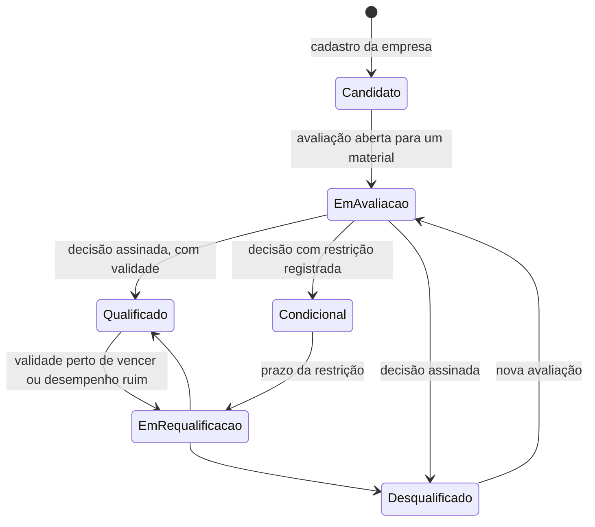

# Passo 3, fluxo 2: qualificar o fornecedor e comprar

**Análise de 19/11/2026. Rascunho para validação do responsável.** Segunda ficha do passo 3. Ela detalha o que o [fluxo 1](fluxo-01-recebimento-quarentena.md) exige antes do primeiro recebimento: **o fornecedor qualificado para o material**.

**Fontes (todas no repositório do legado):** o fluxo de Compras e avaliação do fornecedor (`3.estoque/fluxos/compras-fornecedor.md`), os resultados dos testes de tela do Estoque (casos `CT-EST-160` a `168`, achados `DV-EST-021` a `023`), a conformidade e o inventário da Garantia da Qualidade, e o modelo ideal (trava 5, "só fornecedor qualificado no recebimento"). **O que não fiz:** não li as telas uma a uma.

**Duas partes:** **A) Qualificar o fornecedor** (é o centro e o que trava o recebimento) e **B) Comprar** (da necessidade ao pedido e à baixa no recebimento).

## 1. O caminho, em uma linha
**A.** Cadastrar o fornecedor → avaliá-lo para cada material → decisão de qualificação, assinada, com validade → o recebimento consulta → avaliação a cada entrega → requalificação ou desqualificação.
**B.** Analisar a necessidade (curva ABC e análise do estoque) → gerar o pedido, **só para fornecedor qualificado** → o recebimento baixa o pedido.

### A situação do fornecedor para cada material

No legado **não existe situação do fornecedor**: só existia uma nota por entrega, e a coluna "Qualificado" da lista mostrava **SIM para qualquer fornecedor que tivesse sido avaliado**, mesmo com nota péssima (`DV-EST-022`). No iLabs a situação é **guardada e conferida pelo banco**, por fornecedor e material.

## 2. Parte A: etapa a etapa

| # | Etapa | Quem faz | Exige antes | O que entra | O banco garante (iLabs) | Falha do legado |
|---|---|---|---|---|---|---|
| A1 | **Cadastrar o fornecedor** | Compras | Pessoa jurídica com o papel de fornecedor (e de fabricante, quando for) | Razão social, CNPJ, endereço, contato, **o que fornece** | CNPJ único; empresa inativa não é escolhida | Em quatro cadastros diferentes (passo 1) |
| A2 | **Avaliar o fornecedor para um material** | Garantia da Qualidade | Fornecedor (A1) e **material** | Questionário preenchido; documentos do fornecedor; resultado de amostras ou de auditoria, quando houver | A avaliação fica ligada a **fornecedor + material** e guarda as respostas | Três telas de avaliação eram **protótipo** (GQ e CQ); **não existe auditoria de fornecedor** (`DV-GQ-111`); a do Estoque avaliava a entrega, não o fornecedor |
| A3 | **Decidir a qualificação** | Responsável da Garantia da Qualidade | Avaliação concluída | Decisão (qualificado, condicional, desqualificado), **validade**, restrições, justificativa, **assinatura eletrônica** | Só quem tem a função aprova; **quem avaliou não aprova**; sem validade não qualifica; fica o histórico de cada decisão | A tela **não tinha** campo "qualificado" nem nota de corte (`CT-EST-165`) |
| A4 | **Usar no recebimento** | Estoque (automático) | Decisão (A3) em vigor | Nada: o sistema consulta | **O recebimento recusa** fornecedor não qualificado, ou exige uma **decisão registrada** da Garantia da Qualidade (a validar, seção 7) | O recebimento **nunca consultou** a avaliação (`DV-EST-022`, `CT-EST-166`) |
| A5 | **Avaliar o desempenho a cada entrega** | Estoque e Qualidade | Entrega recebida | Pontuação por entrega (as perguntas do legado servem de ponto de partida): recusado pelo almoxarifado, reprovado pelo CQ, material diferente da nota, atraso | A nota de cada entrega é ligada ao lote; **uma nota abaixo do limite abre a requalificação** | Havia 34 perguntas (valores 0, 5, 10, 50 ou 100) e uma soma, mas **a soma não mudava nada**; depois de gravada, a avaliação **não podia ser alterada nem tinha histórico** (`DV-EST-023`) |
| A6 | **Requalificar ou desqualificar** | Garantia da Qualidade | Validade, desempenho ou desvio | Nova avaliação ou decisão de desqualificação, com motivo | Qualificação vencida **bloqueia** como a de fornecedor não qualificado; aviso antes do vencimento; desqualificar exige assinatura | Não existia |

## 3. Parte B: etapa a etapa

| # | Etapa | Quem faz | Exige antes | O que entra | O banco garante (iLabs) | Falha do legado |
|---|---|---|---|---|---|---|
| B1 | **Analisar a necessidade** | Compras | Consumo registrado, material | Curva ABC (período e percentuais A, B, C) e análise do estoque (grupo, período de análise e de necessidade, até 12 meses) | Período válido; cálculo feito pelo servidor | Curva ABC aceitou **período futuro** e não pedia justificativa (`DV-EST-019`); a regra de **12 meses** da análise estava **comentada no código** e aceitou 13 meses (`DV-EST-020`) |
| B2 | **Gerar o pedido** | Compras | Análise (B1) e **fornecedor qualificado para o material** | Fornecedor, centro de custo | Só oferece fornecedor qualificado para aquele material; sem fornecedor, **mensagem clara** | Sem fornecedor, o botão não dava nenhuma mensagem (`DV-EST-021`) |
| B3 | **Montar o pedido** | Compras | Pedido gerado | Itens, quantidade, **custo unitário** | Item não repete; quantidade exata; pedido editável enquanto aberto | A quantidade `100` virou `0,100`; o pedido **não podia ser editado** depois de criado, só excluído (`DV-EST-021`) |
| B4 | **Baixar o pedido no recebimento** | Estoque (automático) | Pedido; recebimento do fluxo 1 | Lote e quantidade recebidos | **A baixa vem do próprio recebimento**, com a quantidade recebida; saldo do pedido atualizado; baixa manual só com justificativa e assinatura | Baixa **manual** com justificativa (campo `BAIXA_MANUAL`). **Nos testes, ninguém conseguiu finalizar nem baixar um pedido**: a árvore de funções do perfil não tinha o nó de Pedido de Compra (`DV-EST-077`) e o caminho recebimento → endereçamento não gravava (`DV-EST-016`); `CT-EST-164` ficou **bloqueado** |

## 4. O que este fluxo exige de cada cadastro global

| Cadastro (passo 1) | O que o fluxo precisa que ele guarde |
|---|---|
| **Pessoa jurídica** | Papel de **fornecedor** e de **fabricante**; CNPJ; contatos; situação ativa; código do material **no fornecedor** (o legado tinha `APRESENTAÇÃO por fornecedor`) |
| **Qualificação de fornecedor** | **Fornecedor + material (+ fabricante, a validar)**; situação (qualificado, condicional, desqualificado); **validade**; restrições; decisão assinada; histórico |
| **Material** | Quais fornecedores e fabricantes são aprovados para ele; exigência de qualificação (todo material de quarentena exige) |
| **Checklist (serviço comum)** | O **questionário de avaliação** (versionado: as 34 perguntas do legado como base) e o de desempenho por entrega |
| **Profissional, função e grupo** | Funções de **avaliador** e de **aprovador de fornecedor** (Garantia da Qualidade) |
| **Periodicidade** | Prazo de requalificação (por tipo de material ou de risco) |
| **Centro de custo** | Usado pelo pedido |
| **Unidade de medida e moeda** | Quantidade e **custo unitário** do pedido |
| **Notificações (serviço comum)** | Aviso de qualificação perto de vencer |

## 5. Os registros que nascem no fluxo (não são cadastros)
Avaliação (questionário preenchido) · decisão de qualificação · **lista de fornecedores aprovados por material** · avaliação de desempenho por entrega · análise de necessidade (curva ABC e do estoque) · pedido de compra e seus itens · baixa do pedido · histórico de cada decisão.

## 6. O que muda nos documentos anteriores
- **Roteiro de implantação (etapa 7):** ganha o detalhe da qualificação (seção do roteiro). Antes do primeiro recebimento, **cada fornecedor precisa de uma qualificação em vigor para cada material que vende**. Para fornecedores que já entregam, a implantação inclui uma **qualificação inicial** (com a documentação e a data da decisão da Qualidade).
- **Passo 2 (ordem de cadastro):** confirma que a qualificação vem **depois do Item** (liga pessoa jurídica + material) e **antes do primeiro recebimento**; o **questionário** (checklist) e a **periodicidade** entram antes dela.
- **Passo 1:** reforça que a avaliação de fornecedor deve existir **em um lugar só** (hoje são três: Estoque, CQ e GQ) e mora na **Garantia da Qualidade**.

## 7. Pontos a validar com a área (não consegui tirar do código)
1. **Recusar ou exigir decisão registrada:** o recebimento de fornecedor não qualificado é **bloqueado sempre**, ou a Garantia da Qualidade pode **autorizar uma exceção** com assinatura e motivo (por exemplo, uma compra emergencial)?
2. **Qualificação por quê:** por **fornecedor + material**, por **fabricante + material**, ou por fornecedor apenas? (O modelo ideal diz "por material"; o legado era por entrega.)
3. **Critérios:** quais perguntas, qual **nota de corte**, qual **validade** da qualificação e do que depende (risco do material).
4. **Auditoria de fornecedor:** quais tipos (documental, questionário, no local) e **quem** faz.
5. **Compras fica no sistema?** A curva ABC, a análise do estoque e o pedido de compra são parte do sistema completo, como Kits foi retirado? (Se ficarem, a Parte B segue como está; se saírem, só a Parte A permanece.)
6. **Mudança de fabricante ou de fornecedor** exige requalificação? (O legado lista "mudança de fornecedor" como tipo de desvio, mas nada a ligava.)
7. **Quem aprova:** só a Garantia da Qualidade, ou o Controle da Qualidade também para certos materiais?
