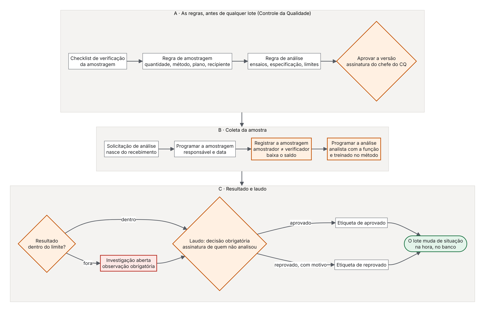
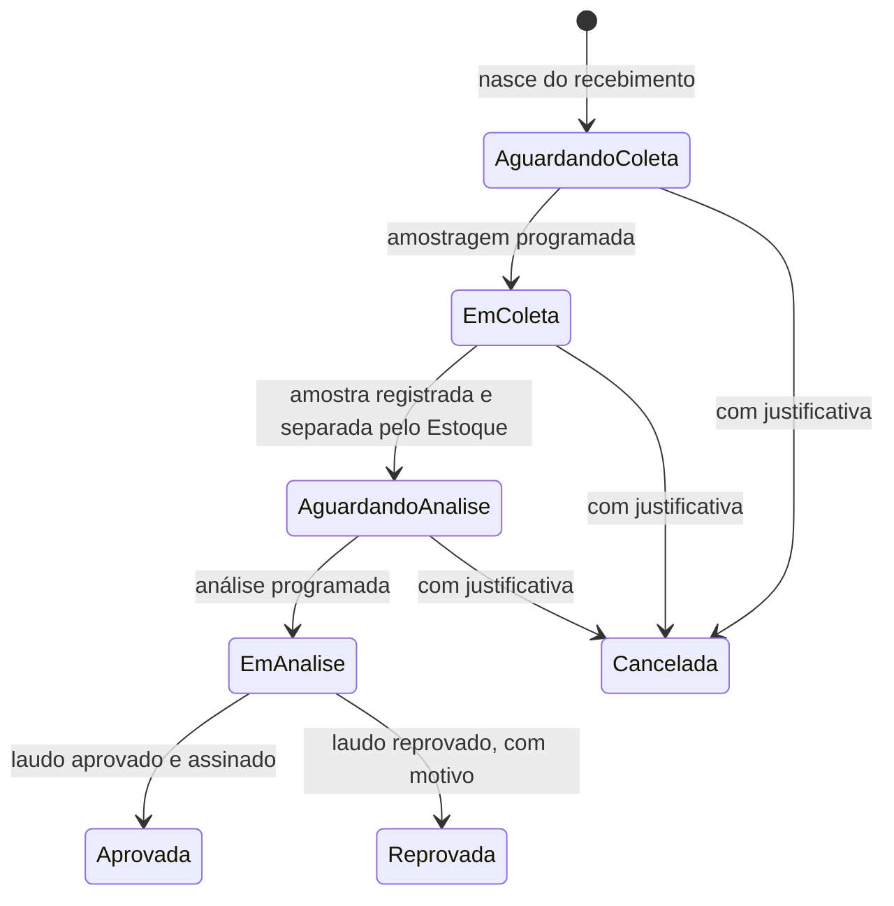

# Passo 3, fluxo 3: as regras do laboratório, a análise e o laudo

*Como ler: **laranja** = o sistema confere (trava); **vermelho** = bloqueio; **verde** = resultado. Clique na imagem para ampliar.*

*Coluna "Onde no sistema": o caminho no sistema atual (legado), no formato **Módulo › Menu › Tela**. Onde diz "tela nova", a tela não existe hoje e será criada.*

> **Em uma frase:** O laboratório tem **regras escritas de como analisar** cada material e, no fim, emite o **laudo**: aprovado ou reprovado.
>
> **Exemplo do dia a dia (ilustrativo, os números são inventados):** Para o açúcar, a regra diz: colher 10 gramas, medir a pureza e comparar com o limite. O resultado vira o laudo, assinado por quem tem autorização.
>
> **Por que importa:** Sem regra clara e sem assinatura, ninguém consegue provar depois por que um material foi liberado.
>
> *Palavra que não conhece? Veja a aba "24 · Glossário" desta página.*

**Análise de 19/11/2026. Rascunho para validação do responsável.** Terceira ficha do passo 3. Ela abre a caixa-preta das etapas 8 a 10 do [fluxo 1](fluxo-01-recebimento-quarentena.md) (amostragem, análise e laudo) e das **regras** que o laboratório precisa ter cadastradas antes.

**Fontes (todas no repositório do legado):** os fluxos do Controle da Qualidade feitos pelo código (`4.controle_qualidade/fluxos/regras-amostragem-analise.md` e `solicitacao-analise-laudo.md`) e os defeitos confirmados nas telas (`DV-CQ-002` a `009`, `029` a `033`, `038`, `043`, `052`, `010`). **O que não fiz:** não li as telas uma a uma; o que está como "legado" vem desses documentos.

**Duas partes:** **A) As regras** (o que amostrar e como analisar, antes de qualquer lote) e **B) O dia a dia** (solicitação, amostragem, análise, laudo e etiqueta).

## 1. O caminho, em uma linha
**A.** Cadastrar o checklist e as regras de amostragem e de análise de cada material → aprovar a **versão** da regra.
**B.** Solicitação de análise (nasce do recebimento) → programar e registrar a amostragem → programar a análise → digitar os resultados → laudo assinado (aprova ou reprova) → etiqueta → o lote muda de situação na hora.

### A situação da solicitação de análise

No legado a solicitação passava por cinco situações; havia ainda três cadastradas (pendente, análise parcial, concluída) que **nenhuma ação atribuía**; e ela podia ser **cancelada até com o laudo liberado** (`DV-CQ-007`). No iLabs a situação é **guardada e conferida pelo banco**; depois do laudo, não se cancela, só se reabre por investigação.

## 2. Parte A: as regras, etapa a etapa

| # | Etapa | Onde no sistema (legado) | Quem faz | Exige antes | O que entra | O banco garante (iLabs) | Falha do legado |
|---|---|---|---|---|---|---|---|
| A1 | **Cadastrar o checklist de verificação da amostragem** | **Controle da Qualidade** › Amostragem › Verificação de Amostragens | Controle da Qualidade | Serviço de checklist | Descrição e perguntas (sim/não) | Descrição única; checklist em uso não é apagado; mudança fica na **versão** | A exclusão só desativava e **não gravava histórico** |
| A2 | **Cadastrar a regra de amostragem** (por material e tipo de análise) | **Controle da Qualidade** › Amostragem › Regra Amostragem | Controle da Qualidade | Material, unidade, checklist | Quantidade, tolerância, tipo de cálculo, utensílios; **método, plano de amostragem, recipiente, identificação, precauções, armazenamento e limpeza** | Uma regra ativa por material e tipo de análise, **conferido na gravação**; quantidade e tolerância inválidas **recusadas**; tolerância no tipo escolhido | A regra só tinha nome, quantidade **fixa**, tolerância, utensílios e checklist (faltam os campos que a norma pede, art. 247); a tolerância "valor absoluto" era aplicada como percentual; quantidade inválida virava **zero** sem aviso |
| A3 | **Cadastrar a regra de análise** (um ensaio por regra) | **Controle da Qualidade** › Análise e Laudo › Regra de Análise | Controle da Qualidade | Material, unidade, tipos de análise | Ensaio, **especificação**, limites (faixa ou conforme/não conforme), unidade, **método**, classificação (padrão ou avulsa) | Mínimo ≤ máximo **sempre** (inclusive com zero e negativos); regra duplicada recusada; **a regra em uso não muda no mesmo registro** | Mínimo maior que o máximo passava quando um valor era zero (`DV-CQ-002`); a trava de especificação em uso era **só da tela**; o histórico cortava textos longos |
| A4 | **Aprovar a versão da regra** | Não existe no legado (tela nova) | Chefe do Controle da Qualidade | Regra cadastrada | **Assinatura eletrônica**, motivo | A regra só vale **depois de aprovada**; cada mudança gera **nova versão**; a análise **guarda a versão usada** | **Não havia versão, aprovador nem "em aprovação"**: o que era salvo valia na hora e não se sabia qual versão cada laudo usou (arts. 253 e 255) |
| A5 | **Cadastrar os motivos regulatórios** (retenção, referência, estabilidade) | **Controle da Qualidade** › Tabelas de Apoio › Motivos | Controle da Qualidade | Almoxarifado do CQ | Descrição e almoxarifado do motivo | Motivo em uso não se exclui; obrigatórios conferidos | Sem conferência de obrigatórios nem de duplicidade; justificativa fixa "." |

## 3. Parte B: o dia a dia, etapa a etapa

| # | Etapa | Onde no sistema (legado) | Quem faz | Exige antes | O que entra | O banco garante (iLabs) | Falha do legado |
|---|---|---|---|---|---|---|---|
| B1 | **Solicitação de análise** | **Controle da Qualidade** › Solicitação de Análise › Solicitação de Análise (e Priorização de Solicitação Análise; Programação de Solicitação de Análise, para água e ambiente) | Automática (recebimento) ou Controle da Qualidade | Lote recebido, regras do material | Material, lote, validade, quantidades, tipo(s) de análise, fase (coleta, análise), teor quando exigido | Uma solicitação por tipo de análise; **teor exigido** quando a regra pedir; urgência com histórico | A regra "teor obrigatório" **nunca era conferida**; toda solicitação manual nascia em "coleta", mesmo só com fase de análise |
| B2 | **Programar a amostragem** | **Controle da Qualidade** › Solicitação de Análise › Programação de Amostragem | Controle da Qualidade | Solicitação em "aguardando coleta" | **Responsável** e data de início (não anterior a hoje) | Só se programa uma vez; reagendar exige **motivo e histórico** | Programar **duas vezes** criava duas amostragens (`DV-CQ-010`); reagendar sem justificativa e sem histórico; **perfil só de consulta programava** (`DV-CQ-029`) |
| B3 | **Registrar a amostragem** | **Controle da Qualidade** › Amostragem › Amostragens Pendentes, Consultar Amostragem (o registro) | Amostrador e verificador | Amostragem programada; regra de amostragem; checklist ativo | Verificador e amostrador (**pessoas diferentes**), data e hora de cada um, quantidades (análise, retenção, referência, estabilidade), respostas do checklist | As conferências valem **na gravação, não só na tela**; só quem tem a função de amostrador; datas não futuras; **a estabilidade entra na conta do saldo**; **baixa o saldo do lote**; pede ao Estoque a separação | A gravação aceitava **qualquer usuário** e datas do formulário; a estabilidade ficava **fora** da conta de saldo; perfil de consulta registrava (`DV-CQ-032`) |
| B4 | **Programar a análise** | **Controle da Qualidade** › Análise e Laudo › Programação de Análise | Controle da Qualidade | Amostra separada pelo Estoque | **Analista** (função físico-química ou microbiológica) e data | Só analista com a função e **treinado no método**; **não programa solicitação cancelada** | Aceitava solicitação cancelada e criava análise já "laudo liberado" (`DV-CQ-038`); a gravação não conferia a função |
| B5 | **Digitar os resultados** | **Controle da Qualidade** › Análise e Laudo › Consultar Análise Programada | Analista | Análise programada; **versão aprovada da regra** | Resultado por ensaio, data, **equipamento e padrão usados**, cálculo, observação, anexos | Só o analista programado digita; resultado **fora do limite** é classificado **pelo banco** e **abre investigação**, com observação obrigatória; **laudo liberado não se altera** | Não guardava o **equipamento nem o cálculo**; o resultado de laudo já liberado **podia ser alterado** (`DV-CQ-052`); em ambiente e água a digitação dizia "sucesso" e **não gravava** (`DV-CQ-009`) |
| B6 | **Decidir e emitir o laudo** | **Controle da Qualidade** › Análise e Laudo › Emissão Laudo Final | Chefe do Controle da Qualidade | Todos os ensaios preenchidos | **Decisão obrigatória** (aprova ou reprova), motivo da reprovação, **validade do laudo**, **assinatura eletrônica** (senha) | **Quem aprova tem a função e não digitou ensaio**; só aprova com todos os resultados na especificação, **conferido na gravação**; **reprovar exige motivo**; o laudo grava **quem decidiu, quando e por quê**; **muda a situação do lote na hora**; validade do laudo nunca passa da do lote | Qualquer usuário (até o de consulta) aprovava (`DV-CQ-003`); reprovar sem motivo (`DV-CQ-005`); aprovar, emitir e corrigir **não deixavam histórico** (`DV-CQ-006`); laudo de lote **vencido** aprovado e emitido (`DV-CQ-043`); **emitir** não exigia a decisão |
| B7 | **Etiqueta** | **Controle da Qualidade** › Análise e Laudo › Gerar Etiqueta | Estoque | **Laudo emitido** | Etiqueta de aprovado ou de reprovado, com número do laudo e validade | Só sai com laudo emitido e a decisão gravada | Saía de **qualquer** análise, com "não aprovado" por falta de decisão |
| B8 | **Avisar o Estoque** | **Estoque** › Estoque › Controle da Qualidade (botão Atualizar resultado) | Automático | Laudo | Nada: o banco muda a situação do lote | **Mesma transação** do laudo; reprovação só vale **com laudo**; cancelamento depois do laudo é barrado | O Estoque só sabia **quando alguém clicava em "Atualizar"**, e recebia "reprovada" **antes do laudo** (`DV-CQ-004`) |

## 4. O que este fluxo exige de cada cadastro global

| Cadastro | O que o fluxo precisa que ele guarde |
|---|---|
| **Material** | Tipo (matéria-prima, embalagem, granel, produto acabado, padrão secundário); **tipos de análise exigidos** (físico-química, microbiológica); validade padrão do laudo; teor obrigatório ou não |
| **Regra de amostragem e regra de análise** (do módulo) | Material + tipo de análise + **versão aprovada**; método; especificação; limites; unidade; checklist; utensílios |
| **Checklist (serviço comum)** | O checklist de verificação da amostragem, **versionado** |
| **Equipamento** | Os usados na análise (registrados por ensaio), com calibração válida; os utensílios de amostragem |
| **Profissional, função, grupo** | Funções de **amostrador, verificador, analista físico-químico, analista microbiológico, chefe do CQ**; treinamento no método (liga com a Garantia da Qualidade) |
| **Unidade de medida** | Unidade dos ensaios e das amostras; conversão |
| **Almoxarifado e locais** | O almoxarifado do CQ (retenção, referência, estabilidade) e o local da amostra |
| **Material de referência e padrões** | O legado guardava só "referência e padrão" como **texto**; o iLabs precisa de um cadastro com lote e validade do padrão (a validar) |
| **Notificações (serviço comum)** | Aviso de coleta, análise e reanálise vencendo |

## 5. Os registros que nascem no fluxo (não são cadastros)
Solicitação de análise e seu agrupamento · programação e registro da amostragem · respostas do checklist · amostras de retenção, referência e estabilidade · programação da análise · análise e seus ensaios (com versão da regra, equipamento e cálculo) · decisão e laudo assinado · etiqueta · histórico completo de cada passo.

## 6. O que muda nos documentos anteriores
- **Roteiro de implantação (etapas 7 e 9):** a etapa 7 ganha o detalhe das regras e da **aprovação da versão**; a etapa 9 passa a incluir, no ensaio ponta a ponta, **um resultado fora do limite** e **uma reprovação**.
- **Passo 2 (ordem de cadastro):** as regras do CQ dependem do **material**, da **unidade**, do **checklist** e das **funções**, e precisam estar **aprovadas antes do primeiro recebimento**; os **padrões de referência** entram antes das regras.
- **Passo 1:** o cadastro de **motivos** e o de **utensílios de amostragem** ficam no Controle da Qualidade (cadastros do módulo); a unidade de medida do CQ some (usa a global).
- **Ficha 1:** as etapas 8 a 11 passam a ter o detalhe desta ficha.

## 7. Pontos a validar com a área (não consegui tirar do código)
1. **Plano de amostragem:** qual critério (raiz de N + 1, por número de volumes, outro) por tipo de material, e se haverá **plano estatístico** no sistema.
2. **Versão da regra:** quem aprova (chefe do CQ, Garantia da Qualidade), e o que fazer com **análises em andamento** quando a regra muda.
3. **Resultado fora do limite:** abre **investigação** na hora (trava 10 do modelo ideal) ou só marca? Quem investiga?
4. **Teor:** em quais materiais é obrigatório.
5. **Reanálise e retenção:** prazos e quem decide; quando o lote **vence antes do laudo**.
6. **Padrões de referência:** como controlam hoje (lote, validade, uso).
7. **Equipamento na análise:** é obrigatório registrar por ensaio? A calibração vencida **impede** o registro?
8. **Cancelar depois do laudo:** realmente nunca? Quem pode **reabrir** um laudo, e como?
9. **Ambiente e água** usam esta mesma sequência? (Pelo legado, a digitação de ambiente e água tinha defeitos próprios, `DV-CQ-008` e `009`; o fluxo de água e ambiente é uma ficha à parte.)
