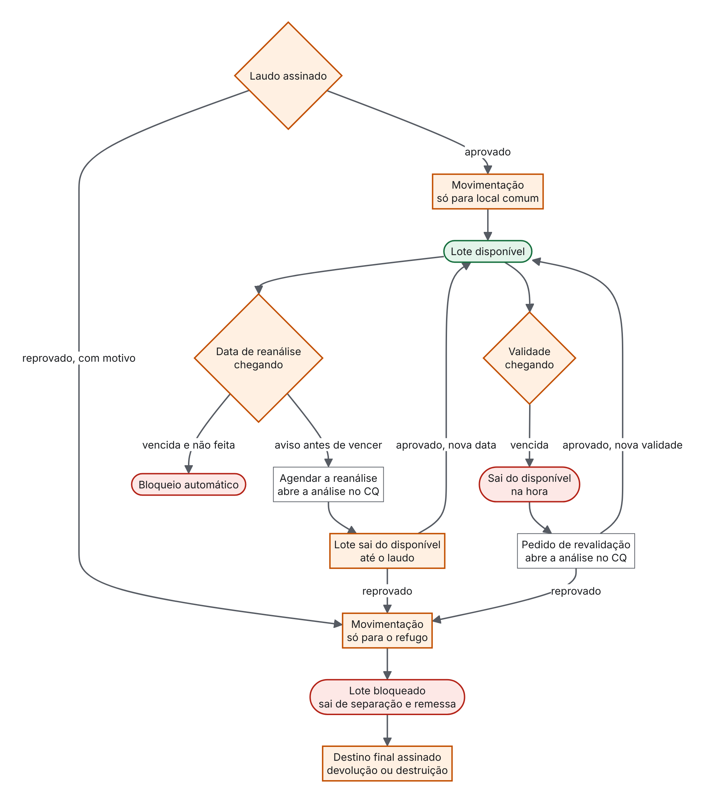
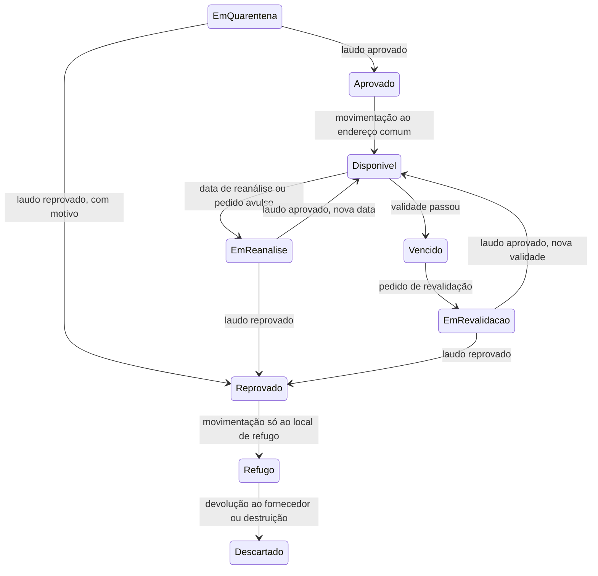

# Passo 3, fluxo 4: o que acontece com o lote depois do laudo (reprovado, reanálise e revalidação)

*Como ler: **laranja** = o sistema confere (trava); **vermelho** = bloqueio; **verde** = resultado. Clique na imagem para ampliar.*

**Análise de 19/11/2026. Rascunho para validação do responsável.** Quarta ficha do passo 3. Ela completa o ciclo do lote que as fichas [1](fluxo-01-recebimento-quarentena.md) e [3](fluxo-03-regras-analise-e-laudo.md) deixaram na saída do laudo: **para onde vai o lote aprovado, o que fazer com o reprovado, e como o lote é reanalisado ou revalidado** antes de a validade acabar.

**Fontes (todas no repositório do legado):** o fluxo de Reprovado, reanálise e revalidação (`3.estoque/fluxos/reprovado-reanalise-revalidacao.md`), os resultados dos testes de tela do Estoque (casos `CT-EST-050` a `065` e `211`; achados `DV-EST-014`, `025`, `027`, `029`, `039`, `043`) e a análise de saldo por situação (visão de saldo do banco). **O que não fiz:** não li as telas uma a uma. Vários casos de reanálise ficaram **bloqueados** nos testes (explicado abaixo), então parte da leitura vem **só do código**, e está marcada.

## 1. O caminho, em uma linha
**Laudo aprovado** → movimentação para local comum → **lote disponível** → reanálise periódica (agenda) → volta a disponível ou é reprovado.
**Laudo reprovado** → movimentação **só para refugo** → lote bloqueado → destino final (devolução ao fornecedor ou destruição, a validar).
**Validade chegando** → revalidação (nova análise) → nova validade ou o lote sai do uso.

### A situação do lote depois do laudo

No legado "disponível" era **calculado** por uma visão de saldo, que separava quarentena, vencido ou em reanálise, bloqueado, reprovado, inventário, retenção, referência, estabilidade e disponível. No iLabs a situação do lote é **uma só, guardada e conferida pelo banco**, e **o que não está disponível não aparece** para separar, remeter nem movimentar.

## 2. Etapa a etapa

| # | Etapa | Quem faz | Exige antes | O que entra | O banco garante (iLabs) | Falha do legado |
|---|---|---|---|---|---|---|
| 1 | **Destino do lote aprovado** | Estoque | Laudo aprovado e emitido | Endereço de destino (almoxarifado, local, rua, coluna, andar), quantidade, justificativa | Só **local comum** (nunca quarentena nem refugo), **conferido no servidor**; quantidade não passa do pendente; o endereço aceita o lote | A regra era **só da lista da tela**; o servidor não recusava um destino forçado (`CT-EST-052`: recusa do servidor **não testada**) |
| 2 | **Destino do lote reprovado** | Estoque | Laudo reprovado **com motivo** | Endereço de refugo, quantidade, justificativa | Só **local de refugo**, conferido no servidor; o saldo passa a **reprovado** e **sai de tudo** (separação, remessa, movimentação) | Passou na tela (`CT-EST-051/053`), mas o **relatório de reprovados (RM36) veio vazio** com o lote reprovado (`CT-EST-063`); o motivo da reprovação não era exigido (`DV-EST-027`) |
| 3 | **Destino final do reprovado** | Estoque e Qualidade | Lote em refugo | Devolução ao fornecedor **ou** destruição, com documento e assinatura | O lote só deixa o refugo com **registro do destino final**, assinado; fica no histórico | **Não existe no código**: o reprovado ficava no refugo, sem baixa |
| 4 | **Agenda de reanálise** | Estoque (aviso) e Qualidade | Material com **classificação de reanálise** (prazo) | Data da primeira reanálise, prazo, motivo | O prazo vem do material; **o sistema avisa antes de vencer**; **a reanálise vencida e não feita bloqueia o lote sozinha** | O cadastro do Item **não tinha o campo** de classificação de reanálise (`DV-EST-043`), então a agenda ficou vazia; a regra que tirava do disponível o lote com reanálise vencida estava **desligada** no banco (leitura do código; o teste ficou bloqueado) |
| 5 | **Agendar a reanálise** | Estoque | Lote disponível, sem análise aberta | Justificativa | Abre a análise do tipo **reanálise** no CQ; o lote sai do disponível até o laudo; **não duplica** | A tela **não pedia justificativa** (`CT-EST-059`); as recusas funcionaram, mas com **mensagem diferente** da prevista (`DV-EST-039`) |
| 6 | **Concluir a reanálise** | Controle da Qualidade | Análise aberta | Laudo da reanálise | Aprovada: o lote **volta ao disponível com nova data**; reprovada: segue o destino do reprovado | Não testado (dependia do ciclo completo do CQ, `CT-EST-060`) |
| 7 | **Revalidar a validade** | Estoque e Qualidade | Lote **vencido** ou perto de vencer | Pedido de revalidação, justificativa | Abre análise de **revalidação**; **a validade só muda com o laudo**; só quem tem função pede | Funcionou, mas **sem justificativa**; a lista só mostrava lote **já vencido** e tinha uma **linha fantasma** quando vazia (`CT-EST-061`) |
| 8 | **Lote vencido** | Automático | Validade menor que hoje | Nada | Sai do disponível **na hora**, conforme o banco, e **não entra por nenhuma porta** (recebimento, produção, devolução) | A saída do disponível funcionou (`CT-EST-062`), mas a entrada aceitava lote vencido (`DV-EST-014`, `025`) |
| 9 | **Consultar e relatar** | Todos | — | — | Um só relatório de lotes por situação, com **histórico completo** (quem, quando, motivo) | RM36 vazio (`CT-EST-063`); o histórico do lote **não mostrava usuário nem justificativa** das movimentações; reanálise e revalidação **não foram exercitadas** no histórico (`CT-EST-064`) |

## 3. O que este fluxo exige de cada cadastro global

| Cadastro (passo 1) | O que o fluxo precisa que ele guarde |
|---|---|
| **Material** | **Classificação de reanálise** (prazo e periodicidade) e **validade padrão**; exigência de reanálise por tipo de material |
| **Locais e endereços** | Tipo do local: **comum, quarentena, refugo**, e (a validar) **destruição** e **devolução** |
| **Periodicidade (lista de apoio)** | Os prazos de reanálise |
| **Pessoa jurídica** | O **fornecedor** para quem se devolve o reprovado |
| **Profissional e função** | Funções de quem **move** reprovado, **registra o destino final** e **aprova a revalidação** |
| **Notificações (serviço comum)** | Aviso de reanálise e de validade chegando |
| **Motivos (do CQ)** | Motivo da reprovação e da reanálise |

## 4. Os registros que nascem no fluxo (não são cadastros)
Movimentação de saída da quarentena · agendamento de reanálise · pedido de revalidação · análise de reanálise e de revalidação · **registro do destino final do reprovado** · histórico do lote.

## 5. O que muda nos documentos anteriores
- **Roteiro de implantação:** na etapa 6 (materiais), a **classificação de reanálise** do material é preenchida junto dos controles; na etapa 5, os locais têm **tipo** (comum, quarentena, refugo); na etapa 9, o ensaio ponta a ponta inclui **uma reprovação até o destino final** e **uma reanálise**.
- **Passo 2 (ordem):** a **periodicidade** (lista de apoio) vem **antes** do material; os locais de refugo, antes do primeiro recebimento (já constava).
- **Ficha 1 e 3:** a etapa 11 da ficha 1 ("etiqueta e liberação") passa a referir este fluxo; a reprovação do laudo (ficha 3) segue para a etapa 2 daqui.

## 6. Pontos a validar com a área (não consegui tirar do código)
1. **Destino final do reprovado:** devolução ao fornecedor, destruição ou os dois? Quem assina? Existe documento (termo de destruição)?
2. **Prazo e regra da reanálise:** por tipo de material? Quem define? O que **bloqueia** (a reanálise vencida bloqueia o uso, como a validade vencida)?
3. **Revalidação:** vale para qualquer material, ou só para alguns? Quantas vezes pode ser feita? Quem decide a nova validade?
4. **Material de produção reprovado:** o aviso "lote de produção reprovado" ganha um caminho próprio (retrabalho ou descarte)?
5. **Reanálise de lote em uso:** o lote fica **bloqueado inteiro** ou só o saldo ainda não usado?
6. **Quarentena na movimentação comum:** a lista de movimentação de material deve mostrar lote em quarentena (`DV-EST-033`)? A proposta é não mostrar.
