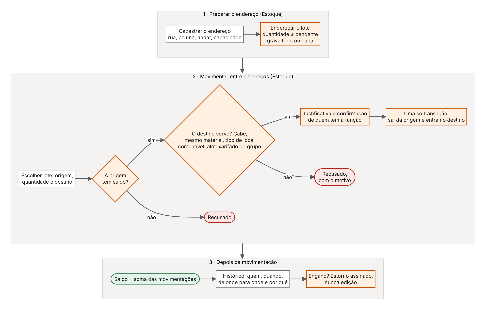
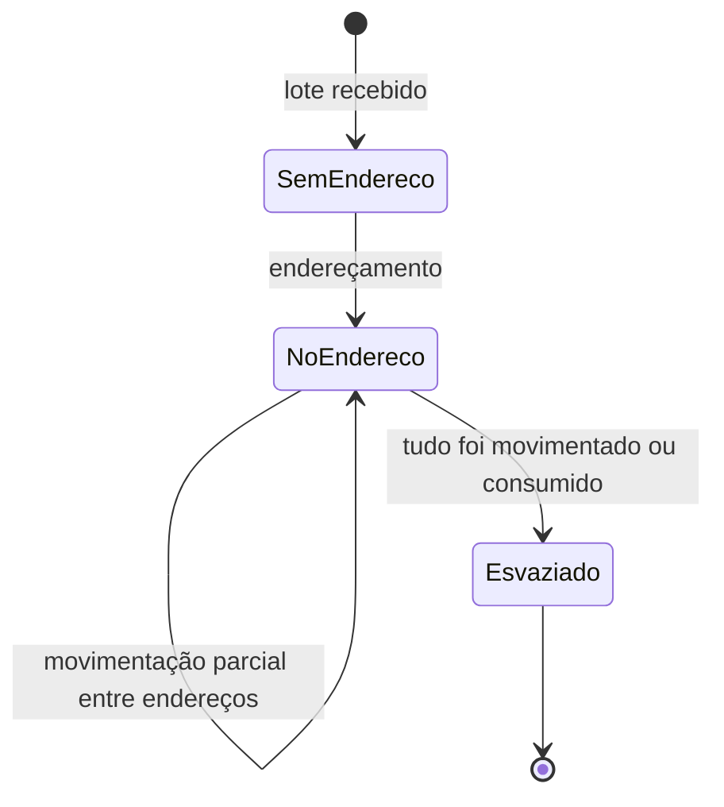

# Passo 3, fluxo 5: guardar e movimentar o material dentro do estoque

*Como ler: **laranja** = o sistema confere (trava); **vermelho** = bloqueio; **verde** = resultado. Clique na imagem para ampliar.*

*Coluna "Onde no sistema": o caminho no sistema atual (legado), no formato **Módulo › Menu › Tela**. Onde diz "tela nova", a tela não existe hoje e será criada.*

**Análise de 19/11/2026. Rascunho para validação do responsável.** Quinta ficha do passo 3. Ela trata do que acontece com o lote **depois de liberado**, dentro do almoxarifado: **endereçar, transferir de um endereço para outro, e consultar onde está e por onde passou.** Completa as etapas 7 e 11 do [fluxo 1](fluxo-01-recebimento-quarentena.md) e o destino do lote da [ficha 4](fluxo-04-reprovado-reanalise-revalidacao.md).

**Fontes (todas no repositório do legado):** o fluxo de Movimentação interna (`3.estoque/fluxos/movimentacao-interna.md`, feito pelo código), os resultados dos testes de tela do Estoque (casos `CT-EST-030` a `045`; achados `DV-EST-016`, `017`, `018`, `033`, `034`, `042`, `044`) e a análise de saldo por situação. **O que não fiz:** não li as telas uma a uma. Os casos de endereçamento ficaram **bloqueados** nos testes por um defeito do legado (`DV-EST-016`); o que não foi testado está marcado.

## 1. O caminho, em uma linha
**Estrutura de endereços** → **endereçar o lote** (guardar com quantidade) → **movimentar** (de um endereço para outro, com justificativa) → **consultar** saldo e histórico.

### O saldo de um lote em um endereço

No legado o saldo de cada endereço, do lote e do custo era atualizado **por um gatilho do banco**, sem registro próprio de quem fez. No iLabs a **movimentação é um registro que não se edita nem se apaga** e **o saldo é sempre a soma delas**: o saldo nunca é digitado nem se perde.

## 2. Etapa a etapa

| # | Etapa | Onde no sistema (legado) | Quem faz | Exige antes | O que entra | O banco garante (iLabs) | Falha do legado |
|---|---|---|---|---|---|---|---|
| 1 | **Cadastrar o endereço** | **Estoque** › Estoque › Endereço do Estoque | Estoque | Almoxarifado, local, tipo do local | Rua, coluna, andar, **capacidade** (altura, largura, profundidade, peso máximo) | Endereço único dentro do local; só local ativo; **só se exclui endereço vazio, com justificativa e histórico** | A exclusão **não pedia justificativa** (`DV-EST-018`); a mensagem de endereço repetido tinha erro de grafia e não dizia o campo (`DV-EST-017`) |
| 2 | **Endereçar o lote** | **Estoque** › Estoque › Endereçamento de Material | Estoque | Recebimento autorizado (fluxo 1) | Item, lote, validade, quantidade, endereço completo | Quantidade não passa do **pendente**; local compatível com o tipo do material; **grava tudo ou nada** | **"Endereçamento finalizado com sucesso" sem gravar**: a lista seguia "Endereçado = NÃO", o saldo ficava zero e não nascia análise (`DV-EST-016`, **Alta**). Os casos `CT-EST-033` a `044` ficaram bloqueados por isso |
| 3 | **Movimentar entre endereços** | **Estoque** › Estoque › Movimentação de Material **Estoque** › Cadastros › Tipo de Movimentação | Estoque | Lote disponível com saldo na origem | Tipo de movimentação, lote, **origem**, quantidade, **destino**, **justificativa** | **Uma só transação:** sai da origem e entra no destino, ou nada acontece. Quantidade ≤ saldo da origem; respeita o fracionamento do item | Funcionou nos testes (`CT-EST-034/035/036`), com mensagens diferentes das previstas (por exemplo, "Quantidade do destino é maior que a origem"); a confirmação "Confirma a inclusão?" vinha **antes** de validar a justificativa |
| 4 | **Conferir o destino** | Automático, sem tela | Automático | Destino escolhido | — | Destino **vazio ou com o mesmo material**; **cabe** em altura, largura, profundidade e peso (peso × quantidade); **tipo do local compatível**: quarentena com quarentena, refugo com refugo, refrigerado, umidade e controlado conforme o material; **só os almoxarifados do grupo do usuário**. **Tudo conferido no servidor** | O destino ocupado por outro item **era oferecido** na lista e só recusado ao adicionar (`CT-EST-037`); a trava de quarentena foi **desligada no código** (`if (true)`), restando só a lista da tela (`DV-EST-033`, o teste só tentou o que a tela oferece); o item refrigerado deixou a lista de destinos **vazia** ou sem rua, coluna e andar (`DV-EST-042`, inconclusivo) |
| 5 | **Impedir movimentação simultânea** | Automático, sem tela | Automático | — | — | Duas pessoas **não movem o mesmo saldo ao mesmo tempo**: a segunda espera ou é recusada, e o saldo nunca fica negativo | **Duas abas salvaram a mesma origem ao mesmo tempo**, sem bloqueio (`CT-EST-042`); o saldo ficou coerente só porque havia saldo para as duas |
| 6 | **Quem vê e quem move** | **Estoque** › Cadastros › Grupo Usuário - Almoxarifado **Principal** › Administração › Grupo de usuários | Automático | Grupo de usuários e almoxarifado | — | Cada pessoa só enxerga e move os almoxarifados do **seu grupo**, em **toda** consulta e gravação; abrir a tela sem permissão é **recusado** | O usuário de outro grupo via **os 12 almoxarifados na Solicitação de Material** e gravou no `TESTE ALMOX` (`CT-EST-041`); o usuário de consulta **abria a Movimentação pelo endereço** (`CT-EST-045`, `DV-EST-008`) |
| 7 | **Consultar saldo e histórico** | **Estoque** › Estoque › Disponibilidade de Estoque, Disponibilidade do Lote, Disponibilidade por Local, Consulta Endereço Item, Histórico do Lote | Todos | — | — | Saldo por item, lote e local **igual à soma das movimentações**; histórico do lote com **quem, quando, de onde para onde e por quê**, e com análise, laudo e aprovador | Saldos batiam nos testes (`CT-EST-043`); o histórico **não mostrava usuário, hora, análise, laudo, aprovador nem reprovação** (`DV-EST-034`) |
| 8 | **Corrigir um engano** | Não existe no legado (tela nova) | Estoque, com a Qualidade | Movimentação feita errada | Estorno, motivo, assinatura | **Não se edita nem se apaga**: corrige-se com um **estorno** assinado, que também fica no histórico | Não havia um caminho de correção registrado (a validar) |

**Falha irmã, de outra ficha, que atinge este fluxo:** mover um lote **aprovado** da quarentena para um endereço comum **gravava a saída e não criava a entrada**: o saldo do lote **sumia** do sistema (`DV-EST-044`, **Alta**). No iLabs a saída da quarentena é uma **movimentação como as outras**, na mesma transação (etapa 3).

## 3. O que este fluxo exige de cada cadastro global

| Cadastro (passo 1) | O que o fluxo precisa que ele guarde |
|---|---|
| **Almoxarifado, locais e endereços** (árvore) | **Tipo do local** (comum, quarentena, refugo), marcas (refrigerado, umidade, controlado), **capacidade do endereço**, situação ativa |
| **Material** | Dimensões e peso (altura, largura, profundidade, peso), **se fraciona**, se é refrigerado, se controla umidade, se é controlado, **se aceita outro material no mesmo endereço** (a validar) |
| **Grupo de usuários e almoxarifado** | Quais grupos enxergam e movem cada almoxarifado |
| **Profissional e função** | Função de quem **movimenta**, de quem **estorna** e de quem **exclui endereço** |
| **Tipo de movimentação** (lista de apoio do Estoque) | O sentido e o efeito de cada tipo (entrada, saída, transferência, ajuste) |
| **Unidade de medida** | Quantidade e fracionamento |

## 4. Os registros que nascem no fluxo (não são cadastros)
Endereçamento · **movimentação** (de onde, para onde, quanto, quem, quando, por quê) · estorno · **saldo por endereço, lote e item** (calculado, nunca digitado) · histórico do lote e do item.

## 5. O que muda nos documentos anteriores
- **Roteiro de implantação (etapas 5 e 6):** o endereço ganha **capacidade**; o material ganha **dimensões, peso e fracionamento**; e a configuração de **quais grupos usam cada almoxarifado** faz parte da etapa 1 (acesso).
- **Passo 2 (ordem):** o **tipo de movimentação** (lista de apoio) vem antes de qualquer movimentação; os dados físicos do material, junto do próprio material.
- **Passo 1:** reforça que **Endereço** (rua, coluna, andar, capacidade) é parte da árvore de almoxarifado, e não um cadastro à parte.
- **Fichas 1 e 4:** o endereçamento (etapa 7 da ficha 1) e a saída da quarentena (ficha 4) passam a seguir **as regras desta ficha**.

## 6. Pontos a validar com a área (não consegui tirar do código)
1. **Um endereço guarda só um material?** (O legado exigia; confirmar se vale para todos, ou se há endereço de vários materiais, como prateleira comum.)
2. **Capacidade:** é regra que **bloqueia** ou **aviso**? Quem pode ultrapassar?
3. **Estorno:** quem pode, em quanto tempo, e para que tipos de movimentação?
4. **Movimentação de lote em reanálise ou bloqueado:** só consulta, ou também movimenta (por exemplo, levar para a quarentena)?
5. **Item controlado (Portaria 344):** a movimentação exige **assinatura** e **segunda pessoa**?
6. **Movimentação entre almoxarifados** (de uma unidade da empresa para outra): é a mesma tela ou uma **transferência** com envio e recebimento?
7. **Inventário** e movimentação: durante a contagem, o endereço fica **congelado**?
