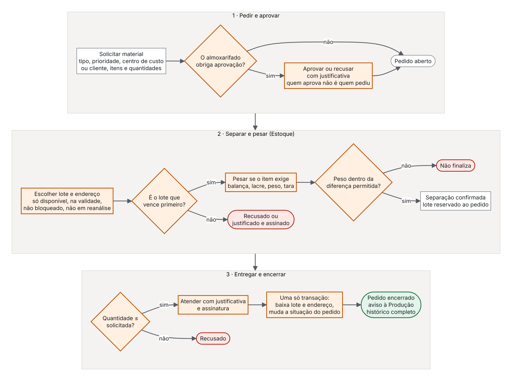
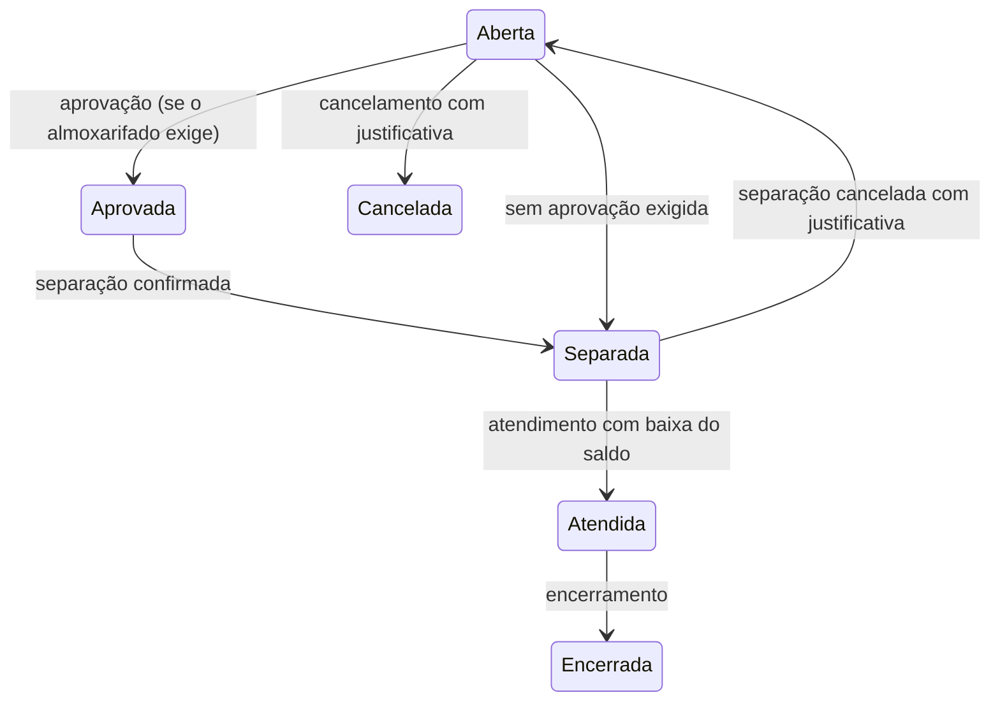

# Passo 3, fluxo 6: pedir, separar e entregar o material (solicitação, separação e atendimento)

*Como ler: **laranja** = o sistema confere (trava); **vermelho** = bloqueio; **verde** = resultado. Clique na imagem para ampliar.*

*Coluna "Onde no sistema": o caminho no sistema atual (legado), no formato **Módulo › Menu › Tela**. Onde diz "tela nova", a tela não existe hoje e será criada.*

> **Em uma frase:** Como a produção (ou outro setor) **pede um material** ao estoque, o estoque **separa** o lote certo e **entrega**, com baixa no saldo.
>
> **Exemplo do dia a dia (ilustrativo, os números são inventados):** A produção pede 20 kg de açúcar. O estoque escolhe o lote que vence primeiro, pesa, entrega e o saldo diminui 20 kg.
>
> **Por que importa:** Entregar o lote errado ou fora da validade é um erro que pode contaminar a fabricação.
>
> *Palavra que não conhece? Veja a documento "Glossário" (grupo "Para começar" da lista do estudo).*

**Análise de 19/11/2026. Rascunho para validação do responsável.** Sexta ficha do passo 3. É o **primeiro consumo do lote aprovado**: quem precisa de material pede ao Estoque, o Estoque escolhe o lote, pesa quando é preciso e entrega. Depois dela, o saldo do lote muda por **pedido**, e não só por movimentação interna ([ficha 5](fluxo-05-movimentacao-interna.md)).

**Fontes (todas no repositório do legado):** o fluxo "Solicitação, separação e atendimento" (`3.estoque/fluxos/solicitacao-atendimento-producao.md`, lido do código) e os resultados dos testes de tela do Estoque (casos `CT-EST-070` a `083`; achados `DV-EST-032`, `045`, `048`, `061`, `060`, `063`, `067`, `069`, `070`, `073`, `164`, `165`). **O que não fiz:** não li as telas uma a uma. A **solicitação do tipo Produção** não pôde ser testada (a ordem de produção não nasceu), e a **pesagem** não abriu no teste; essas partes vêm **só do código** e estão marcadas.

## 1. O caminho, em uma linha
**Pedido** (produção, consumo, cliente ou CQ) → **aprovação**, se o almoxarifado exige → **separação do lote** (só o disponível, o que vence primeiro) → **pesagem**, se o item exige → **atendimento** (baixa o saldo) → **encerramento** e aviso à Produção.

### A situação do pedido

No legado a situação ia mudando **tela a tela**, porque o gatilho do banco que a recalculava está **desligado**; a ordem exata entre separada, atendida, fechada e finalizada **não ficou clara** (a validar). No iLabs a situação do pedido é **uma só, guardada e conferida pelo banco**, e só anda pelas setas acima.

## 2. Etapa a etapa

| # | Etapa | Onde no sistema (legado) | Quem faz | Exige antes | O que entra | O banco garante (iLabs) | Falha do legado |
|---|---|---|---|---|---|---|---|
| 1 | **Pedir o material** | **Estoque** › Estoque › Solicitação de Material, Solicitação de Material (Produção), Solicitação de Material (Consumo) | Produção, CQ ou qualquer setor | Item com saldo disponível; centro de custo ou cliente cadastrado | Tipo (produção, consumo, cliente, CQ), prioridade, centro de custo **ou** cliente, itens e quantidades; no consumo, também data e almoxarifado | O pedido só nasce com tudo isso; o almoxarifado é **do grupo de quem pede**; o tipo Produção **só nasce da ordem de produção** | A de **Consumo** oferecia **todos** os almoxarifados e gravava em um que não era do grupo (`DV-EST-069`); a de **Produção** abria sem Incluir e a busca de item não achava nenhum (`DV-EST-063`); a ordem de produção não nasceu, **bloqueou os casos de produção** (`CT-EST-082`, `091`) |
| 2 | **Aprovar o pedido** | **Estoque** › Estoque › Aprovação de Solicitação | Quem tem a função, do grupo do almoxarifado | Almoxarifado que **obriga aprovação** | Aprovar ou recusar, com justificativa | **Quem aprova não é quem pediu**; a decisão fica **assinada** e **cancelar a aprovação exige justificativa** | A **mesma pessoa** que criou e concluiu aprovou, sem recusa (`DV-EST-070`); cancelar a aprovação **não pedia justificativa** (`DV-EST-164`). Quem enxerga o pedido é o **grupo × almoxarifado**; o "tipo liberado no perfil" **não se confirmou** (`CT-EST-072`) |
| 3 | **Separar o lote** | **Estoque** › Estoque › Separação de Material | Estoque | Pedido aberto ou aprovado | Lote e endereço de cada item | Só entra na lista o saldo **disponível**: fora de quarentena, refugo, bloqueio e reanálise, **dentro da validade**; a lista vem **ordenada pelo que vence primeiro**; escolher outro lote exige **justificativa assinada** | Os filtros **funcionaram** (`CT-EST-075`), mas **não havia ordem de validade** nem aviso ao escolher o que vence depois (`DV-EST-048`, `CT-EST-073/074` ficaram bloqueados por outro defeito); lote com reanálise vencida podia aparecer (`CT-EST-058`); **cancelar a separação não gravava a justificativa no log** e o histórico mantinha a saída (`DV-EST-165`) |
| 4 | **Pesar o material** | **Estoque** › Estoque › Central de Pesagem (Pesagem) | Estoque | Separação feita, item que exige pesagem | Balança, número do lacre, peso bruto, líquido e tara; volumes A e B quando divide | Balança é **equipamento cadastrado**; **a soma dos volumes bate com o total**; **divergência além da diferença permitida do subgrupo não finaliza** (para produção) | A tela **deu erro de servidor ao abrir o volume** e a pesagem não pôde ser feita (`DV-EST-067`, `CT-EST-077` bloqueado); a **amostra do CQ saía do estoque sem registro na pesagem** (`DV-EST-032`); a **diferença permitida do subgrupo** aceitava até 999,99% (`DV-EST-089`) e **não ia para o log** (`DV-EST-090`) |
| 5 | **Atender (entregar)** | **Estoque** › Estoque › Atendimento de Solicitação, Atendimento | Estoque | Separação confirmada | Lote, quantidade entregue, **justificativa** | Quantidade **não passa da solicitada**; **uma só transação** baixa o lote e o endereço e muda a situação do pedido; fica **assinado** | O saldo baixou e a situação mudou (`CT-EST-079`), mas a tela **não tinha campo de justificativa** (`DV-EST-045`); aceitava lote que **vence depois sem avisar** (`DV-EST-048`); **cancelar o atendimento não pedia justificativa e não deixava rastro** no histórico do lote (`DV-EST-061`) |
| 6 | **Encerrar e avisar a Produção** | Automático, ao concluir a separação do pedido de produção (a ordem de produção fica no módulo **Produção**) | Automático | Atendimento concluído | Nada | O pedido de produção **volta à ordem de produção** com o que foi entregue; o encerramento é **conferido pelo banco**, não por tela | O gatilho que recalculava a situação estava **desligado**; o elo com a Produção **não pôde ser testado** (`CT-EST-082`) |
| 7 | **Saída avulsa** | **Estoque** › Estoque › Saída de Material (Outras) | Estoque | Lote disponível | Data, tipo e motivo da movimentação, item, lote, endereço, quantidade, valor, justificativa | **Só sai o disponível**; tipo e motivo vêm de **lista cadastrada**; **sem pedido, só com justificativa assinada** | Passou com ressalva (`CT-EST-081`): as recusas dos campos vazios funcionaram, mas **não exigia justificativa**, tinha **textos com erro** e gravava **custo 0,00** (`DV-EST-060`) |
| 8 | **Consultar** | **Estoque** › Estoque › Histórico do Lote; **Estoque** › Relatórios › Material Reservado (RM10) | Todos | — | — | Histórico com **quem pediu, quem aprovou, quem separou, quem entregou, quando e por quê**; o **reservado** nunca passa do saldo | A saída por remessa aparecia como "atendimento de solicitação" do tipo **Cliente**, sem a remessa nem o destino (`DV-EST-073`); o **RM10 listava lotes sem reserva** e **reserva maior que o saldo** (`DV-EST-132`) |

## 3. O que este fluxo exige de cada cadastro global

| Cadastro (passo 1) | O que o fluxo precisa que ele guarde |
|---|---|
| **Material** | Se o item **exige pesagem**; **subgrupo** com a **diferença de pesagem permitida** (com limite e log); validade |
| **Lote e saldo** | Situação do lote (só disponível sai) e **reserva por pedido** |
| **Locais e endereços** | O almoxarifado **de cada grupo** e se ele **obriga aprovação** |
| **Centro de custo** | Obrigatório no pedido de consumo e na saída avulsa |
| **Pessoa jurídica** | O **cliente** do pedido do tipo Cliente |
| **Equipamento** | A **balança** (tag) usada na pesagem |
| **Profissional e função** | Quem **aprova**, **separa**, **pesa** e **atende**; quem pede **não** aprova o próprio pedido |
| **Grupo de usuários** | Liga a pessoa ao almoxarifado, e define o que ela vê |
| **Tipo e motivo de movimentação** | Lista da saída avulsa |
| **Ordem de produção (Produção)** | Origem do pedido do tipo Produção (ainda não testada) |

## 4. Os registros que nascem no fluxo (não são cadastros)
Solicitação de material e seus itens · aprovação · separação · pesagem e volumes · atendimento · saída avulsa · movimentação do lote (a baixa) · histórico do lote.

## 5. O que muda nos documentos anteriores
- **Roteiro de implantação:** na etapa 5 (locais), cada almoxarifado diz se **obriga aprovação** e a **qual grupo** pertence; na etapa 6 (materiais), o item diz se **exige pesagem** e o subgrupo traz a **diferença de pesagem permitida**; na etapa 9, o ensaio inclui **um pedido de consumo até a entrega** e **uma pesagem com divergência**.
- **Passo 2 (ordem):** equipamento (balança), centro de custo e grupo de usuários vêm **antes** do primeiro pedido.
- **Ficha 5:** o que sai pelo atendimento passa a ser **consumo** (nota) e não "movimentação".

## 6. Pontos a validar com a área (não consegui tirar do código)
1. **Lote que vence primeiro:** é **obrigatório** (só o primeiro é aceito) ou **recomendado** (aceita outro, com justificativa assinada)?
2. **Aprovação:** vale **sempre**, só para certos almoxarifados (como hoje) ou **por tipo e por valor**? Quem aprova pode ser da mesma área de quem pediu?
3. **Reserva:** o pedido **reserva** o lote desde a aprovação ou só desde a separação?
4. **Diferença de pesagem:** qual é o limite por subgrupo? Vale para todos os tipos de pedido ou só para produção?
5. **Pedido de produção:** nasce **da ordem de produção** (como o código sugere) ou também pode ser aberto no Estoque?
6. **Situações do pedido:** a ordem exata entre separada, atendida, fechada e finalizada (e se "fechada" e "finalizada" são a mesma coisa).
7. **Cancelamento de atendimento já entregue:** é permitido? Gera **devolução** ([fluxo 8](fluxos-do-legado.md)) ou estorno?
