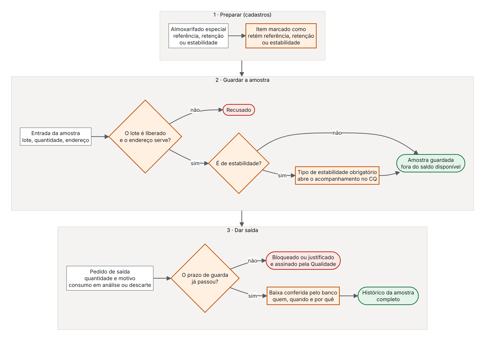
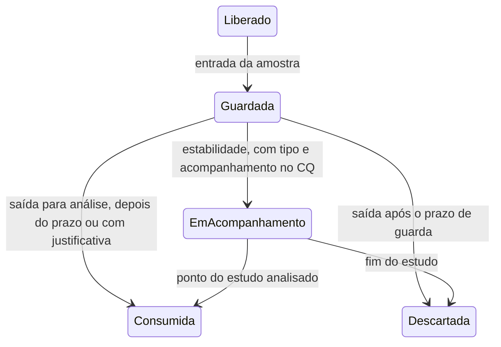

# Passo 3, fluxo 7: guardar as amostras do Controle da Qualidade (referência, retenção e estabilidade)

*Como ler: **laranja** = o sistema confere (trava); **vermelho** = bloqueio; **verde** = resultado. Clique na imagem para ampliar.*

*Coluna "Onde no sistema": o caminho no sistema atual (legado), no formato **Módulo › Menu › Tela**. Onde diz "tela nova", a tela não existe hoje e será criada.*

**Análise de 19/11/2026. Rascunho para validação do responsável.** Sétima ficha do passo 3. É o destino das **amostras que a Qualidade guarda de cada lote**: a de **referência** (para comparar), a de **retenção** (para investigar reclamação) e a de **estabilidade** (para acompanhar o produto ao longo do tempo). Esse saldo **não é estoque disponível** e nunca sai por pedido de produção ([ficha 6](fluxo-06-solicitacao-separacao-atendimento.md)).

**Fontes (todas no repositório do legado):** o fluxo "Almoxarifado do Controle da Qualidade" (`3.estoque/fluxos/almoxarifado-cq.md`, lido do código) e os resultados dos testes de tela do Estoque (casos `CT-EST-170` a `178`; achados `DV-EST-047`, `068`, `071`, `074`, `075`, `124`, `125`). **O que não fiz:** não li as telas uma a uma. A **estabilidade** não pôde ser testada até o fim (o acompanhamento no CQ nunca abriu) e a **saída** só funcionou em parte; essas partes vêm **do código** e estão marcadas.

## 1. O caminho, em uma linha
**Almoxarifado especial** e **item marcado** → **entrada da amostra** (lote liberado, endereço que serve) → amostra **guardada fora do saldo disponível** → estabilidade abre o **acompanhamento no CQ** → **saída** só depois do **prazo de guarda**, com motivo e assinatura.

### A situação da amostra

No legado a amostra era só **saldo em um almoxarifado marcado**; **nada guardava o prazo de guarda** nem o motivo da saída. No iLabs a amostra tem **situação, prazo de guarda e destino**, **guardados e conferidos pelo banco**.

## 2. Etapa a etapa

| # | Etapa | Onde no sistema (legado) | Quem faz | Exige antes | O que entra | O banco garante (iLabs) | Falha do legado |
|---|---|---|---|---|---|---|---|
| 1 | **Preparar o almoxarifado e o item** | **Estoque** › Cadastros › Almoxarifado; **Estoque** › Cadastros › Item (marcas Referência, Retenção, Estabilidade) | Estoque | Local, rua, coluna e andar cadastrados | Tipo do almoxarifado (referência, retenção ou estabilidade) e, no item, **quais amostras ele guarda** | Saldo de almoxarifado especial **nunca conta como disponível**; o item **só guarda o que está marcado** | O item de teste estava **sem as marcações** e a consulta ficava vazia até marcar (`DV-EST-047`, letra a) |
| 2 | **Guardar a amostra (entrada)** | **Estoque** › Regulatório › Movimentações (Entrada: Referência, Retenção, Estabilidade) | Estoque ou Qualidade | **Lote liberado**, endereço que aceita o lote | Quantidade, almoxarifado, local, rua, coluna, andar, tipo da reserva | Só entra amostra de **lote liberado**; a quantidade **não passa da disponível**; o endereço **serve** ao lote | A **quantidade** e o endereço foram conferidos (`CT-EST-174` passou); a entrada gravou, mas a **lista de Movimentações ficou sempre vazia** (`DV-EST-124`) e a **observação digitada sumia** (`DV-EST-125`) |
| 3 | **Abrir o acompanhamento de estabilidade** | **Estoque** › Regulatório › Movimentações (Entrada - Estabilidade) e **Controle da Qualidade** › Regulatório › Acompanhamento Estabilidade | Qualidade | Item com **regra de estabilidade** | Tipo de estabilidade (condição, prazo, pontos) | Amostra de estabilidade **exige o tipo** e **abre o acompanhamento sozinha**, com os pontos do estudo | A tela **não tinha o campo** e aceitou (`CT-EST-172`, `DV-EST-071`); o acompanhamento **nunca abriu** (`CT-EST-173` bloqueado); a **entrada pendente de estabilidade nunca nascia** porque o campo do Registro de Amostragem está desligado no código (`DV-EST-074`); a **Regra de Estabilidade** respondia "Selecione um item." para item com letras no código (`DV-EST-075`) |
| 4 | **Consultar o que está guardado** | **Estoque** › Regulatório › Consulta Disponibilidade (Referência - Retenção - Estabilidade); **Estoque** › Estoque › Disponibilidade do Lote, Histórico do Lote | Estoque e Qualidade | — | — | Um só relatório de amostras por item, lote, tipo e **prazo de guarda restante** | A consulta ficava **vazia** com o item sem marcações; depois de marcar, mostrou o saldo (`DV-EST-047`). A amostra **não conta no disponível** do atendimento (`CT-EST-175` **passou**) |
| 5 | **Dar saída da amostra** | **Estoque** › Regulatório › Movimentações (Saída: Referência, Retenção, Estabilidade) | Qualidade | Amostra guardada | Quantidade, **motivo** (consumo em análise, descarte, devolução), justificativa | **Só sai depois do prazo de guarda**; antes, só com **justificativa assinada pela Qualidade**; o motivo é de **lista cadastrada** | **A saída antes do vencimento do lote foi aceita**, sem aviso, sem impedimento e sem justificativa (`CT-EST-176`, `DV-EST-068`). Num lote, a saída deu **erro** e **não localizava o endereço que a própria entrada gravou** (`DV-EST-047`, letra b) |
| 6 | **Registrar o destino** | **Estoque** › Estoque › Histórico do Lote | Todos | Saída feita | — | Histórico com **quem deu a saída, quando, quanto e por quê**, incluindo a amostra | O histórico do lote **não mostrava usuário nem hora** (`CT-EST-209`) e a lista de Movimentações do Regulatório vinha vazia (`DV-EST-124`) |

## 3. O que este fluxo exige de cada cadastro global

| Cadastro (passo 1) | O que o fluxo precisa que ele guarde |
|---|---|
| **Locais e endereços** | Almoxarifado **especial** (referência, retenção, estabilidade) e o **tipo do local** |
| **Material** | Quais amostras o item guarda (referência, retenção, estabilidade), **prazo de guarda** depois da validade e **regra de estabilidade** (condição, prazo, pontos) |
| **Lote** | Só **lote liberado** gera amostra |
| **Tipo de referência e tipo de estabilidade** | As **listas de apoio** (sem repetir código: `DV-EST-106`) |
| **Tipo e motivo de movimentação** | **Consumo em análise**, **descarte**, **devolução** |
| **Profissional e função** | Quem **guarda**, **dá saída** e **assina** o descarte antes do prazo |
| **Notificações (serviço comum)** | **Aviso** de prazo de guarda terminando e de ponto de estabilidade chegando |

## 4. Os registros que nascem no fluxo (não são cadastros)
Entrada da amostra · reserva (referência, retenção, estabilidade) · acompanhamento de estabilidade e seus pontos · saída da amostra · histórico da amostra.

## 5. O que muda nos documentos anteriores
- **Roteiro de implantação:** na etapa 5 (locais), cadastrar os **almoxarifados especiais**; na etapa 6 (materiais), marcar **quais amostras o item guarda**, o **prazo de guarda** e, para estabilidade, a **regra de estabilidade**; na etapa 9, o ensaio inclui **uma amostra de retenção até a saída** e **uma tentativa de saída antes do prazo** (recusada ou justificada).
- **Passo 2 (ordem):** tipo de referência e tipo de estabilidade (listas de apoio) vêm **antes** do primeiro lote liberado.
- **Ficha 3 (laudo):** a **amostra de retenção e de referência** nasce na **separação da amostra** do CQ; o elo com a Central de Pesagem (`DV-EST-032`) fica nesta ficha como **ponto a validar**.

## 6. Pontos a validar com a área (não consegui tirar do código)
1. **Prazo de guarda:** quantos anos **depois da validade do lote** para referência e para retenção? É o mesmo para todo produto? (A RDC 658/2022 pede um período definido; o código **não guarda esse prazo**.)
2. **Saída antes do prazo:** é **proibida** ou permitida **com justificativa assinada** pela Qualidade? Quem assina?
3. **Motivos de saída:** consumo em análise, descarte e devolução bastam? Descarte precisa de **termo** e testemunha?
4. **Estabilidade:** quem define os **pontos** e as condições? O acompanhamento nasce **na entrada** ou depois da **regra de estabilidade** aprovada?
5. **Amostra de referência e de retenção** do **medicamento acabado** e da **matéria-prima**: as duas seguem o mesmo fluxo?
6. **Amostra do CQ que sai pelo pedido do CQ** (ficha 6): passa pela pesagem como as demais (`DV-EST-032`)?
