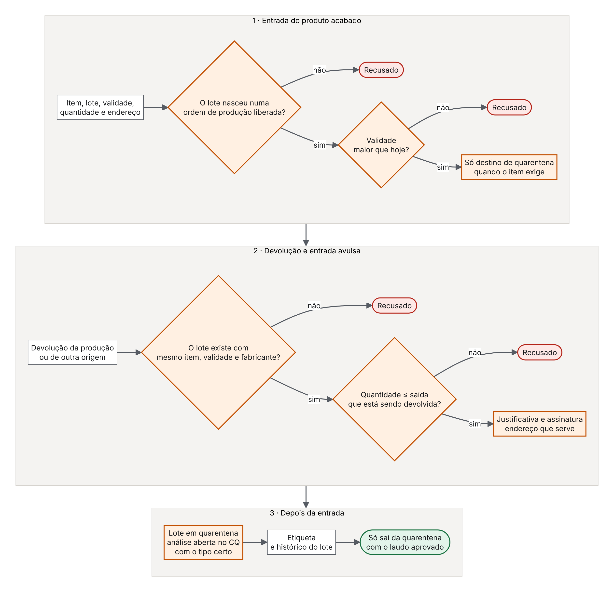
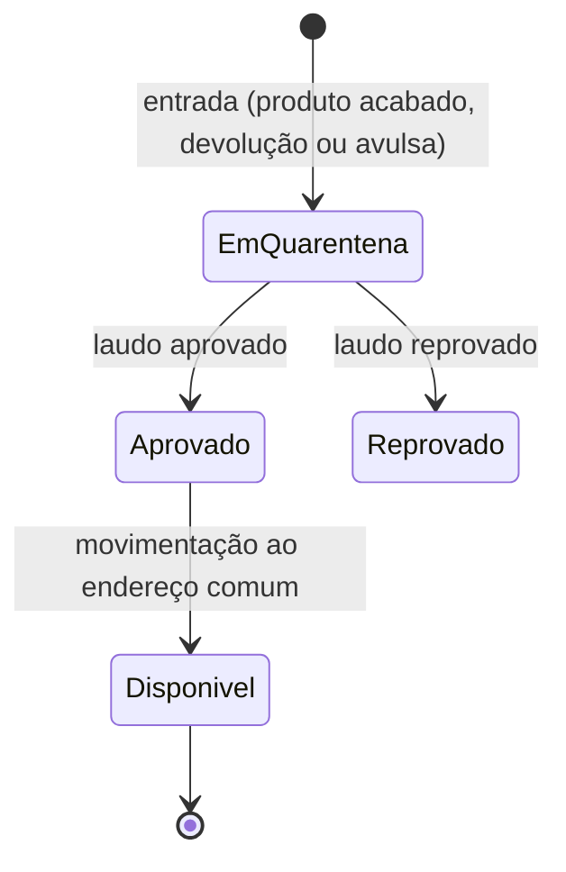

# Passo 3, fluxo 8: as outras portas de entrada do lote (devolução, entrada avulsa e produto acabado)

*Como ler: **laranja** = o sistema confere (trava); **vermelho** = bloqueio; **verde** = resultado. Clique na imagem para ampliar.*

*Coluna "Onde no sistema": o caminho no sistema atual (legado), no formato **Módulo › Menu › Tela**. Onde diz "tela nova", a tela não existe hoje e será criada.*

> **Em uma frase:** As **outras formas de entrada** de material no estoque, além da compra: o remédio pronto que sai da fábrica, a sobra que volta da produção e o material devolvido.
>
> **Exemplo do dia a dia (ilustrativo, os números são inventados):** A produção termina um lote de remédio e entrega ao estoque. O sistema só aceita se o lote veio de uma ordem de produção real e dentro da validade.
>
> **Por que importa:** Se entrar lote inventado ou vencido, a rastreabilidade (saber de onde veio) se perde.
>
> *Palavra que não conhece? Veja a documento "Glossário" (grupo "Para começar" da lista do estudo).*

**Análise de 19/11/2026. Rascunho para validação do responsável.** Oitava ficha do passo 3. A [ficha 1](fluxo-01-recebimento-quarentena.md) cobriu a entrada por **compra**. Esta cobre **as outras portas**: o **produto acabado** que sai da fabricação, a **sobra** que volta da produção, o **material devolvido** e a **entrada avulsa**. Todas criam ou aumentam um lote, então todas precisam da **mesma trava**: lote rastreável, validade boa e quarentena até o laudo.

**Fontes (todas no repositório do legado):** o fluxo "Devolução e entradas" (`3.estoque/fluxos/devolucao-entrada-producao.md`, lido do código) e os resultados dos testes de tela do Estoque (casos `CT-EST-090` a `102`; achados `DV-EST-024`, `025`, `026`, `034`, `063`, `064`, `076`, `104`, `126`, `168`). **O que não fiz:** não li as telas uma a uma. A **Devolução da Produção** e a **Entrada de Produção (serviços)** não puderam ser testadas, porque dependem da **ordem de produção**, que não nasceu; essas partes vêm **só do código** e estão marcadas.

## 1. O caminho, em uma linha
**Produto acabado** → lote **de uma ordem de produção** → quarentena → análise → laudo.
**Sobra da produção** → só do lote que **saiu** para a produção → volta ao saldo (**a validar**: precisa de análise?).
**Material devolvido** → só lote **que já existe** (mesmo item, validade e fabricante) → quarentena e análise.
**Entrada avulsa** → tipo e motivo cadastrados → quarentena e análise.

### A situação do lote que entra

O que acontece depois do laudo está na [ficha 4](fluxo-04-reprovado-reanalise-revalidacao.md). No iLabs **toda porta de entrada passa pela mesma regra**: o banco **recusa** lote sem origem, validade vencida e destino que não serve, e **só o laudo** tira o lote da quarentena.

## 2. Etapa a etapa

| # | Etapa | Onde no sistema (legado) | Quem faz | Exige antes | O que entra | O banco garante (iLabs) | Falha do legado |
|---|---|---|---|---|---|---|---|
| 1 | **Dar entrada ao produto acabado** | **Estoque** › Estoque › Entrada de Material - Produção | Estoque | Ordem de produção **liberada**; item com controle de quarentena e análise | Item, lote, validade, fabricante, quantidade, quantidade por volume, endereço | O lote **nasce de uma ordem de produção** e **vem dela** (não é digitado); validade **maior que hoje**; destino **só de quarentena** quando o item exige | O destino só de quarentena **funcionou** (`CT-EST-096`), mas o sistema aceitou **lote inventado, sem ordem de produção** (`DV-EST-024`) e **lote vencido** (`DV-EST-025`); a conferência do lote está **comentada no código**; a primeira gravação levou **50 s** |
| 2 | **Abrir a análise e a etiqueta** | Automático ao salvar (a análise aparece em **Controle da Qualidade** › Solicitação de Análise; a etiqueta, em **Controle da Qualidade** › Análise e Laudo) | Automático | Entrada gravada | Nada | A análise nasce com o **tipo produto acabado**; o lote fica **em quarentena**, sem aparecer como disponível; a etiqueta sai **do lote** | A análise abriu, mas com o tipo **NORMAL** em vez de produto acabado (`DV-EST-026`); o **conteúdo da etiqueta não foi conferido** (a impressão não abriu) |
| 3 | **Devolver a sobra da produção** | **Estoque** › Estoque › Devolução da Produção | Estoque | Material **atendido** à produção por pedido do tipo Produção ([ficha 6](fluxo-06-solicitacao-separacao-atendimento.md)) | Lote devolvido, quantidade, endereço, justificativa | A quantidade **não passa do que saiu** para a produção; o destino respeita quarentena, umidade e refrigeração; **justificativa assinada**; a sobra **volta ao saldo** e fica no histórico | **Não pôde ser testada**: só reconhece lote saído por pedido do tipo Produção, e esse pedido não nasce (`DV-EST-063`, `DV-EST-076`; `CT-EST-090`, `091` bloqueados). **O código não abre análise** da sobra devolvida (**a validar**) |
| 4 | **Devolver material de outra origem** | **Estoque** › Estoque › Devolução de Material | Estoque | Lote que **já existe** no estoque | Tipo de movimentação, item, lote, validade, fabricante, custo, quantidade, endereço, justificativa | O lote **existe** com o **mesmo** item, validade e fabricante; **o total endereçado não passa da quantidade**; entra **em quarentena** e abre análise | A recusa de lote **inexistente** (`CT-EST-092`) e a de **quantidade maior** (`CT-EST-094`) funcionaram. Mas o item **com controle de qualidade** **não achava o lote que existia** (`DV-EST-064`), e o item **sem** CQ entrou **direto como disponível** e **criou um segundo item de entrada** do mesmo lote, que passou a aparecer **em duas linhas** na Disponibilidade (`CT-EST-093`) |
| 5 | **Entrada avulsa (outras)** | **Estoque** › Estoque › Entrada de Material - Outras | Estoque | Tipo e motivo de movimentação **ativos** | Tipo e motivo, item, lote, validade, fabricante, custo, quantidade, endereço, justificativa | **Item, lote e fabricante não se repetem na lista**; só tipo e motivo **ativos**; entra em **quarentena** e abre análise | A repetição na lista **foi recusada** (`CT-EST-095`); o **motivo inativo continuava oferecido** (`DV-EST-104`) |
| 6 | **Entrada de produção de serviço** | **Estoque** › Estoque › Entrada de Produção | Estoque | Ordem de produção; serviço terceirizado | Custo do item, custos adicionais (FR170 e FR180), volumes, endereço | **Custos de lista cadastrada**; mesma regra de lote da etapa 1 | **Não pôde ser testada**: a lista abriu vazia e **sem Incluir** (`CT-EST-100`); o **código do lote era cortado em 10 caracteres**, sem aviso (`DV-EST-168`). O que são **FR170 e FR180** e quando se usa **está por validar** |
| 7 | **Consultar** | **Estoque** › Estoque › Histórico do Lote, Disponibilidade do Lote; **Estoque** › Relatórios › Quarentena de Produto Acabado (RM18) | Todos | — | — | Histórico com **entrada, análise, laudo, aprovador, usuário e hora**; um só relatório de quarentena | O histórico mostrava a entrada e as movimentações **sem a análise, sem o laudo, sem o aprovador e sem o usuário** (`CT-EST-101`, `DV-EST-034`); o **RM18 ficava em branco** quando não havia resultado (`DV-EST-126`) |

## 3. O que este fluxo exige de cada cadastro global

| Cadastro (passo 1) | O que o fluxo precisa que ele guarde |
|---|---|
| **Material** | Se **exige quarentena e análise**, **fabricante** e **validade padrão**; o **tipo de análise** de cada item (produto acabado, normal) |
| **Lote** | **Origem** do lote (ordem de produção, compra, devolução) e **fabricante** |
| **Locais e endereços** | Tipo do local: **quarentena** para entrada de produto acabado; **umidade** e **refrigeração** |
| **Tipo e motivo de movimentação** | Lista da entrada avulsa e da devolução, com **ativo e inativo** |
| **Ordem de produção (Produção)** | Origem do lote do produto acabado, das sobras e da entrada de serviço (ainda não testada) |
| **Pessoa jurídica** | **Fabricante** e, na devolução ao fornecedor, o fornecedor |
| **Profissional e função** | Quem **dá entrada**, **assina a devolução** e **abre a análise** |
| **Custos (FR170 e FR180)** | A definir com a área |

## 4. Os registros que nascem no fluxo (não são cadastros)
Entrada de produto acabado · devolução da produção · devolução de material · entrada avulsa · entrada de produção de serviço · lote e item de entrada · análise aberta no CQ · etiqueta · histórico do lote.

## 5. O que muda nos documentos anteriores
- **Roteiro de implantação:** na etapa 6 (materiais), o item diz se **exige quarentena e análise** e qual **tipo de análise**; na etapa 7, o produto acabado depende da **ordem de produção** (módulo Produção, ainda por analisar); na etapa 9, o ensaio inclui **uma entrada de produto acabado**, **uma devolução** e **uma tentativa de lote inventado** (recusada).
- **Passo 2 (ordem):** tipo e motivo de movimentação e o **fabricante** vêm **antes** da primeira entrada que não é compra.
- **Ficha 1:** a **trava de validade** do recebimento passa a valer também nestas portas (`DV-EST-014` e `025`).

## 6. Pontos a validar com a área (não consegui tirar do código)
1. **Sobra devolvida da produção:** precisa de **análise** antes de ser usada de novo (por exemplo, embalagem aberta) ou volta direto ao saldo?
2. **Produto acabado:** o lote **nasce sempre** da ordem de produção, ou pode haver **entrada sem ordem** (importação, terceirizado)? Se pode, quem autoriza?
3. **Entrada de produção de serviço:** quando é usada (produção terceirizada?) e o que são os custos **FR170** e **FR180**?
4. **Devolução de material:** de quem (cliente, outra unidade)? O lote devolvido volta **à quarentena** sempre?
5. **Entrada avulsa:** quais motivos existem de fato e quem os pode usar? Vale para **material de produção**?
6. **Tipo de análise do produto acabado:** é o mesmo da matéria-prima ou tem regras próprias (`DV-EST-026`)?
