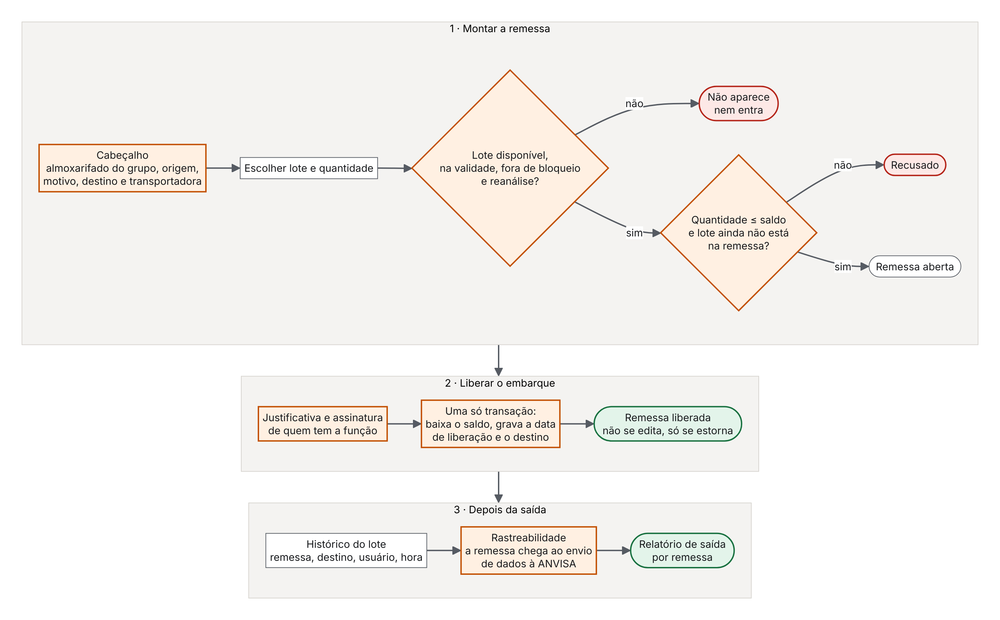
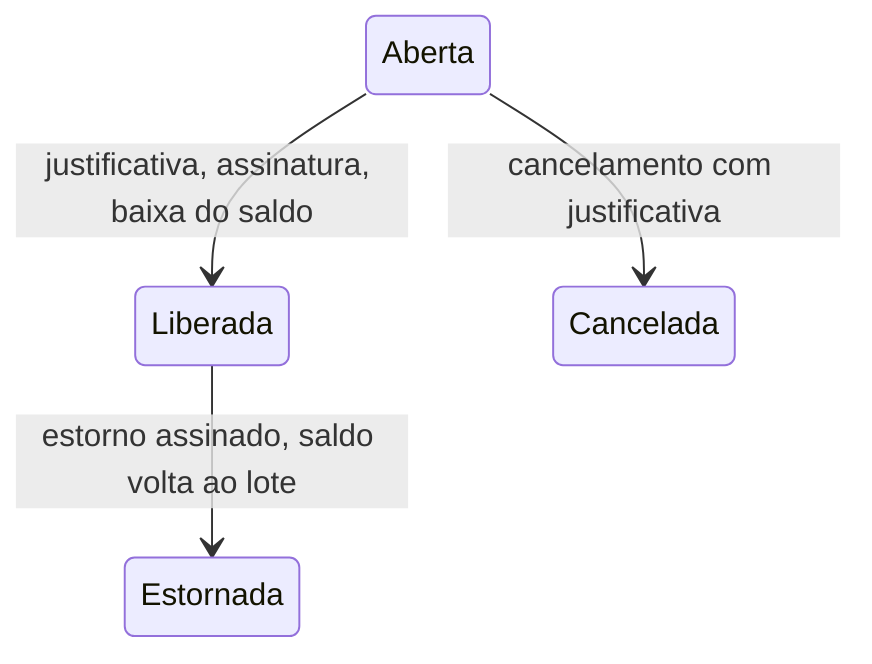

# Passo 3, fluxo 9: a saída do lote para fora da empresa (remessa e expedição)

*Como ler: **laranja** = o sistema confere (trava); **vermelho** = bloqueio; **verde** = resultado. Clique na imagem para ampliar.*

*Coluna "Onde no sistema": o caminho no sistema atual (legado), no formato **Módulo › Menu › Tela**. Onde diz "tela nova", a tela não existe hoje e será criada.*

> **Em uma frase:** Como o **produto sai da empresa** para um cliente ou destino, com baixa no estoque e registro de para onde foi.
>
> **Exemplo do dia a dia (ilustrativo, os números são inventados):** Uma caixa de remédio vai para uma distribuidora: o sistema tira do estoque, registra o destino e avisa a rastreabilidade.
>
> **Por que importa:** Sem registro do destino, não dá para fazer um recolhimento se o lote tiver problema.
>
> *Palavra que não conhece? Veja a documento "Glossário" (grupo "Para começar" da lista do estudo).*

**Análise de 19/11/2026. Rascunho para validação do responsável.** Nona ficha do passo 3. É **a saída do lote para fora**: o material sai da empresa para um destino (cliente, consignatário, devolução ao fornecedor). Fecha o ciclo que começou no recebimento ([ficha 1](fluxo-01-recebimento-quarentena.md)), e é onde a **rastreabilidade do medicamento** deixa de ser só interna.

**Fontes (todas no repositório do legado):** o fluxo "Remessa e expedição" (`3.estoque/fluxos/remessa-expedicao.md`, lido do código) e os resultados dos testes de tela do Estoque (casos `CT-EST-110` a `119`; achados `DV-EST-002`, `034`, `046`, `058`, `072`, `073`, `078`, `100`, `121`). **O que não fiz:** não li as telas uma a uma. A **remessa por guia (GMM)** e a **saída por nota fiscal** não puderam ser testadas, porque a tela de remessa **não tem** os campos delas; essas partes vêm **só do código** e estão marcadas. A norma pede o **vínculo do lote com o destino**; como a Rastreabilidade ainda não foi analisada, o elo com ela fica **a validar**.

## 1. O caminho, em uma linha
**Remessa aberta** (destino, motivo, transportadora) → **lotes escolhidos** (só disponível, na validade) → **liberação do embarque**, que **baixa o saldo** → **histórico do lote** com o destino → **Rastreabilidade** (envio de dados à ANVISA, a validar).

### A situação da remessa

No legado a remessa ficava **sem etapa de estorno**, e o **Finalizar** dava erro em dois testes seguidos; a liberação grava a data, mas **não mostrava quem** liberou nem para onde foi no histórico. No iLabs a **remessa liberada não se edita**: só se **estorna**, com assinatura, e o saldo volta ao lote.

## 2. Etapa a etapa

| # | Etapa | Onde no sistema (legado) | Quem faz | Exige antes | O que entra | O banco garante (iLabs) | Falha do legado |
|---|---|---|---|---|---|---|---|
| 1 | **Montar o cabeçalho** | **Estoque** › Estoque › Remessa de Materiais, Remessa de Material | Estoque ou Expedição | Almoxarifado **do grupo** do usuário; destino cadastrado | Almoxarifado, origem, motivo (evento) da remessa, local de entrega (destino), transportadora | Só almoxarifado **ativo e do grupo**; motivo de **lista cadastrada** e ativa; destino **vem do cadastro de pessoa jurídica** | O almoxarifado **inativo** e o que foi **desligado do grupo** ainda eram oferecidos (`DV-EST-078`); só havia **um motivo cadastrado** (Devolução); o **Tipo de Remessa** do Parâmetro do Estoque era sobrescrito por quem salvava por último (`DV-EST-100`) |
| 2 | **Escolher os lotes** | Mesma tela, grade de itens | Estoque | Lote liberado, com saldo | Item, lote, quantidade, valor unitário | Só lote **disponível**: fora de quarentena, reprovado, bloqueado e reanálise, **na validade**; **o mesmo lote não entra duas vezes**; **quantidade ≤ saldo**; **ordenado pelo que vence primeiro** | Os filtros e as recusas **funcionaram** (`CT-EST-111`, `112`, `113`), com a ressalva da máscara de quantidade (`DV-EST-002`). O **lote com saldo zerado ainda era listado**; o **lote vencido não foi isolado no teste** (o código **não tem filtro de validade**); **não havia ordem de validade** |
| 3 | **Remessa por guia (GMM)** | **Estoque** › Estoque › Remessa de Material (GMM) | Estoque | Consignatário e centro de custo cadastrados | Consignatário, centro de custo, datas da guia e do embarque | **Data do embarque não é anterior à da guia**; consignatário **de cadastro** | **Não pôde ser testada**: a tela de remessa **não tem** os campos de guia (`CT-EST-117` não se aplica); a guia da solicitação de kit ficava **desabilitada** |
| 4 | **Saída por nota fiscal** | **Estoque** › Estoque › Saída por Nota Fiscal | Estoque | Cliente cadastrado | Empresa cliente, **chave da nota fiscal**, justificativa | A **chave da nota tem formato conferido**; a saída **liga o lote ao cliente** | **Não pôde ser testada**: a tela de remessa **não tem** o campo da chave (`CT-EST-118` não se aplica); a regra vem só do código |
| 5 | **Liberar o embarque** | Mesma tela, botão Finalizar | Quem tem a função | Remessa aberta com ao menos um lote | Justificativa | **Uma só transação** baixa o saldo, grava a data de liberação e o destino; fica **assinado**; **engano se estorna, nunca se edita** | O **Finalizar** deu **"Erro ao gerar a solicitação do material!"** em dois testes seguidos e a remessa não avançava (`DV-EST-046`, `CT-EST-115`); no código, a rotina monta uma solicitação auxiliar **sem centro de custo**. Num teste posterior a remessa foi **finalizada e liberada**, mas a causa que a destravou **não foi identificada**. A **remessa gerada por kit** nascia **sem origem e sem responsável** e não finalizava (`DV-EST-058`) |
| 6 | **Avisar a Rastreabilidade** | Automático, se o módulo está ativo; depois, **Rastreabilidade** › IUM, Eventos | Automático | Remessa liberada | Nada | A remessa liberada **chega à Rastreabilidade** com lote, destino e data, para o envio de dados à ANVISA | O Estoque só **exibia o aviso** "O envio poderá ser feito pelo módulo RASTREABILIDADE"; **nenhuma tela da Rastreabilidade listou a remessa** (`DV-EST-072`, **a validar com a área**) |
| 7 | **Consultar e relatar** | **Estoque** › Estoque › Histórico do Lote; **Estoque** › Relatórios › Relatório de saída por remessa, Listagem de Lotes (Kits) | Todos | — | — | Histórico com **remessa, destino, quem liberou, quando e por quê**; um só relatório por remessa | A saída aparecia como **"atendimento de solicitação" do tipo Cliente**, **sem a remessa, sem o destino e sem usuário** (`DV-EST-073`, `034`); a **Listagem de Lotes (Kits)** mostrava o mesmo lote em duas linhas e incluía remessa que não era de kit (`DV-EST-121`) |

## 3. O que este fluxo exige de cada cadastro global

| Cadastro (passo 1) | O que o fluxo precisa que ele guarde |
|---|---|
| **Pessoa jurídica** | **Destino** (cliente, consignatário, fornecedor a quem se devolve) e **transportadora**, com CNPJ |
| **Locais e endereços** | Almoxarifado **ativo** e **do grupo**; o que sai vem de endereço disponível |
| **Motivo (evento) da remessa** | Lista cadastrada e ativa; só um motivo existia no legado |
| **Centro de custo** | Obrigatório na remessa por guia |
| **Parâmetros do Estoque** | **Tipo de remessa**; com **histórico de quem mudou** (`DV-EST-100`) |
| **Material e lote** | Só lote liberado, **na validade**; **valor unitário** e **registro na ANVISA** do produto, se a norma pedir |
| **Profissional e função** | Quem **monta**, **libera** e **estorna** a remessa |
| **Rastreabilidade (módulo)** | IUM e eventos que recebem a remessa (ainda não analisada) |

## 4. Os registros que nascem no fluxo (não são cadastros)
Remessa (cabeçalho e itens) · remessa por guia · saída por nota fiscal · solicitação auxiliar da remessa · movimentação de saída do lote · data de liberação · estorno · histórico do lote · evento enviado à Rastreabilidade.

## 5. O que muda nos documentos anteriores
- **Roteiro de implantação:** na etapa 3 (pessoa jurídica), o **destino** e a **transportadora** são cadastrados antes da primeira remessa; na etapa 5, o **motivo da remessa** e o **tipo de remessa** do parâmetro; na etapa 9, o ensaio inclui **uma remessa até a liberação**, **uma tentativa de lote vencido** (recusada) e **um estorno assinado**.
- **Passo 2 (ordem):** destino, transportadora e motivo da remessa vêm **antes** da primeira remessa.
- **Ficha 6:** a saída por **pedido** e a saída por **remessa** passam a deixar **o mesmo rastro**: quem, quando, destino e por quê.

## 6. Pontos a validar com a área (não consegui tirar do código)
1. **GMM:** o que significa a sigla, e a remessa por guia ainda é usada?
2. **Saída por nota fiscal:** é o caminho de **venda** (módulo Comercial) ou só de remessas especiais? Quem emite a nota?
3. **Rastreabilidade:** a remessa liberada **deve chegar** ao módulo Rastreabilidade para o **envio à ANVISA**? Ou o IUM é digitado à parte? (`DV-EST-072`)
4. **Lote vencido e FEFO:** a remessa só aceita lote **na validade** e o que vence primeiro? Há exceção para **devolução ao fornecedor** de lote vencido ou reprovado?
5. **Estorno:** é permitido depois de o material sair? Até quando? Quem assina?
6. **Remessa de kit:** o kit ainda existe? (Decisão do responsável: **não existe mais**, o que tira os defeitos `DV-EST-058` e `121` do iLabs.)
