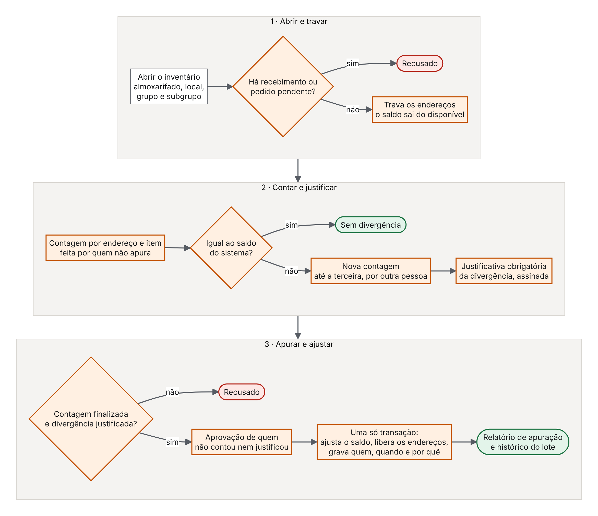
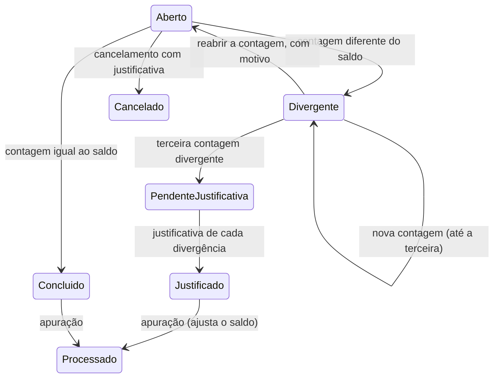

# Passo 3, fluxo 10: conferir o saldo contando o estoque (inventário)

*Como ler: **laranja** = o sistema confere (trava); **vermelho** = bloqueio; **verde** = resultado. Clique na imagem para ampliar.*

*Coluna "Onde no sistema": o caminho no sistema atual (legado), no formato **Módulo › Menu › Tela**. Onde diz "tela nova", a tela não existe hoje e será criada.*

**Análise de 19/11/2026. Rascunho para validação do responsável.** Décima ficha do passo 3, a **última do Estoque**. O inventário **confere o saldo que o sistema calcula com o que está na prateleira** e, quando diverge, **ajusta o saldo**. É a única operação em que o saldo muda **sem** haver entrada nem saída de material; por isso é a que mais exige **segregação de funções** e **registro de quem fez**. Depende de tudo o que vem antes: sem fichas 1 a 9, não há saldo para contar.

**Fontes (todas no repositório do legado):** o fluxo "Inventário" (`3.estoque/fluxos/inventario.md`, lido do código) e os resultados dos testes de tela do Estoque (casos `CT-EST-130` a `140`; achados `DV-EST-034`, `049`, `050`, `130`, `136`, `137`, `138`, `139`). **O que não fiz:** não li as telas uma a uma. O **relatório de apuração** e as **etiquetas de inventário** não foram abertos no teste; o **inventário com recebimentos pendentes** só abriu num almoxarifado sem pendência (os outros recusaram). Essas partes vêm **do código** ou de teste parcial, e estão marcadas.

## 1. O caminho, em uma linha
**Abrir** (sem recebimento nem pedido pendente) → **endereços travados** → **contar** (até três vezes) → **justificar** a divergência → **apurar** (ajusta o saldo e libera os endereços) → **relatório** e **histórico do lote**.

### A situação do inventário

No legado as situações existiam (aberto, divergente, pendente, concluído, processado, cancelado), mas **reabrir e cancelar não pediam motivo** e **a apuração não entrava no log** (`DV-EST-136`, `050`). No iLabs a situação do inventário é **uma só, guardada e conferida pelo banco**, e **cada seta grava quem, quando e por quê**.

## 2. Etapa a etapa

| # | Etapa | Onde no sistema (legado) | Quem faz | Exige antes | O que entra | O banco garante (iLabs) | Falha do legado |
|---|---|---|---|---|---|---|---|
| 1 | **Abrir o inventário** | **Estoque** › Inventário › Inventário | Estoque | Nenhum recebimento nem pedido pendente no almoxarifado | Tipo, motivo, data, almoxarifado, local, grupo e subgrupo | **Recusa** se há recebimento ou pedido pendente; a data é **a de hoje**; **trava os endereços** e o saldo deles **sai do disponível** | A data já é **travada pela tela** (grava a de hoje); a recusa com pedido pendente **funcionou** (`CT-EST-131`); com **recebimento pendente** a mensagem é outra ("Existem solicitações não finalizadas...") e **só um almoxarifado sem pendência abriu**; o saldo **saiu do disponível** (`CT-EST-133`) |
| 2 | **Contar** | **Estoque** › Inventário › Inventário - Contagem | Estoque (contador) | Inventário aberto | Código da contagem, endereço, item, quantidade | **Até três contagens**; igual ao saldo, **conclui sem divergência**; **quem conta não é quem apura**; a contagem é **cega** (o contador não vê o saldo do sistema) *(a validar)* | As mensagens e a regra das **três contagens funcionaram** (`CT-EST-134`, `135`); **a mesma pessoa contou as três vezes, justificou e apurou**, sem aviso (`DV-EST-049`, `CT-EST-140`); a contagem **aceitava 99.999 e 0 sem confirmar** (`DV-EST-138`) |
| 3 | **Justificar a divergência** | **Estoque** › Inventário › Inventário - Justificativa (Auditoria) | Qualidade ou chefia do estoque | Terceira contagem divergente | Justificativa de cada item divergente | **Obrigatória e assinada**; quem justifica **vê o saldo do sistema e as três contagens**; a justificativa **fica no log** | A recusa **sem justificativa funcionou** (`CT-EST-135`); quem justifica **só via a 3ª contagem**, sem o saldo nem as anteriores (`DV-EST-139`); o campo **cortava em 100 caracteres** e a **coluna Justificativa do log ficava vazia** (`DV-EST-137`); **cancelar a justificativa** não pedia motivo nem deixava registro (`DV-EST-136`) |
| 4 | **Apurar e ajustar o saldo** | **Estoque** › Inventário › Inventário - Apuração / Auditoria (Executar Inventário) | Quem **não contou nem justificou** | Contagem finalizada e divergência justificada | Confirmação | **Uma só transação** ajusta o saldo do lote e do endereço, **libera os endereços** e grava **quem, quando e por quê**; **engano se estorna**, nunca se edita | A recusa **sem contagem finalizada funcionou** (`CT-EST-136`) e o **ajuste foi correto** (`CT-EST-137`: 75 para 72); mas **a execução não entrava no log** (`DV-EST-136`) e o **histórico do lote** mostrava só **"INVENTÁRIO, SAÍDA"**, **sem usuário nem justificativa** (`CT-EST-138`, `DV-EST-034`) |
| 5 | **Reabrir contagem ou cancelar** | **Estoque** › Inventário › Inventário - Apuração / Auditoria (Voltar contagem, Cancelar) | Chefia do estoque | Inventário não processado | **Motivo** | **Motivo obrigatório e assinado**; cancelar **libera os endereços** | Funcionaram (**o endereço foi liberado**), mas **não pediam motivo** e **não deixavam registro** (`DV-EST-050`, `136`); a lista oferecia **primeira, segunda e terceira contagem** mesmo com **uma só feita** |
| 6 | **Relatar** | **Estoque** › Relatórios › Inventário do Mês, Apuração, Itens do Inventário; **Estoque** › Inventário › Etiquetas de inventário | Todos | — | — | **Um só relatório** com **todos os itens com saldo**, com ou sem custo; etiqueta do endereço contado | O **Inventário do Mês deixava de fora os itens com saldo e sem custo** e declarava o **valor total** sem avisar (`DV-EST-130`); o relatório de apuração e as etiquetas **não foram abertos** no teste |

## 3. O que este fluxo exige de cada cadastro global

| Cadastro (passo 1) | O que o fluxo precisa que ele guarde |
|---|---|
| **Locais e endereços** | O endereço com **estado de inventário** (travado ou não) e o **tipo do local** |
| **Material** | **Grupo e subgrupo** (usados para escolher o que contar) e **custo** (o relatório de valor depende dele) |
| **Lote e saldo** | Saldo por **lote e endereço**, com a situação "bloqueado por inventário" |
| **Profissional e função** | Quem **conta**, quem **justifica** e quem **apura**: **três funções separadas** |
| **Parâmetros do Estoque** | **Limite de divergência** que exige aprovação da Qualidade (a definir) |
| **Notificações (serviço comum)** | Aviso de inventário aberto e de divergência pendente de justificativa |

## 4. Os registros que nascem no fluxo (não são cadastros)
Inventário (cabeçalho e itens) · contagens (1ª, 2ª e 3ª) · justificativa · apuração · ajuste de saldo (movimentação de inventário) · cancelamento e reabertura · relatório de apuração · etiqueta de inventário · histórico do lote.

## 5. O que muda nos documentos anteriores
- **Roteiro de implantação:** na etapa 1 (acesso), **três funções separadas** (contar, justificar, apurar); na etapa 6 (materiais), **grupo, subgrupo e custo** preenchidos antes do primeiro inventário; na etapa 9, o ensaio inclui **um inventário com divergência até a apuração**, **uma tentativa de a mesma pessoa contar e apurar** (recusada) e **um estorno de ajuste**.
- **Passo 2 (ordem):** grupo e subgrupo do item vêm **antes** do primeiro inventário; **carga inicial de saldo** é decisão aberta (ver pontos em aberto do roteiro).
- **Fichas 6, 8 e 9:** o ajuste de inventário passa a deixar **o mesmo rastro** que as outras movimentações: quem, quando e por quê.

## 6. Pontos a validar com a área (não consegui tirar do código)
1. **Segregação:** contar, justificar e apurar precisam ser **três pessoas diferentes**? Ou duas bastam (quem conta ≠ quem apura)?
2. **Contagem cega:** o contador **pode ver** o saldo do sistema, ou a contagem deve ser cega?
3. **Limite de divergência:** a partir de quanto o ajuste **exige aprovação da Qualidade**? Muda por tipo de material (controlado, matéria-prima, produto acabado)?
4. **Frequência:** o inventário é por **rotação** (cíclico) ou geral? Quem agenda?
5. **Ajuste de lote em quarentena, reprovado ou vencido:** entra no inventário? Como é tratado?
6. **Estorno de ajuste:** é permitido depois de processado? Até quando? Quem assina?
7. **Carga inicial de saldo:** o primeiro saldo do cliente entra por **inventário** ou por entrada avulsa?
