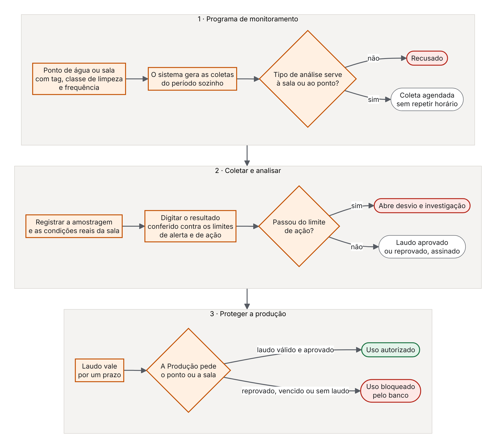
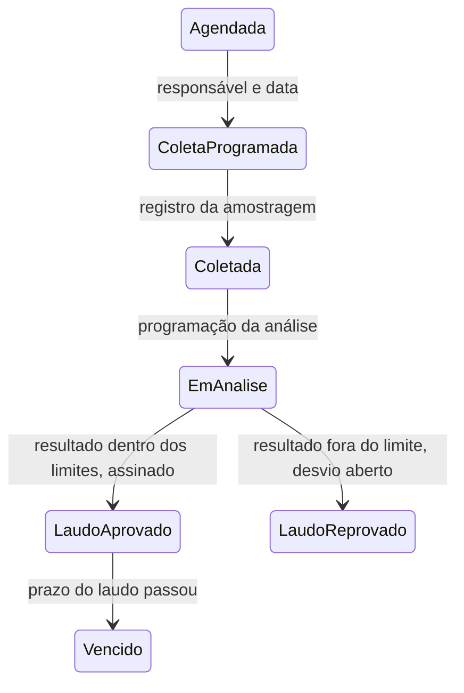

# Passo 3, fluxo 11a: monitorar a água e as salas (água e ambiente, Controle da Qualidade)

*Como ler: **laranja** = o sistema confere (trava); **vermelho** = bloqueio; **verde** = resultado. Clique na imagem para ampliar.*

*Coluna "Onde no sistema": o caminho no sistema atual (legado), no formato **Módulo › Menu › Tela**. Onde diz "tela nova", a tela não existe hoje e será criada.*

> **Em uma frase:** A empresa **testa regularmente a água e o ar das salas** onde se fabrica, porque sujeira ali contamina o remédio.
>
> **Exemplo do dia a dia (ilustrativo, os números são inventados):** Toda semana, uma amostra da água usada na fábrica vai ao laboratório. Se vier fora do limite, abre-se uma investigação.
>
> **Por que importa:** Água ou sala fora do padrão, se for usada mesmo assim, pode contaminar um lote inteiro.
>
> *Palavra que não conhece? Veja a documento "Glossário" (grupo "Para começar" da lista do estudo).*

**Análise de 19/11/2026. Rascunho para validação do responsável.** Primeira parte da ficha 11 do passo 3 (a outra é a [estabilidade](fluxo-11b-estabilidade.md)), e a **primeira do Controle da Qualidade fora do material**. O CQ monitora a **água** (potável, purificada, para injetáveis) e as **salas** (ambiente). O ciclo é o mesmo da [ficha 3](fluxo-03-regras-analise-e-laudo.md) (solicitação, amostragem, análise, laudo, etiqueta); aqui estão **só as diferenças** e a ligação com a **Produção**, que usa os pontos e as salas.

**Fontes (todas no repositório do legado):** o fluxo "Água e ambiente" (`4.controle_qualidade/fluxos/agua-ambiente.md`, lido do código) e os resultados dos testes de tela do CQ (rodadas de 23/10/2026 e de reteste de 03/11/2026; casos `CT-CQ-060` a `068`; achados `DV-CQ-001`, `008`, `009`, `018`, `019`, `020`, `022`, `023`, `025`, `060`). **O que não fiz:** não li as telas uma a uma. O **laudo de água**, a **etiqueta** e a **autorização do ponto de água na Produção** não puderam ser testados: o **resultado não grava** (`DV-CQ-009`), então nenhum laudo de água chegou a existir. A parte da Produção vem **só do código**.

## 1. O caminho, em uma linha
**Programa de monitoramento** (ponto ou sala, frequência) → **coletas geradas** → **amostragem** (com as condições reais) → **análise** (limites de alerta e de ação) → **laudo assinado** → **a Produção só usa o ponto ou a sala com laudo válido e aprovado**.

### A situação da coleta

No legado a coleta era **agendada uma a uma**, **sem frequência** e **sem limite de alerta ou de ação**, e o resultado era só "conforme" ou "não conforme". No iLabs a coleta nasce de um **programa** (frequência por ponto ou sala), o resultado é **conferido contra os limites** e o banco **guarda a situação**; o laudo **vale por um prazo**.

## 2. Etapa a etapa

| # | Etapa | Onde no sistema (legado) | Quem faz | Exige antes | O que entra | O banco garante (iLabs) | Falha do legado |
|---|---|---|---|---|---|---|---|
| 1 | **Cadastrar o ponto ou a sala** | **Principal** › Cadastros › Pontos de água, Ambientes | Qualidade (cadastro do Principal) | Equipamento e estrutura cadastrados | Tag, tipo da água, classe e grau de limpeza da sala, frequência de coleta | O ponto e a sala têm **tag única**, **classe de limpeza** e **frequência**; só o **ativo** é oferecido | O CQ **não trazia a classe nem o grau de limpeza** da sala, só nome, descrição e tag; **não havia frequência** (`RN003`, `RN004` do fluxo) |
| 2 | **Agendar a coleta** | **Controle da Qualidade** › Solicitação de Análise › Programação de Solicitação de Análise; **Consultar Coletas Pendentes de Programação** | Qualidade | Ponto ou sala cadastrado | Tipo (água ou ambiente), tipo de análise, ponto ou sala, dia e horário | O programa **gera as coletas do período**; ambiente **só aceita análise microbiológica**; **não repete horário**; hoje e o passado são recusados | Cada coleta era **marcada à mão** (`DV-CQ-023`, `CT-CQ-063` falhou); a agenda de água **não carregava** até o DBA ajustar o nome da tabela (`DV-CQ-001`, `008`, resolvidos no ambiente em 03/11, abertos no projeto de banco); a agenda **aceitou ambiente com físico-químico** e horário fora de 8h às 18h (`DV-CQ-020`); a recusa de **hoje** e de **horário repetido** funcionou (`CT-CQ-060`, `061`); Carregar em Ambiente (físico-químico) deu erro interno (`DV-CQ-060`) |
| 3 | **Programar e registrar a amostragem** | **Controle da Qualidade** › Amostragem › Programação de Amostragem, Consultar Amostragem (Registro de Amostragem) | Amostrador e verificador | Coleta programada | Responsável, verificador, amostrador, **condições reais da coleta** | **Sem pedido ao Estoque**; verificador diferente do amostrador; as **condições da sala** (vazia, fluxo, ar, em atividade) **são registradas** | A programação de água funcionou no reteste (`CT-CQ-064`, `S04-11` passaram), mas **registrar a amostragem mostrava "Ocorreu um erro interno não esperado." e gravava** (`DV-CQ-019`); as funções do amostrador e do verificador são procuradas **por número fixo no código**, e a 71, de estabilidade, nem existe no cadastro (`DV-CQ-022`) |
| 4 | **Programar e digitar a análise** | **Controle da Qualidade** › Análise e Laudo › Programação de Análise, Consultar Análise Programada | Analista | Amostragem registrada | Responsável, ensaios, **resultado**, referência e data | Ensaios vêm da **regra de análise** do ponto ou da sala; resultado **conferido contra os limites de alerta e de ação**; fora do limite de ação **abre desvio** | A programação passou (`passo 4` do reteste), mas **digitar o resultado dizia "Alteração efetuada com sucesso." e não gravava**: referência, data e resultado sumiam (`DV-CQ-009`, `CT-CQ-N-37`); **não havia regra de análise** de água cadastrada, nem **limites de alerta e de ação** nem tendência (`RN007` do fluxo) |
| 5 | **Aprovar e emitir o laudo** | **Controle da Qualidade** › Análise e Laudo › Emissão Laudo Final | Quem tem a função de aprovar | Resultado gravado | Aprovar ou reprovar, com justificativa | **Assinado** por quem tem a função, **diferente do analista**; **reprovar abre desvio**; o laudo **vale por um prazo** | **Bloqueado no teste**: sem resultado não há laudo (`CT-CQ-L05-10`); com resultado fora da faixa o laudo oferecia **só Aprovar** (`DV-CQ-009`); qualquer usuário, **até o perfil só de consulta**, conseguia aprovar laudo (`DV-CQ-003`) |
| 6 | **Boletim e etiqueta** | **Controle da Qualidade** › Análise e Laudo › Gerar Etiqueta; **Consultar Análise Programada** (imprimir) | Qualidade | Laudo emitido | — | Boletim com **as condições reais da sala** e o resultado; etiqueta **da instituição** | O boletim de ambiente **imprimiu**, mas **data da exposição, ambiente avaliado, condições e resultado saíam em branco** (`CT-CQ-065`, `DV-CQ-009`); a etiqueta trazia o **nome de outra instituição** (`DV-CQ-025`); a etiqueta de água **não foi testada** |
| 7 | **Liberar o uso na Produção** | **Produção** › Autorizações › Autorização de ponto de água (e telas próprias de análise de água e de ambiente) | Produção | Laudo de água aprovado e **válido** | Escolha de autorizar o ponto | A Produção **só autoriza** o ponto ou a sala com **laudo aprovado do CQ e dentro do prazo**; o banco **bloqueia** o resto | **Não testado** (sem laudo de água, `CT-CQ-066` bloqueado). Pelo código, a Produção **não consulta o laudo do CQ**: decide **à mão**, pelos registros dela, e mantém **um controle paralelo** de água e de ambiente |
| 8 | **Excluir ou cancelar uma coleta** | **Controle da Qualidade** › Programação de Solicitação de Análise (lixeira) | Qualidade | — | Justificativa | **Justificativa obrigatória** e histórico; coleta com laudo **não se cancela** | A exclusão ia à lixeira **sem justificativa e sem histórico** (`DV-CQ-018`, `CT-CQ-067` falhou); uma solicitação com laudo liberado podia ser cancelada (`DV-CQ-007`) |

## 3. O que este fluxo exige de cada cadastro global

| Cadastro (passo 1) | O que o fluxo precisa que ele guarde |
|---|---|
| **Pontos de água** | Tag única, tipo da água (potável, purificada, injetáveis) e **frequência de coleta** |
| **Ambientes (salas)** | Tag, **classe e grau de limpeza** (A, B, C, D) e **frequência de coleta** |
| **Tipo de água** | Lista de apoio (no legado, a tabela colidia entre Principal e CQ: `DV-CQ-001`) |
| **Regra de análise (CQ)** | Ensaios, métodos e **limites de alerta e de ação** por tipo de água e por classe de sala |
| **Profissional e função** | Quem **amostra**, **verifica**, **analisa** e **aprova** (funções com nome, não números fixos) |
| **Equipamento** | O que se usa na coleta e na análise (ligado ao ponto ou à sala, quando for o caso) |
| **Notificações (serviço comum)** | **Aviso** de coleta do dia, de resultado fora do limite e de laudo vencendo |
| **Desvio (GQ)** | Recebe a **reprovação** e o resultado acima do limite de ação |

## 4. Os registros que nascem no fluxo (não são cadastros)
Programa de monitoramento e coletas geradas · solicitação de análise · amostragem · análise e resultados · laudo e etiqueta · boletim de ambiente · autorização do ponto na Produção · histórico.

## 5. O que muda nos documentos anteriores
- **Roteiro de implantação:** na etapa 5 (locais), cada **ponto de água** e cada **sala** ganha **tag, classe de limpeza e frequência de coleta**; na etapa 7, as **regras de análise de água e de ambiente**, com **limites de alerta e de ação**; na etapa 1, as funções de amostrar, verificar, analisar e aprovar; na etapa 9, o ensaio inclui **uma coleta de água até o laudo**, **um resultado acima do limite de ação** (abre desvio) e **uma tentativa de usar na Produção um ponto reprovado** (bloqueada).
- **Passo 2 (ordem):** ponto de água, sala, tipo de água e regra de análise vêm **antes** do primeiro programa de monitoramento.
- **Ficha 3:** o laudo de água e de ambiente passa a **valer por um prazo** e a ser **conferido pela Produção**.

## 6. Pontos a validar com a área (não consegui tirar do código)
1. **Frequência:** como a empresa garante hoje a frequência de coleta (planilha, procedimento)? Muda por ponto e por classe de sala?
2. **Limites:** quais os **limites de alerta e de ação** por tipo de água e por classe de sala? Quem os define e os aprova?
3. **Resultado acima do limite de ação:** abre **desvio** automaticamente? Bloqueia o ponto ou a sala até a investigação?
4. **Validade do laudo de água e de ambiente:** quanto tempo o laudo autoriza o uso?
5. **Produção:** deve **consultar** o laudo do CQ para liberar o ponto, ou o controle dela continua à parte? Se continua, de quem é a decisão final?
6. **Condições da sala na coleta:** quais registrar (sala vazia, fluxo, ar, em atividade e outras)?
7. **Reanálise e coleta repetida** de água: quando se repete e quem autoriza (`DV-CQ-056`: a reanálise cancelava a solicitação de origem)?
