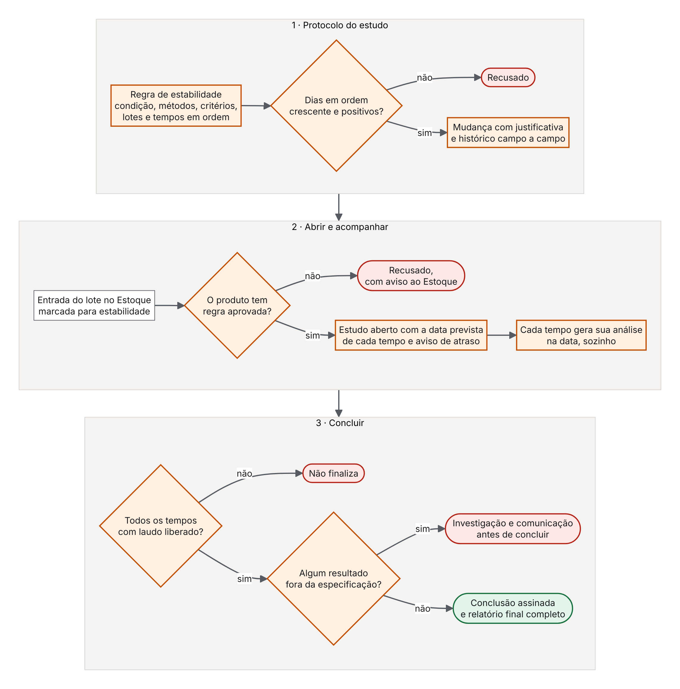
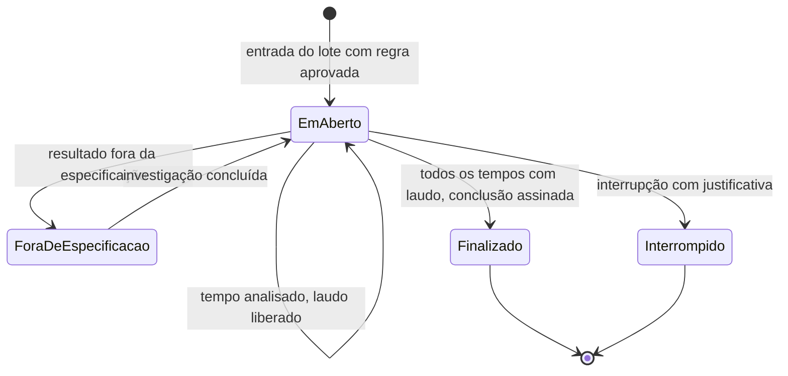

# Passo 3, fluxo 11b: acompanhar a estabilidade do produto acabado (Controle da Qualidade)

*Como ler: **laranja** = o sistema confere (trava); **vermelho** = bloqueio; **verde** = resultado. Clique na imagem para ampliar.*

*Coluna "Onde no sistema": o caminho no sistema atual (legado), no formato **Módulo › Menu › Tela**. Onde diz "tela nova", a tela não existe hoje e será criada.*

> **Em uma frase:** Acompanhar o remédio **ao longo do tempo** (meses e anos) para provar que continua bom até a data de validade.
>
> **Exemplo do dia a dia (ilustrativo, os números são inventados):** Um lote é guardado em câmara com temperatura controlada e analisado aos 3, 6, 12 e 24 meses. Se algum resultado piorar, a empresa investiga.
>
> **Por que importa:** Sem esse acompanhamento, a validade impressa na caixa não teria prova.
>
> *Palavra que não conhece? Veja a documento "Glossário" (grupo "Para começar" da lista do estudo).*

**Análise de 19/11/2026. Rascunho para validação do responsável.** Segunda parte da ficha 11 do passo 3 (a outra é a [água e ambiente](fluxo-11a-agua-e-ambiente.md)). A estabilidade **acompanha o produto acabado ao longo do tempo** para provar que ele mantém a qualidade até a validade. Começa no Estoque ([ficha 7](fluxo-07-almoxarifado-cq.md), que guarda a amostra) e cada tempo do estudo vira uma análise do CQ ([ficha 3](fluxo-03-regras-analise-e-laudo.md)).

**Fontes (todas no repositório do legado):** o fluxo "Estabilidade" (`4.controle_qualidade/fluxos/estabilidade.md`, lido do código) e os resultados dos testes de tela do CQ (rodadas de 23/10 e 28/10/2026; casos `CT-CQ-040` a `052`; achados `DV-CQ-015`, `016`, `017`, `022`, `041`, `042`; `DV-EST-071`, `074`, `075`). **O que não fiz:** não li as telas uma a uma. **Nenhum acompanhamento de estabilidade chegou a abrir** no teste (o Estoque não cria a entrada de estabilidade: `DV-EST-074`), então a **execução dos tempos, a interrupção e a finalização** vêm **só do código** e estão marcadas. Só a **Regra de Estabilidade** foi testada na tela.

## 1. O caminho, em uma linha
**Regra de estabilidade** (protocolo e tempos) → **entrada do lote no Estoque** marcada para estabilidade → **estudo aberto** com a data prevista de cada tempo → **cada tempo vira uma análise** → **conclusão assinada** (ou **interrupção**, com justificativa) → **relatório final**.

### A situação do estudo

No legado o estudo tinha **três situações** (em aberto, finalizado, interrompido), **sem fora de especificação**, e podia ser **finalizado como aprovado com laudo reprovado** (`RN003` da finalização). No iLabs a situação é **uma só, guardada e conferida pelo banco**, e **resultado fora da especificação segura o estudo** até a investigação.

## 2. Etapa a etapa

| # | Etapa | Onde no sistema (legado) | Quem faz | Exige antes | O que entra | O banco garante (iLabs) | Falha do legado |
|---|---|---|---|---|---|---|---|
| 1 | **Escrever o protocolo (regra)** | **Controle da Qualidade** › Tabelas de Apoio › Regra Estabilidade | Qualidade | Produto acabado cadastrado | Item, tipo de análise, **tempos** (T0, T1…) com os **dias** de cada tipo de estudo (acelerado, longa duração, acompanhamento, prateleira) e, no iLabs, **condição de armazenamento, métodos, critérios e número de lotes** | **Dias positivos e em ordem crescente**; **uma regra aprovada por produto e tipo de análise**; mudança **com justificativa** e histórico campo a campo | Tempos fora de ordem e negativos **foram recusados** (`CT-CQ-040`), exceto o campo Acompanhamento do último tempo; a **terceira regra foi aceita** (`DV-CQ-016`, `CT-CQ-041`); uma regra **sem nenhum tempo** era salva e dava erro (`DV-CQ-016`, `041`); a regra **não é um protocolo** (sem condição, métodos, critérios, lotes); a lista de itens devolvia o **código no lugar do identificador** e a tela dizia "Selecione um item." para código com letras (`DV-EST-075`) |
| 2 | **Mudar a regra** | Mesma tela (editar) | Qualidade | Regra existente | Justificativa | **Justificativa obrigatória** e **log campo a campo**; regra com estudo aberto **só se muda por nova versão** | Alterar **não pedia justificativa** e o log dizia **"NÃO EXISTE LOG DE ALTERAÇÃO"** (`DV-CQ-017`, `CT-CQ-042`); por baixo, **todos os tempos eram apagados e regravados**; a regra não se exclui, só se desativa |
| 3 | **Abrir o estudo** | Automático, pelo **Estoque** › Regulatório › Movimentações (Entrada - Estabilidade); depois, **Controle da Qualidade** › Estabilidade › Acompanhamento Estabilidade | Estoque (entrada) | Lote liberado e **regra do produto** | Tipo de estudo e de análise | O estudo só abre **com regra aprovada**; sem regra, o Estoque **recebe a recusa**; guarda **quantidade reservada, condição de armazenamento e data de início**; **data prevista de cada tempo** calculada | **Nenhum estudo chegou a abrir** (`DV-EST-074`, `DV-EST-071`: a entrada não pedia o tipo de estudo; `CT-CQ-043` a `052` **bloqueados**); pelo código, **sem regra nada era aberto e nenhum aviso voltava ao Estoque**, e o estudo **não guardava** quantidade, condição nem data de início |
| 4 | **Gerar a análise de cada tempo** | **Controle da Qualidade** › Estabilidade › Acompanhamento Estabilidade (Gerar Solicitação) | Qualidade | Estudo em aberto, amostra no almoxarifado de estabilidade | Escolha dos ensaios | **A análise do tempo nasce na data prevista, sozinha**, com lote, validade e quantidade do T0; **aviso de tempo próximo e atrasado**; atraso exige justificativa | **Não testado** (nenhum estudo abriu). Pelo código, a solicitação de cada tempo era gerada **à mão**, pelo botão, só no primeiro tempo ainda sem solicitação; **nada era gerado pela data** e **tempo atrasado não tinha aviso, bloqueio nem justificativa** |
| 5 | **Interromper o estudo** | Mesma tela (Interromper Estudo) | Quem tem a função de estabilidade | Estudo em aberto | **Justificativa** | **Justificativa obrigatória e assinada**; com análise pendente, **o banco recusa** (não só a tela); a função é **conferida na gravação** | **Não testado.** Pelo código, a trava de "solicitações pendentes" era **só da tela** e a conferência da função de estabilidade estava **desligada**: qualquer usuário com a tela no menu interrompia; a função 71, que o código procura, **nem existe no cadastro** (`DV-CQ-022`, `CT-CQ-049`) |
| 6 | **Concluir o estudo** | **Controle da Qualidade** › Estabilidade › Final de Estabilidade | Qualidade (função de aprovar) | **Todos os tempos com laudo liberado** | Temperatura, conclusão, resultado (aprovado ou reprovado) | **Não conclui como aprovado com resultado reprovado** nem fora da especificação sem investigação; **assinatura** de quem conclui | **Não testado.** Pelo código, o estudo podia ser **finalizado como aprovado com laudo reprovado**, a temperatura era **texto livre**, sem assinatura, e o histórico usava o texto fixo **"Alteração"** quando não havia justificativa |
| 7 | **Imprimir o relatório final** | Mesma tela (Imprimir) | Qualidade | Estudo finalizado | — | Relatório com **protocolo, condição, métodos, resultados por tempo, data prevista e realizada, conclusão e quem assinou** | **Não testado** (`CT-CQ-052` bloqueado); relatórios de estabilidade quebravam com erro técnico quando o registro não existia (`DV-CQ-042`). Pelo código, o relatório **não traz protocolo, métodos nem responsável** e a "Data de Fabricação" mostra a **data de entrada** |
| 8 | **Resultado fora da especificação** | Não existe no legado (tela nova) | Qualidade | Laudo de um tempo reprovado | Investigação e comunicação | O estudo **fica retido**; **abre desvio**; conclusão **só depois** da investigação | **Não existe**: resultado fora da especificação **não mudava nada** no estudo |

## 3. O que este fluxo exige de cada cadastro global

| Cadastro (passo 1) | O que o fluxo precisa que ele guarde |
|---|---|
| **Material (produto acabado)** | Se **entra em estabilidade**; **regra de estabilidade aprovada** (protocolo e tempos) |
| **Regra de estabilidade (CQ)** | **Condição de armazenamento, métodos, critérios de aceitação, número de lotes**, tempos com dias, tipos de estudo |
| **Locais e endereços** | **Almoxarifado de estabilidade** com as câmaras (condição de armazenamento) |
| **Tipo de estabilidade e motivo de movimentação** | Listas de apoio da entrada e da saída da amostra |
| **Lote** | Lote de produto acabado **liberado**, com a amostra reservada |
| **Profissional e função** | Quem **abre**, **gera as análises**, **interrompe** e **conclui** (função com nome, não o número fixo 71) |
| **Equipamento** | Câmaras de estabilidade e sua **qualificação** (a validar) |
| **Notificações (serviço comum)** | Aviso de **tempo próximo e atrasado** e de resultado fora da especificação |
| **Desvio (GQ)** | Recebe o **resultado fora da especificação** |

## 4. Os registros que nascem no fluxo (não são cadastros)
Estudo (acompanhamento) e seus tempos · análise de cada tempo · interrupção · conclusão · relatório final · investigação de resultado fora da especificação · histórico.

## 5. O que muda nos documentos anteriores
- **Roteiro de implantação:** na etapa 5 (locais), o **almoxarifado de estabilidade**, com as câmaras; na etapa 6 (materiais), o produto acabado diz se **entra em estabilidade**; na etapa 7, a **regra de estabilidade** (protocolo completo e tempos) **aprovada** antes da primeira entrada; na etapa 9, o ensaio inclui **um estudo com três tempos até a conclusão**, **uma entrada sem regra** (recusada) e **um resultado fora da especificação** (retém o estudo).
- **Passo 2 (ordem):** a regra de estabilidade vem **antes** da primeira entrada de produto acabado marcada para estabilidade.
- **Ficha 7:** a amostra de estabilidade só entra com **tipo de estudo** e **regra aprovada**; o estudo no CQ **abre na mesma transação** (`DV-EST-071`, `074`).

## 6. Pontos a validar com a área (não consegui tirar do código)
1. **Protocolo:** quais campos a empresa quer na regra (condição, métodos, critérios de aceitação, número de lotes)? O protocolo já existe em documento à parte?
2. **Cobertura:** ao menos **um lote por ano** de cada produto entra no programa? Quem confere? Hoje o sistema não confere.
3. **Tempos:** as datas de cada tempo contam **da entrada do lote** ou **da fabricação**? E os tipos de estudo (acelerado, longa duração, acompanhamento, prateleira) valem para todo produto?
4. **Resultado fora da especificação:** abre **investigação** e **comunicação** automaticamente? Quem decide manter o produto no mercado?
5. **Quem conclui:** a função de estabilidade é de **uma pessoa** ou **de um grupo**? Precisa de segunda assinatura?
6. **Câmaras:** a **qualificação** das câmaras de estabilidade entra neste fluxo ou é do módulo de equipamentos?
7. **Interrupção:** em que casos (produto retirado do mercado, lote descartado) e quem autoriza?
