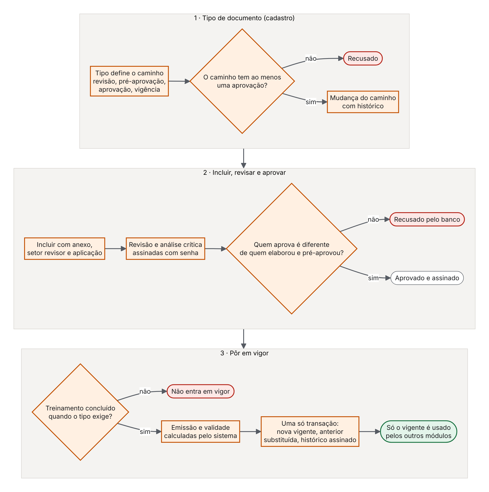
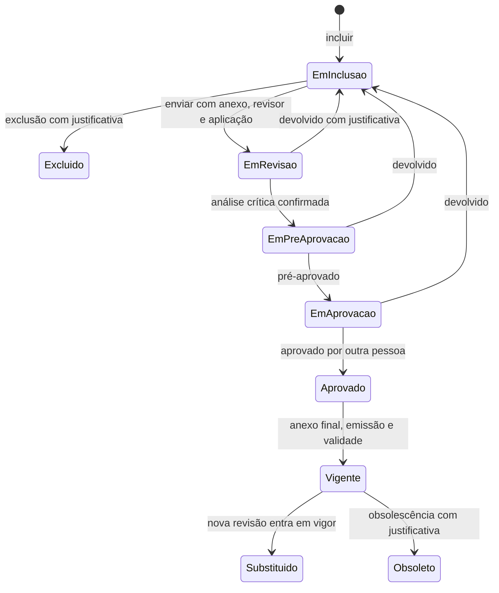

# Passo 3, fluxo 12a: o documento até ficar em vigor (ciclo do documento, Controle de Documentos)

*Como ler: **laranja** = o sistema confere (trava); **vermelho** = bloqueio; **verde** = resultado. Clique na imagem para ampliar.*

*Coluna "Onde no sistema": o caminho no sistema atual (legado), no formato **Módulo › Menu › Tela**. Os nomes de menu seguem as pastas de menu do inventário de telas do módulo (Documento, Cópias, Externo e Legado, Tabelas de Apoio). Onde diz "tela nova", a tela não existe hoje e será criada.*

> **Em uma frase:** Todo procedimento escrito (POP) passa por **revisão, aprovação e entrada em vigor**, e só a versão em vigor pode ser usada.
>
> **Exemplo do dia a dia (ilustrativo, os números são inventados):** Alguém escreve o procedimento de limpeza; outros revisam; um aprova; só então ele vale. Quando sai uma versão nova, a antiga deixa de valer.
>
> **Por que importa:** Usar um procedimento antigo ou não aprovado é uma falha grave de BPF.
>
> *Palavra que não conhece? Veja a documento "Glossário" (grupo "Para começar" da lista do estudo).*

**Análise de 19/11/2026. Rascunho para validação do responsável.** Primeira parte da ficha 12 do passo 3 (a outra é [cópias, documento externo e legado](fluxo-12b-copias-externo-legado.md)), e a **primeira do módulo Controle de Documentos**. É o fluxo que **garante que só a versão aprovada e vigente de um procedimento esteja em uso**. Outros módulos (Garantia da Qualidade, treinamento) só aceitam documento **vigente**.

**Fontes (todas no repositório do legado):** o fluxo "Ciclo do documento" e o de "Tipo de documento, arquivos e modelos" (`6.controle_documento/fluxos/ciclo-documento.md` e `tipo-arquivos-modelos.md`, lidos do código) e os resultados dos testes de tela (rodadas de 23/10 e 03/11/2026; casos `CT-DOC-001` a `017`; achados `DV-DOC-001`, `002`, `004`, `005`, `007`, `008`, `023`, `024`). **O que não fiz:** não li as telas uma a uma. Nenhum teste abriu telas **digitando o endereço** (decisão do responsável), então a **conferência no servidor** de quem decide ficou **a confirmar**. As telas de **Arquivos e Modelos** (ciclo básico), que ficam **fora do menu**, vêm **só do código**.

## 1. O caminho, em uma linha
**Tipo de documento** (define o caminho) → **incluir** com anexo, setor revisor e aplicação → **revisão** e análise crítica → **pré-aprovação** → **aprovação** → **vigência** (a anterior vira Substituída) → **nova revisão** ou **obsolescência**; **só o vigente** é usado pelos outros módulos.

### A situação do documento

No legado a situação seguia o **caminho configurado no tipo**, que **podia pular a aprovação** e até ficar **vazio**, e o documento devolvido voltava à **"pré-inclusão"**. No iLabs o **caminho tem sempre ao menos uma aprovação**, e a situação do documento é **uma só, guardada e conferida pelo banco**.

## 2. Etapa a etapa

| # | Etapa | Onde no sistema (legado) | Quem faz | Exige antes | O que entra | O banco garante (iLabs) | Falha do legado |
|---|---|---|---|---|---|---|---|
| 1 | **Definir o tipo de documento** | **Controle de Documentos** › Tabelas de Apoio › Tipo de Documento | Qualidade documental | — | Nome do tipo, código automático, validade e alerta, exige treinamento, controla arquivos, **caminho** (revisão, pré-aprovação, aprovação) | O **caminho tem ao menos uma aprovação**; o nome não se repete; só se exclui o tipo **sem documento ativo**; **mudar o caminho fica no histórico** | Um tipo só com a etapa "Vigente" **pôs o documento em vigor já no envio**, sem revisão, aprovação, senha, código nem datas, e o histórico ficou vazio (`DV-DOC-004`, `005`, `CT-DOC-013`); a mudança do caminho **apaga e regrava** a configuração (rastro a confirmar) |
| 2 | **Incluir o documento** | **Controle de Documentos** › Documento › Documento | Autor | Tipo, setor responsável e aplicações cadastrados | Tipo, código, título, setor, **anexo**, **setores revisores**, **aplicações** | O documento só segue com **anexo, ao menos um revisor e uma aplicação**; a **exclusão só em inclusão, com justificativa**, e **não apaga** | As recusas existem, mas vêm **uma de cada vez** (`CT-DOC-001`); o envio terminou com **"Ocorreu um erro inesperado."** apesar de mudar a situação, e **não gravou "CRIAÇÃO DO DOCUMENTO"** no histórico (`DV-DOC-001`, `CT-DOC-002`); o documento excluído **não deixava histórico visível** (`DV-DOC-024`) |
| 3 | **Revisar (análise crítica)** | **Controle de Documentos** › Documento › Revisão Documento | Setores revisores | Documento em revisão | Revisar ou devolver, com justificativa; confirmar a revisão (exige anexo) | Cada **setor revisor decide**; a decisão **leva senha** e fica **assinada**; a devolução **volta ao autor** | "Assinar e Revisar" **com senha funcionou** e gravou "REVISADO" (`CT-DOC-005`); **devolver não pedia senha** e o histórico **"DEVOLVIDO" saía sem assinante** (`DV-DOC-023`, `CT-DOC-004`) |
| 4 | **Pré-aprovar** | **Controle de Documentos** › Documento › Pré-Aprovação Documento | Aprovador inicial | Análise crítica confirmada | Anexo final, decisão | **Quem pré-aprova é diferente de quem elaborou**; exige anexo final | A recusa **sem anexo final funcionou** (`CT-DOC-N-09`); **a mesma pessoa pré-aprovou e aprovou** pela lista de Aprovação, com as duas assinaturas dela (`DV-DOC-002`, `CT-DOC-006` falhou) |
| 5 | **Aprovar** | **Controle de Documentos** › Documento › Aprovação Documento; **Aprovação de Documentos** *(fora do menu)* | Aprovador final | Pré-aprovado | Aprovar ou devolver, com senha | **Quem aprova é diferente de quem elaborou e de quem pré-aprovou, conferido na gravação**; **senha** de quem decide, **assinatura** no histórico | **Senha errada foi recusada** e a certa aprovou, gravando aprovador, data e assinante (`CT-DOC-007` passou); a separação entre quem pré-aprova e aprova **só existia na lista** (leitura do código; a conferência no servidor, **a confirmar**: o teste só usou o menu) |
| 6 | **Pôr em vigor** | **Controle de Documentos** › Documento › Vigência de Documento; **Vigência de Documentos** *(fora do menu)* | Quem tem a função | Aprovado, anexo final, treinamento (se o tipo exige) | Emissão e validade | A **emissão e a validade são calculadas pelo sistema** (a emissão não é anterior à aprovação); com treinamento exigido e **não concluído, não entra em vigor**; **uma só transação**: nova vigente, anterior Substituída, histórico assinado | A **emissão retroativa** foi aceita (23/09 para um documento aprovado depois) (`DV-DOC-007`, `CT-DOC-009` falhou); a tela **trocava a validade digitada** e somava um mês, sem mensagem (`DV-DOC-008`); a **conferência do treinamento funcionou na tela**, escondendo o botão (`CT-DOC-010` passou), mas o código dizia que estava desligada: **conferir no servidor**; o anterior **só ficou Substituído** quando a nova entrou em vigor (`CT-DOC-011`); a vigência estava programada **em dois lugares** (leitura do código) |
| 7 | **Nova revisão** | **Controle de Documentos** › Documento › Nova Revisão de Documento | Autor | Documento **vigente** | Motivo | Só se abre revisão de **vigente**; copia os dados e **soma 1 à revisão**; o anterior segue vigente **até a nova entrar em vigor**, e **os dois ficam ligados** | Funcionou: a revisão 01 nasceu e a 00 virou Substituído ao entrar a nova (`CT-DOC-011`); **não pedia confirmação nem motivo**; o botão só aparecia para vigente (`CT-DOC-017` passou) |
| 8 | **Obsoletar** | **Controle de Documentos** › Documento › Obsolescência de Documento | Quem tem a função | Documento vigente | Senha e **justificativa** | Só **vigente**; **justificativa obrigatória** e assinatura; **recolhe as cópias** ([ficha 12b](fluxo-12b-copias-externo-legado.md)) | Pedia senha e confirmação, mas **não pedia justificativa** (`CT-DOC-014`); o documento obsoleto **não aparecia** nas listas |
| 9 | **Consultar e histórico** | **Controle de Documentos** › Documento › Documento (histórico), Visualizar Documento; **Garantia da Qualidade** › Treinamento (busca de documento) | Todos | — | — | Histórico com **toda ação, justificativa, data e assinante**; **só o vigente** aparece para uso nos outros módulos | O histórico trazia REVISADO, PRÉ-APROVADO, APROVADO e VIGENTE assinados, mas **faltavam a criação e o assinante do "SUBSTITUÍDO"** (`CT-DOC-016`); a busca da GQ **só devolveu o vigente** (`CT-DOC-015` passou na rodada 3) |

## 3. O que este fluxo exige de cada cadastro global

| Cadastro (passo 1) | O que o fluxo precisa que ele guarde |
|---|---|
| **Tipo de documento** | Nome, **código automático** (sequencial), **validade e alerta**, **exige treinamento**, **controla arquivos**, **caminho** (com ao menos uma aprovação) e **prazo de revisão** |
| **Estrutura organizacional (setor)** | Setor responsável, **setores revisores** e **aplicações** (onde o documento vale) |
| **Profissional e função** | Quem **elabora**, **revisa**, **pré-aprova**, **aprova**, **põe em vigor** e **obsoleta**: **funções separadas**, com nome e **assinatura com senha** |
| **Grupo de usuários** | Quem vê cada documento (aplicação do setor) |
| **Notificações (serviço comum)** | **Aviso** de revisão pendente, de documento a vencer e de nova revisão |
| **Treinamento (GQ)** | Treinamento do documento, conferido **antes** da vigência |
| **Arquivo (anexo)** | Anexo final, com **controle de versão** |

## 4. Os registros que nascem no fluxo (não são cadastros)
Documento (cada revisão é um documento ligado ao de origem) · revisões por setor · pré-aprovação · aprovação · vigência · substituição · obsolescência · histórico assinado · cópia (na ficha 12b).

## 5. O que muda nos documentos anteriores
- **Roteiro de implantação:** na etapa 3 (estrutura), os **setores** e as **aplicações**; na etapa 1, as funções de **elaborar, revisar, pré-aprovar, aprovar e obsoletar**, **separadas** e com **assinatura com senha**; na etapa 7, o **tipo de documento com caminho completo**; na etapa 9, o ensaio inclui **um documento do tipo completo até a vigência**, **uma tentativa de a mesma pessoa pré-aprovar e aprovar** (recusada) e **uma nova revisão até a substituição**.
- **Passo 2 (ordem):** estrutura organizacional e tipo de documento vêm **antes** do primeiro documento.
- **Ficha 13 (GQ, treinamento):** o treinamento passa a ser conferido **antes** da vigência do documento.

## 6. Pontos a validar com a área (não consegui tirar do código)
1. **Tipos sem aprovação:** algum tipo de documento **pode** ir à vigência sem aprovação (por exemplo, formulário)? Se pode, quem autoriza esse tipo?
2. **Quem aprova:** a pré-aprovação e a aprovação são **duas pessoas** sempre? O **autor** pode ser aprovador de outro documento do mesmo setor?
3. **Emissão e validade:** a emissão é a **data da aprovação** ou da **vigência**? A validade vem **do tipo**? Pode ser alterada, com justificativa?
4. **Ciclo básico (Arquivos e Modelos):** os modelos e arquivos **precisam** do ciclo completo? Quais tipos usam o ciclo básico, que põe o documento **em vigor ao salvar**?
5. **Treinamento:** o documento só entra em vigor com o treinamento concluído, ou o treinamento **pode vir depois**?
6. **Obsolescência:** quem pode obsoletar? A justificativa é obrigatória? Obsoleta também as **cópias**?
7. **Nova revisão sem aprovação:** é permitida? O que acontece com o vigente enquanto a nova espera aprovação (hoje, segue vigente)?
