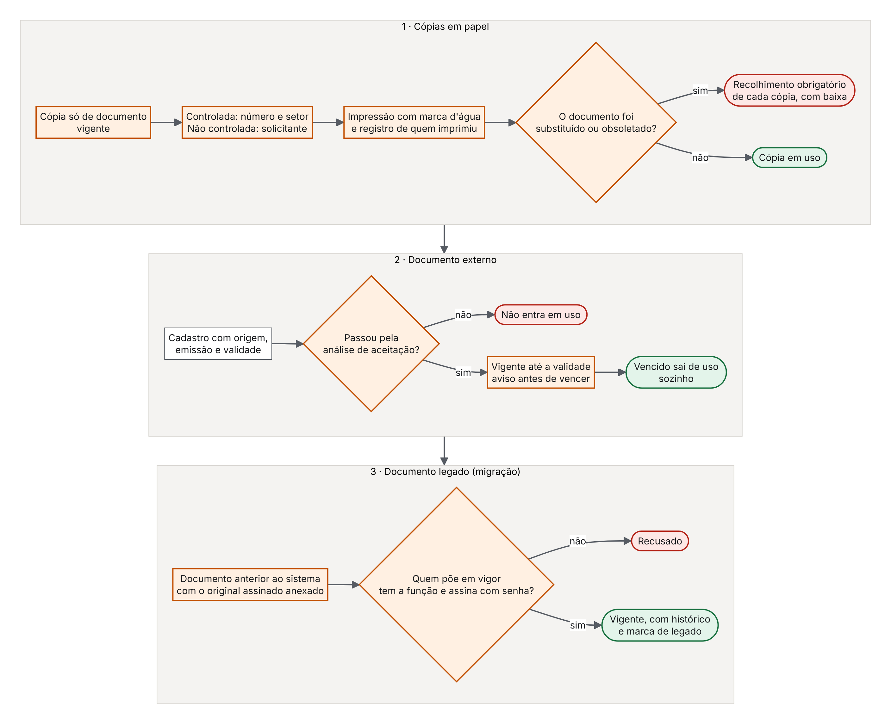
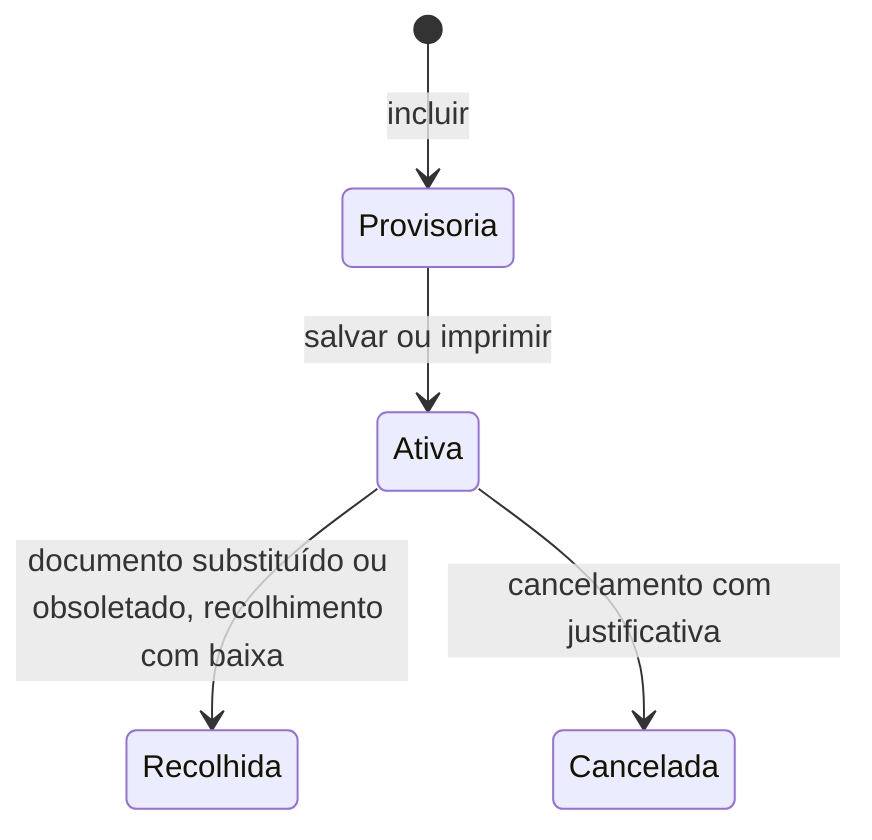

# Passo 3, fluxo 12b: cópias em papel, documento externo e documento legado (Controle de Documentos)

*Como ler: **laranja** = o sistema confere (trava); **vermelho** = bloqueio; **verde** = resultado. Clique na imagem para ampliar.*

*Coluna "Onde no sistema": o caminho no sistema atual (legado), no formato **Módulo › Menu › Tela**. Os nomes de menu seguem as pastas de menu do inventário de telas do módulo. Onde diz "tela nova", a tela não existe hoje e será criada.*

**Análise de 19/11/2026. Rascunho para validação do responsável.** Segunda parte da ficha 12 do passo 3 (a outra é o [ciclo do documento](fluxo-12a-ciclo-do-documento.md)). Reúne **três caminhos que saem do ciclo**: a **cópia em papel** do documento vigente, o **documento externo** (norma, bula de fornecedor) e o **documento legado** (anterior ao sistema). Os três precisam da **mesma trava**: o que está em uso é o que está **vigente e dentro da validade**.

**Fontes (todas no repositório do legado):** os fluxos "Controle de cópias" e "Documento externo e legado" (`6.controle_documento/fluxos/controle-copias.md` e `externo-legado.md`, lidos do código) e os resultados dos testes de tela (rodadas de 23/10 e 03/11/2026; casos `CT-DOC-020` a `037`; achados `DV-DOC-009`, `010`, `011`, `012`, `015`, `016`, `017`, `018`, `019`, `024`). **O que não fiz:** não li as telas uma a uma. A **marca d'água** não pôde ser verificada (a impressão da cópia devolveu arquivo vazio) e **o acesso pelo endereço** não foi testado (decisão do responsável).

## 1. O caminho, em uma linha
**Cópia:** só de documento **vigente** → numerada (controlada) ou sem número (não controlada) → **impressa com marca d'água** e registro → **recolhida** quando o documento é substituído ou obsoletado.
**Externo:** cadastro → **análise de aceitação** → vigente até a validade, com aviso.
**Legado:** cadastro com o **original assinado** → vigência por **quem tem a função, com senha**.

### A situação da cópia

No legado a cópia só tinha **provisória** e **ativa**, **sem recolhimento, sem cancelamento e sem rastro de remoção** (`DV-DOC-018`, `019`). No iLabs a cópia tem **situação guardada pelo banco**, e **substituir ou obsoletar o documento abre o recolhimento de cada cópia**.

## 2. Etapa a etapa

| # | Etapa | Onde no sistema (legado) | Quem faz | Exige antes | O que entra | O banco garante (iLabs) | Falha do legado |
|---|---|---|---|---|---|---|---|
| 1 | **Pedir cópias** | **Controle de Documentos** › Cópias › Controle de Cópias | Qualidade documental | Documento **vigente** com anexo final | Tipo da cópia (controlada ou não), setor ou solicitante, quantidade | Só **documento vigente**; a controlada recebe **o número seguinte**, a não controlada fica **sem número**; **cada inclusão fica no histórico**, com quem incluiu | **As cópias foram numeradas e o log trouxe o usuário certo** (`CT-DOC-020` passou); mas a lista **também oferecia documento aprovado e ainda não vigente**, e uma cópia foi gravada para ele (`DV-DOC-017`, `CT-DOC-024`); o filtro **não lista nem imprime** cópia de substituído ou obsoleto (`CT-DOC-023` passou) |
| 2 | **Imprimir a cópia** | Mesma tela (Imprimir Selecionados) | Qualidade documental | Cópia ativa | — | A impressão leva **número, setor, "cópia controlada" e marca d'água**; registra **quem imprimiu, quando e para quem**; **recusa documento que não é vigente** | A impressão disse **"Salvo com sucesso!" e abriu uma aba em branco** (resposta de 0 byte, sem arquivo), então a **marca d'água não foi verificada** (`DV-DOC-016`, `CT-DOC-021` falhou, reproduzido na rodada 3); pelo código, a marca d'água **existe e não é usada** e a impressão **não confere a situação** |
| 3 | **Recolher a cópia** | Não existe no legado (tela nova) | Qualidade documental e setor | Documento substituído ou obsoletado | Confirmação do setor, data e quem recebeu | **Substituir ou obsoletar o documento abre o recolhimento** de cada cópia ativa, com **aviso ao setor** e **baixa assinada**; sem baixa, o documento continua **pendente** | **Não existe**: a nova revisão entrou em vigor e **nenhum aviso, tarefa ou pedido de recolhimento** apareceu; a cópia da revisão antiga **deixou de ser listada e não há como recolher** (`DV-DOC-018`, `CT-DOC-025` falhou) |
| 4 | **Remover ou cancelar uma cópia** | Mesma tela | Qualidade documental | Cópia ativa | Justificativa | **Justificativa obrigatória** e histórico | **A tela não tem comando de remover**; cada cópia é **gravada ao adicionar**, sem como desfazer (`DV-DOC-019`, `CT-DOC-022`) |
| 5 | **Cadastrar o documento externo** | **Controle de Documentos** › Externo e Legado › Documento Externo | Qualidade documental | Empresa de origem (pessoa jurídica), tipo | Código, título, origem, revisão, tipo, setor, aplicações, arquivo, **emissão e validade**, situação | O **código não se repete**; **análise de aceitação** antes de pôr em uso; **validade obrigatória**; a **validade vencida impede o uso**; **aviso antes de vencer** | O código repetido **foi recusado** e a validade em branco **também** (`CT-DOC-030`, `031`); porém **a situação Vigente era escolhida direto, sem análise, sem senha e sem assinante** (`DV-DOC-009`, `CT-DOC-032` falhou); um externo **já vencido há 660 dias foi aceito como vigente** (`DV-DOC-010`) |
| 6 | **Consultar e relatar o externo** | Mesma tela (lista e relatório) | Todos | — | — | **Dias a vencer** na lista e no relatório; **vencido sai de uso** | A lista trazia os dias (731 e **-660**), mas o **relatório não gerava** (erro do servidor, `DV-DOC-015`, `CT-DOC-033`); nada avisava nem bloqueava no vencimento |
| 7 | **Excluir o externo** | Mesma tela | Qualidade documental | — | Justificativa | **Justificativa obrigatória** e **histórico consultável** | A justificativa foi pedida, mas o externo **sumiu de todas as listas** e o **log não pôde ser consultado** (`DV-DOC-024`, `CT-DOC-034`) |
| 8 | **Cadastrar o documento legado** | **Controle de Documentos** › Externo e Legado › Documento Legado | Qualidade documental | Documento anterior ao sistema | Dados do documento, **análise, pré-aprovação, aprovação e vigência** (quem e quando) | Só **quem tem a função** põe em vigor, **com senha** e **assinatura**; exige o **original assinado anexado**; fica **marcado como legado**; **grava no histórico** | Os nomes **são escolhidos entre usuários cadastrados** (não digitados livremente) e a aprovação igual à pré-aprovação é recusada, mas **"Tornar Vigente" não pedia senha e ficava fora do histórico do documento** (`DV-DOC-011`, `CT-DOC-035` falhou); o legado **salvo e abandonado ficava parado** (`DV-DOC-012`); o usuário sem função foi barrado **na entrada** (`CT-DOC-036`) |
| 9 | **Visualizar o documento em uso** | **Controle de Documentos** › Documento › Visualizar Documento | Todos | — | — | Só **vigente** e **da aplicação do usuário**; **substituído e obsoleto não abrem** | **Funcionou**: a lista só trouxe vigentes da aplicação do usuário; o de outro setor viu a lista vazia (`CT-DOC-037` passou) |

## 3. O que este fluxo exige de cada cadastro global

| Cadastro (passo 1) | O que o fluxo precisa que ele guarde |
|---|---|
| **Tipo de documento** | **Validade** e **aviso** de vencimento; se aceita **cópia controlada**; prazo de revisão |
| **Estrutura organizacional (setor)** | Setor que **recebe a cópia** e **responsável pelo recolhimento** |
| **Pessoa jurídica** | **Origem** do documento externo (fabricante, órgão, fornecedor) |
| **Profissional e função** | Quem **imprime**, **recolhe**, **aceita o externo** e **põe o legado em vigor** |
| **Notificações (serviço comum)** | **Aviso** de recolhimento pendente e de documento externo a vencer |
| **Documento (ficha 12a)** | Só o **vigente** gera cópia; a **substituição ou obsolescência** abre o recolhimento |

## 4. Os registros que nascem no fluxo (não são cadastros)
Cópia controlada e não controlada · impressão da cópia · recolhimento da cópia · documento externo · análise de aceitação do externo · documento legado · histórico.

## 5. O que muda nos documentos anteriores
- **Roteiro de implantação:** na etapa 3 (estrutura), o **setor que recebe cópia**; na etapa 7, o **tipo de documento com validade e aviso**, e a **carga dos documentos legados** com **original assinado anexado**; na etapa 9, o ensaio inclui **uma cópia controlada até o recolhimento**, **um documento externo vencido** (sai de uso) e **um legado posto em vigor com assinatura**.
- **Passo 2 (ordem):** pessoa jurídica (origem) vem **antes** do primeiro documento externo; o **legado** entra **antes** do primeiro documento novo do mesmo tipo (para o código e a revisão seguirem a sequência).
- **Ficha 12a:** a obsolescência e a substituição passam a **abrir o recolhimento** das cópias.

## 6. Pontos a validar com a área (não consegui tirar do código)
1. **Cópias em papel:** a empresa ainda distribui cópia em papel, ou todo uso é pela tela? Se distribui, **quem recolhe** e como comprova?
2. **Marca d'água:** o texto "Cópia controlada, impressão não autorizada" é o desejado? Vale para a **cópia não controlada**?
3. **Documento externo:** precisa de **análise de aceitação** antes do uso? Quem faz? Quais externos entram (normas, bulas, certificados)?
4. **Documento legado:** a carga dos documentos **anteriores ao sistema** é **uma só vez**, na implantação? Depois, a tela deve **fechar**? O **original assinado** fica anexado?
5. **Quem põe em vigor o legado:** só a Qualidade? Com senha?
6. **Arquivos e Modelos (ciclo básico, fora do menu):** a empresa usa? Se usa, quais tipos? (O código põe o documento **em vigor ao salvar** e **tira o anterior de uso** ao criar a nova revisão.)
