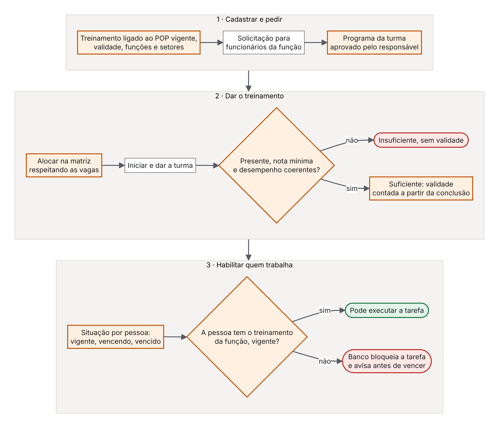
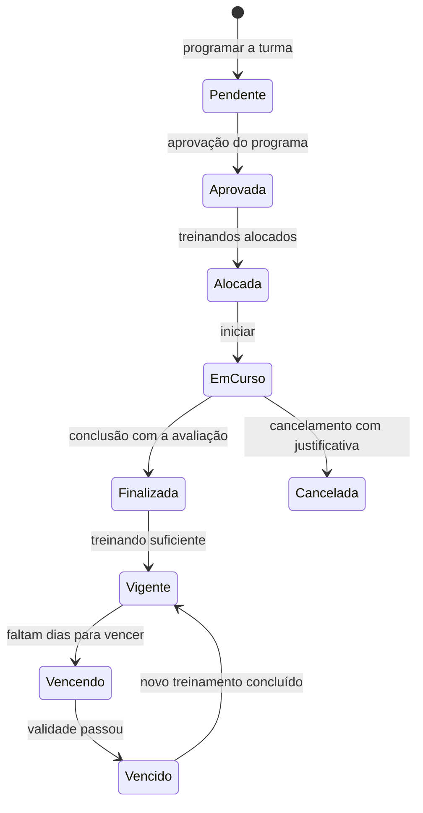

# Passo 3, fluxo 13a: treinar e habilitar quem executa a tarefa (treinamento técnico, Garantia da Qualidade)

*Como ler: **laranja** = o sistema confere (trava); **vermelho** = bloqueio; **verde** = resultado. Clique na imagem para ampliar.*

*Coluna "Onde no sistema": o caminho no sistema atual (legado), no formato **Módulo › Menu › Tela**. Onde diz "tela nova", a tela não existe hoje e será criada.*

> **Em uma frase:** Garantir que **quem executa uma tarefa foi treinado nela** (e que o treinamento ainda vale), e registrar isso.
>
> **Exemplo do dia a dia (ilustrativo, os números são inventados):** Antes de operar a máquina de encher frascos, a pessoa faz um treinamento, tira nota e o sistema registra a validade. Vencido: não opera.
>
> **Por que importa:** Pessoa sem treinamento fazendo a tarefa é um risco de qualidade e de fiscalização.
>
> *Palavra que não conhece? Veja a documento "Glossário" (grupo "Para começar" da lista do estudo).*

**Análise de 20/11/2026. Rascunho para validação do responsável.** Primeira das cinco fichas da Garantia da Qualidade (a ficha 13 se divide em 13a treinamento, 13b desvios e CAPA, 13c mudanças, 13d autoinspeção e 13e assuntos regulatórios). O treinamento liga o **documento vigente** ([ficha 12a](fluxo-12a-ciclo-do-documento.md)) à **pessoa e à função** ([funções do profissional](funcoes-do-profissional.md)): é o que diz **quem pode executar cada tarefa**. O legado tem o fluxo mais completo da GQ, mas **o treinamento não habilita nem bloqueia ninguém**.

**Fontes (todas no repositório do legado):** o fluxo "Treinamento" (`5.garantia_qualidade/fluxos/treinamento.md`, lido do código) e os resultados dos testes de tela da GQ (rodadas de 15/10, 23/10 e 26/10/2026; casos `CT-GQ-070` a `083`; achados `DV-GQ-013`, `300`, `301`, `303`, `305`, `311`, `312`, `313`, `314`, `315`, `316`, `317`, `320`, `321`, `326`). **O que não fiz:** não li as telas uma a uma. O **dia seguinte** (o treinamento de 1 dia vencer) foi repetido em 24/10; o efeito sobre a **Produção e o Estoque** foi visto só pelo que a tela mostra. O elo com o **Controle de Documentos** vem **do código**, porque a tela de vigência não foi exercitada com turma insuficiente.

## 1. O caminho, em uma linha
**Cadastro do treinamento** (POP, validade, funções, setores) → **solicitação** para os funcionários → **programação** da turma, **aprovada** → **matriz** (alocar e iniciar) → **conclusão** com presença, nota e desempenho → **situação por pessoa** (vigente, vencendo, vencido) → **só quem está vigente executa a tarefa**.

### A situação da programação e da pessoa

No legado a programação ia de pendente a finalizado **sem aprovação** do programa, e a **situação da pessoa era calculada só no relatório**, sem aviso. No iLabs a situação da pessoa é **guardada e conferida pelo banco**, e **vencido ou pendente bloqueia a tarefa**.

## 2. Etapa a etapa

| # | Etapa | Onde no sistema (legado) | Quem faz | Exige antes | O que entra | O banco garante (iLabs) | Falha do legado |
|---|---|---|---|---|---|---|---|
| 1 | **Cadastrar tipo, motivo e o treinamento** | **Garantia da Qualidade** › Treinamento Técnico › Tipo de Treinamento, Motivo de Treinamento, Cadastro de Treinamento | Qualidade | **Documento (POP) vigente**; funções e setores cadastrados | Tipo, POP e revisão, nome, setor responsável, origem (interna ou externa, com instituição e CNPJ), **obrigatório**, **validade**, funções e setores | O treinamento **liga ao POP vigente**; externo **exige instituição e CNPJ**; **não se exclui** com programação ou solicitação; exclusão **com histórico** | O externo sem instituição e sem CNPJ **foi recusado** e a validade de 1 dia **foi aceita** (`CT-GQ-070`, `071`); a função **não podia ser retirada depois** (`DV-GQ-325`); a **exclusão pedia justificativa e sumia sem rastro**, e o Log não abria (`DV-GQ-313`, `CT-GQ-083`); o nome com **apóstrofo** gravava e a lista dava erro (`DV-GQ-308`) |
| 2 | **Solicitar treinamento** | **Garantia da Qualidade** › Treinamento Técnico › Solicitação de Treinamento | Chefia do setor | Treinamento cadastrado | Treinamento, motivo, **funcionários** | **Só funcionário da função e do setor**; nasce Pendente, com histórico; cancelar **grava histórico** | A recusa **sem funcionário funcionou** (`CT-GQ-072`); o **cancelamento não aparecia no Log** e a situação da solicitação **não acompanhava a turma** (`DV-GQ-313`, `314`) |
| 3 | **Programar a turma** | **Garantia da Qualidade** › Treinamento Técnico › Programação de Treinamento | Qualidade | Treinamento cadastrado | Versão, local, período, turno, horário, custo, **instrutores**, recursos, máximo de treinandos | **Aprovação do programa** pelo responsável da Produção ou do CQ; datas coerentes (fim depois do início, horário final depois do inicial); máximo **maior que um** | A programação **não tinha aprovação** (`DV-GQ-322`, `CT-GQ-074`); aceitava **máximo 1**, **fim antes do início** e **horário final antes do inicial** (`DV-GQ-311`, `312`); **não salvava** na primeira rodada, com "Ocorreu um erro inesperado." (`DV-GQ-013`); nome com **aspas duplas** dava erro (`DV-GQ-309`) |
| 4 | **Alocar na matriz e iniciar** | **Garantia da Qualidade** › Treinamento Técnico › Matriz de Treinamento | Qualidade | Programação | Treinandos vindos das solicitações ou **avulsos** | **Respeita as vagas**; só **funcionário ativo com setor**; Log da alocação e da mudança de situação | Pendente, Alocado e Em Curso **funcionaram, com Log** (`CT-GQ-074`); o **avulso ignorava as vagas** (2 alocados para máximo 1) (`DV-GQ-315`); um avulso **sem setor** derrubava depois o acompanhamento com **erro 500** (`DV-GQ-316`) |
| 5 | **Concluir com a avaliação** | **Garantia da Qualidade** › Treinamento Técnico › Conclusão do Treinamento | Instrutor | Turma em curso | Data de conclusão, **avaliação do instrutor**, presença, **nota** e **desempenho** de cada treinando, certificado | **Nota mínima** definida; **ausente não pode ser suficiente**; **desempenho vem da nota e da presença**, não escolhido à mão; **só o instrutor designado** conclui; a conclusão fica **assinada** | O ausente **ficava com nota e desempenho desabilitados** na tela, mas, **preenchendo antes e marcando "Não" depois, concluía como "Suficiente"**, e o relatório saía "NÃO / Suficiente" (`DV-GQ-301`, `CT-GQ-076` falhou); **nota 11 e 10,5 aceitas**, e nota 8 com "Insuficiente" (`DV-GQ-305`); o **tipo de avaliação nem existe na tela** (`CT-GQ-077`); o **Log da conclusão existia** (`CT-GQ-078`); o **ícone Editar só aparecia para o instrutor pelo nome** (`DV-GQ-302`); **cancelar a turma** deixava todos insuficientes (`DV-GQ-304`) |
| 6 | **Calcular a validade** | Automático, ao concluir | Automático | Treinando suficiente | Nada | A validade **conta da data da conclusão do treinando**, pelo prazo do treinamento; **só quem ficou suficiente** a recebe | O vencimento era **da turma**, calculado até para a turma **100% insuficiente** (leitura do código e `CT-GQ-081`) |
| 7 | **Acompanhar quem está vigente, vencendo e vencido** | **Garantia da Qualidade** › Treinamento Técnico › Acompanhamento dos Treinamentos | Qualidade e chefias | Treinamento ligado a função | — | **Uma linha por pessoa e treinamento**; situação **guardada pelo banco**; **aviso antes de vencer** | Com treinamento **ligado a uma função**, a consulta dava **HTTP 500** e a tela dizia "A pesquisa não retornou nenhum resultado." (`DV-GQ-300`, `CT-GQ-079` falhou); sem função, mostrava **uma linha por pessoa e por turma**, inclusive turma que a pessoa não fez (`DV-GQ-317`); **nenhum aviso** de vencimento; o **dia seguinte** foi repetido em 24/10, sem aviso |
| 8 | **Habilitar ou bloquear a tarefa** | Não existe no legado (tela nova); hoje nenhum módulo consulta | Automático | Treinamento obrigatório da função | — | **Quem tem o treinamento obrigatório vencido ou pendente não executa** a tarefa da função (Produção, Estoque, CQ); **o banco recusa**, com o motivo | **Não existe**: o papel Administrador, com o treinamento obrigatório **Pendente**, abriu o Estoque e a Produção **sem aviso e sem bloqueio**; o código desses módulos **não cita treinamento** (`DV-GQ-320`, `CT-GQ-080` falhou) |
| 9 | **Liberar o documento só com treinamento efetivo** | **Controle de Documentos** › Documento › Vigência de Documento (consulta à GQ) | Automático | Documento aprovado | — | O documento entra em vigor quando **as pessoas da função** estão **treinadas e suficientes**, não só quando existe uma turma concluída | O Controle de Documentos só olhava se **havia uma turma "Concluído"**, sem ver **quantos foram aprovados**: uma turma toda insuficiente também liberava (`DV-GQ-321`, `CT-GQ-081`, pelo código); na tela de vigência o botão ficava escondido sem treinamento concluído (ficha 12a) |

## 3. O que este fluxo exige de cada cadastro global

| Cadastro (passo 1) | O que o fluxo precisa que ele guarde |
|---|---|
| **Documento (POP)** | **Documento vigente**, com revisão; o treinamento muda quando o POP muda |
| **Funções profissionais** | A função que **exige** o treinamento; a lista de **tarefas** da função (ver [funções do profissional](funcoes-do-profissional.md)) |
| **Profissional** | Setor, função **com validade e área** e **situação do treinamento por pessoa** |
| **Estrutura organizacional** | **Setores** que precisam do treinamento |
| **Pessoa jurídica** | **Instituição externa** (nome e CNPJ) quando o treinamento é externo |
| **Tipo e motivo de treinamento** | Listas de apoio, com **ativo e inativo** e histórico |
| **Instrutor** | Quem pode **concluir** a turma (profissional com a função de instrutor) |
| **Nota mínima e prazo** | **Parâmetro** da nota mínima e do aviso de vencimento |
| **Notificações (serviço comum)** | Aviso de **treinamento vencendo** e de **documento novo que exige treinamento** |

## 4. Os registros que nascem no fluxo (não são cadastros)
Solicitação de treinamento · programação da turma e aprovação · alocação na matriz · conclusão (presença, nota, desempenho) · certificado · validade por pessoa · situação do treinamento por pessoa · histórico.

## 5. O que muda nos documentos anteriores
- **Roteiro de implantação:** na etapa 1, a função **instrutor** e as funções que **exigem** treinamento; na etapa 7, o **cadastro de treinamento** de cada POP, com a nota mínima e o prazo; na etapa 9, o ensaio inclui **uma turma com um ausente** (recusado como suficiente), **um treinamento vencido** (bloqueia a tarefa) e **um documento novo que exige treinamento** (só entra em vigor com a turma suficiente).
- **Passo 2 (ordem):** documento vigente, função e setor vêm **antes** do cadastro de treinamento.
- **Ficha 12a (documentos):** a vigência passa a conferir **as pessoas treinadas e suficientes**, não só a existência de uma turma.
- **Funções do profissional:** o **treinamento** passa a ser **condição** da função: quem não tem o treinamento vigente não exerce as tarefas dela.

## 6. Pontos a validar com a área (não consegui tirar do código)
1. **Nota mínima:** qual a nota que torna o treinando "suficiente"? A mesma para todos os treinamentos, ou por tipo?
2. **Bloqueio da tarefa:** o treinamento vencido ou pendente **bloqueia** a tarefa, ou só **avisa**? Há exceções (supervisão, tarefa urgente)?
3. **Aviso de vencimento:** com quantos dias de antecedência, e para quem (a pessoa, a chefia, a Qualidade)?
4. **Programa de treinamento:** quem **aprova** o programa (responsável da Produção, do CQ, da Qualidade)?
5. **Treinamento externo:** o certificado externo substitui a avaliação interna? Quem confere a instituição?
6. **POP novo:** o treinamento é **obrigatório antes** de o documento entrar em vigor, ou pode ocorrer **depois**, com prazo?
7. **Instrutor:** qualquer profissional pode ser instrutor? É conferido por função ou por designação em cada turma (hoje, pelo nome)?
