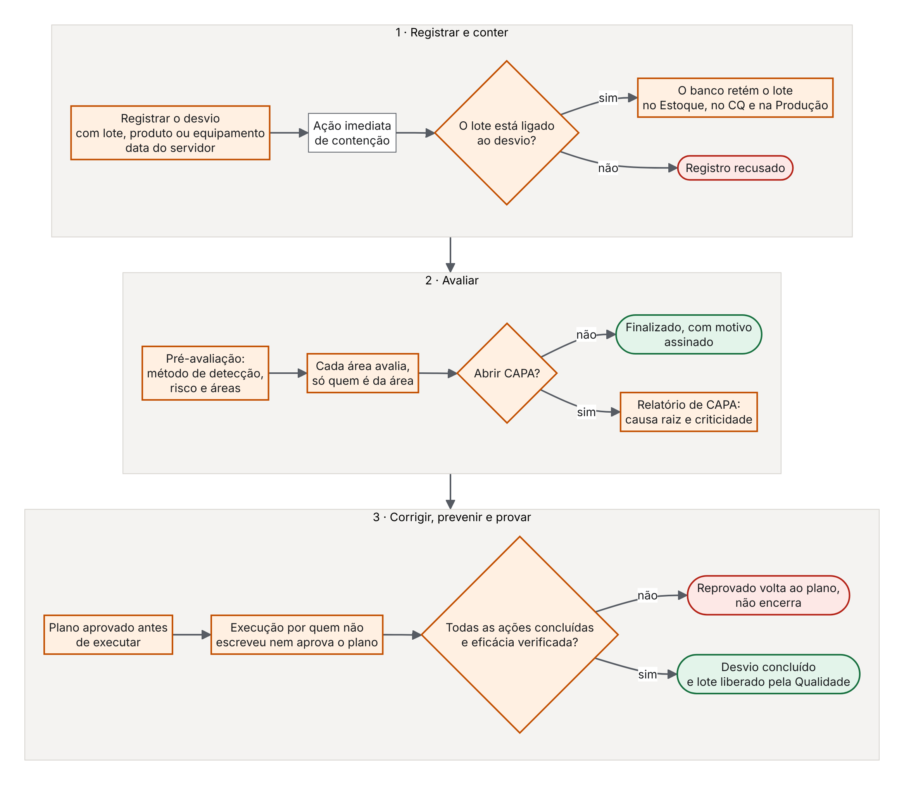
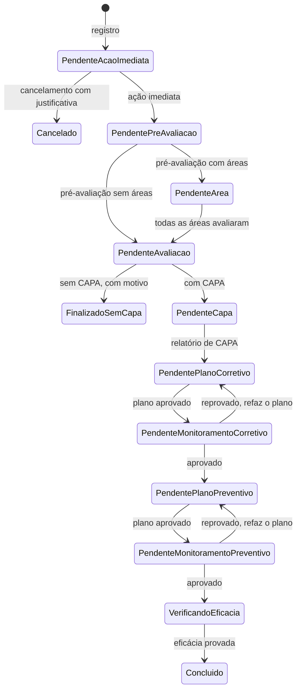

# Passo 3, fluxo 13b: o desvio até a ação corretiva e preventiva provadas (desvios e CAPA, Garantia da Qualidade)

*Como ler: **laranja** = o sistema confere (trava); **vermelho** = bloqueio; **verde** = resultado. Clique na imagem para ampliar.*

*Coluna "Onde no sistema": o caminho no sistema atual (legado), no formato **Módulo › Menu › Tela**. Onde diz "tela nova", a tela não existe hoje e será criada.*

> **Em uma frase:** Quando **algo sai do combinado** (um desvio), a empresa registra, investiga a causa verdadeira, corrige e **prova que não volta a acontecer**.
>
> **Exemplo do dia a dia (ilustrativo, os números são inventados):** A máquina esquentou além do limite. Registra-se, descobre-se que o sensor estava sem calibrar, calibra-se e cria-se uma rotina para não repetir.
>
> **Por que importa:** Se o problema é só 'arrumado' e não investigado, ele volta, e o lote pode ter saído com defeito.
>
> *Palavra que não conhece? Veja a aba "24 · Glossário" desta página.*

**Análise de 20/11/2026. Rascunho para validação do responsável.** Segunda das cinco fichas da Garantia da Qualidade (a [13a](fluxo-13a-treinamento.md) foi o treinamento). É o fluxo em que **um problema vira ação corretiva e preventiva com prova de que funcionou**. É também o fluxo que **deveria reter o lote**: o desvio com lote aberto não pode deixar o lote seguir ([ficha 4](fluxo-04-reprovado-reanalise-revalidacao.md), [ficha 6](fluxo-06-solicitacao-separacao-atendimento.md)).

**Fontes (todas no repositório do legado):** o fluxo "Desvios e CAPA" (`5.garantia_qualidade/fluxos/desvios-capa.md`, lido do código) e os resultados dos testes de tela da GQ (rodadas de 12 a 22/10 e 11/11/2026; casos `CT-GQ-001` a `026`; achados `DV-GQ-001`, `002`, `010`, `012`, `016`, `017`, `019`, `020`, `021`, `022`, `023`, `025`, `030`, `036`, `039`, `041`, `042`, `044`, `046`, `047`, `057`, `062`, `078`, `082`, `083`, `086`, `099`). **O que não fiz:** não li as telas uma a uma. O **efeito do desvio sobre o lote** não pôde ser testado (a busca de produto e de material não devolvia nada, `DV-GQ-010`). Quem pode fazer cada etapa por Nível está na [matriz de Níveis](funcoes-do-profissional.md) (seção 6.3 e 6.4).

## 1. O caminho, em uma linha
**Registro** (com lote) → **ação imediata** (contenção) → **pré-avaliação** (método, áreas) → **avaliação por área** → **avaliação do relatório** (abrir CAPA ou finalizar) → **relatório de CAPA** (causa raiz) → **plano corretivo** → **execução** → **monitoramento** (aprova ou reprova) → **plano preventivo** → **monitoramento** → **concluído**, com a **eficácia** provada.

### A situação do desvio

No legado, **reprovar o plano corretivo não era possível** (só havia o botão Aprovar), o preventivo **concluía o desvio mesmo "não implementado"**, e **nenhuma etapa verificava a eficácia**. No iLabs a situação do desvio é **uma só, guardada e conferida pelo banco**, **reprovar volta ao plano** e **só a eficácia provada conclui**.

## 2. Etapa a etapa

| # | Etapa | Onde no sistema (legado) | Quem faz | Exige antes | O que entra | O banco garante (iLabs) | Falha do legado |
|---|---|---|---|---|---|---|---|
| 1 | **Registrar o desvio** | **Garantia da Qualidade** › Controle de Desvios › Relatório de Desvios | Qualquer área | Lote, produto ou equipamento cadastrado | Descrição, local, **item e lote**, anexo | **Número sequencial por ano**; **data e hora do servidor**; **o lote fica ligado ao desvio**; edição **só até a ação imediata**, com **justificativa** e histórico; cancelamento **com justificativa e histórico** | A descrição e o local eram exigidos, uma mensagem por vez (`CT-GQ-001`); **a busca de produto e de material não devolvia nada**, só o equipamento, e o desvio **salvava sem item** (`DV-GQ-010`, `CT-GQ-014` bloqueado); escolher material ou produto **escondia o botão Salvar** (`DV-GQ-062`); a **data do navegador era gravada** (`DV-GQ-039`, `019`; o teste de 12/10 viu a data do dia, os de 21 e 22/10 viram a data enviada gravada: **reconfirmar**); **cancelar pela tela do relatório não deixava histórico** (`DV-GQ-001`, `CT-GQ-006` falhou), mas **pela tela da ação imediata deixava** (`CT-GQ-007` passou); um **apóstrofo na descrição esvaziava a lista** (`DV-GQ-017`) |
| 2 | **Conter (ação imediata)** | **Garantia da Qualidade** › Controle de Desvios › Registro Ação Corretiva Imediata | Área do desvio | Desvio registrado | Descrição da ação imediata, data e hora | A **contenção inclui o lote** (bloqueio ou aviso); data **do servidor**; **uma gravação por vez** (sem sobrescrever) | A descrição obrigatória e a passagem para a pré-avaliação **funcionaram** (`CT-GQ-008`); a data vinha do navegador (`DV-GQ-019`); **duas janelas salvavam ações diferentes e só a última ficava** (`DV-GQ-057`) |
| 3 | **Pré-avaliar** | **Garantia da Qualidade** › Controle de Desvios › Pré Avaliação Relatório Desvios | Garantia da Qualidade | Ação imediata registrada | **Método de detecção**, observação do chefe da GQ, **áreas envolvidas**, **classificação de risco** | Método **obrigatório** (com texto se "outros"); **risco classificado já aqui**; sem áreas, **segue direto**; com áreas, **espera cada uma** | O método "Outros" sem texto foi recusado e as duas áreas levaram a "Pendente Responsável Área" (`CT-GQ-009`, `010` passaram); **não havia classificação de risco** nesta etapa (só a criticidade no CAPA) |
| 4 | **Avaliar por área** | **Garantia da Qualidade** › Controle de Desvios › Avaliação Área | Cada área envolvida | Pré-avaliação com áreas | **Parecer** de cada área | **Só quem é da área** avalia (conferido **na gravação**); parecer **obrigatório e com conteúdo**; **fica no histórico**; salvar ao mesmo tempo **não trava** o desvio | A observação obrigatória e a passagem quando **todas** avaliaram **funcionaram** (`CT-GQ-012`, `013`); **só espaços era aceito** (`DV-GQ-041`); **a avaliação não deixava histórico** (`DV-GQ-042`); **duas áreas salvando juntas deixavam o desvio parado** (`DV-GQ-083`); o sistema **não conferia de novo** se o usuário era da área, ao salvar (leitura do código) |
| 5 | **Decidir sobre a CAPA** | **Garantia da Qualidade** › Controle de Desvios › Avaliação Relatório Desvios | Garantia da Qualidade | Todas as áreas avaliaram | Avaliação, observação do chefe, **necessário abrir CAPA** (sim ou não, com motivo) | Sem CAPA, **motivo com conteúdo**, assinado; com CAPA, **segue**; **a necessidade de mudança abre a solicitação de mudança** (ficha 13c) | As recusas e as duas saídas **funcionaram** (`CT-GQ-015`, `016`); a decisão de **não abrir CAPA** aceitava **só espaços** (`DV-GQ-044`); a marcação de **controle de mudança não abria nenhuma solicitação** (`CT-GQ-016`: a busca ficou vazia) |
| 6 | **Escrever o relatório de CAPA** | **Garantia da Qualidade** › Controle de Desvios › Relatório de CAPA | Garantia da Qualidade | Decisão de abrir CAPA | **Diagrama de causa e efeito** (7 campos), impacto, **criticidade** (crítico, maior, menor), divisões participantes | **Causa raiz obrigatória**; **erro humano só com justificativa**; criticidade **obrigatória**; impressão **sem erro** | O diagrama completo e a divisão foram exigidos (`CT-GQ-017`); **imprimir o CAPA dava página de erro** (`DV-GQ-018`, `086`: a impressão saía com mensagem de erro no lugar da avaliação); **não havia campo** para justificar erro humano |
| 7 | **Planejar e executar a ação corretiva** | **Garantia da Qualidade** › Controle de Desvios › Plano de Ação Corretiva, Execução do Plano de Ação Corretiva | Garantia da Qualidade (nível 3) e responsáveis | Relatório de CAPA | Ações: descrição, **responsável**, **prazo**; execução: data de conclusão | **Plano com ao menos uma ação**; **aprovação do plano antes de executar**; execução **por quem não escreveu o plano**; **prazo vencido exige justificativa** | O plano **era aceito sem nenhuma ação** (`DV-GQ-020`); o desvio ia **direto** a "Pendente Monitoramento", **sem aprovar o plano** (`CT-GQ-019`); a **data futura foi recusada** (`CT-GQ-020`), mas a **conclusão com prazo vencido era aceita sem aviso** (`DV-GQ-025`) |
| 8 | **Monitorar o plano corretivo** | **Garantia da Qualidade** › Controle de Desvios › Monitoramento do Plano de Ação Corretiva | Garantia da Qualidade (nível 3) | Ações executadas | Verificação final, resultado por ação, **aprovar ou reprovar** | **Só aprova com todas as ações concluídas e implementadas**; **reprovar volta ao plano**; assinatura de **quem não escreveu** o plano | Aprovava **com ação pendente**, quando a operação chegava sem o botão (`DV-GQ-002`, `CT-GQ-021` falhou), **com "Implementada = Não"**, **com ação inexistente** e **com plano sem ações** (`DV-GQ-021`); **só havia o botão Aprovar**: o estado "reprovado" **nunca era alcançado** (`DV-GQ-016`, `CT-GQ-022`) |
| 9 | **Planejar, executar e monitorar a ação preventiva** | **Garantia da Qualidade** › Controle de Desvios › Plano de Ação Preventiva, Execução Plano de Ação Preventiva, Monitoramento do Plano de Ação Preventiva | Garantia da Qualidade (nível 3) e responsáveis | Plano corretivo aprovado | As mesmas do corretivo | As mesmas travas; **só conclui com a eficácia provada**; **reprovar volta ao plano**; **separação de funções** | Sem botão **Reprovar**: com a ação "não implementada" o desvio **era finalizado** (`DV-GQ-012`, `CT-GQ-023` falhou); finalizava **sem resultado e sem verificação final** (`DV-GQ-022`) e **com ação pendente** (`DV-GQ-046`), e **respondendo NÃO à confirmação** (`DV-GQ-078`); **salvar e finalizar não deixavam registro** (`DV-GQ-047`); **a mesma pessoa escrevia o plano, executava a ação e aprovava** (`DV-GQ-023`, `CT-GQ-024`) |
| 10 | **Reter e liberar o lote** | Não existe no legado (tela nova); hoje, nenhum módulo consulta o desvio | Automático e Qualidade | Desvio com lote | — | **Desvio aberto com lote retém o lote** no Estoque, no CQ e na Produção; **só a Qualidade o libera**, com assinatura, **depois da contenção ou da conclusão**; a investigação **alcança outros lotes** | **Não existe**: os lotes eram **copiados como texto** e nada era bloqueado ou sinalizado nos outros módulos (leitura do código); **o efeito não pôde ser testado** (`CT-GQ-014`, `DV-GQ-010`); a **auditoria finalizada "não conforme" também não abria desvio** (`DV-GQ-099`) |
| 11 | **Acompanhar e relatar** | **Garantia da Qualidade** › Controle de Desvios › Acompanhamento RD, Controle de Emissão de RNC | Garantia da Qualidade | — | Período e situação | Relatório **por causa, área e produto** (tendência); **exige entrada no sistema**; **todos os desvios aparecem**, inclusive cancelados | O **Acompanhamento RD abria sem entrar no sistema** (`CT-GQ-026` falhou; a impressão respondia "Usuário não encontrado"); o **Controle de Emissão de RNC deixava de fora cancelados e não pré-avaliados**, sem marcar a lacuna (`DV-GQ-030`, `082`); o **histórico do desvio não guardava o conteúdo** das avaliações, da ação imediata, do plano e dos resultados (`DV-GQ-036`) |

## 3. O que este fluxo exige de cada cadastro global

| Cadastro (passo 1) | O que o fluxo precisa que ele guarde |
|---|---|
| **Material, produto e lote** | O **lote** que o desvio atinge (busca funcionando) e a **situação do lote** que o desvio altera (retido) |
| **Equipamento** | O equipamento do desvio, com **última calibração** e **situação** |
| **Estrutura organizacional (áreas)** | Áreas, com **responsáveis cadastrados** (o CAPA exige) |
| **Profissional e função** | **Quem registra, pré-avalia, avalia, planeja, executa, monitora e libera o lote**: funções **separadas** |
| **Método de detecção, tipo de item e criticidade** | **Listas de apoio** do desvio |
| **Grupo de perfil (Níveis)** | Quem faz o quê por Nível ([matriz de Níveis](funcoes-do-profissional.md)), com **conferência na gravação** |
| **Notificações (serviço comum)** | **Aviso** de desvio pendente, de prazo de ação vencendo e de eficácia a verificar |
| **Mudança (ficha 13c)** | A decisão de abrir **controle de mudança** gera a solicitação |

## 4. Os registros que nascem no fluxo (não são cadastros)
Relatório de desvio · ação imediata · pré-avaliação · avaliação por área · avaliação do relatório · relatório de CAPA · planos corretivo e preventivo e suas ações · execução · monitoramento · retenção do lote · verificação de eficácia · histórico.

## 5. O que muda nos documentos anteriores
- **Roteiro de implantação:** na etapa 1, as funções do desvio (**registrar, pré-avaliar, avaliar, planejar, monitorar, liberar o lote**), separadas; na etapa 5, **áreas com responsáveis**; na etapa 7, as **listas de apoio** (método de detecção, tipo de item, criticidade); na etapa 9, o ensaio inclui **um desvio com lote** (o lote fica retido), **um plano reprovado** (volta ao plano) e **uma tentativa de a mesma pessoa escrever e aprovar o plano** (recusada).
- **Passo 2 (ordem):** áreas com responsáveis e lote **antes** do primeiro desvio.
- **Ficha 4 (reprovado, reanálise):** o desvio com lote passa a **reter o lote** como uma terceira causa, ao lado de reprovado e reanálise.
- **Matriz de Níveis:** cada linha de 6.3 e 6.4 vira **capacidade nomeada** conferida na gravação.

## 6. Pontos a validar com a área (não consegui tirar do código)
1. **Retenção do lote:** o desvio aberto **bloqueia** o lote até a contenção, ou só **avisa**? Quem libera?
2. **Classificação de risco:** quando fazer (na pré-avaliação ou no CAPA) e quais níveis (crítico, maior, menor) exigem o quê?
3. **Aprovação do plano:** quem aprova o plano **antes** da execução? É a mesma pessoa que monitora?
4. **Eficácia:** com quantos dias depois de concluir a ação se verifica? Quem verifica?
5. **Erro humano como causa:** exige **justificativa e plano de treinamento** (a ficha 13a)?
6. **Abrangência:** o desvio de um lote **alcança outros lotes** do mesmo produto ou material? Quem decide?
7. **Reprovar o plano:** volta ao plano, à CAPA ou ao desvio? Quantas vezes pode?
8. **Desvio vindo da auditoria:** a auditoria "não conforme" abre o desvio automaticamente (ficha 13d)?
