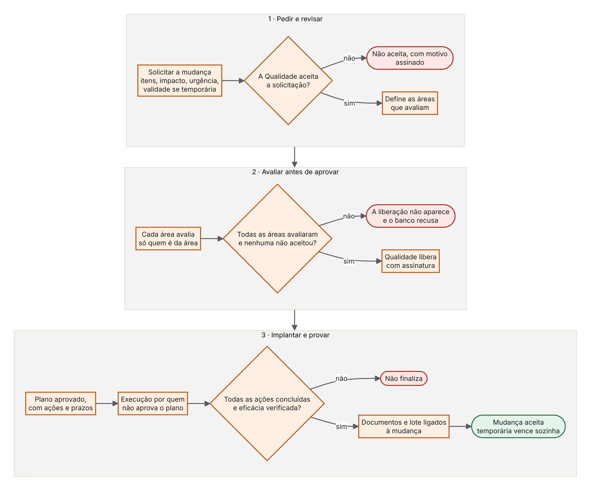
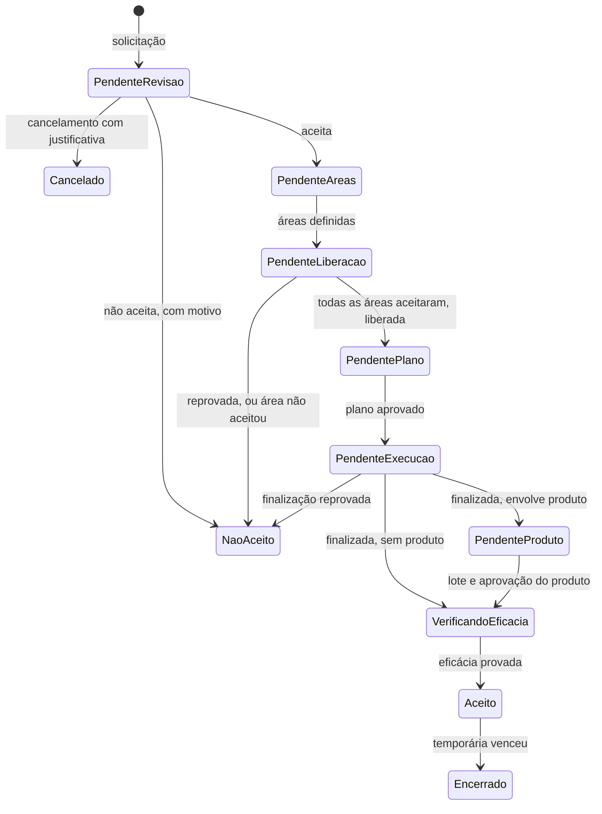

# Passo 3, fluxo 13c: mudar algo com avaliação, plano e prova de eficácia (controle de mudanças, Garantia da Qualidade)

*Como ler: **laranja** = o sistema confere (trava); **vermelho** = bloqueio; **verde** = resultado. Clique na imagem para ampliar.*

*Coluna "Onde no sistema": o caminho no sistema atual (legado), no formato **Módulo › Menu › Tela**. Onde diz "tela nova", a tela não existe hoje e será criada.*

**Análise de 20/11/2026. Rascunho para validação do responsável.** Terceira das cinco fichas da Garantia da Qualidade (a [13a](fluxo-13a-treinamento.md) foi o treinamento e a [13b](fluxo-13b-desvios-e-capa.md), desvios e CAPA). O controle de mudanças existe para que **nenhuma mudança em processo, fórmula, produto ou regulatório seja feita sem avaliação prévia das áreas impactadas** e sem prova de que funcionou. Ele **recebe** do desvio a necessidade de mudar e **entrega** documentos novos ([ficha 12a](fluxo-12a-ciclo-do-documento.md)) e lotes ligados ([Estoque](fluxos-do-legado.md)).

**Fontes (todas no repositório do legado):** o fluxo "Controle de mudanças" (`5.garantia_qualidade/fluxos/controle-mudancas.md`, lido do código) e os resultados dos testes de tela da GQ (rodadas de 12 e 22/10/2026; casos `CT-GQ-030` a `049` e `CT-GQ-M01` a `M09`; achados `DV-GQ-003` a `007`, `219`, `235`, `236`, `239`, `244`, `247`, `248`, `250`, `251`, `253`, `256`, `258`, `261`, `267`, `268`, `277`, `339`). **O que não fiz:** não li as telas uma a uma. O **vencimento da mudança temporária** ficou **bloqueado no teste** (precisa do dia seguinte) e o **acesso pelo endereço** foi excluído por decisão do responsável nas rodadas de 22/10. Quem pode fazer cada etapa por Nível está na [matriz de Níveis](funcoes-do-profissional.md) (seção 6.1 e 6.2).

## 1. O caminho, em uma linha
**Solicitação** → **revisão** da Qualidade (aceita ou não) → **áreas definidas** → **parecer de cada área** → **liberação** (aprova ou reprova) → **plano de ação** → **execução** → **finalização** → **aprovação do produto**, se envolve produto → **mudança aceita** (temporária vence sozinha).

### A situação da mudança

No legado a mudança podia **ser liberada sem parecer de nenhuma área**, **aprovada com área "não aceito"**, **finalizada com ação pendente** e **concluída como "aceito" sem verificação de eficácia**; a **solicitação não podia ser recusada** (não havia botão Reprovar). No iLabs a situação da mudança é **uma só, guardada e conferida pelo banco**, e **a liberação só existe depois que todas as áreas aceitaram**.

## 2. Etapa a etapa

| # | Etapa | Onde no sistema (legado) | Quem faz | Exige antes | O que entra | O banco garante (iLabs) | Falha do legado |
|---|---|---|---|---|---|---|---|
| 1 | **Solicitar a mudança** | **Garantia da Qualidade** › Controle de Mudanças › Solicitação de Mudanças | Qualquer área (Nível 1 em diante) | Área solicitante, itens e produto cadastrados | Descrição, tipo (definitiva ou temporária), mudança proposta, área, **itens a alterar** (processo, formulação, regulatórios, produto, projetos, outros), motivo, impacto, urgência, **validade** se temporária, **áreas de impacto**, anexos | Só **mudança temporária tem validade**, que **precisa ser futura**; **áreas de impacto obrigatórias**; **o desvio liga a solicitação** (campo do número do desvio); o anexo **fica na solicitação certa**; o cancelamento **só com justificativa e histórico** | As seis recusas dos campos vazios **funcionaram** (`CT-GQ-030`); o item **"Outros" sozinho não gravava** e, **junto de outro, era descartado em silêncio** (`DV-GQ-219`, `220`); a **Mudança Proposta abria vazia** na edição (`DV-GQ-221`); a mensagem da validade **dizia quase o contrário** do que queria dizer (`CT-GQ-031`); as **áreas de impacto não eram exigidas** (leitura do código e `CT-GQ-031`); **anexos**: 5 e 10 MB diziam "enviado" e **não ficavam**, e **o anexo da 0039 foi gravado na 0040** (`DV-GQ-269`, `270`, `271`); **não havia ligação com o desvio** (`CT-GQ-049`, `DV-GQ-065`); um **segundo caminho cancelava sem justificativa e sem histórico** (`DV-GQ-007`, `CT-GQ-047`) |
| 2 | **Revisar a solicitação** | **Garantia da Qualidade** › Controle de Mudanças › Pré-Avaliação de Mudanças | Qualidade (Nível 2 ou 3) | Solicitação pendente de revisão | Aceita ou **não aceita**, com justificativa | **Aceitar ou não aceitar**, com **motivo assinado**; ajustes na revisão **gravam histórico**; Nível 1 não revisa | **O botão Reprovar nunca aparecia**: a solicitação **não podia ser recusada pela tela** (`DV-GQ-235`, `CT-GQ-M02-01` e `CT-GQ-032` falharam); aceitar e escolher áreas **funcionou** (`CT-GQ-033`) |
| 3 | **Definir as áreas que avaliam** | Mesma tela (áreas) | Qualidade | Solicitação aceita | **Ao menos uma área**, com **responsável** | **Só área ativa e responsável ativo**; **ao menos uma área** | **Adicionar e remover a mesma área e salvar era aceito**, e a mudança ficava **sem área** (`DV-GQ-236`); a lista oferecia **responsável inativo** (`DV-GQ-268`) |
| 4 | **Avaliar pelas áreas** | **Garantia da Qualidade** › Controle de Mudanças › Avaliação de Mudanças | Cada área escolhida | Áreas definidas | **Parecer** (aceito ou não aceito, com justificativa) e anexos | **Só quem é da área** avalia; **parecer imutável depois de gravado** (mudar exige nova versão com justificativa); **anexo só do próprio autor**; Nível 1 não avalia | O parecer "Não Aceito" **trocava para "Aceito" sem justificativa** (`DV-GQ-239`); a área **excluía o anexo de outra pessoa**, sem confirmação, sem justificativa e sem registro (`DV-GQ-241`); a lista dava o **botão de avaliar a quem era da área**, mas **o sistema não conferia a área ao gravar** (leitura do código) |
| 5 | **Liberar a avaliação** | **Garantia da Qualidade** › Controle de Mudanças › Liberação Avaliação de Mudanças | Qualidade (Nível 3) | **Todas as áreas avaliaram** | **Aprovar ou reprovar**, com justificativa | **A liberação só existe com todos os pareceres**; **um "não aceito" impede a aprovação** (só reprova); a decisão é **assinada** e **do Nível 3 conferido na gravação** | A GQ **aprovou com uma área em "Não Aceito"** (`DV-GQ-004`, `CT-GQ-035` falhou, reconfirmado pela tela); aprovou **sem nenhum parecer** quando a operação chegava sem o botão (`DV-GQ-003`, `CT-GQ-034` falhou) e **mostrava Aprovar e Reprovar para uma mudança sem nenhuma área** (`DV-GQ-244`); **Nível 1 e Nível 2 aprovaram** a liberação (`DV-GQ-339`); a recusa pelo Nível 2 pela **tela** funcionou (`CT-GQ-036`) |
| 6 | **Planejar as ações** | **Garantia da Qualidade** › Controle de Mudanças › Plano de Ação | Qualidade e responsáveis | Mudança liberada | Ações: descrição, **prioridade**, área, **responsável**, **data prevista** | **Ao menos uma ação**; **prazo não anterior à solicitação**; **aprovação do plano antes de executar**; ação finalizada **não se altera** sem justificativa e histórico; **consultar não cria** nada | Prioridade 11 era **recusada em silêncio** (`DV-GQ-250`); duas ações salvaram, mas **"erro inesperado" em duas de seis gravações** (`DV-GQ-251`); o plano **ia direto à execução, sem aprovação** (`CT-GQ-038`); **excluir a única ação e salvar era aceito** (`DV-GQ-247`); **ação finalizada era alterada sem justificativa e fora do histórico** (`DV-GQ-248`); a **consulta do plano não criou plano** no teste (`CT-GQ-039`), ao contrário do que o código indicava |
| 7 | **Executar as ações** | **Garantia da Qualidade** › Controle de Mudanças › Execução Plano de Ação | Responsáveis | Plano aprovado | **Data de conclusão** de cada ação | **Só o responsável da ação** conclui; **data não futura nem anterior à solicitação**; **ação concluída não reabre** sem justificativa; **prazo vencido é marcado e exige justificativa** | A data futura e a anterior **foram recusadas** (`CT-GQ-040`); **o usuário da área B concluía a ação da área A** (`DV-GQ-277`); **ação finalizada era reaberta sem justificativa** (`DV-GQ-253`); a lista **não tinha coluna de prazo nem marca de atraso** (`DV-GQ-267`) |
| 8 | **Finalizar o plano** | **Garantia da Qualidade** › Controle de Mudanças › Liberação Plano de Ação (na tela, "Finalização Plano de Ação") | Qualidade (Nível 3) | **Todas as ações concluídas** | **Conclusão**, aprovar ou **reprovar** | **Só finaliza com todas as ações concluídas**; **verificação de eficácia** (prazo e responsável) antes de aceitar; **reprovar existe**; aprovada, **a mudança com produto vai à aprovação do produto** | Com ação pendente o **botão Finalizar não aparecia**, mas **o servidor finalizava a operação sem o botão** (`DV-GQ-005`, `CT-GQ-041`); **não existia o botão Reprovar** (`DV-GQ-258`, `CT-GQ-045` falhou); **não havia verificação de eficácia** (`CT-GQ-042`, leitura do código); **o histórico não registrava a execução, a finalização nem a passagem a Aceito** (`DV-GQ-256`) |
| 9 | **Aprovar o produto e ligar o lote** | **Garantia da Qualidade** › Controle de Mudanças › Controle Mudança Produto | Qualidade (Nível 3) | Plano finalizado, mudança com produto | **Lote**, observação e **justificativa** | O lote **vem do Estoque e da Produção** (não digitado), com **justificativa obrigatória** e **assinatura**; **fica no histórico**; o lote liga ao **desvio** e ao **documento novo** | Confirmava **sem justificativa, sem lote e sem observação** e levava a **Aceito** (`DV-GQ-006`, `261`; `CT-GQ-043` falhou, reconfirmado); o **lote era digitado à mão**, sem consulta à Produção ou ao Estoque; **a aprovação final não entrava no histórico** (`DV-GQ-006`) |
| 10 | **Encerrar a mudança temporária** | Não existe no legado (tela nova) | Automático | Mudança temporária aceita | — | **A validade vencida encerra a mudança sozinha**, com **aviso** antes e **registro**; a mudança volta ao padrão | **Bloqueado no teste** (`CT-GQ-048`: precisava do dia seguinte); pelo código, a validade só servia de **filtro** na lista e **ninguém era avisado** quando vencia |

## 3. O que este fluxo exige de cada cadastro global

| Cadastro (passo 1) | O que o fluxo precisa que ele guarde |
|---|---|
| **Estrutura organizacional (áreas)** | Área solicitante e **áreas avaliadoras**, **com responsáveis ativos** |
| **Profissional e função** | Quem **solicita**, **revisa**, **avalia pela área**, **libera**, **executa** e **finaliza**: funções **separadas** |
| **Produto e lote** | O produto da mudança e o **lote** ligado (consulta à Produção e ao Estoque) |
| **Documento (ficha 12a)** | Os **documentos a revisar** e a **nova revisão** gerada pela mudança |
| **Desvio (ficha 13b)** | O **número do desvio** que originou a solicitação |
| **Assuntos regulatórios (ficha 13e)** | O item "regulatórios" avisa a tela de registro de produto |
| **Treinamento (ficha 13a)** | O **treinamento** do documento ou do processo novo |
| **Grupo de perfil (Níveis)** | Quem faz o quê por Nível ([matriz de Níveis](funcoes-do-profissional.md)), **conferido na gravação** |
| **Impacto e urgência** | Listas de apoio (cinco níveis de impacto, prazos de urgência) |
| **Notificações (serviço comum)** | Aviso de revisão pendente, parecer pendente, prazo de ação e **mudança temporária vencendo** |

## 4. Os registros que nascem no fluxo (não são cadastros)
Solicitação de mudança e anexos · revisão · áreas e pareceres · liberação · plano de ação e ações · execução · finalização · verificação de eficácia · aprovação do produto e lote · encerramento da temporária · histórico.

## 5. O que muda nos documentos anteriores
- **Roteiro de implantação:** na etapa 1, as funções da mudança (**solicitar, revisar, avaliar, liberar, executar, finalizar**), separadas; na etapa 5, **áreas com responsáveis ativos**; na etapa 7, as **listas de impacto e urgência**; na etapa 9, o ensaio inclui **uma mudança com produto até a aprovação do lote**, **uma tentativa de liberar com área "não aceito"** (recusada), **uma de finalizar com ação pendente** (recusada) e **uma mudança temporária que vence**.
- **Passo 2 (ordem):** áreas com responsáveis, produto e documento vêm **antes** da primeira mudança.
- **Ficha 13b (desvios):** a decisão "necessário controle de mudança" **abre a solicitação** e leva o número do desvio.
- **Ficha 12a (documentos):** a mudança aprovada **gera ou liga a nova revisão** do documento.

## 6. Pontos a validar com a área (não consegui tirar do código)
1. **Liberação:** a Qualidade pode aprovar com uma área "não aceito"? Em que condição (justificativa, comitê)?
2. **Recusa da solicitação:** quem pode recusar? Precisa de justificativa **assinada**?
3. **Eficácia:** com quantos dias depois de finalizar o plano se verifica? Quem verifica?
4. **Plano:** quem aprova o plano **antes** da execução? É a mesma pessoa que o escreve?
5. **Mudança temporária:** o que acontece na validade: encerra, exige prorrogação com nova avaliação ou só avisa?
6. **Produto e lote:** a mudança de produto exige **qual lote** (o primeiro fabricado depois da mudança)? A Produção informa?
7. **Validação e qualificação:** a mudança deve **exigir validação** ou qualificação (hoje, só protótipo na GQ)?
8. **Documentos:** a mudança lista os **documentos a revisar** e só se conclui com eles em vigor?
