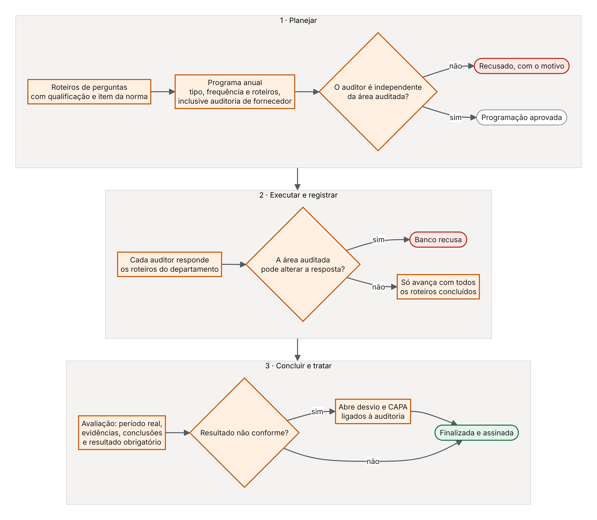
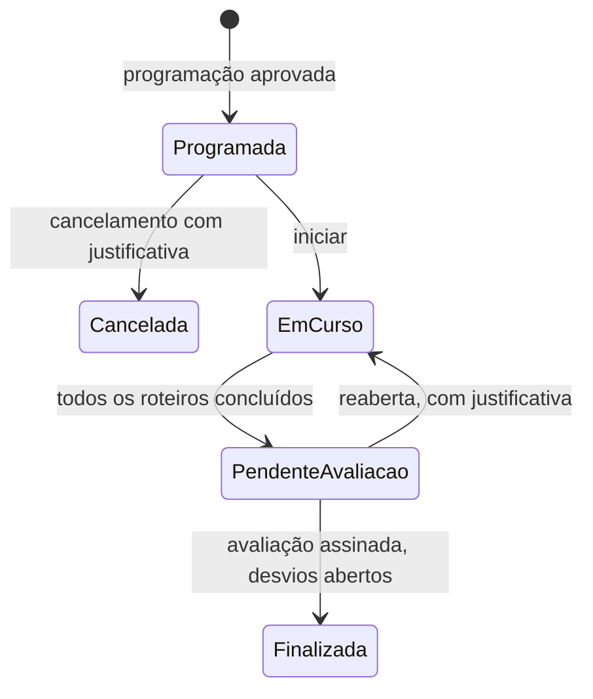

# Passo 3, fluxo 13d: inspecionar e auditar com independência e tratamento do achado (autoinspeção e auditoria, Garantia da Qualidade)

*Como ler: **laranja** = o sistema confere (trava); **vermelho** = bloqueio; **verde** = resultado. Clique na imagem para ampliar.*

*Coluna "Onde no sistema": o caminho no sistema atual (legado), no formato **Módulo › Menu › Tela**. Onde diz "tela nova", a tela não existe hoje e será criada.*

> **Em uma frase:** A empresa **faz vistorias em si mesma** (autoinspeção e auditoria) com uma lista de perguntas, para achar problemas antes da fiscalização.
>
> **Exemplo do dia a dia (ilustrativo, os números são inventados):** Uma equipe percorre a área de pesagem com um checklist de 50 perguntas, anota o que está fora do padrão e abre as correções.
>
> **Por que importa:** Se quem vistoria é da própria área vistoriada, o resultado perde a credibilidade.
>
> *Palavra que não conhece? Veja a aba "24 · Glossário" desta página.*

**Análise de 20/11/2026. Rascunho para validação do responsável.** Quarta das cinco fichas da Garantia da Qualidade (a [13a](fluxo-13a-treinamento.md) foi o treinamento, a [13b](fluxo-13b-desvios-e-capa.md), desvios e CAPA e a [13c](fluxo-13c-controle-de-mudancas.md), mudanças). A autoinspeção e a auditoria **procuram o que está fora do padrão antes que um desvio aconteça**; o que elas acham deve virar **desvio** e **CAPA** ([ficha 13b](fluxo-13b-desvios-e-capa.md)). No legado, essa ligação **não existe**.

**Fontes (todas no repositório do legado):** o fluxo "Autoinspeção e auditoria" (`5.garantia_qualidade/fluxos/autoinspecao-auditoria.md`, lido do código) e os resultados dos testes de tela da GQ (rodadas de 15/10 e 22/10/2026; casos `CT-GQ-050` a `065` e `CT-GQ-AUD`; achados `DV-GQ-090`, `092`, `093`, `096`, `097`, `098`, `099`, `100`, `101`, `102`, `103`, `104`, `106`, `107`, `110`, `111`, `112`, `113`, `114`, `115`, `116`, `117`, `118`, `347`). **O que não fiz:** não li as telas uma a uma. O campo de **número de RNC** nunca apareceu no Registro, então o vínculo com o desvio **não pôde ser testado** (`CT-GQ-058`). A **reabertura** não tem botão (`CT-GQ-062`), ao contrário do que o código indicava.

## 1. O caminho, em uma linha
**Roteiros** → **cadastro da autoinspeção** (tipo, frequência) → **programação** (período, inspetores, departamentos) → **início** → **registro das respostas** por departamento → **avaliação** (evidências, conclusões, resultado) → **desvios** do que foi achado → **finalizada**.

### A situação da programação

No legado havia as mesmas situações, mas **não existia caminho para reabrir** (nenhuma tela tinha o botão), o avanço para a avaliação era **conferido só pelo botão** e **o resultado não abria desvio**. No iLabs a situação é **uma só, guardada e conferida pelo banco**, e **o resultado "não conforme" abre o desvio**.

## 2. Etapa a etapa

| # | Etapa | Onde no sistema (legado) | Quem faz | Exige antes | O que entra | O banco garante (iLabs) | Falha do legado |
|---|---|---|---|---|---|---|---|
| 1 | **Classificar as perguntas** | **Garantia da Qualidade** › Autoinspeção e Auditoria › Cadastro Tipo Qualificação | Qualidade | — | Sigla, descrição | **Sigla única**; classificação (crítico, maior, menor) **definida pela empresa** | A **mesma abreviação era aceita duas vezes** (`DV-GQ-092`); a classificação usada pela área **não está definida** (a validar) |
| 2 | **Escrever os roteiros** | **Garantia da Qualidade** › Autoinspeção e Auditoria › Cadastro de Roteiro | Qualidade | Tipo de qualificação | Título, perguntas (número, texto, qualificação, forma de resposta, obrigatória, observação, **item da norma**, **gera desvio**) | **Título único**; **a pergunta pode gerar desvio** (a marcação aparece); exclusão **com justificativa e histórico**; roteiro em uso **só se revisa** | A recusa do **título repetido** funcionou (`CT-GQ-050`); a pergunta **não conseguia gerar RNC**: a caixa existia no código e o formulário **não a mostrava** (`DV-GQ-096`, `CT-GQ-051`, `058`); **aspas duplas no título** salvavam o roteiro **sem nenhuma pergunta e sem aviso** (`DV-GQ-090`); excluir **roteiro sem uso** **não pedia justificativa e não deixava rastro**; o em uso **não se excluía** (`DV-GQ-102`, `CT-GQ-065`) |
| 3 | **Cadastrar a autoinspeção ou a auditoria** | **Garantia da Qualidade** › Autoinspeção e Auditoria › Cadastro Autoinspeção e Auditoria | Qualidade | Roteiros | Nome, **tipo**, **frequência**, roteiros | **Nome único**; **tipos incluem auditoria de fornecedor**, com o fornecedor auditado | A lista tinha **autoinspeção de rotina, completa, específica e auditoria interna**, **sem auditoria de fornecedor** (`DV-GQ-111`, `CT-GQ-052` falhou); **aceitava dois cadastros com o mesmo nome** (`DV-GQ-110`); nome **com aspas** não podia ser escolhido na programação (`DV-GQ-093`) |
| 4 | **Planejar o ano** | **Garantia da Qualidade** › Autoinspeção e Auditoria › Planejamento de Autoinspeção e Auditorias | Qualidade | Programações | Período e situação | **O planejamento anual mostra o calendário** e **o que falta fazer** por período e situação | O relatório **ignorava o período e a situação e não listava as programações** (`DV-GQ-100`, Alta) |
| 5 | **Programar a execução** | **Garantia da Qualidade** › Autoinspeção e Auditoria › Programação Autoinspeção e Auditoria | Qualidade | Autoinspeção cadastrada | Nome da versão, **motivo**, **período**, **inspetores** (internos ou externos), **departamentos auditados**, responsável e contato | **Inspetor independente** da área auditada (**de qualquer pessoa da área, não só do responsável**); **coordenador obrigatório**; período futuro e coerente; **horário final depois do inicial**; **só edita e cancela em Programada, conferido na gravação** | O período anterior a hoje e o início depois do fim **foram recusados** (`CT-GQ-053`); a **independência** só era conferida **contra o responsável** da área, e a recusa dizia "Inspetor/Auditor é obrigatório.", que **parecia falta de preenchimento** (`CT-GQ-055`, `DV-GQ-104`); o **coordenador não era exigido** (`CT-GQ-054`); **hora final antes da inicial era aceita** (`DV-GQ-106`); com **inspetor externo, ninguém conseguia registrar as respostas** (`DV-GQ-118`); o **Nível 1 incluía e excluía** nesta tela (`DV-GQ-347`); a lista de **"Pendente Avaliação"** devolvia zero (`DV-GQ-107`) |
| 6 | **Iniciar** | Mesma tela | Qualidade | Programada | — | Ao iniciar, **cada departamento recebe seus roteiros**; **Editar e Cancelar somem** | **Funcionou**: passou a Em Curso e Editar e Cancelar sumiram (`CT-GQ-056`) |
| 7 | **Registrar as respostas** | **Garantia da Qualidade** › Autoinspeção e Auditoria › Registro Autoinspeção e Auditoria | Inspetores do departamento | Programação em curso | Resposta de cada pergunta, observação, item da norma, **número do desvio** | **Só o inspetor designado responde**; **a área auditada só vê**; roteiro **só avança com todas as respostas**, conferido **no banco**; a resposta **liga ao desvio** | A **área auditada só via "Visualizar"** e **não gravava**: o ponto do código "a área auditada edita" **não se confirmou** (`CT-GQ-057`); a **seleção única marcada depois da primeira gravação não era gravada** e o roteiro **não podia mais ser concluído** (`DV-GQ-113`); **"Próxima Etapa" aparecia numa programação já pendente e dizia sucesso** (`DV-GQ-117`); o **campo do RNC nunca aparecia** (`DV-GQ-096`); o botão só aparecia com roteiros concluídos, mas **a conferência no servidor não foi feita** (`CT-GQ-059`); **"Imprimir Roteiro" saía sem as respostas** (`DV-GQ-101`) |
| 8 | **Avaliar e concluir** | **Garantia da Qualidade** › Autoinspeção e Auditoria › Avaliação Autoinspeção e Auditoria | Qualidade (avaliador) | Roteiros concluídos | **Período real**, **evidências**, **conclusões**, **resultado** (conforme, não conforme, com restrições), destinatários, anexos | **Período real não futuro**; evidências, conclusões e **resultado obrigatórios**; **assinatura**; **reabrir só com justificativa** | As recusas de **período futuro, evidências e conclusões vazias funcionaram** (`CT-GQ-060`); **finalizava sem escolher o resultado** (`DV-GQ-097`); **não havia como reabrir** programação, registro ou avaliação (`DV-GQ-112`, `CT-GQ-062` bloqueado); os **anexos não abriam**, com erro 404 (`DV-GQ-114`); o **PDF não trazia as respostas dos roteiros** (`DV-GQ-101`, `CT-GQ-064`) |
| 9 | **Tratar o que foi achado** | Hoje, só uma lista digitada na Avaliação; **Garantia da Qualidade** › Controle de Desvios (ficha 13b) | Qualidade | Avaliação com não conformidade | Número, descrição e situação do desvio | **Resultado "não conforme" abre o desvio e a CAPA**, ligados à auditoria; **excluir desvio exige justificativa** e histórico | **A auditoria não abria desvio**: a busca no Relatório de Desvios voltou vazia (`DV-GQ-099`, `CT-GQ-063` falhou); o desvio da avaliação era **um registro digitado à parte**, **sem histórico** na alteração (`DV-GQ-098`, `CT-GQ-061` falhou); **excluir desvio apagava na hora**, sem confirmação, sem justificativa e sem registro (`DV-GQ-115`); descrição acima de 400 ou número acima de 100 caracteres dava **erro interno** (`DV-GQ-116`) |

## 3. O que este fluxo exige de cada cadastro global

| Cadastro (passo 1) | O que o fluxo precisa que ele guarde |
|---|---|
| **Estrutura organizacional (áreas e departamentos)** | Áreas e **responsáveis**, e **quem é de cada área** (para conferir a independência) |
| **Profissional e função** | **Inspetor e auditor** (interno), **coordenador** da auditoria e **avaliador**: funções **separadas**, com **treinamento** (ficha 13a) |
| **Pessoa jurídica** | **Inspetor externo** (empresa) e o **fornecedor auditado** |
| **Fornecedor qualificado (Estoque, ficha 2)** | O **resultado da auditoria** qualifica ou desqualifica o fornecedor |
| **Item da norma** | **Lista de apoio** (RDC 658/2022, Guia 33) usada nas perguntas e nas respostas |
| **Tipo de qualificação e tipo de auditoria** | Listas de apoio com histórico |
| **Desvio (ficha 13b)** | Recebe o **resultado não conforme** da auditoria |
| **Notificações (serviço comum)** | **Aviso** de autoinspeção a vencer e de programação pendente |

## 4. Os registros que nascem no fluxo (não são cadastros)
Roteiro e perguntas · autoinspeção ou auditoria cadastrada · programação · departamentos auditados e inspetores · respostas · avaliação e anexos · desvios da auditoria · relatório · histórico.

## 5. O que muda nos documentos anteriores
- **Roteiro de implantação:** na etapa 1, as funções de **inspetor, auditor, coordenador e avaliador**, separadas; na etapa 5, **áreas e departamentos com responsáveis**; na etapa 7, as **listas de apoio** (tipo de qualificação, item da norma) e **o primeiro roteiro**; na etapa 9, o ensaio inclui **uma autoinspeção até a avaliação**, **uma tentativa de o inspetor ser da área auditada** (recusada) e **um resultado "não conforme" que abre desvio**.
- **Passo 2 (ordem):** áreas, funções treinadas e itens da norma **antes** do primeiro roteiro.
- **Ficha 2 (fornecedor):** a **auditoria de fornecedor** passa a **qualificar** o fornecedor.
- **Ficha 13b (desvios):** o desvio pode **nascer da auditoria**, com a origem identificada.

## 6. Pontos a validar com a área (não consegui tirar do código)
1. **Independência:** o inspetor **não pode ser de nenhuma pessoa da área auditada**, ou só do **responsável**? Quem pode auditar quem?
2. **Coordenador:** a auditoria exige um **coordenador**? Quem?
3. **Tipos:** além de autoinspeção de rotina, completa, específica e auditoria interna, há **auditoria de fornecedor** e **auditoria externa** (cliente, ANVISA)?
4. **Qualificação das perguntas:** crítico, maior e menor, ou outra classificação? O resultado depende dela?
5. **Reabertura:** quem pode reabrir uma avaliação, até quando e com qual justificativa?
6. **Desvio da auditoria:** todo "não conforme" abre desvio, ou só os **críticos e maiores**?
7. **Frequência:** quem **acompanha o programa anual**? O sistema deve avisar a autoinspeção a vencer?
