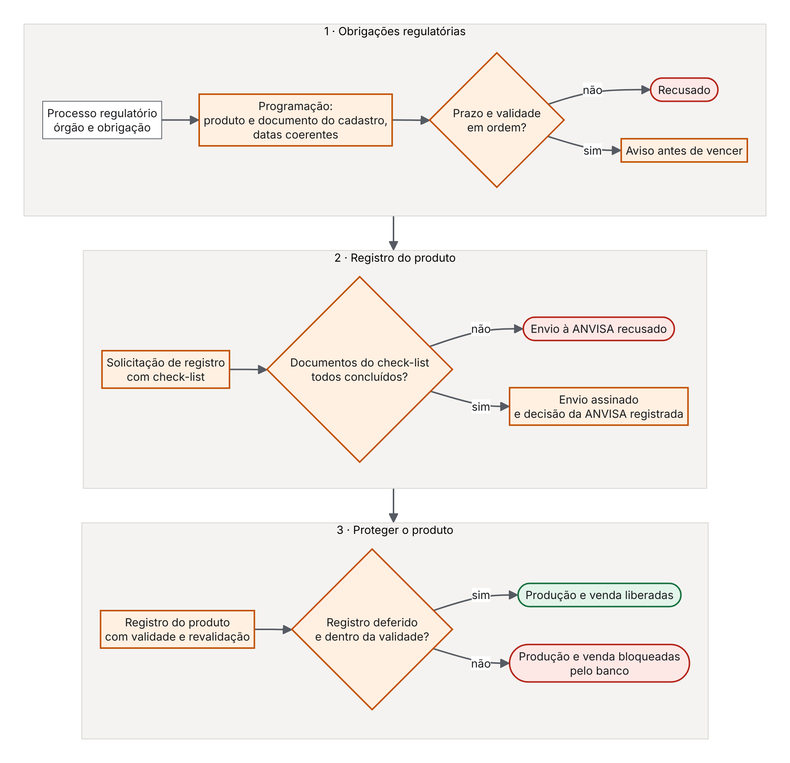
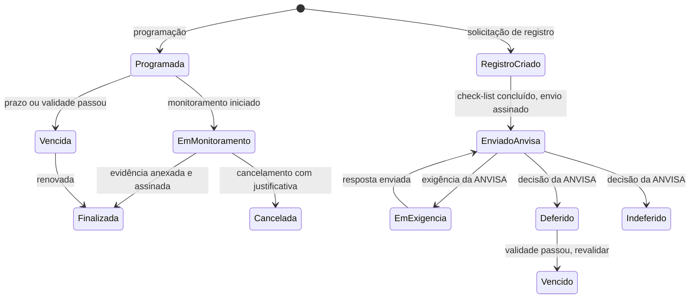

# Passo 3, fluxo 13e: manter o produto e a empresa em dia com os órgãos reguladores (assuntos regulatórios, Garantia da Qualidade)

*Como ler: **laranja** = o sistema confere (trava); **vermelho** = bloqueio; **verde** = resultado. Clique na imagem para ampliar.*

*Coluna "Onde no sistema": o caminho no sistema atual (legado), no formato **Módulo › Menu › Tela**. Onde diz "tela nova", a tela não existe hoje e será criada.*

> **Em uma frase:** Manter **em dia as licenças e obrigações** com a ANVISA e outros órgãos, e o **registro de cada produto**, que tem validade.
>
> **Exemplo do dia a dia (ilustrativo, os números são inventados):** O registro de um remédio vence em março. O sistema avisa antes, e sem registro válido o produto não pode ser fabricado nem vendido.
>
> **Por que importa:** Registro vencido sem aviso pode parar a fábrica ou gerar autuação.
>
> *Palavra que não conhece? Veja a aba "24 · Glossário" desta página.*

**Análise de 20/11/2026. Rascunho para validação do responsável.** Última das cinco fichas da Garantia da Qualidade (a [13a](fluxo-13a-treinamento.md) foi o treinamento, a [13b](fluxo-13b-desvios-e-capa.md), desvios e CAPA, a [13c](fluxo-13c-controle-de-mudancas.md), mudanças e a [13d](fluxo-13d-autoinspecao-e-auditoria.md), autoinspeção). Os assuntos regulatórios cuidam de **duas coisas**: as **obrigações da empresa** perante os órgãos (licenças, certificados, notificações) e o **registro de cada produto** na ANVISA. O produto só pode ser **fabricado e vendido** se o registro está **deferido e dentro da validade**.

**Fontes (todas no repositório do legado):** o fluxo "Assuntos regulatórios" (`5.garantia_qualidade/fluxos/assuntos-regulatorios.md`, lido do código) e os resultados dos testes de tela da GQ (rodadas de 15/10, 22/10 e 23/10/2026; casos `CT-GQ-090` a `101` e `CT-GQ-AR`; achados `DV-GQ-015`, `200`, `201`, `203`, `204`, `205`, `206`, `207`, `211`, `212`, `213`, `214`, `215`, `263`, `264`, `347`, `348`). **O que não fiz:** não li as telas uma a uma. **As quatro telas do registro de produto** (Check-list, Solicitação de Registro, Controle de Produtos, Exigências da ANVISA) **não têm entrada no menu** e **não puderam ser testadas** (`DV-GQ-015`, `348`); essa metade do fluxo vem **só do código**.

## 1. O caminho, em uma linha
**Obrigações:** processo regulatório → **programação** (datas, produto, documento) → **monitoramento** (evidência) → finalizada.
**Registro do produto:** **check-list** → **solicitação de registro** → **envio à ANVISA** → **decisão** (deferida, indeferida, exigência) → **validade e revalidação** → **bloqueia a produção e a venda** se não está regular.

### A situação da obrigação e do registro

No legado a obrigação tinha **só datas digitadas**, **sem aviso de vencimento**, e o registro do produto **não chegava a nenhum outro módulo**. No iLabs a situação é **uma só, guardada e conferida pelo banco**, **vencer gera aviso** e **o registro indeferido ou vencido bloqueia a produção e a venda**.

## 2. Etapa a etapa

| # | Etapa | Onde no sistema (legado) | Quem faz | Exige antes | O que entra | O banco garante (iLabs) | Falha do legado |
|---|---|---|---|---|---|---|---|
| 1 | **Cadastrar o processo regulatório** | **Garantia da Qualidade** › Assuntos Regulatórios › Processo Regulatório | Assuntos Regulatórios | Órgão regulador cadastrado | Descrição, órgão, observação | **Descrição única e com conteúdo**; exclusão **com justificativa e histórico** | A descrição obrigatória funcionou (`CT-GQ-090`); aceitava **só espaços e descrição repetida** (`DV-GQ-201`); **excluir não deixava rastro e o histórico deixava de abrir** (`DV-GQ-200`); descrição acima de 250 caracteres dava erro sem dizer o limite (`DV-GQ-202`); o **Responsável e a Data** mostravam **quem abre e o momento**, não o autor nem a data do cadastro (`DV-GQ-263`) |
| 2 | **Programar a obrigação** | **Garantia da Qualidade** › Assuntos Regulatórios › Programação | Assuntos Regulatórios | Processo regulatório | Processo, tipo, categoria, grau ou classe, **data programada, prazo máximo, validade**, **produto**, **documento**, fornecedor | **Prazo não anterior à data programada e validade não anterior ao prazo**; **produto vem da Produção** e **documento, do Controle de Documentos**; fornecedor do cadastro; **data válida** | **As datas fora de ordem foram aceitas** (`DV-GQ-203`, `CT-GQ-091` falhou); o **produto era texto livre**, sem busca (`CT-GQ-092`); **nome e número do documento digitados**; **não havia campo para a validade do documento** (`DV-GQ-205`); **data programada apagada ou inválida era ignorada com mensagem de sucesso** (`DV-GQ-207`), e datas de **1900 e 2000** passavam (`DV-GQ-209`); **alterar a programação de outra pessoa trocava o Responsável original** (`DV-GQ-264`); o filtro de situação **não funcionava** para Cancelada e Finalizada (`DV-GQ-208`) |
| 3 | **Avisar o prazo e a validade** | Não existe no legado (tela nova) | Automático | Programação | — | **Aviso antes do prazo e da validade**, na tela inicial e nas notificações; **vencida sem monitoramento** aparece como **pendência** | **Nenhum aviso**: a programação com validade vencida há dias **não aparecia** na tela inicial, nas notificações nem na lista, que **nem mostrava as datas** (`DV-GQ-204`, `CT-GQ-093` falhou, reconfirmado) |
| 4 | **Monitorar e finalizar** | **Garantia da Qualidade** › Assuntos Regulatórios › Monitoramento | Assuntos Regulatórios | Programação | **Anexo de evidência**, observação, finalizar ou cancelar | **Só finaliza com evidência anexada**; **cancelar e finalizar com justificativa assinada**; **o anexo fica no histórico**; **atraso exige justificativa** | **Finalizava sem anexo e sem nunca ter monitorado** (`DV-GQ-213`, `CT-GQ-094` falhou); **salvava sem anexo** (`DV-GQ-212`); **cancelar e finalizar não pediam justificativa** (`DV-GQ-214`); **anexos incluídos e excluídos não deixavam rastro** (`DV-GQ-211`); **finalizar com prazo e validade vencidos não avisava o atraso** (`DV-GQ-215`); a grade de anexos **não tinha ícone para abrir o arquivo** (`DV-GQ-217`); o Monitoramento **mostrava o processo regulatório errado** (`DV-GQ-206`); numa programação o Monitoramento deu "erro inesperado" (`DV-GQ-278`) |
| 5 | **Montar o check-list do registro** | **Garantia da Qualidade** › Assuntos Regulatórios › Check-list *(tela existe, sem entrada no menu)* | Assuntos Regulatórios | Tipo de registro | Documentos exigidos, seção responsável, responsável, entrega e retorno, situação | Check-list **por tipo de processo**, com **histórico de cada mudança** | **Não pôde ser testada** (`DV-GQ-015`); pelo código, a edição do check-list e a inclusão e exclusão de documentos **gravavam sem histórico** |
| 6 | **Solicitar o registro e enviar à ANVISA** | **Garantia da Qualidade** › Assuntos Regulatórios › Solicitação de Registro *(sem entrada no menu)* | Assuntos Regulatórios | **Produto da Produção**, check-list **concluído** | Tipo (novo, renovação, alteração, lote piloto, HMP), tipo e grau do produto, área, número da CI | **Só envia com todos os documentos do check-list concluídos**; o envio e o fechamento **ficam no histórico, assinados** | **Não pôde ser testada**: a Solicitação não permitia incluir (`DV-GQ-348`); pelo código, o envio **não conferia o check-list**, e o envio e o fechamento **gravavam sem histórico** |
| 7 | **Registrar a decisão da ANVISA** | **Garantia da Qualidade** › Assuntos Regulatórios › Controle de Produtos Enviados para Registro Anvisa *(sem entrada no menu)*; Exigências da ANVISA *(quebrada)* | Assuntos Regulatórios | Solicitação enviada | Situação (deferida, indeferida, em exigência), **motivo da exigência**, número do processo e do registro, **publicação no DOU**, **validade em meses**, **revalidação** | **Validade e revalidação calculadas**; **aviso antes de vencer**; **cada mudança no histórico, assinada**; **exigência com prazo de resposta** | **Não pôde ser testada** (`DV-GQ-348`: Controle de Produtos e Exigências da ANVISA não funcionam fora do menu); pelo código, a alteração do histórico **gravava sem histórico** e **nenhum aviso** de vencimento existia |
| 8 | **Proteger o produto** | Não existe no legado (tela nova) | Automático | Registro do produto | — | **Produto com registro indeferido, vencido ou em exigência não entra em ordem de produção, não é expedido e não é vendido**; **o banco recusa**, com o motivo | **Não existe**: pelo código, a situação do registro **não chegava a nenhum outro módulo**, e `CT-GQ-099` (produção com registro indeferido) **não pôde ser testado** |
| 9 | **Receber a mudança regulatória** | Não existe no legado (tela nova); **Controle de Mudanças** tem o item "Regulatórios" | Automático | Mudança com item "regulatórios" | — | **A mudança com item regulatório abre a obrigação** em Assuntos Regulatórios, com a mudança de origem | **Nenhuma ligação**: a mudança "regulatórios" **não abria nem consultava** nada aqui (leitura do código, ficha 13c) |

## 3. O que este fluxo exige de cada cadastro global

| Cadastro (passo 1) | O que o fluxo precisa que ele guarde |
|---|---|
| **Produto (Produção)** | **Registro na ANVISA**, com situação, número, validade e revalidação; o produto vem do cadastro, não digitado |
| **Documento (ficha 12a)** | O documento da obrigação (licença, certificado) **com validade** |
| **Pessoa jurídica** | **Órgão regulador** e **fornecedor** ligado à obrigação |
| **Processo e tipo de registro** | Lista de apoio: registro novo, renovação, alteração, lote piloto, HMP |
| **Profissional e função** | Quem **programa**, **monitora**, **envia à ANVISA** e **registra a decisão**: funções **separadas** |
| **Mudança (ficha 13c)** | O item "regulatórios" abre a obrigação |
| **Notificações (serviço comum)** | **Aviso** de prazo, validade e revalidação |
| **Produção, Estoque e Comercial** | **Bloqueio** do produto sem registro regular |

## 4. Os registros que nascem no fluxo (não são cadastros)
Processo regulatório · programação · monitoramento e anexos · check-list e documentos · solicitação de registro · envio à ANVISA · histórico do produto na ANVISA · exigência · bloqueio do produto · histórico.

## 5. O que muda nos documentos anteriores
- **Roteiro de implantação:** na etapa 1, as funções regulatórias, separadas; na etapa 6, o **registro de cada produto na ANVISA** (número, validade, revalidação) preenchido **antes** da primeira ordem de produção; na etapa 7, os **processos regulatórios** e os **tipos de registro**; na etapa 9, o ensaio inclui **uma obrigação que vence** (gera aviso), **um envio com documento pendente** (recusado) e **uma ordem de produção de produto com registro indeferido** (bloqueada).
- **Passo 2 (ordem):** produto e documento **antes** da primeira programação; **registro do produto** antes de a produção e a venda abrirem.
- **Ficha 13c (mudanças):** a mudança "regulatórios" **abre a obrigação**.
- **Produção, Estoque e Comercial:** o **bloqueio por registro** entra nos fluxos de ordem de produção, expedição e venda.

## 6. Pontos a validar com a área (não consegui tirar do código)
1. **Duas listas ou uma:** obrigações regulatórias (licenças, certificados) e registro de produto são **a mesma tela** ou **duas**? Quem cuida de cada uma?
2. **Registro e produção:** o registro **indeferido ou vencido** bloqueia a **produção**, a **venda**, ou só avisa? E o produto **em exigência**?
3. **Aviso:** com quantos dias de antecedência do prazo e da validade, e para quem?
4. **Check-list:** o envio à ANVISA **só com todos os documentos concluídos**? Quem assina o envio?
5. **Exigência da ANVISA:** tem **prazo de resposta**? Quem acompanha? (A tela do legado estava quebrada.)
6. **Mudança regulatória:** toda mudança com item "regulatórios" **abre uma obrigação**? Quem decide?
7. **Lote piloto e HMP:** têm fluxo próprio (protótipo no legado) ou seguem o mesmo?
