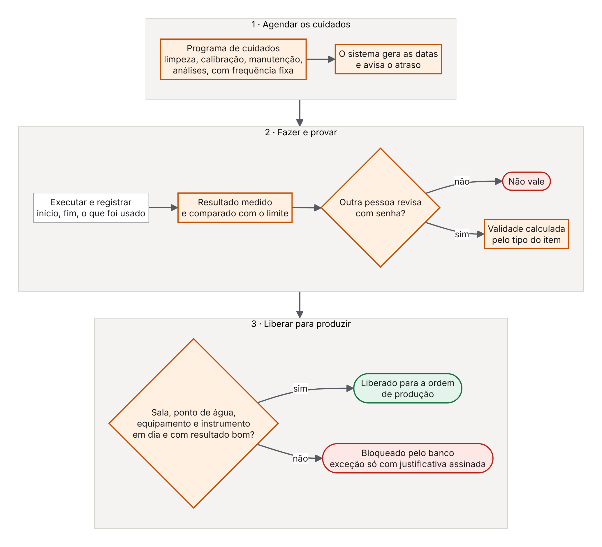
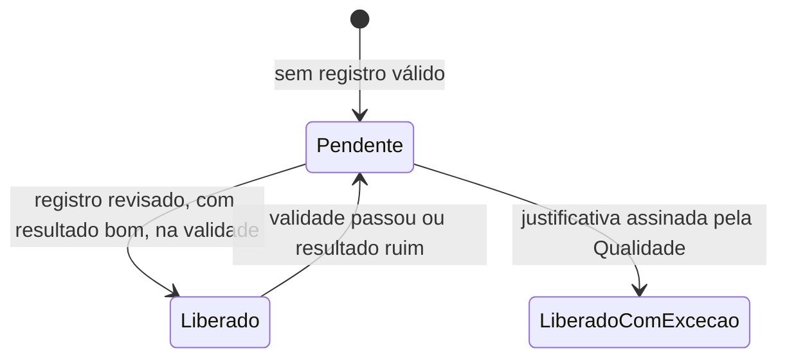

# Passo 3, fluxo 14a: deixar sala, equipamento, instrumento e água prontos para produzir (preparação, Produção)

*Como ler: **laranja** = o sistema confere (trava); **vermelho** = bloqueio; **verde** = resultado. Clique na imagem para ampliar.*

*Coluna "Onde no sistema": o caminho no sistema atual (legado), no formato **Módulo › Menu › Tela**. Os nomes de menu seguem as telas do módulo Produção. Onde diz "tela nova", a tela não existe hoje e será criada.*

> **Em uma frase:** antes de fabricar, a empresa precisa **provar que a sala está limpa, que os equipamentos funcionam e estão em dia, que os instrumentos de medir estão certos e que a água está boa**, e o sistema só deixa produzir se tudo isso estiver em dia.
>
> **Exemplo do dia a dia (ilustrativo, os números são inventados):** a máquina de encher frascos foi limpa na segunda e a limpeza vale por 7 dias. Na terça da semana seguinte, sem nova limpeza registrada, o sistema deve bloquear o uso dela na ordem de produção.
>
> **Por que importa:** equipamento sujo ou balança descalibrada pode estragar um lote inteiro sem ninguém perceber.
>
> *Palavra que não conhece? Veja a documento "Glossário" (grupo "Para começar" da lista do estudo). Aqui: **calibração** é conferir um instrumento de medir (uma balança, um termômetro) contra um padrão e ajustá-lo; **qualificação** é provar que um equipamento funciona como deveria; **manutenção preventiva** é cuidar da máquina antes de quebrar; **LogBook** é o "livro de bordo" do equipamento, com tudo que foi feito nele.*

**Análise de 20/11/2026. Rascunho para validação do responsável.** Primeira das cinco fichas da **Produção** (a [13e](fluxo-13e-assuntos-regulatorios.md) fechou a Garantia da Qualidade). É o **passo que vem antes da ordem de produção**: os registros daqui alimentam as **autorizações** da ficha 14c, e um item com registro vencido aparece como **pendente**.

**Fontes (todas no repositório do legado):** o fluxo "Preparação" (`2.producao/fluxos/preparacao.md`, lido do código) e o inventário de telas com os resultados dos testes da Produção (rodadas de 02 a 09/11/2026; casos `CT-PRO-057` a `072`). **O que não fiz:** não li as telas uma a uma. **Só a Programação e o Registro de Limpeza foram testados na tela**; todo o resto (calibração, qualificação, manutenção, lubrificação, análise de ambiente e de água, liberação) está **como "não testada"** e vem **só do código**, marcado na tabela. As normas citadas (RDC 658/2022, arts. 105, 110, 148, 195 e 198) foram conferidas no texto.

## 1. O caminho, em uma linha
**Agendar** o cuidado (limpeza, calibração, qualificação, manutenção, lubrificação, análise) → **executar e registrar** (com validade) → **outra pessoa revisa** → o item aparece **liberado ou pendente** na autorização da produção.

### A situação de cada item (sala, equipamento, instrumento, ponto de água)

No legado a situação era **calculada na hora** a partir das datas, **sem olhar o resultado** da análise. No iLabs a situação é **uma só, guardada e conferida pelo banco**, **vencido ou com resultado ruim bloqueia**, e a exceção exige **justificativa assinada**.

## 2. Etapa a etapa

| # | Etapa | Onde no sistema (legado) | Quem faz | Exige antes | O que entra | O banco garante (iLabs) | Falha do legado |
|---|---|---|---|---|---|---|---|
| 1 | **Agendar os cuidados** | **Produção** › Preparação › Programação de Limpeza, de Calibração, de Qualificação, de Manutenção Preventiva, de Lubrificação, de Análise de Ambientes, de Análise de Pontos de Água | Responsável pela área | Sala, equipamento, instrumento, utilidade ou ponto de água **cadastrados no Principal** | O item, a data, o tempo previsto, o responsável | O **programa tem frequência por item** e o sistema **gera as datas**; **avisa o atraso**; o cuidado **só vale para item ativo** | Cada data era **lançada uma a uma**, **sem frequência** (`RN002`); **nenhum aviso** de atraso foi encontrado (`RN003`, a confirmar); a Programação de Limpeza **não gravou** em três tentativas por problema da máscara de data e foi **criada** em outra rodada (`DV-PRO-003`, **não reproduzido**) |
| 2 | **Registrar a limpeza** | **Produção** › Preparação › Registro de Limpeza | Quem limpou | Programação de limpeza | Início e fim, **produto e lote anterior e seguinte**, **solução usada** (com validade e lote), observação, **validade da limpeza** | **Início não futuro**; **validade maior que o fim da limpeza**; a validade **vem do tipo de equipamento ou sala**, não digitada; a **solução tem de estar na validade** | Funcionou na rodada 9: **gravou até com início anterior ao relógio do servidor** e o executor foi adicionado à grade; as mensagens de data (início futuro, validade vencida) **vêm do código**; **a validade era digitada por quem registrava** (`RN010`); a **sessão expirava** durante a gravação (`DV-PRO-006`, **não reproduzido**) |
| 3 | **Limpeza avulsa** | **Produção** › Preparação › Registro de Limpeza Avulso | Quem limpou | — | A mesma limpeza, **sem programação prévia** | A limpeza avulsa **conta para liberar a sala** só se **revisada e na validade**; **fica ligada ao motivo** (limpeza extra) | **Não testada**; pelo código, **conta para liberar a sala** (`RN006`) |
| 4 | **Calibrar e qualificar** | **Produção** › Preparação › Registro de Calibração, Registro de Qualificação | Quem executou (empresa ou equipe) | Programação | **Certificado**, ordem de serviço, empresa, **validade** | **Resultado obrigatório** (aprovado, reprovado, desvio encontrado); **instrumento reprovado não libera** e **abre desvio** ([ficha 13b](fluxo-13b-desvios-e-capa.md)); **certificado não anterior ao fim do serviço** | **Não testada**; pelo código, **não havia campo de resultado**: um instrumento reprovado **não tinha como ser registrado como reprovado** (`RN007`, art. 110); a liberação **só olhava a validade**, não a revisão (`RN014`, **a confirmar**) |
| 5 | **Manutenção e lubrificação** | **Produção** › Preparação › Registro de Manutenção Preventiva, Registro de Manutenção Corretiva, Registro de Lubrificação | Manutenção | Programação (a corretiva não precisa) | Início, fim, ordem de serviço, empresa, observações; **validade** (só a preventiva) | **Corretiva abre um registro de ocorrência** e **o equipamento fica pendente até a liberação**; a preventiva tem **validade pelo tipo** | **Não testada**; pelo código, a corretiva **não tem validade** e **nada prende o equipamento** depois dela (`RN008`) |
| 6 | **Analisar o ambiente e a água** | **Produção** › Preparação › Programação e Registro de Análise de Ambientes, de Análise de Pontos de Água | Executor e chefe | Programação | Início, fim, validade, executor, chefe, **tipo de resultado**, observação | **Resultado numérico** comparado com **limites de alerta e de ação**; fora do limite **abre desvio**; **uma só análise** de água e de ambiente (a do CQ, [ficha 11a](fluxo-11a-agua-e-ambiente.md)), não duas | **Não testada**; o **resultado era só um "tipo"** de uma lista livre, **sem valor medido nem limite** (`RN009`, art. 198); **dois controles da mesma coisa**, o do CQ e o da Produção, que **não se falam** (ponto 2) |
| 7 | **Revisar (por outra pessoa)** | Mesmas telas de registro | Revisor | Registro feito | Confirmação do revisor | **Revisor diferente de quem registrou**, **com senha** (assinatura eletrônica), conferido **no banco** | A regra "revisor ≠ executor" **existe e dá mensagem** ("O Responsável pela Revisão não pode ser igual ao Responsável pelo Registro ou Executor!"), mas a revisão **não pede senha** (`RN011`); a data da revisão **vem do servidor** (bom) |
| 8 | **Liberar para produzir** | **Produção** › Autorizações › Autorização Ambientes, Equipamentos, Instrumentos e Pontos de Água x Produção (ficha 14c) | Automático e responsável | Registros revisados e na validade | — | **Sala** liberada com limpeza **e** análise de ambiente em dia e **com resultado bom**; **ponto de água** com análise boa; **equipamento e instrumento** com cada cuidado em dia **e revisado**; **pendente só com justificativa assinada** | **O resultado da análise não contava**: sala ou ponto de água com resultado ruim, mas **revisado e na validade, liberava** (`RN015`, ponto 1); calibração e qualificação podiam **liberar sem revisão** (`RN014`, **a confirmar**); um item **pendente podia ser autorizado com justificativa** (`RN016`) |
| 9 | **Consultar e imprimir** | **Produção** › Relatórios › LogBook, RP14 - Equipamento Manutenção e Limpeza; **Produção** › Preparação › etiqueta de limpeza | Todos | — | Equipamento e período | **Livro do equipamento completo** (limpeza, manutenção, calibração, quem e quando); **etiqueta com a validade da limpeza** | **Não testada**; pelo código, o LogBook e o RP14 **listam por equipamento e período** (`RN017`, `RN018`) |
| 10 | **Programar o calendário de pessoal** | **Produção** › Preparação › Programação de Calendário de Pessoal | Responsável | Profissional cadastrado | Ausências (início, fim, motivo) | A **ausência impede escalar a pessoa** para tarefa no período; **treinamento vencido também** ([ficha 13a](fluxo-13a-treinamento.md)) | **Não testada**; **onde a ausência é usada não está claro** (`RN004`, **a validar**) |

## 3. O que este fluxo exige de cada cadastro global

| Cadastro (passo 1) | O que o fluxo precisa que ele guarde |
|---|---|
| **Locais e ambientes (salas)** | **Classe de limpeza** e **frequência de limpeza e de análise** de cada sala |
| **Equipamento e instrumento** | **Frequência** de limpeza, calibração, qualificação e manutenção; **tolerância** do instrumento; **tipo** (medição, produção) |
| **Pontos de água e utilidades** | Frequência de análise e **limites de alerta e de ação** |
| **Solução de limpeza** | Nome, **validade** e lote |
| **Profissional e função** | Quem **executa**, **revisa** e **autoriza exceção**; **treinamento** do executor ([ficha 13a](fluxo-13a-treinamento.md)) |
| **Tipo de resultado** | Lista de apoio, com **aprovado, reprovado, desvio**, não livre |
| **Notificações (serviço comum)** | Aviso de **serviço atrasado**, de **validade perto do fim** e de **resultado fora do limite** |
| **Desvio (ficha 13b)** | Recebe **instrumento reprovado** e **análise fora do limite** |

## 4. Os registros que nascem no fluxo (não são cadastros)
Programação de cada cuidado · registro de limpeza (e avulsa), calibração, qualificação, manutenção, lubrificação · análise de ambiente e de água · revisão · liberação (e exceção) · etiqueta · histórico do equipamento (LogBook).

## 5. O que muda nos documentos anteriores
- **Roteiro de implantação:** na etapa 5 (locais), cada sala, equipamento, instrumento e ponto de água recebe **frequência e limites**; na etapa 7, a **lista de tipos de resultado** e as **soluções de limpeza**; na etapa 9, o ensaio inclui **uma limpeza até a liberação da sala**, **um instrumento reprovado** (abre desvio e bloqueia) e **uma análise de água fora do limite** (bloqueia o ponto).
- **Passo 2 (ordem):** sala, equipamento, instrumento, ponto de água e funções treinadas **antes** da primeira ordem de produção.
- **Ficha 11a (água e ambiente):** a análise da Produção e a do CQ passam a ser **uma só**, com o laudo do CQ valendo para a Produção.

## 6. Pontos a validar com a área (não consegui tirar do código)
1. **Frequência:** de quanto em quanto tempo cada sala, equipamento e instrumento precisa de limpeza, calibração e análise? Muda por tipo?
2. **Resultado da análise:** qual resultado **bloqueia** a sala ou o ponto de água? Quem define os **limites**?
3. **Calibração reprovada:** o que acontece com o que **foi produzido** desde a última calibração boa (rastrear lotes)?
4. **Exceção:** quem pode **autorizar** o uso de um item pendente? Em que caso?
5. **Água e ambiente:** a análise da Produção e a do CQ são **a mesma coisa**? Quem é o dono do dado?
6. **Calendário de pessoal:** para que serve na prática (escala, bloqueio de tarefa)?
7. **Limpeza entre lotes:** qual **tempo máximo** entre a limpeza e o uso do equipamento (a validade da limpeza)?
