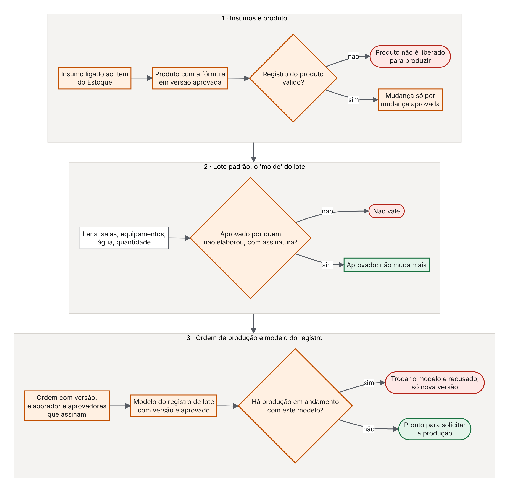
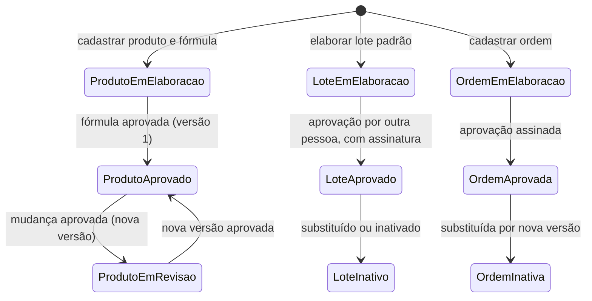

# Passo 3, fluxo 14b: definir o que se fabrica (produto, fórmula, lote padrão e ordem de produção, Produção)

*Como ler: **laranja** = o sistema confere (trava); **vermelho** = bloqueio; **verde** = resultado. Clique na imagem para ampliar.*

*Coluna "Onde no sistema": o caminho no sistema atual (legado), no formato **Módulo › Menu › Tela**. Os nomes de menu seguem as telas do módulo Produção. Onde diz "tela nova", a tela não existe hoje e será criada.*

> **Em uma frase:** é a **"receita" oficial do remédio**: o que entra (a fórmula), em que quantidade, em que salas e equipamentos, e a **ordem de produção** que manda fabricar uma quantidade, com o modelo do caderno onde tudo é anotado.
>
> **Exemplo do dia a dia (ilustrativo, os números são inventados):** o xarope tem a fórmula "10% de princípio ativo, 40% de açúcar, 50% de água". O **lote padrão** diz: "para um lote de 1.000 litros, use a sala 3, o tanque A e a balança B". Só depois que alguém **aprova** esse lote padrão é que a produção pode ser pedida.
>
> **Por que importa:** se a receita puder mudar sem aprovação, dois lotes do "mesmo" remédio podem sair diferentes sem ninguém perceber.
>
> *Palavra que não conhece? Veja a aba "24 · Glossário" desta página. Aqui: **fórmula** é a lista do que entra no remédio e em que quantidade; **lote padrão** é o "molde" aprovado de um lote (itens, locais, equipamentos); **OPE (ordem de produção)** é a ordem que manda fabricar, ligada a um modelo de **registro de lote** (o caderno de anotações da fabricação); **XML** é o formato do arquivo desse modelo.*

**Análise de 20/11/2026. Rascunho para validação do responsável.** Segunda das cinco fichas da **Produção** (a [14a](fluxo-14a-preparacao.md) foi a preparação). Aqui nasce **tudo o que a produção precisa para ser pedida**: sem produto, lote padrão aprovado e ordem de produção, não há como solicitar a produção (ficha 14c).

**Fontes (todas no repositório do legado):** o fluxo "Produto, fórmula e ordem de produção" (`2.producao/fluxos/produto-formula-ordem.md`, lido do código) e os resultados dos testes de tela da Produção (rodadas 1 a 9; casos `CT-PRO-041` a `056`). **O que não fiz:** não li as telas uma a uma. **Foram testados na tela** o Cadastro de Insumos, o Cadastro do Produto, o Cadastro de Lote Padrão e o Cadastro da Ordem de Produção; a **troca do modelo durante a produção** e as **demandas** vêm **só do código**. As normas (RDC 658/2022, arts. 133, 134, 135, 176 e 177) foram conferidas no texto.

## 1. O caminho, em uma linha
**Insumo** ligado ao item do Estoque → **produto** com a fórmula e o registro → **lote padrão** (o "molde" do lote), **aprovado** por outra pessoa → **ordem de produção** com o modelo do registro de lote → **pronto para pedir a produção**.

### A situação do produto, do lote padrão e da ordem

No legado o **produto não tinha situação** (só ativo ou inativo), a **fórmula não tinha versão** e a **aprovação da ordem de produção era um nome escolhido numa lista**. No iLabs cada um dos três tem **situação e versão, guardadas e conferidas pelo banco**.

## 2. Etapa a etapa

| # | Etapa | Onde no sistema (legado) | Quem faz | Exige antes | O que entra | O banco garante (iLabs) | Falha do legado |
|---|---|---|---|---|---|---|---|
| 1 | **Cadastrar o insumo (ingrediente)** | **Produção** › Cadastros › Cadastro de Insumos, Configurações Insumos Produção, Configurações Insumos Diversos, Classificação Insumos | Produção | **Item do Estoque** cadastrado ([ficha 5](fluxo-05-movimentacao-interna.md)) | Nome, classificação, unidade, ligação com o item do Estoque, e os controles (lote, validade, quarentena, substância controlada) | **Um item do Estoque, um insumo**; os **controles ficam em um só lugar** (no cadastro do item); controle de lote e de quarentena **não pode ser desligado** para insumo de fabricação | **Funcionou** (insumos criados e ligados ao Estoque; um item só se liga a um insumo); os **controles de lote, validade e quarentena existiam em dois cadastros** (o do insumo e o do item do Estoque) e **não se sabe qual vale quando divergem** (`RN004`, a confirmar) |
| 2 | **Cadastrar soluções de limpeza** | **Produção** › Cadastros › Cadastro de Soluções | Produção | — | Nome, **exigência de validade e de lote** | **Solução com validade e lote obrigatórios**, usada na limpeza ([ficha 14a](fluxo-14a-preparacao.md)) | Funcionou pelo código (`RN005`); **não testada** na tela |
| 3 | **Cadastrar o produto e a fórmula** | **Produção** › Cadastros › Cadastro do Produto | Produção e Qualidade | Insumos; registro do produto ([ficha 13e](fluxo-13e-assuntos-regulatorios.md)) | Descrição, categoria, classe terapêutica, forma física, via de administração, restrição de uso, **tempo de validade**, **fórmula** (insumo, concentração, unidade, percentual) | **Fórmula com versão e aprovação**; **ao menos um item**; conteúdo da fórmula como pede a norma (nome, forma, concentração, tamanho do lote, matérias-primas e quantidades, rendimento esperado) | O produto foi gravado **só no segundo "SIM"** de confirmação (rodadas 3 e 4); a **fórmula não tinha versão nem aprovação própria** (`RN008`, art. 133); o produto **sem número de registro** era gravado depois de uma confirmação (`RN007`) |
| 4 | **Informar o registro na ANVISA** | Mesma tela | Assuntos Regulatórios | Registro do produto (ficha 13e) | Número, data do registro, **validade do registro** | O produto **só é liberado para produzir** com registro **válido**; vem do cadastro regulatório, **não digitado** em duas telas | Aceitava **registro vencido há até 5 anos** (`RN007`, `CT-PRO-042`); a validade era **só informativa** e **não impedia** pedir nem autorizar a produção (`RN014`, `CT-PRO-055`); o registro era **cadastrado em dois lugares que não se falam**: a Produção e a GQ ([ficha 13e](fluxo-13e-assuntos-regulatorios.md)) |
| 5 | **Mudar o produto ou a fórmula** | Mesma tela (alterar, **Duplicar**) | Produção, com mudança aprovada | **Mudança aprovada** na GQ ([ficha 13c](fluxo-13c-controle-de-mudancas.md)) | Justificativa, nova versão | **Só muda por mudança aprovada**, gera **nova versão da fórmula**; a **versão antiga fica guardada**; **produto novo guarda de qual veio** | Alterar exigia **justificativa** e gravava histórico (`RN009`); **produto com lote padrão ficava travado** (`RN010`), **mas a trava caía com a configuração "em migração"** (`RN011`); o caminho era **Duplicar**, que **não guardava o produto de origem** (`RN012`); **nada ligava a mudança a uma mudança aprovada na GQ** (arts. 8º XII e 176) |
| 6 | **Ligar o produto ao Estoque** | Mesma tela | Produção | Item do produto acabado no Estoque | O item que **recebe o produto acabado** | **Um produto, um item do Estoque**; o lote de produto acabado **nasce da ordem de produção** ([ficha 8](fluxo-08-devolucao-e-entradas.md)) | Funcionou pelo código (`RN013`); **não testada** na tela |
| 7 | **Montar o lote padrão** | **Produção** › Cadastros › Cadastro de Lote Padrão | Produção | Produto, insumos, salas, equipamentos, instrumentos, utensílios e pontos de água cadastrados | **Itens e quantidades**, salas, equipamentos, instrumentos, utensílios, utilidades, pontos de água; tipo (**fabricação** ou **embalagem**); **quais autorizações são obrigatórias** | **Sem repetir item**; instruções de processo com os itens da norma (local, equipamento principal, preparação do equipamento, conferência de linha livre) | **Funcionou**: "O item já está adicionado!" e equivalentes (`RN016`); a lista de **autorizações obrigatórias** vem do lote padrão (ficha 14c) |
| 8 | **Aprovar o lote padrão** | Mesma tela (botão Aprovar) | Quem tem a função de aprovar | Lote padrão montado | Aprovação, com **assinatura** | **Aprova quem não elaborou, conferido pelo usuário (não pelo nome)**, com **senha**; **depois de aprovado, não se edita**; só lote padrão **ativo e aprovado** é oferecido para produzir | **Funcionou** depois de ligar uma função profissional à **configuração 19** (`DV-EST-076`: sem isso **ninguém conseguia aprovar** e a Produção não pedia nem o primeiro lote); a separação "quem elaborou não aprova" era **feita pelo nome** digitado, não pelo usuário (`RN017`); após aprovar, os itens **ficavam bloqueados** (`RN018`); a **aprovação automática estava comentada** (`RN020`) |
| 9 | **Cadastrar a ordem de produção** | **Produção** › Cadastros › Cadastro Ordem de Produção | Produção | Produto | **Número, versão e revisão**, **datas**, **elaborado por**, **aprovado por**, **análise crítica** e **GQ** (com datas), situação | **Versão e revisão numeradas pelo sistema**; **datas do servidor**; **cada aprovador assina com senha**; alteração **com justificativa e nova versão** | **Ninguém assinava**: quem cadastrava **escolhia os nomes** de quem elaborou e aprovou e **digitava as datas**, sem senha nem conferência de função (`RN021`, `RN022`, `CT-PRO-050`); a ordem 6 foi criada com o aprovador **digitado**, sem a pessoa aprovar (rodada 3); alterar **exigia justificativa** (`RN023`) |
| 10 | **Enviar o modelo do registro de lote (XML)** | Mesma tela (enviar e baixar XML) | Produção | Ordem cadastrada; modelo montado no **Gerador de OPE** (módulo OPE) | Arquivo XML com as **etapas, subetapas e campos** do caderno de fabricação | **O modelo tem versão e aprovação**; **cada lote guarda a versão do modelo usada**; **trocar o modelo com produção em andamento é recusado** (só nova versão) | A troca do modelo **não conferia se havia produção em andamento** (só a exclusão conferia) e o registro lia **sempre o modelo atual**: trocar durante uma produção **podia mudar o caderno que estava sendo preenchido** (`RN025`, **a confirmar**); o modelo **vinha do Gerador de OPE, sem versão nem aprovação** (`RN027`) |
| 11 | **Cadastrar etapas e horas-padrão** | **Produção** › Cadastros › Cadastro de Etapa, Cadastro de HH Padrão | Produção | — | Etapas e horas-padrão por etapa | Horas-padrão **por produto e etapa**, para o controle de horas | **Não testada**; pelo código, as horas-padrão alimentam o controle de horas (`RN026`) |
| 12 | **Cadastrar demandas de clientes** | **Produção** › Cadastros › Cadastro de Demandas | Produção e Comercial | Cliente cadastrado | Tipo, cliente, contrato, valor, vigência, itens | Demanda **ligada ao Comercial** (pedido e cliente) | **Não testada**; **a validar com a área** se ainda se usa e como se liga ao Comercial (`RN028`) |

## 3. O que este fluxo exige de cada cadastro global

| Cadastro (passo 1) | O que o fluxo precisa que ele guarde |
|---|---|
| **Item de Estoque** | O item do insumo e o do produto acabado, com os controles (lote, validade, quarentena) **em um só lugar** |
| **Produto (Produção)** | Fórmula **com versão e aprovação**, tempo de validade, **registro na ANVISA** (vindo do cadastro regulatório) |
| **Locais, equipamentos, instrumentos, utensílios, pontos de água** | Tudo o que o lote padrão lista, **ativo e com preparação em dia** ([ficha 14a](fluxo-14a-preparacao.md)) |
| **Profissional e função** | **Elaborar**, **aprovar o lote padrão**, **elaborar e aprovar a ordem**, **análise crítica** e **GQ**: funções **separadas**, com assinatura |
| **Registro do produto (ficha 13e)** | Número, validade e situação; **bloqueia** o produto sem registro regular |
| **Mudança (ficha 13c)** | A mudança aprovada **autoriza** a nova versão da fórmula |
| **Documento (ficha 12a)** | A **ordem de produção e o modelo do registro** como **documentos controlados** (vigentes, com versão) |
| **Modelo do registro de lote (módulo OPE)** | Versão, aprovação e ligação com a ordem |
| **Notificações (serviço comum)** | Aviso de **registro do produto a vencer**, de **lote padrão pendente de aprovação** e de **ordem a revisar** |

## 4. Os registros que nascem no fluxo (não são cadastros)
Fórmula (versões) · lote padrão (versões) · ordem de produção (versões) · modelo do registro de lote (versões) · histórico de alterações · justificativas.

## 5. O que muda nos documentos anteriores
- **Roteiro de implantação:** na etapa 6 (materiais), o insumo e o produto acabado ligados ao Estoque, com **controles em um só lugar**; na etapa 7, a **fórmula do produto com versão aprovada**, o **lote padrão aprovado** e a **ordem de produção com o modelo do registro**; na etapa 1, as funções de **elaborar e aprovar** lote padrão e ordem, **separadas e com assinatura**; na etapa 9, o ensaio inclui **um produto com registro vencido** (não é liberado), **uma tentativa de aprovar o próprio lote padrão** (recusada) e **uma troca de modelo com produção em andamento** (recusada).
- **Passo 2 (ordem):** insumos, itens do Estoque, registro do produto e preparação (14a) vêm **antes** do lote padrão; o lote padrão vem **antes** da ordem de produção.
- **Ficha 13e (regulatórios):** o **registro do produto** é **uma só fonte**, usada aqui e lá.
- **Ficha 13c (mudanças):** a nova versão da fórmula **só nasce de uma mudança aprovada**.
- **Ficha 12a (documentos):** a ordem de produção e o modelo do registro passam a ser **documentos com ciclo de aprovação**.

## 6. Pontos a validar com a área (não consegui tirar do código)
1. **Fórmula:** quem **aprova** a fórmula (e a mudança dela)? A mudança de fórmula **sempre** passa pela GQ?
2. **Lote padrão:** um lote padrão por **tamanho de lote** e por **produto**? Quando o lote padrão é **substituído**, o antigo ainda vale para ordens abertas?
3. **Ordem de produção:** quem **elabora**, **aprova**, faz a **análise crítica** e a **GQ**? São pessoas ou funções?
4. **Modelo do registro (XML):** quem **monta e aprova** o modelo (o Gerador de OPE, módulo OPE)? Ele pode mudar durante uma produção?
5. **Registro do produto vencido:** impede **pedir** a produção, **iniciá-la**, ou só **vender**? ([ficha 13e](fluxo-13e-assuntos-regulatorios.md))
6. **Insumo:** os controles de lote, validade e quarentena ficam no **item do Estoque** ou no **insumo da Produção**? Qual manda?
7. **Demandas:** ainda se usam? Ligam ao **Comercial**?
8. **Em migração:** a configuração que **desliga a trava do produto** deve existir? Quem pode ligá-la, por quanto tempo?
