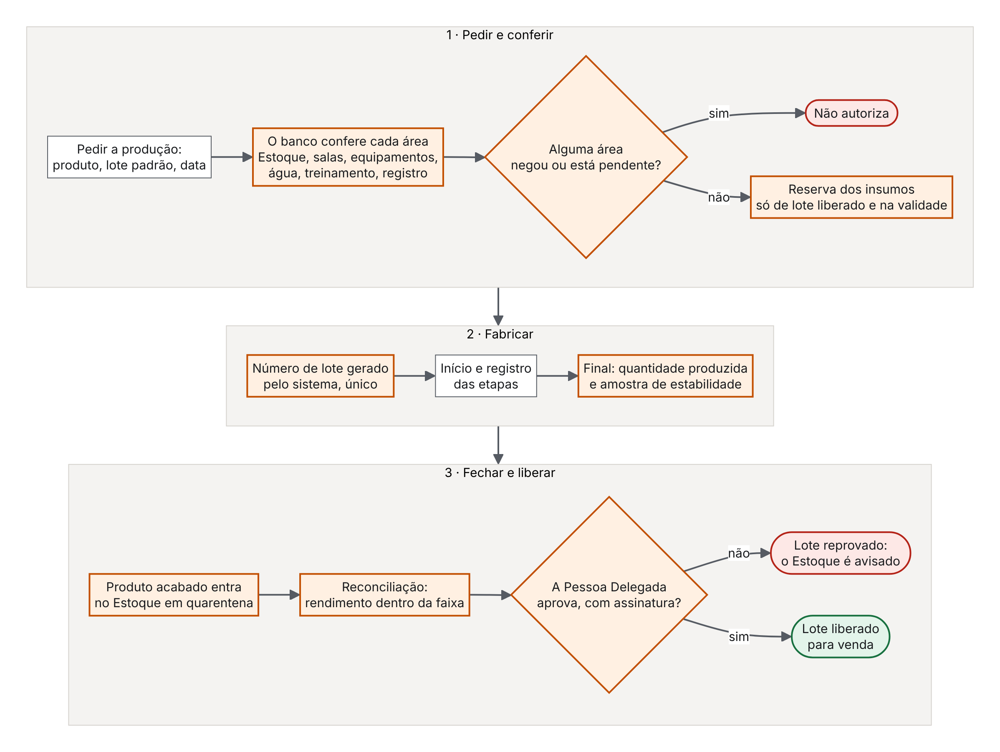
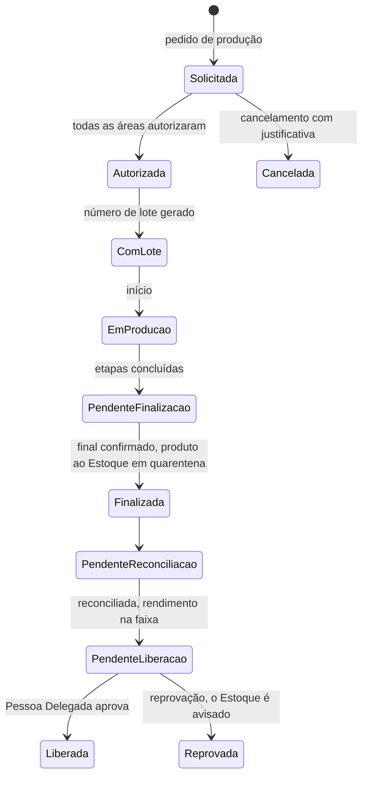

# Passo 3, fluxo 14c: do pedido de produção até a liberação do lote (autorização, início e final da produção, Produção)

*Como ler: **laranja** = o sistema confere (trava); **vermelho** = bloqueio; **verde** = resultado. Clique na imagem para ampliar.*

*Coluna "Onde no sistema": o caminho no sistema atual (legado), no formato **Módulo › Menu › Tela**. Os nomes de menu seguem as telas do módulo Produção. Onde diz "tela nova", a tela não existe hoje e será criada.*

> **Em uma frase:** é a **corrente principal da fábrica**: a produção pede para fabricar, **cada área confirma que está pronta** (estoque, salas, equipamentos, água, qualidade), a produção é autorizada, o lote **recebe um número**, é fabricado, e no fim é **conferido e liberado**.
>
> **Exemplo do dia a dia (ilustrativo, os números são inventados):** a produção pede 1.000 litros de xarope. O estoque confirma que há ingredientes aprovados, a sala está limpa, a balança calibrada, o analista treinado. Autorizado, o lote ganha o número L-2026-045. Fabricado, vai ao estoque **em quarentena** até a Pessoa Delegada assinar a liberação.
>
> **Por que importa:** é aqui que **tudo o que foi estudado antes se encontra**. Se uma área pode ser ignorada, um lote pode ser fabricado com ingrediente vencido, equipamento sem calibrar ou gente sem treinamento.
>
> *Palavra que não conhece? Veja a documento "Glossário" (grupo "Para começar" da lista do estudo). Aqui: **reconciliação** é conferir se a quantidade que entrou e a que saiu **fecham** (sem sumiço nem sobra); **rendimento** é quanto saiu pronto em relação ao esperado; **Pessoa Delegada** é quem assina que o lote pode ser vendido; **estabilidade** é a amostra guardada para acompanhar o produto ao longo da validade.*

**Análise de 20/11/2026. Rascunho para validação do responsável.** Terceira das cinco fichas da **Produção** (a [14a](fluxo-14a-preparacao.md) foi a preparação e a [14b](fluxo-14b-produto-formula-ordem.md), produto, fórmula e ordem). É a ficha mais importante da Produção: **liga o Estoque, o CQ e a GQ à fabricação**.

**Fontes (todas no repositório do legado):** o fluxo "Autorização, início e final" (`2.producao/fluxos/autorizacao-inicio-final.md`, lido do código) e o inventário de telas com os resultados dos testes da Produção (rodadas de 02 a 09/11/2026; casos `CT-PRO-001` a `020`; achados `DV-PRO-005`, `006`, `007`, `010`, `DV-EST-076`). **O que não fiz:** não li as telas uma a uma. **A cadeia ficou bloqueada nos testes**: a Solicitação de Autorizações grava, mas a integração com o Estoque não completa e a tela não avisa (`DV-PRO-010`, Alta); por isso a autorização da produção, o número de lote, o início, o final, a reconciliação e a liberação **não puderam ser testados** e vêm **só do código**. Só a Autorização de Equipamentos foi exercitada na tela. As normas (RDC 658/2022, arts. 137, 160, 167, 189, 195 e 220) foram conferidas no texto.

## 1. O caminho, em uma linha
**Pedir a produção** → **sete áreas autorizam** (Estoque, salas, equipamentos, instrumentos, água, GQ, CQ) → **autorizar a produção** → **gerar o número de lote** → **fabricar e registrar** (ficha 14d) → **finalizar** (quantidade, estabilidade) → **produto acabado ao Estoque** → **reconciliar** → **liberar** (aprovar ou reprovar).

### A situação da produção

No legado a situação era **calculada na hora** a partir do que foi registrado e a "autorização" **não conferia** os outros módulos. No iLabs a situação é **uma só, guardada e conferida pelo banco**, e cada passo **consulta de fato** o módulo que responde por ele.

## 2. Etapa a etapa

| # | Etapa | Onde no sistema (legado) | Quem faz | Exige antes | O que entra | O banco garante (iLabs) | Falha do legado |
|---|---|---|---|---|---|---|---|
| 1 | **Pedir a produção** | **Produção** › Autorizações › Solicitação de Autorizações | Produção | Produto, **lote padrão aprovado**, ordem de produção ([ficha 14b](fluxo-14b-produto-formula-ordem.md)) | Produto, lote padrão, **data e hora previstas de início** | O pedido **só vale com lote padrão aprovado**; **todo item, sala, equipamento, instrumento e ponto de água do lote padrão está ativo e liberado**; **reserva dos insumos no Estoque na mesma gravação**; **insumo sem saldo recusa** | A solicitação **gravava, mas a integração com o Estoque não completava e a tela não avisava**: as quatro autorizações ficavam sem andamento (`DV-PRO-010`, Alta, `CT-PRO-001` a `003`); bloqueada também por **conversão de unidade ausente** na massa de teste (`DV-PRO-005`, `007`); inativos e sem saldo eram conferidos pelo código (`RN002`, `RN005`); a regra de saldo **podia ser desligada** por configuração |
| 2 | **Escolher quais áreas autorizam** | Mesma tela (autorizações criadas conforme o lote padrão) | Automático | Lote padrão | — | **As sete áreas são sempre exigidas**; **nenhuma pode ser dispensada** pelo lote padrão | **GQ e CQ sempre**, mas **Estoque, salas, equipamentos, instrumentos e água só se o lote padrão marcasse a área como obrigatória**: marcada de menos, a autorização **nem era criada** (`RN003`, ponto 5) |
| 3 | **Estoque confirma os insumos** | **Produção** › Autorizações › Autorização Estoque x Produção | Estoque | Reserva feita | Para cada insumo: quantidade, **lote**, **validade** | O lote vem **do Estoque** (não digitado), **só lote liberado pelo CQ e dentro da validade** (art. 189); **FEFO** (o que vence primeiro) por regra definida | **Bloqueada no teste**: a grade de confirmação do insumo veio **vazia** porque a integração com o Estoque não rodou (`CT-PRO-004`); pelo código, **lote, validade e data eram todos digitados** e a tela **não conferia** a situação do lote nem a validade (`RN007`, ponto 3) |
| 4 | **Salas, equipamentos, instrumentos e água autorizam** | **Produção** › Autorizações › Autorização Ambientes, Equipamentos, Instrumentos, Pontos de Água x Produção | Produção | Preparação em dia ([ficha 14a](fluxo-14a-preparacao.md)) | Situação de cada item e, se pendente, a **justificativa** | **Pendente não autoriza**; exceção **só com justificativa assinada pela Qualidade** e **abre desvio** ([ficha 13b](fluxo-13b-desvios-e-capa.md)); **resultado ruim bloqueia** | Equipamento: **funcionou** (autorizado com justificativa; o primeiro envio devolveu "Sessão Expirada" e a repetição passou, `DV-PRO-006`, **não reproduzido**); a **pendência podia ser autorizada com justificativa de até 100 caracteres**, **sem aprovação de outra pessoa** e **sem virar desvio** (`RN009`, `CT-PRO-005`, ponto 4, art. 167); **ambientes, instrumentos e água não foram testados** (resultado ruim não contava, ficha 14a) |
| 5 | **GQ e CQ autorizam** | **Produção** › Autorizações › Autorização Garantia da Qualidade x Produção, Autorização Controle de Qualidade x Produção | Qualidade e Controle da Qualidade | Documentos e treinamento em dia | A marcação de cada item (reagentes, equipamentos do CQ etc.) | A GQ **consulta de verdade**: **documento vigente** da ordem ([ficha 12a](fluxo-12a-ciclo-do-documento.md)), **treinamento** de quem vai produzir ([ficha 13a](fluxo-13a-treinamento.md)), **mudança aprovada** ([ficha 13c](fluxo-13c-controle-de-mudancas.md)) e **registro do produto** ([ficha 13e](fluxo-13e-assuntos-regulatorios.md)); o CQ consulta **laudo dos insumos** | **Eram só marcações**: o sistema **não consultava** o módulo da GQ nem o do CQ (`RN011`, `RN012`, ponto 2); a **data e a hora eram digitadas** (`RN012`); **quem autoriza** (área dona ou Produção) **não está claro** (`RN014`) |
| 6 | **Autorizar ou cancelar a produção** | **Produção** › Autorizações › Autorizar/Cancelar Produção | Responsável pela Produção | As sete autorizações respondidas | Data e hora autorizadas de início, justificativa | **Só autoriza se todas as áreas autorizaram** (uma que **negou** impede); **cancelar** exige justificativa e **estorna a reserva no Estoque** | **Bloqueada no teste** (depende de `DV-PRO-010`); pelo código, **"pendente" era só a autorização sem resposta**: uma área que respondeu **"Não autorizada" não impedia** a produção (`RN016`, ponto 1, `CT-PRO-006`, **a confirmar**); a **data e hora de início eram digitadas** (`RN017`); o **cancelamento não estornava a reserva** no Estoque (`RN019`, `CT-PRO-009`, **a confirmar**) |
| 7 | **Gerar o número de lote** | **Produção** › Autorizações › Gerar Número de Lote | Responsável pela Produção | Produção autorizada | Tipo de lote (convencional, piloto, **reprocessado**, ordem de serviço), e, no reprocesso, lote anterior, etapa, justificativa, PDF | **O sistema gera o número**, único, no **formato da empresa**; **validade contada da fabricação**; **reprocesso exige a justificativa e a aprovação da Qualidade** | **Não testada**; pelo código, o **número era digitado**, conferido contra o formato e contra os já usados (`RN022`, `RN023`); o código trazia **dois formatos fixos de clientes anteriores** ("Padrão Exército" e "Padrão Marinha") (`RN022`); a **validade contava da geração do número**, não da fabricação (`RN024`) |
| 8 | **Iniciar e registrar a produção** | **Produção** › Autorizações › Início da Produção; **Produção** › Registro da Produção (ficha 14d) | Produção | Número de lote | As etapas do modelo | O início **só com tudo autorizado e com o lote gerado**; só se registra em produção iniciada | **Bloqueada no teste**; **não existe ato de "iniciar"**: a tela é uma **lista** das produções com número de lote (`RN026`); só se registra em produção iniciada ou pendente de finalização (`RN027`) |
| 9 | **Finalizar a produção** | **Produção** › Produção › Final da Produção | Produção | Etapas concluídas | **Data e hora finais**, **quantidade produzida**, **quantidade de estabilidade** | **Data do servidor**; estabilidade **não passa da produzida**; **o produto acabado entra no Estoque em quarentena** ([ficha 8](fluxo-08-devolucao-e-entradas.md)) **na mesma gravação**; **sem opção de não enviar** | **Bloqueada no teste**; pelo código, a pergunta "enviar para o estoque" vinha **marcada Sim**, mas com **Não a produção finalizava e o produto acabado não entrava no Estoque** (`RN030`, ponto 6); o produto entrava **antes da reconciliação e da liberação**, **sem se saber em que situação** (`RN031`, art. 220); data e hora finais **digitadas** (`RN029`) |
| 10 | **Reconciliar (fechar as contas)** | **Produção** › Produção › Reconciliação da Produção | Produção | Final confirmado | **Rendimentos obtido e comercial**, aprovação, justificativa | **Rendimento comparado com a faixa esperada**; **fora da faixa abre desvio**; **a reabertura só com justificativa e aprovação da Qualidade** | **Bloqueada no teste**; pelo código, os rendimentos eram **digitados, sem faixa esperada** (`RN033`, art. 160); a reabertura pedia só **justificativa** (`RN033`, ponto 11) |
| 11 | **Liberar a produção** | **Produção** › Produção › Liberação da Produção | **Pessoa Delegada** | Reconciliação aprovada | Aprovar ou **reprovar**, justificativa | **Aprova quem não produziu nem reconciliou**; **só a Pessoa Delegada libera o lote para venda** (art. 8º, XV); **a reprovação chega ao Estoque** e retém o lote | **Bloqueada no teste**; **final, reconciliação e liberação usavam o mesmo código de tela**: **quem finalizava podia reconciliar e liberar** (`RN035`, ponto 7, `CT-PRO-018`); **não se encontrou a liberação pela Pessoa Delegada**; a **reprovação não chegava ao Estoque** (`RN031`, `CT-PRO-019`); data e hora **digitadas** (`RN034`) |
| 12 | **Ver a situação da produção** | Listas de Gerar Número de Lote, Início da Produção e Final da Produção | Todos | — | — | **Situação guardada**: cadastrada, autorizada, com lote, em produção, pendente de finalização, de reconciliação e de liberação, liberada, reprovada, cancelada | A situação era **calculada na hora** pelo que estava registrado (`RN037`) |

## 3. O que este fluxo exige de cada cadastro global

| Cadastro (passo 1) | O que o fluxo precisa que ele guarde |
|---|---|
| **Produto, fórmula, lote padrão e ordem de produção** | Tudo **aprovado**, com versão ([ficha 14b](fluxo-14b-produto-formula-ordem.md)) |
| **Item de Estoque, lote e saldo** | Lote **liberado, dentro da validade**, com **reserva** por produção e conversão de unidade cadastrada |
| **Sala, equipamento, instrumento, ponto de água** | Situação de **liberado ou pendente** vinda da preparação ([ficha 14a](fluxo-14a-preparacao.md)) |
| **Profissional e função** | Quem **solicita**, **autoriza por área**, **autoriza a produção**, **gera o lote**, **finaliza**, **reconcilia** e **libera (Pessoa Delegada)**: funções **separadas**, treinadas e com assinatura |
| **Documento (ficha 12a)** | A ordem de produção como **documento vigente** |
| **Treinamento (ficha 13a)** | Quem executa **está treinado e vigente** |
| **Registro do produto (ficha 13e)** | **Válido** na data da produção |
| **Faixa de rendimento** | **Limites esperados** por produto, para a reconciliação |
| **Formato do número de lote** | Regra da **empresa** (sem formatos de outros clientes) |
| **Notificações (serviço comum)** | Aviso de autorização pendente, de produção parada e de lote aguardando liberação |

## 4. Os registros que nascem no fluxo (não são cadastros)
Produção (solicitação) · autorizações por área · reserva dos insumos · número de lote · registro da produção (ficha 14d) · final · reconciliação · liberação · produto acabado e amostra de estabilidade no Estoque · histórico.

## 5. O que muda nos documentos anteriores
- **Roteiro de implantação:** na etapa 1, as funções **separadas** (solicitar, autorizar por área, autorizar a produção, finalizar, reconciliar, **Pessoa Delegada**), com assinatura; na etapa 7, o **formato do número de lote**, a **faixa de rendimento** por produto e a **conversão de unidade** dos itens; na etapa 9, o ensaio inclui **uma produção completa até a liberação**, **uma área que nega** (a produção não é autorizada), **um insumo vencido** (recusado), **uma finalização sem entrar no Estoque** (impossível) e **uma reprovação** (o Estoque retém o lote).
- **Passo 2 (ordem):** todas as fichas anteriores vêm **antes**: Estoque, CQ, GQ, preparação, produto e ordem. Esta ficha é **o fim da cadeia**.
- **Fichas 13a, 13c e 13e:** o **treinamento**, a **mudança aprovada** e o **registro do produto** passam a ser **consultados aqui**, na autorização da GQ.
- **Ficha 8 (devolução e entradas):** o produto acabado da Produção entra **em quarentena**, **sempre**.

## 6. Pontos a validar com a área (não consegui tirar do código)
1. **Quem autoriza cada área?** O Estoque autoriza a parte do Estoque, o CQ a do CQ, a GQ a da GQ? Ou é a Produção quem marca em nome deles?
2. **Área que nega:** a produção **pode** ser autorizada assim mesmo? Em que caso e com quem aprovando?
3. **Item pendente** (equipamento, sala): quem pode **autorizar a exceção** e como se registra o **desvio**?
4. **Número de lote:** quem define o **formato**? A **validade** conta da **fabricação** ou da **liberação**?
5. **Quarentena do produto acabado:** o produto entra no Estoque **antes** ou **depois** da liberação? (Pela norma, art. 220, em quarentena até a liberação final.)
6. **Pessoa Delegada:** quem é na empresa? É a mesma que **reconcilia**? A liberação é feita **no sistema** ou no papel?
7. **Rendimento:** qual a **faixa aceitável** por produto? Fora dela, abre **desvio**?
8. **Reabertura** de final, reconciliação e liberação: **quem pode** e **com qual justificativa**?
9. **Reprovação do lote:** **o que acontece** com o produto já enviado ao Estoque (retém, descarta, retrabalha)?
