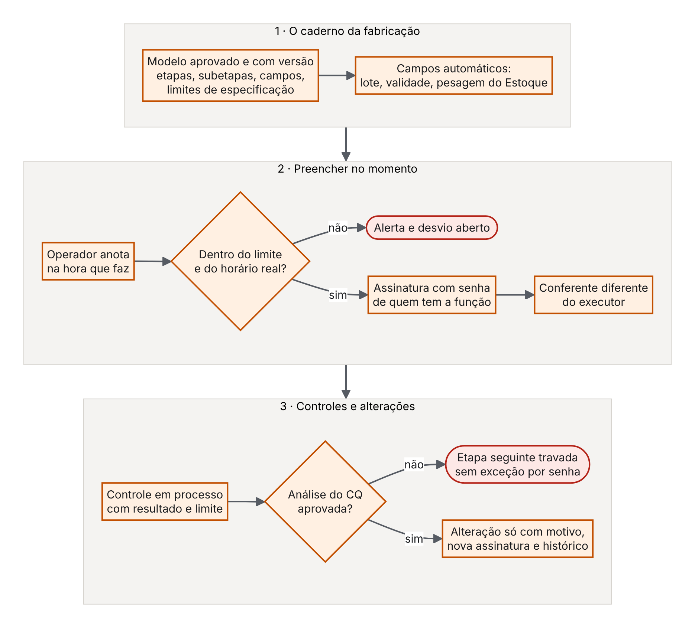
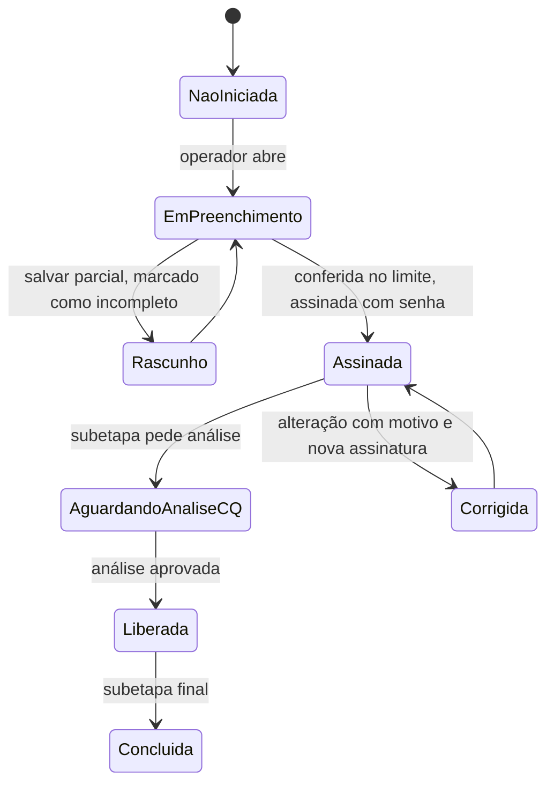

# Passo 3, fluxo 14d: o "caderno" que prova como o lote foi fabricado (registro de lote, Produção)

*Como ler: **laranja** = o sistema confere (trava); **vermelho** = bloqueio; **verde** = resultado. Clique na imagem para ampliar.*

*Coluna "Onde no sistema": o caminho no sistema atual (legado), no formato **Módulo › Menu › Tela**. Os nomes de menu seguem as telas do módulo Produção. Onde diz "tela nova", a tela não existe hoje e será criada.*

> **Em uma frase:** enquanto o lote é fabricado, o operador **anota cada passo num "caderno" oficial** (o registro de lote): o que fez, quando, com o quê, quem conferiu. Esse caderno é a **prova de como o lote foi feito**.
>
> **Exemplo do dia a dia (ilustrativo, os números são inventados):** na etapa de mistura, o caderno pede: hora de início e fim, a temperatura (que deve ficar entre 20 e 25 graus), o lote de cada ingrediente pesado e a assinatura de quem misturou e de quem conferiu. Se a temperatura anotada for 30, o sistema deve alertar.
>
> **Por que importa:** se alguém consegue **mudar o caderno depois**, anotar uma hora que não é a real ou liberar uma análise reprovada, a empresa não consegue provar que o lote foi bem feito, e uma fiscalização encontra isso.
>
> *Palavra que não conhece? Veja a aba "24 · Glossário" desta página. Aqui: **etapa e subetapa** são os passos da fabricação, em ordem; **controle em processo** é uma conferência feita no meio da fabricação (por exemplo, medir o peso médio dos comprimidos); **modelo XML** é o arquivo que desenha o caderno de cada produto; **assinatura** é confirmar com usuário e senha.*

**Análise de 20/11/2026. Rascunho para validação do responsável.** Quarta das cinco fichas da **Produção** (a [14a](fluxo-14a-preparacao.md) foi a preparação, a [14b](fluxo-14b-produto-formula-ordem.md), produto e ordem e a [14c](fluxo-14c-autorizacao-inicio-final.md), autorização e final). É o **registro que a fiscalização lê primeiro**: mostra, passo a passo, como o lote foi fabricado.

**Fontes (todas no repositório do legado):** o fluxo "Registro de lote" (`2.producao/fluxos/registro-de-lote.md`, lido do código) e o inventário de telas com os resultados dos testes da Produção (rodadas de 02 a 09/11/2026; casos `CT-PRO-021` a `040`). **O que não fiz:** não li as telas uma a uma. **Nenhuma tela deste fluxo foi testada**: o Registro da Produção ficou **bloqueado** porque a produção não chegou a ser iniciada (`DV-PRO-010`, ficha 14c), e o Log OPE, a Pesagem, a Manipulação de Horas e a Solicitação Avulsa ficaram **não testados**. **Tudo vem só do código.** As normas (RDC 658/2022, arts. 124, 125, 137, 192, 193 e 198) foram conferidas no texto.

## 1. O caminho, em uma linha
**Modelo do caderno** (por produto) → **abrir o registro** (só em produção iniciada) → **campos automáticos** (lote, validade, pesagem do Estoque) → **preencher e assinar** → **controles em processo e análise do CQ** → **alterações com histórico** → **última subetapa** → produção pendente de finalização.

### A situação de cada subetapa

No legado a subetapa só tinha "salva" e "não salva"; o **rascunho gravava até campo inválido**, a **análise reprovada podia ser liberada com senha** e **alterar não pedia motivo nem nova assinatura**. No iLabs cada subetapa tem **situação guardada e conferida pelo banco**, e **alterar assinada exige motivo e reassinar**.

## 2. Etapa a etapa

| # | Etapa | Onde no sistema (legado) | Quem faz | Exige antes | O que entra | O banco garante (iLabs) | Falha do legado |
|---|---|---|---|---|---|---|---|
| 1 | **Ter o modelo do caderno** | Ligado à ordem de produção em **Produção** › Cadastros › Cadastro Ordem de Produção ([ficha 14b](fluxo-14b-produto-formula-ordem.md)); montado no **Gerador de OPE** (módulo OPE) | Produção e Qualidade | Ordem de produção | O modelo (etapas, subetapas, campos, **limites de especificação**) | **Modelo com versão e aprovação**; **limite mínimo e máximo por campo no próprio modelo**; **cada lote guarda a versão que usou** | O modelo **não tinha limite de especificação**: a conferência contra o limite só existia se um **programador a escrevesse na classe do produto** (`RN003`); um produto novo ou uma mudança no processo **exigia programador**; o nome **"Glibenclamida" estava escrito no código geral** (`RN004`, ponto 1) |
| 2 | **Abrir o registro** | **Produção** › Produção › Início da Produção, depois Registro da Produção | Operador | **Produção iniciada** (ficha 14c) | — | **Só abre em produção iniciada**; depois da finalização, **só leitura** | **Bloqueada no teste** (a produção não chegou a ser iniciada, `DV-PRO-010`); pelo código, abria só em produção iniciada ou pendente de finalização e depois **ficava bloqueada** (`RN005`, `RN030`) |
| 3 | **Preencher sozinho o que dá** | Mesma tela (campos automáticos) | Automático | Lote gerado | Número do lote e da OPE, **validade**, quem criou e quem gerou, **revisão e versão da ordem** | Tudo **vem do sistema**, **não digitável** | **Pelo código**, funcionava (`RN006`); a **validade contava da geração do número** do lote, não da fabricação (ficha 14c) |
| 4 | **Trazer a pesagem do Estoque** | Mesma tela (campos de integração) | Automático | Pesagem feita no Estoque ([ficha 6](fluxo-06-solicitacao-separacao-atendimento.md)) | Item, **lote do insumo**, peso líquido, tara, quantidade, quem pesou e quem separou | A pesagem **vem do Estoque** (não digitada), **só de lote liberado e na validade**; **cada pesagem conferida por segunda pessoa** (art. 193) | **Pelo código**, trazia os dados do Estoque (`RN007`); existia **uma segunda tela de pesagem na Produção, isolada**, com responsáveis **sem senha** que **podiam ser a mesma pessoa**, e o registro de lote **não usava essa pesagem** (`RN024`, `RN025`, ponto 8, art. 193) |
| 5 | **Preencher e validar** | Mesma tela | Operador | Registro aberto | Campos digitados, **datas e horas**, resultados | **Data e hora do servidor** (não digitadas); **valor dentro do limite** ou **alerta e desvio**; campos obrigatórios | Datas **futuras eram recusadas**, mas **passadas eram aceitas**, e o início e o fim da subetapa vinham **da tela** (`RN009`, `RN012`, `CT-PRO-025`, ponto 5, art. 124); campos obrigatórios eram conferidos (`RN008`) |
| 6 | **Assinar e conferir** | Mesma tela (campo com ícone de login) | Operador e conferente | Campo de assinatura | Usuário e senha | **Cada campo de assinatura pede a função certa**; **o conferente é diferente do executor, sempre**, não só "quando o modelo pede" | A assinatura **conferia a função profissional** ("NÃO TEM PERMISSÃO.") e a regra "campos não podem ser iguais" **só valia onde o modelo pedisse** (`RN010`, `RN011`, `CT-PRO-026`, `027`) |
| 7 | **Salvar** | Mesma tela | Operador | Subetapa preenchida | Salvar completo ou parcial | **Salvar completo só se tudo válido**; **rascunho marcado como incompleto** e **não deixa avançar a etapa** | O **rascunho gravava mesmo com campo inválido**, depois de uma confirmação (`RN014`, ponto 7); **como o rascunho aparece na impressão e no avanço da etapa não estava claro** (a confirmar) |
| 8 | **Corrigir o que já foi salvo** | Mesma tela; **Produção** › Produção › Consultar Log OPE | Operador | Subetapa salva | Novo valor | **Corrigir exige motivo, nova assinatura e aprovação da Qualidade**; **histórico sem corte** com valor anterior, novo, quem e quando | A alteração gravava **valor anterior, novo, usuário e data, mas sem motivo**, com o valor **cortado em 255 caracteres** (`RN016`, `CT-PRO-034`, `035`, ponto 6, art. 125); campos salvos **podiam ser alterados sem aprovação de outra pessoa** (`RN017`, a confirmar) |
| 9 | **Controle em processo** | Mesma tela (subetapa de controle) | Operador e conferente | Etapa concluída | Os resultados do controle | **Resultado comparado com o limite**; **fora do limite abre desvio** ([ficha 13b](fluxo-13b-desvios-e-capa.md)) e **trava a etapa seguinte** | O controle conferia **só se os campos foram preenchidos**, **não se o resultado estava no limite**: um resultado fora da especificação **passava sem alerta**, a menos que a classe do produto tratasse (`RN019`, `CT-PRO-028`, ponto 2, art. 198) |
| 10 | **Pedir e esperar a análise do CQ** | Mesma tela (solicitar análise) | Operador e CQ | Subetapa de granel ou semielaborado | Pedido de análise | **A análise é pedida automaticamente** pelo modelo; **sem laudo aprovado a etapa seguinte fica travada**; **análise reprovada não se libera**, **abre desvio** | A subetapa com análise **travava as seguintes até a aprovação**, **mas quem tinha a função "Liberar Controle Qualidade" liberava com senha e justificativa, mesmo com a análise reprovada**, **sem desvio** (`RN021`, `RN022`, `CT-PRO-031`, ponto 3, arts. 167 e 245); **sem solicitação registrada, a subetapa não travava** (`RN023`, ponto 4) |
| 11 | **Horas, insumos extras e anexos** | **Produção** › Produção › Manipulação de Horas, Solicitação Avulsa | Operador | Produção em andamento | Horas trabalhadas, insumos adicionais, anexos | **Horas do servidor**, **exclusão com histórico**; **insumo extra só com motivo e aprovação**, reservado no Estoque | **Não testada**; as horas eram **digitadas, alteráveis e excluíveis** (`RN026`); a Solicitação Avulsa **não pedia motivo nem aprovação** e **cancelar marcava CANCELADA mesmo se o Estoque já tivesse separado** (`RN027`) |
| 12 | **Fechar e imprimir** | Mesma tela (última subetapa) e **Produção** › Produção › Registro da Produção (impressão) | Operador | Todas as subetapas | — | A **subetapa final** leva a produção a **pendente de finalização**; **a impressão traz todas as etapas, os responsáveis e as correções** | **Pelo código**, a subetapa final levava a produção a pendente de finalização e **bloqueava os campos** (`RN029`, `RN030`); a impressão usava as respostas gravadas (`RN031`) |

## 3. O que este fluxo exige de cada cadastro global

| Cadastro (passo 1) | O que o fluxo precisa que ele guarde |
|---|---|
| **Modelo do registro de lote (módulo OPE)** | Versão, aprovação e **limites de especificação por campo**, **ligado à ordem de produção** ([ficha 14b](fluxo-14b-produto-formula-ordem.md)) |
| **Profissional e função** | **Operador, conferente, "liberar controle da qualidade"**, cada uma com **treinamento vigente** ([ficha 13a](fluxo-13a-treinamento.md)) e assinatura |
| **Item de Estoque, lote e pesagem** | Pesagem **do Estoque** (item, lote liberado, peso, tara, quem pesou e quem conferiu) |
| **Equipamento e instrumento** | O equipamento principal usado, **com a preparação em dia** ([ficha 14a](fluxo-14a-preparacao.md)) |
| **Controle da Qualidade** | **Análise em processo** pedida pelo registro e **laudo** que **trava** a etapa |
| **Desvio (ficha 13b)** | Recebe **resultado fora do limite** e **análise reprovada liberada** |
| **Notificações (serviço comum)** | Aviso de **subetapa pendente de análise** e de **resultado fora do limite** |

## 4. Os registros que nascem no fluxo (não são cadastros)
Respostas de cada campo (com autor e data) · assinaturas · controles em processo · pedidos e laudos de análise em processo · liberações · horas · insumos avulsos · anexos · histórico de alterações (Log OPE) · OPE impressa.

## 5. O que muda nos documentos anteriores
- **Roteiro de implantação:** na etapa 7, o **modelo do registro de cada produto** com **limites de especificação** e **versão aprovada**, montado **antes** da primeira produção; na etapa 1, as funções de **operador, conferente e liberar controle da qualidade**, **treinadas e com assinatura**; na etapa 9, o ensaio inclui **um resultado fora do limite** (alerta e desvio), **uma análise reprovada** (a etapa seguinte fica travada, sem exceção) e **uma correção de campo assinado** (exige motivo e reassinatura).
- **Passo 2 (ordem):** o modelo do registro e o treinamento **antes** da primeira produção.
- **Ficha 14b (produto e ordem):** o modelo passa a ter **versão e limites**, e a troca com produção em andamento **é recusada**.
- **Ficha 13b (desvios):** o resultado fora do limite e a análise reprovada **abrem desvio** automaticamente.

## 6. Pontos a validar com a área (não consegui tirar do código)
1. **Limites de especificação:** quem os define e **onde ficam** (no modelo do registro, no cadastro do produto, na Qualidade)? **Mudam por lote**?
2. **Assinatura:** **todo** campo crítico exige assinatura de executor **e** de conferente, ou só alguns? Quem pode ser conferente?
3. **Análise do CQ em processo reprovada:** **ninguém** pode liberar a etapa seguinte, ou pode, **com investigação e aprovação da Qualidade**? Quem decide?
4. **Correção de campo assinado:** **quem aprova**? Há **prazo** para corrigir?
5. **Rascunho:** deve existir? Se existir, **não pode aparecer como registro concluído** na impressão.
6. **Pesagem:** vale **só a do Estoque** ou também a da Produção? A **segunda verificação** (art. 193) é de quem?
7. **Horas e insumos extras:** qual a regra de **aprovação** e de **motivo**?
8. **Nome de produto no código** ("Glibenclamida"): como ficam **os produtos novos** sem programador?
