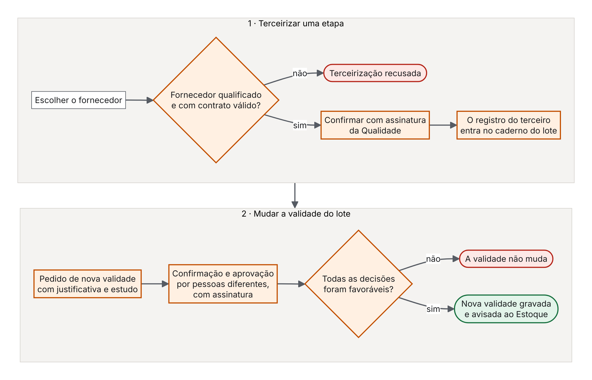
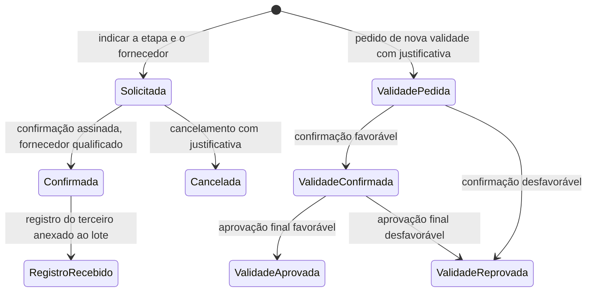

# Passo 3, fluxo 14e: mandar uma etapa para um terceiro e mudar a validade de um lote (terceirização e validade da ordem de produção, Produção)

*Como ler: **laranja** = o sistema confere (trava); **vermelho** = bloqueio; **verde** = resultado. Clique na imagem para ampliar.*

*Coluna "Onde no sistema": o caminho no sistema atual (legado), no formato **Módulo › Menu › Tela**. Os nomes de menu seguem as telas do módulo Produção. Onde diz "tela nova", a tela não existe hoje e será criada.*

> **Em uma frase:** dois casos especiais da fabricação: **mandar uma etapa para outra empresa fazer** (terceirização) e **mudar a data de validade de um lote** que ainda não foi finalizado.
>
> **Exemplo do dia a dia (ilustrativo, os números são inventados):** a esterilização de um lote é feita por uma empresa de fora. Antes, a Qualidade precisa ter avaliado essa empresa e ter um contrato assinado. Já a validade do lote só deveria mudar se houvesse um estudo mostrando que o produto dura mais, com duas pessoas aprovando.
>
> **Por que importa:** o que o terceiro faz é responsabilidade da empresa. Se a etapa terceirizada não fica registrada no caderno do lote, ou se a validade muda sem prova, o lote perde a credibilidade.
>
> *Palavra que não conhece? Veja a aba "24 · Glossário" desta página. Aqui: **terceirização** é contratar outra empresa para executar uma etapa da fabricação ou da análise; **Contratante** é a empresa que contrata (a nossa); **Contratado** é quem executa; **OPE** é a ordem de produção.*

**Análise de 21/11/2026. Rascunho para validação do responsável.** Última das cinco fichas da **Produção** (a [14a](fluxo-14a-preparacao.md) foi a preparação, a [14b](fluxo-14b-produto-formula-ordem.md), produto e ordem, a [14c](fluxo-14c-autorizacao-inicio-final.md), autorização e final e a [14d](fluxo-14d-registro-de-lote.md), registro de lote). São dois processos menores: a **terceirização** e a **alteração da validade da ordem de produção** (a tela está **fora do menu**).

**Fontes (todas no repositório do legado):** o fluxo "Terceirização e validade da OPE" (`2.producao/fluxos/terceirizacao-validade.md`, lido do código) e o inventário de telas com os resultados dos testes da Produção (casos `CT-PRO-073` a `082`). **O que não fiz:** não li as telas uma a uma. **Nada deste fluxo foi testado na tela**: a Terceirização ficou **não testada** e a tela de Validade da OPE está **fora do menu**. **Tudo vem só do código.** As normas (RDC 658/2022, arts. 167, 298, 299, 304, 305 e 310) foram conferidas no texto.

## 1. O caminho, em uma linha
**Terceirização:** escolher a etapa e o **fornecedor** → **confirmar** ou **cancelar** → a etapa terceirizada **entra no registro do lote**.
**Validade da OPE:** **pedir** nova validade (antes da finalização) → **confirmar** → **aprovação final** → a nova validade **substitui** a do lote.

### A situação da terceirização e do pedido de validade

No legado a terceirização tinha só "confirmar" ou "cancelar", e o pedido de validade **podia ser aprovado no final mesmo com a confirmação reprovada**. No iLabs a situação de cada um é **uma só, guardada e conferida pelo banco**.

## 2. Etapa a etapa

| # | Etapa | Onde no sistema (legado) | Quem faz | Exige antes | O que entra | O banco garante (iLabs) | Falha do legado |
|---|---|---|---|---|---|---|---|
| 1 | **Indicar a etapa terceirizada** | **Produção** › Produção › Terceirização da Ordem de Produção | Produção | Produção iniciada ([ficha 14c](fluxo-14c-autorizacao-inicio-final.md)); **fornecedor** cadastrado | OPE, **etapa** (e subetapa), se a terceirização é completa, fornecedor, observação | O fornecedor **precisa estar qualificado** ([ficha 2](fluxo-02-compras-e-fornecedor.md), [ficha 13d](fluxo-13d-autoinspecao-e-auditoria.md)) e com **contrato válido**; sem isso, o banco **recusa** | O fornecedor era escolhido **entre as pessoas jurídicas do Principal, sem conferir a qualificação** na GQ, e **não havia campo de contrato, acordo técnico nem responsabilidades** (`RN005`, ponto 1, arts. 298, 299 e 304) |
| 2 | **Confirmar ou cancelar** | Mesma tela | Responsável pela Produção e Qualidade | Terceirização indicada | Decisão, quem e quando | **Confirmação com assinatura da Qualidade**; **cancelamento com justificativa**, ambos no histórico | Cada item podia ser **confirmado ou cancelado**, gravando quem e quando, **pelo servidor** (`RN002`); **não testada** na tela |
| 3 | **Anexar documentos** | Mesma tela | Produção | — | Arquivos (até 4 MB) | **Contrato, certificado e relatórios do terceiro** ficam ligados à terceirização | Aceitava anexos de **até 4 MB** (`RN003`); **nada obrigava** a anexar o relatório do terceiro |
| 4 | **Receber o registro do que o terceiro fez** | **Produção** › Produção › Registro da Produção ([ficha 14d](fluxo-14d-registro-de-lote.md)) | Produção e Qualidade | Terceirização confirmada | Os dados da etapa executada pelo terceiro | **A etapa terceirizada entra no caderno do lote**, com **o relatório do terceiro** e **a revisão da Qualidade** (art. 305: o Contratante revisa e avalia os registros e resultados) | A subetapa terceirizada confirmada **não mostrava o botão de salvar**, e **não ficou claro como entram os dados do que o terceiro fez** (`RN004`, ponto 2, **a confirmar**); **nada garantia a revisão** dos registros do terceiro |
| 5 | **Pedir a nova validade do lote** | **Produção** › Produção › Validade da OPE *(fora do menu)* | Produção | Produção **ainda não finalizada** | **Validade atual**, **nova validade**, observação, **justificativa** | O pedido **exige a base técnica** (estudo de estabilidade); **só antes da finalização**; a mudança **abre uma mudança aprovada** na GQ ([ficha 13c](fluxo-13c-controle-de-mudancas.md)) | **Funcionou pelo código**: a nova data **não podia ser anterior a hoje**, e depois da finalização a mensagem era "A data de validade não pode ser alterada, pois a OPE já foi finalizada." (`RN006`, `RN007`); **nada ligava o pedido a estudo ou mudança** (ponto 4, art. 167) |
| 6 | **Confirmar e aprovar** | Mesma tela (confirmação e aprovação final) | Duas pessoas diferentes | Pedido feito | Decisão, observação, justificativa | **Confirmação e aprovação por pessoas diferentes de quem pediu**, com **assinatura**; **data do servidor**; **uma reprovação encerra o pedido** | As **datas das decisões eram digitadas** (`RN008`); **nada conferia que pedir, confirmar e aprovar fossem pessoas diferentes** (`RN009`); a regra conferia **se todas as decisões foram dadas**, mas **não se foram favoráveis**: um pedido reprovado na confirmação e aprovado no final **podia mudar a validade** (`RN010`, ponto 3, **a confirmar**) |
| 7 | **Gravar a nova validade** | Automático | Automático | Aprovação final favorável | — | A nova validade **vai ao lote e ao Estoque**, com **histórico** | A nova validade **era gravada no lote**, mas **não ia ao Estoque** (`RN010`, `RN011`); a tela **está fora do menu**, mas existe e tem permissão própria: **a validar se ainda é usada** (`RN012`) |

## 3. O que este fluxo exige de cada cadastro global

| Cadastro (passo 1) | O que o fluxo precisa que ele guarde |
|---|---|
| **Pessoa jurídica (fornecedor)** | **Qualificação** vigente, **contrato** escrito, **acordo técnico** e **responsabilidades** de cada parte |
| **Fornecedor qualificado (ficha 2) e auditoria (ficha 13d)** | O resultado da **auditoria do terceiro** |
| **Etapa e subetapa do modelo (ficha 14b)** | Quais etapas **podem** ser terceirizadas |
| **Profissional e função** | Quem **indica**, **confirma** e **aprova** a terceirização e a validade: funções **separadas**, com assinatura |
| **Estabilidade (ficha 11b)** | O **estudo** que sustenta a validade do produto e de cada lote |
| **Mudança (ficha 13c)** | A **mudança aprovada** que autoriza alterar a validade |
| **Estoque (lote)** | A validade do lote **atualizada** quando muda |
| **Notificações (serviço comum)** | Aviso de **terceirização pendente de confirmação**, de **registro do terceiro a revisar** e de **pedido de validade pendente** |

## 4. Os registros que nascem no fluxo (não são cadastros)
Terceirização (etapa e subetapa) e anexos · confirmação ou cancelamento · registro do que o terceiro fez · pedido de nova validade · confirmação · aprovação final · histórico.

## 5. O que muda nos documentos anteriores
- **Roteiro de implantação:** na etapa 3 (pessoas jurídicas), o **fornecedor terceirizado** com **qualificação, contrato e acordo técnico**; na etapa 1, as funções de **confirmar a terceirização** e **aprovar a validade**; na etapa 9, o ensaio inclui **uma etapa terceirizada** (o registro do terceiro entra no caderno), **um fornecedor não qualificado** (recusado) e **um pedido de validade reprovado** (a validade não muda).
- **Passo 2 (ordem):** o fornecedor **qualificado** (ficha 2) e o **contrato** vêm **antes** da primeira terceirização.
- **Ficha 14d (registro de lote):** a **etapa terceirizada** passa a ter **campos próprios** do relatório do terceiro.
- **Ficha 11b (estabilidade):** a **validade do produto** passa a vir **do estudo**, e **alterá-la por lote** exige mudança aprovada.

## 6. Pontos a validar com a área (não consegui tirar do código)
1. **Terceirização:** a empresa terceiriza hoje alguma etapa? Quais (esterilização, análise, embalagem)? Se não, a tela **deve existir**?
2. **Contrato e qualificação:** onde ficam hoje? Quem **confere** antes de terceirizar?
3. **Registro do terceiro:** como o relatório do terceiro **entra no caderno do lote** e **quem o revisa**?
4. **Validade do lote:** a empresa **altera** a validade de um lote já fabricado? Em que caso, e **com qual prova**?
5. **Aprovadores:** quem **confirma** e quem **aprova** a nova validade? Podem ser a mesma pessoa que **pediu**?
6. **Tela fora do menu:** ainda é usada? Ou o pedido de validade **deve ser retirado** do iLabs?
7. **Pedido reprovado:** a validade **nunca** muda se uma decisão é desfavorável?
