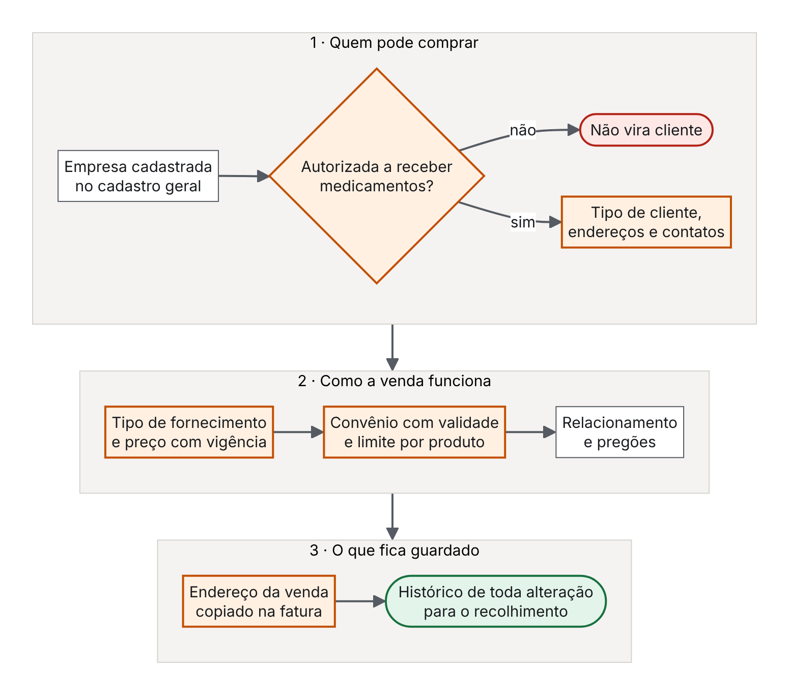
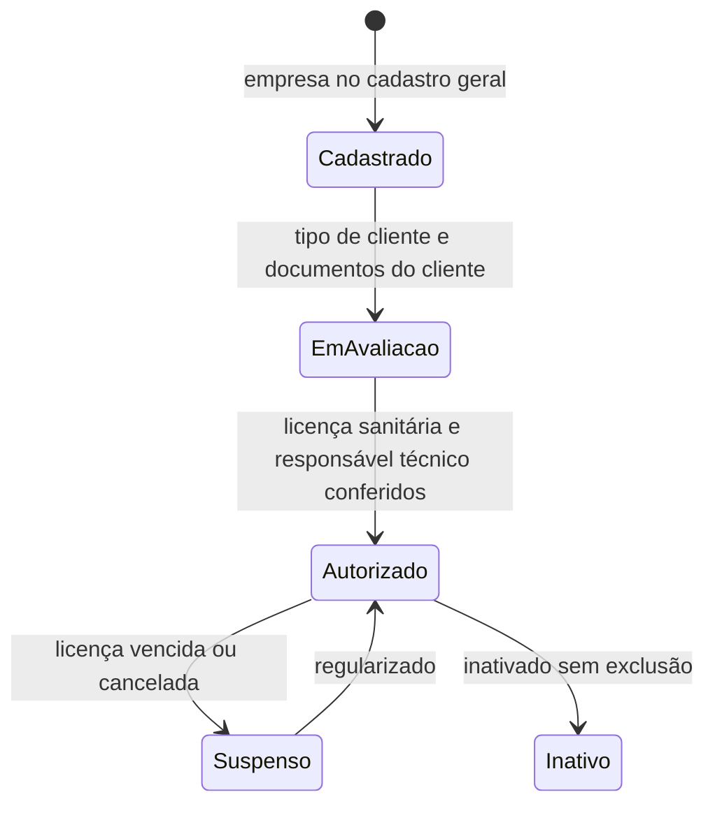

# Passo 3, fluxo 15a: a quem a empresa vende (cliente e cadastros de venda, Comercial)

*Como ler: **laranja** = o sistema confere (trava); **vermelho** = bloqueio; **verde** = resultado. Clique na imagem para ampliar.*

*Coluna "Onde no sistema": o caminho no sistema atual (legado), no formato **Módulo › Menu › Tela**. Onde diz "tela nova", a tela não existe hoje e será criada.*

> **Em uma frase:** antes de vender, a empresa cadastra **quem é o cliente**, **para onde entrega**, **a que preço** e **sob qual contrato (convênio)**.
>
> **Exemplo do dia a dia (ilustrativo, os números são inventados):** uma farmácia hospitalar vira cliente. A empresa guarda o endereço de entrega, o preço combinado por produto e um convênio de 1.000 caixas por ano. Se o lote tiver problema e precisar ser recolhido, é esse cadastro que diz **para onde o lote foi**.
>
> **Por que importa:** a norma exige que os registros de distribuição tenham informação suficiente sobre os clientes abastecidos, para o **recolhimento** de um lote. **Recolhimento** é tirar do mercado um lote já vendido. Se o endereço mudou ou sumiu depois da venda, o recolhimento fica no escuro.
>
> *Palavra que não conhece? Veja a documento "Glossário" (grupo "Para começar" da lista do estudo). Aqui: **convênio** é um contrato de venda com produtos e quantidades combinados; **pregão** é uma concorrência pública de que o cliente participa; **tipo de fornecimento** diz de que jeito a venda acontece (convênio, cotação, guia de simples remessa).*

**Análise de 21/11/2026. Rascunho para validação do responsável.** Primeira das três fichas do **Comercial** (a 15b será cotação, requisição e reserva; a 15c, fatura, remessa e cancelamento). Este fluxo é a base das outras duas: tudo o que se vende depende dele.

**Fontes (todas no repositório do legado):** o fluxo "Cliente e cadastros de venda" (`7.comercial/fluxos/cliente-cadastros.md`, lido do código, regras `RN001` a `RN021`) e o inventário de telas do Comercial (casos `CT-COM-034` a `048`). **O que não fiz:** não li as telas uma a uma. **Nada deste fluxo foi testado na tela** (todas as telas aparecem como "não testada"); **tudo vem só do código.** As normas (RDC 658/2022, arts. 125, 344 a 347) foram conferidas no texto. A exigência de licença sanitária do cliente vem das Boas Práticas de Distribuição (RDC 430/2020), que **não está no repositório**: fica como ponto a validar.

## 1. O caminho, em uma linha
**Cadastrar a empresa** (cadastro geral do Principal) → **marcar como cliente** e dar o **tipo** → **endereços e contatos** → **tipo de fornecimento e preço** → **convênio** (quando há contrato) → **relacionamento e pregões**.

### A situação do cliente

No legado o cliente **não tem situação**: basta ter um tipo de cliente. No iLabs a situação é **uma só, guardada e conferida pelo banco**, e só um cliente **autorizado** recebe venda.

## 2. Etapa a etapa

| # | Etapa | Onde no sistema (legado) | Quem faz | Exige antes | O que entra | O banco garante (iLabs) | Falha do legado |
|---|---|---|---|---|---|---|---|
| 1 | **Cadastrar a empresa** | **Principal** › Pessoa Jurídica | Cadastro | — | Dados da empresa (cadastro geral, passo 1) | **Um só cadastro** da empresa, usado por Compras, Comercial e Estoque | Já era uma só tabela, **lida pela API** (`RN001`); o cliente é uma pessoa jurídica do Principal |
| 2 | **Marcar como cliente e dar o tipo** | **Comercial** › Cliente › Endereço | Comercial | Empresa cadastrada | **Tipo de cliente** | Só vira cliente com **tipo** e com **documentos que autorizam receber medicamentos** | "O Tipo Cliente é obrigatório." é o **único dado próprio** do cliente (`RN002`); **sem licença sanitária, autorização de funcionamento, responsável técnico nem situação** (`RN003`, ponto 1) |
| 3 | **Endereços e contatos** | Mesma tela | Comercial | Cliente com tipo | Endereços de **entrega** e **cobrança** (CEP preenche), contatos com nome, cargo, telefones e e-mail | **Um só endereço de cobrança** conferido **na inclusão e na alteração**; vários de entrega; endereço **inativado, nunca excluído** | A regra do endereço de cobrança único existe **na alteração, mas está comentada na inclusão** (`RN005`); contatos com os dados básicos (`RN008`) |
| 4 | **Definir o tipo de fornecimento** | **Comercial** › Tabelas de apoio › Tipo de Fornecimento | Comercial | — | Descrição e **vínculos** (convênio, cotação, contabilidade, guia de simples remessa) | Cada tipo tem **uma regra clara**, **guardada e versionada**: uma mudança **não altera pedidos já abertos** | O **primeiro** vínculo decide a requisição e **qualquer** vínculo decide a remessa; **a alteração vale para requisições em aberto** (`RN016`, `RN017`, ponto 6); o tipo de número 3 abre a lista **inteira** do Principal, inclusive fornecedores (`RN004`, ponto 2) |
| 5 | **Definir o preço** | **Comercial** › Tabelas de apoio › Preço | Comercial | Produto acabado e tipo de cliente | Valor por **produto** e **tipo de cliente** | Preço **com início e fim de vigência** e **histórico**; a venda guarda **o preço da época** | **Sem vigência**: alterar o preço muda a sugestão na hora e o anterior se perde (`RN018`, ponto 7) |
| 6 | **Criar o convênio** | **Comercial** › Cliente › Convênio | Comercial | Cliente com tipo; tipo de fornecimento | **Código** único, conveniado, tipo de fornecimento, produtos com **quantidade** e **valor** | Convênio com **vigência (início e fim)**, **situação** e **limite por produto conferido em toda requisição** | **Sem vigência nem situação**; o limite **não é conferido** na requisição; só não se exclui convênio com requisição (`RN009` a `RN013`, ponto 5) |
| 7 | **Registrar relacionamento e pregões** | **Comercial** › Cliente › Relacionamento | Comercial | Cliente | Atividades (descrição, contato, datas, situação) e **pregões** (código, data, vencimento, produto, quantidade, valor, situação) | Datas **do servidor**; o pregão **vira cotação** e **a venda aponta para ele** | As datas das atividades são **digitadas**; o pregão **não se liga** à cotação nem à requisição (`RN014`, `RN015`, ponto 8) |
| 8 | **Guardar a história** | Todas as telas | Automático | — | Quem mudou o quê e quando | **Trilha de auditoria por gatilho**, **que não se apaga**: preço, endereço, convênio, tipo de cliente | O serviço de histórico existe, **mas nenhuma tela o chama**; a única chamada está comentada (`RN020`, `RN021`, ponto 4, art. 125) |
| 9 | **Guardar o endereço da venda** | Na fatura ([ficha 15c](fluxo-15c-fatura-remessa-cancelamento.md)) | Automático | Endereço do cliente | Cópia do endereço de entrega | **A fatura guarda a cópia** do endereço da época; mudar ou inativar o cadastro **não mexe nas vendas antigas** | A fatura **aponta** para o cadastro, **sem cópia**: alterar muda e excluir **apaga** o endereço de vendas antigas (`RN007`, ponto 3, arts. 346 e 347) |

## 3. O que este fluxo exige de cada cadastro global

| Cadastro (passo 1) | O que o fluxo precisa que ele guarde |
|---|---|
| **Pessoa jurídica** | Papel de **cliente** separado do de **fornecedor** (uma empresa pode ter os dois, **só se marcada**); **situação** (ativa, suspensa, inativa) |
| **Documentos do cliente** (novo) | **Licença sanitária**, **autorização de funcionamento**, **responsável técnico**, **validade** de cada um |
| **Endereço** | Tipo (entrega, cobrança), **inativação sem exclusão** e **histórico**; **a venda guarda a cópia** |
| **Produto acabado** (ficha 14b) | Somente produto **liberado** entra em convênio, preço e pregão |
| **Tipo de cliente, tipo de cobrança e tipo de fornecimento** | Regra do tipo **fora do código** (hoje o número 3 está fixado) |
| **Profissional e função** | Quem **cadastra cliente**, **aprova convênio** e **altera preço**: funções separadas, com assinatura |
| **Notificações (serviço comum)** | Aviso de **licença do cliente vencendo**, **convênio perto do fim** e **pregão perto do vencimento** |

## 4. Os registros que nascem no fluxo (não são cadastros)
Atividades de relacionamento · pregões · alterações de preço, endereço e convênio (histórico) · avisos de vencimento.

## 5. O que muda nos documentos anteriores
- **Roteiro de implantação:** na etapa 3 (pessoas jurídicas), o **cliente** com **tipo, documentos que autorizam receber medicamentos e endereços**; na etapa 1, as funções de **cadastrar cliente**, **aprovar convênio** e **alterar preço**; na etapa 9, o ensaio inclui **um cliente sem licença** (recusado) e **um endereço alterado depois da venda** (a fatura antiga mantém o endereço da época).
- **Passo 1 (cadastros globais):** acrescentar **documentos do cliente** e a **separação entre cliente e fornecedor** na pessoa jurídica.
- **Fichas 15b e 15c (cotação, requisição, fatura):** passam a **herdar** a regra do tipo de fornecimento, o preço da época e a cópia do endereço.
- **Ficha 9 (remessa e expedição):** a remessa do Estoque **já guarda o endereço**; o Comercial passa a fazer o mesmo.

## 6. Pontos a validar com a área (não consegui tirar do código)
1. **Autorização do cliente:** onde a empresa confere hoje a licença sanitária e o responsável técnico de quem compra? Quem **confere**?
2. **Tipos de cliente:** quais existem (hospital, distribuidor, governo, farmácia)? A regra de venda **muda** conforme o tipo?
3. **Tipo de fornecimento:** a regra do "primeiro vínculo" e a do "qualquer vínculo" são **intencionais**? O que o **número 3** (lista inteira do Principal) tenta resolver?
4. **Convênio:** tem **prazo**? Quem **aprova**? O que acontece quando o **limite** acaba?
5. **Preço:** quem pode alterar? Precisa de **vigência**? Há **preço por contrato**?
6. **Pregão:** a empresa participa de pregões? Ele deve **virar cotação** automaticamente?
7. **Histórico:** quem pediria o histórico de uma alteração de preço ou de endereço, e **por quanto tempo** deve ser guardado?
8. **Licença do cliente (RDC 430/2020):** o texto da norma de distribuição **não está no repositório**; pedir à Qualidade para confirmar a exigência.
