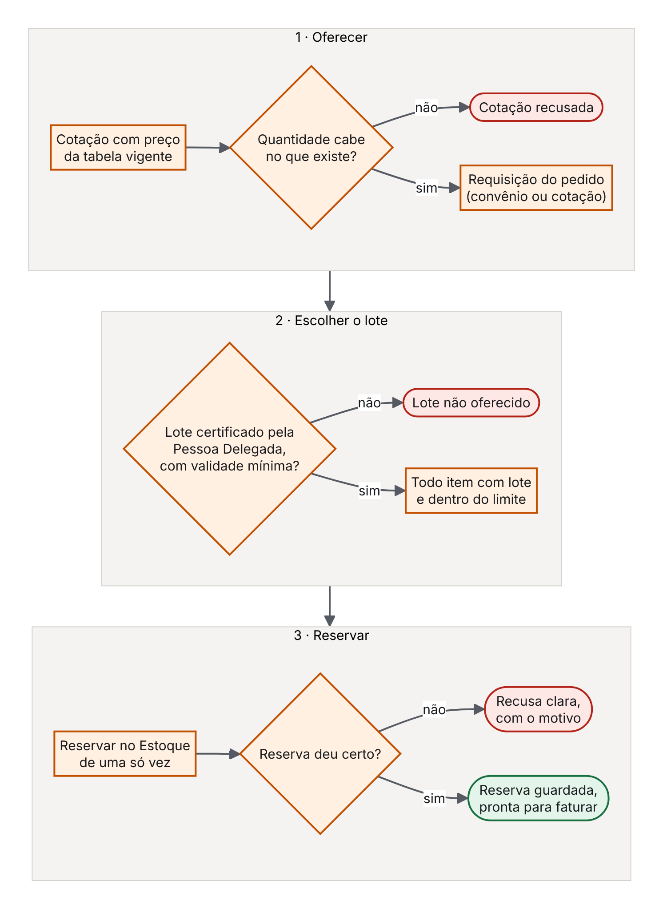
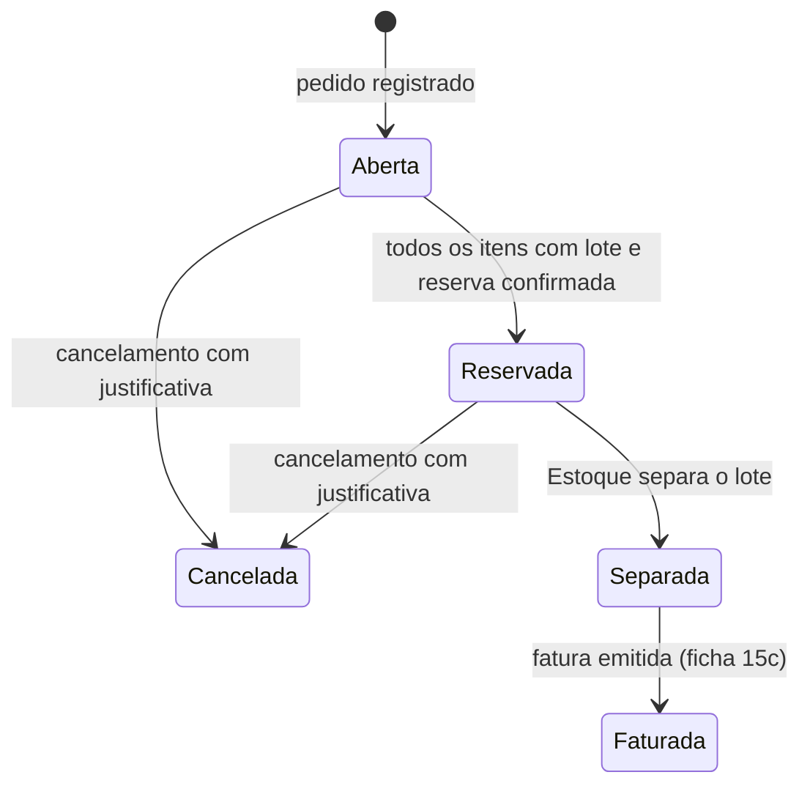

# Passo 3, fluxo 15b: do pedido do cliente à reserva do lote (cotação, requisição e reserva, Comercial)

*Como ler: **laranja** = o sistema confere (trava); **vermelho** = bloqueio; **verde** = resultado. Clique na imagem para ampliar.*

*Coluna "Onde no sistema": o caminho no sistema atual (legado), no formato **Módulo › Menu › Tela**. Onde diz "tela nova", a tela não existe hoje e será criada.*

> **Em uma frase:** a empresa **oferece** o produto ao cliente (cotação), registra o **pedido** (requisição), escolhe **qual lote** vai para esse cliente e **reserva** esse lote no Estoque.
>
> **Exemplo do dia a dia (ilustrativo, os números são inventados):** um hospital pede 500 caixas. O vendedor escolhe os lotes que vão atender o pedido, e o Estoque separa essas caixas para ninguém mais vender. Se o lote escolhido ainda não foi liberado pela Qualidade, ou vence em poucos dias, o pedido não deveria seguir.
>
> **Por que importa:** é aqui que se decide **qual lote sai para qual cliente**. Num recolhimento (tirar do mercado um lote já vendido), é essa decisão que diz quem recebeu o quê. E nenhum lote pode ser vendido antes de uma pessoa responsável da Qualidade **certificar** que ele foi feito e controlado conforme o registro do produto.
>
> *Palavra que não conhece? Veja a documento "Glossário" (grupo "Para começar" da lista do estudo). Aqui: **cotação** é a proposta de preço enviada ao cliente; **requisição** é o pedido de venda; **reserva** é separar no Estoque, no papel, o lote que foi prometido; **Pessoa Delegada** é a pessoa designada pela empresa para liberar cada lote para venda.*

**Análise de 21/11/2026. Rascunho para validação do responsável.** Segunda das três fichas do **Comercial** (a [15a](fluxo-15a-cliente-e-cadastros.md) foi cliente e cadastros; a 15c será fatura, remessa e cancelamento).

**Fontes (todas no repositório do legado):** o fluxo "Cotação, requisição e reserva" (`7.comercial/fluxos/cotacao-requisicao-reserva.md`, lido do código, regras `RN001` a `RN024`) e o inventário de telas do Comercial (casos `CT-COM-001` a `018`). **O que não fiz:** não li as telas uma a uma. **Nada deste fluxo foi testado na tela** (Cotação, Requisição de PA e Cancelar Requisição de PA aparecem como "não testadas"); **tudo vem só do código.** As normas (RDC 658/2022, arts. 8º XV, 14 VII, 125, 346 e 347) foram conferidas no texto.

## 1. O caminho, em uma linha
**Cotação** (opcional) → **requisição** (tipo de fornecimento, cliente, cotação ou convênio) → **escolher o lote de cada item** → **salvar** (o sistema reserva o lote no Estoque) → ou **cancelar** (a reserva também é cancelada).

### A situação da requisição

No legado a requisição fica sempre "em aberto" até ser faturada ou cancelada, e uma reserva que falha **não aparece** para o usuário. No iLabs a situação é **uma só, guardada e conferida pelo banco**.

## 2. Etapa a etapa

| # | Etapa | Onde no sistema (legado) | Quem faz | Exige antes | O que entra | O banco garante (iLabs) | Falha do legado |
|---|---|---|---|---|---|---|---|
| 1 | **Cotar** (opcional) | **Comercial** › Cotação › Cotação | Comercial | Cliente autorizado e preço vigente ([ficha 15a](fluxo-15a-cliente-e-cadastros.md)) | Tipo de fornecimento, cliente, observações, itens (produto, quantidade, valor) | Preço **vem da tabela vigente**; **a quantidade não passa do que o Estoque pode oferecer**; o código `NNNN/AAAA` nasce **com a cotação** | O código só nasce no primeiro item, e a cotação começa "na lixeira" (`RN002`); a conferência da quantidade contra o disponível está **comentada** (`RN004`, ponto 5); a cotação **não escolhe lote** (`RN005`) |
| 2 | **Abrir a requisição** | **Comercial** › Cotação › Requisição de PA | Comercial | Cliente com tipo; cotação ou convênio válidos | Tipo de fornecimento, cliente, cotação ou convênio | A requisição nasce **em aberto**, com quem criou e a data do servidor; **só cotação ainda não usada** e **convênio vigente com saldo** | Os produtos vêm **da cotação** (com quantidade e valor) ou **do convênio** (com quantidade zero), **sem lote** (`RN006` a `RN009`); o **primeiro** vínculo do tipo decide (`RN007`) |
| 3 | **Escolher o lote de cada item** | Mesma tela, grade de itens | Comercial | Item com produto | **Lote** (número interno, lote do fabricante, validade) e quantidade | Só oferece lote **certificado pela Pessoa Delegada**, **fora da quarentena, não bloqueado, não em reanálise e dentro da validade mínima** do cliente; **desconta o já reservado** | A lista traz o lote **disponível**, **não o certificado** (`RN010`, ponto 1, arts. 8º XV e 14 VII); **sem validade mínima**: o valor zero está fixado no código (`RN011`, ponto 4); a quantidade conferida é **a que a tela envia** (`RN012`) |
| 4 | **Conferir os limites** | Ao salvar | Automático | Itens com lote | Quantidade pedida | **Limite do convênio** (por produto) e **quantidade da cotação** conferidos **em toda gravação** | As conferências do convênio e da cotação **nunca rodam** (`RN017`, ponto 5); a de saldo é **por produto**, não pelo lote escolhido (`RN016`, ponto 6) |
| 5 | **Salvar e reservar** | Ao salvar | Automático | Todos os itens com lote | Itens da requisição | Uma **reserva única e atômica** no Estoque: **ou reserva tudo, ou recusa com o motivo**; a requisição vira **reservada** | A cada gravação a reserva é **cancelada e refeita**, sem conferir o cancelamento (`RN018`, ponto 7); a conferência "todo item tem lote" está **comentada** (`RN016`, ponto 3) |
| 6 | **Tratar a falha da reserva** | Estoque (serviço de reserva) | Automático | Reserva pedida | — | **Falha vira recusa clara**, com o motivo, e a requisição **segue em aberto, sem número de reserva** | O Estoque **devolve -1** em vez de recusar, o Comercial **guarda o -1 como número da reserva** e o usuário **não é avisado**; a requisição **some da lista de faturar** (`RN019`, `RN020`, ponto 2) |
| 7 | **Registrar a reserva no Estoque** | **Estoque** › Solicitação de material (tipo comercial) | Automático | Reserva confirmada | Lotes e quantidades | A reserva é **uma solicitação do tipo comercial**, e o saldo reservado **sai da lista dos outros pedidos** | Já era assim, **mas a confirmação está comentada** (`RN018`, `RN021`) |
| 8 | **Cancelar a requisição** | **Comercial** › Cotação › Cancelar Requisição de PA | Comercial | Requisição **em aberto ou reservada** | **Justificativa** | Cancelar **cancela a reserva** no Estoque (se falhar, **nada é cancelado**), com **quem, quando e por quê** | Só a requisição **em aberto** cancela; o cancelamento grava quem e quando, mas **não pede justificativa** (`RN022` a `RN024`, ponto 8) |

## 3. O que este fluxo exige de cada cadastro global

| Cadastro (passo 1) | O que o fluxo precisa que ele guarde |
|---|---|
| **Cliente (ficha 15a)** | **Autorizado** a receber medicamentos, com **endereço de entrega**; o endereço **copiado na fatura** |
| **Convênio e preço (ficha 15a)** | **Vigência** e **limite por produto**; preço **da época** |
| **Produto acabado (ficha 14b)** | Só **produto liberado** é cotado, e cada lote traz a **certificação** da Pessoa Delegada |
| **Lote (Estoque)** | **Certificação da Pessoa Delegada**, **validade**, **situação** (liberado, quarentena, bloqueado, em reanálise) e **saldo disponível** |
| **Validade mínima do cliente** (novo) | O número de **dias** que o cliente exige, **por tipo de cliente ou convênio**, e não fixado no código |
| **Tipo de fornecimento (ficha 15a)** | A regra de **onde vêm os produtos** (convênio ou cotação) e **se gera remessa** |
| **Profissional e função** | Quem **cota**, **requisita**, **escolhe o lote** e **cancela**: funções separadas, com assinatura |
| **Notificações (serviço comum)** | Aviso de **reserva que falhou**, de **requisição parada sem reserva** e de **lote reservado perto do vencimento** |

## 4. Os registros que nascem no fluxo (não são cadastros)
Cotação e itens · requisição e itens com lote · reserva no Estoque (solicitação comercial) · cancelamento com justificativa · histórico.

## 5. O que muda nos documentos anteriores
- **Roteiro de implantação:** na etapa 3, a **validade mínima** por cliente ou convênio; na etapa 1, a função de **escolher o lote** e a **certificação da Pessoa Delegada** (hoje inexistente em qualquer módulo); na etapa 9, o ensaio inclui **um lote em quarentena** (não oferecido), **um lote perto do vencimento** (recusado pela validade mínima) e **uma reserva sem saldo** (recusa clara, sem número negativo).
- **Fichas 1 e 14c (recebimento e liberação do lote):** a **certificação da Pessoa Delegada** passa a ser **um passo guardado**, antes de o lote ficar disponível para venda.
- **Ficha 6 (solicitação, separação e atendimento):** a reserva do Comercial entra na **mesma fila** de separação, com a **regra de validade** (o lote que vence antes sai primeiro).
- **Ficha 15c (fatura):** só fatura requisição **reservada e separada**; a requisição sem reserva **nunca** aparece como se estivesse pronta.

## 6. Pontos a validar com a área (não consegui tirar do código)
1. **Certificação da Pessoa Delegada:** onde acontece hoje? Quem é a Pessoa Delegada? O lote só entra no estoque comercial **depois** dela?
2. **Validade mínima:** quantos dias os clientes exigem? Varia por cliente, por convênio ou por compra pública?
3. **Cotação:** ela **reserva** produto ou é só uma proposta de preço? Tem **prazo de validade**?
4. **Reserva:** quanto tempo uma reserva pode ficar parada? Quem a **libera** se o cliente desiste?
5. **Falha de reserva:** o que o vendedor faz hoje quando a requisição não aparece para faturar? Alguém acompanha as requisições paradas?
6. **Limites do convênio e da cotação:** podem ser **ultrapassados**? Com autorização de quem?
7. **Cancelamento:** por que se cancela e quem pode? A justificativa deve ser obrigatória?
8. **Ordem de uso dos lotes:** o lote que vence primeiro deve ser **sugerido** (ou imposto) ao escolher o lote?
