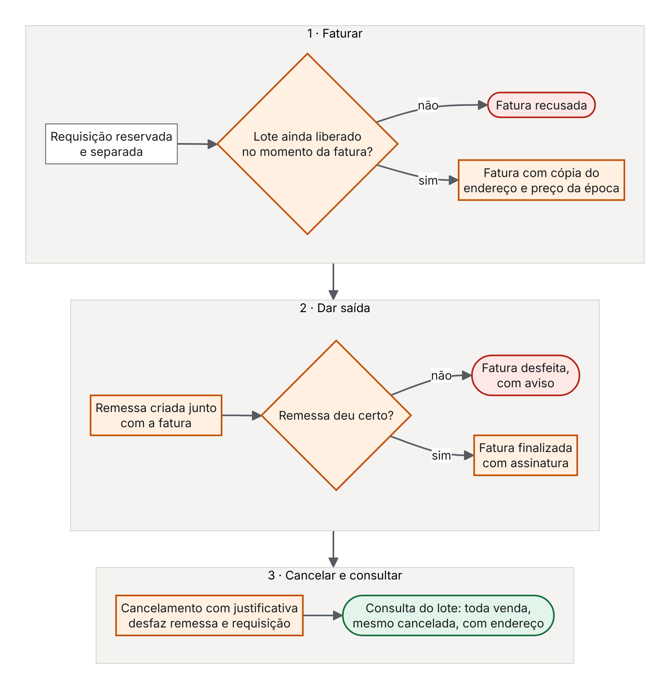
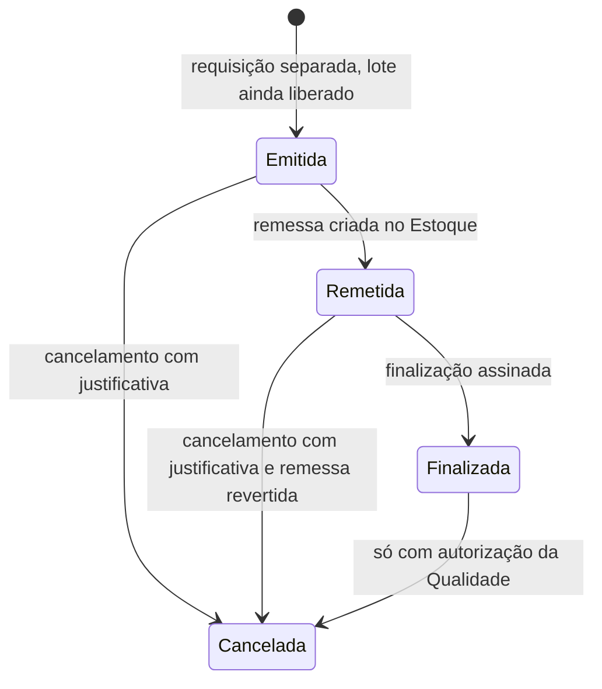

# Passo 3, fluxo 15c: da fatura à saída do lote e à consulta de recolhimento (fatura, remessa e cancelamento, Comercial)

*Como ler: **laranja** = o sistema confere (trava); **vermelho** = bloqueio; **verde** = resultado. Clique na imagem para ampliar.*

*Coluna "Onde no sistema": o caminho no sistema atual (legado), no formato **Módulo › Menu › Tela**. Onde diz "tela nova", a tela não existe hoje e será criada.*

> **Em uma frase:** a empresa **fatura** o pedido separado, o Estoque dá a **saída** do material (a remessa) e, se for preciso, a fatura é **finalizada** ou **cancelada**. Depois, a pergunta de um recolhimento tem de ter resposta: **para quem foi o lote X?**
>
> **Exemplo do dia a dia (ilustrativo, os números são inventados):** o lote 123 teve um problema e precisa ser tirado do mercado. A empresa abre uma consulta, digita o número do lote e vê todos os clientes que o receberam, com o endereço de entrega, em poucos minutos. Mesmo se uma fatura foi cancelada depois que o material saiu, esse cliente precisa aparecer.
>
> **Por que importa:** é o último elo da corrente do lote dentro da empresa. A norma exige que os registros de distribuição estejam **prontamente disponíveis** para quem faz o recolhimento. Se o relatório esconde uma venda, um paciente pode ficar com um medicamento que já deveria ter sido retirado.
>
> *Palavra que não conhece? Veja a aba "24 · Glossário" desta página. Aqui: **fatura** é o documento da venda; **remessa** é o registro da saída física do material; **guia de simples remessa** é o tipo de venda em que a saída é registrada por remessa; **recolhimento** é tirar do mercado um lote já vendido.*

**Análise de 21/11/2026. Rascunho para validação do responsável.** Última das três fichas do **Comercial** (a [15a](fluxo-15a-cliente-e-cadastros.md) foi cliente e cadastros e a [15b](fluxo-15b-cotacao-requisicao-reserva.md), cotação, requisição e reserva).

**Fontes (todas no repositório do legado):** o fluxo "Fatura, remessa e cancelamento" (`7.comercial/fluxos/fatura-remessa-cancelamento.md`, lido do código, regras `RN001` a `RN021`) e o inventário de telas do Comercial (casos `CT-COM-019` a `033`). **O que não fiz:** não li as telas uma a uma. **Nada deste fluxo foi testado na tela** (Fatura, Cancelar Fatura e RV07 aparecem como "não testadas"); **tudo vem só do código.** As normas (RDC 658/2022, arts. 8º XV, 14 VII, 125 e 344 a 347) foram conferidas no texto.

## 1. O caminho, em uma linha
**Escolher a requisição separada** → **gerar a fatura** (endereço, cobrança, peso, volume) → **remessa no Estoque** (guia de simples remessa) → **finalizar** ou **cancelar** → **consultar para onde foi o lote** (recolhimento).

### A situação da fatura

No legado a fatura só era **ativa**, **finalizada** (sem registrar quem e quando) ou **cancelada** (sem desfazer nada). No iLabs a situação é **uma só, guardada e conferida pelo banco**, e cada mudança desfaz ou confirma o que a antecede.

## 2. Etapa a etapa

| # | Etapa | Onde no sistema (legado) | Quem faz | Exige antes | O que entra | O banco garante (iLabs) | Falha do legado |
|---|---|---|---|---|---|---|---|
| 1 | **Escolher a requisição** | **Comercial** › Faturamento › Fatura | Comercial | Requisição reservada e **separada** no Estoque ([ficha 15b](fluxo-15b-cotacao-requisicao-reserva.md)) | Requisição | Só lista requisição **reservada e separada**; **nunca** uma sem reserva | A lista traz as requisições em aberto, com reserva válida e separadas (`RN001`); a conferência "atendida pelo Estoque" da tela está **fixada como verdadeira** (`RN003`) |
| 2 | **Informar entrega e cobrança** | Mesma tela | Comercial | Cliente com endereço de entrega ([ficha 15a](fluxo-15a-cliente-e-cadastros.md)) | Endereço de **entrega**, tipo de cobrança, peso, volume | Endereço **só de entrega** do cliente **autorizado** | Exige requisição, endereço e cobrança; só endereços de entrega são oferecidos (`RN002`) |
| 3 | **Conferir o lote de novo** | Ao gravar | Automático | Requisição separada | — | **Reconfere a situação de cada lote** (liberado, não bloqueado, não em reanálise, **não recolhido**) **no momento da fatura**, **em toda gravação** | A fatura confere **só a separação**, e só se o número da reserva for maior que zero; **o lote bloqueado depois da separação é faturado e remetido** (`RN004`, `RN005`, `RN010`, ponto 1, arts. 8º XV e 14 VII) |
| 4 | **Gravar a fatura** | Ao gravar | Automático | Lote conferido | Itens e valores | Fatura com **quem, quando, valor total** e **cópia do endereço e do preço da época** (ficha 15a); **prazo de pagamento** por regra do cliente | Grava quem e quando, o valor dos itens não excluídos e **pagamento fixo em 30 dias**; a requisição vira **faturada** (`RN004`) |
| 5 | **Dar a saída (remessa)** | **Estoque** › Remessa de Material (gerada pela fatura) | Automático | Fatura gravada | Lotes e quantidades da requisição | A remessa é criada **junto com a fatura, de uma só vez**: **se falhar, a fatura é desfeita e o usuário é avisado**; **só entram itens ativos** | **Só nasce se o tipo de fornecimento for "guia de simples remessa"**; a fatura é gravada **antes**, e **se a remessa falhar o erro é ignorado**; **entram os itens excluídos** (`RN006` a `RN010`, pontos 4, 6 e 7) |
| 6 | **Finalizar a fatura** | **Comercial** › Faturamento › Fatura (lista) | Comercial | Fatura remetida | Finalização | **Finalização assinada**, com **quem e quando** | Só marca como finalizada, **sem registrar quem nem quando** (`RN011`, ponto 8) |
| 7 | **Cancelar a fatura** | **Comercial** › Faturamento › Cancelar Fatura | Comercial e Qualidade | Fatura emitida ou remetida | **Justificativa** | Cancelar **desfaz a remessa e libera a reserva**; **guarda a justificativa e a observação original**; **fatura finalizada só cancela com autorização da Qualidade** | Cancelar exclui a fatura, mas **a requisição continua faturada** e **a remessa continua ativa**; a justificativa **apaga a observação original**; a lista traz também as finalizadas (`RN012` a `RN014`, ponto 5) |
| 8 | **Consultar para onde foi o lote** | **Comercial** › RV07 Produtos Faturados (fora do menu) | Qualidade, Comercial | Fatura gravada | Lote, produto, período (opcional) | **Consulta direta por lote**, **no menu**, **com todas as vendas, inclusive de fatura cancelada cuja remessa saiu**, com **cliente, endereço de entrega, remessa, quantidade e data** | Fora do menu; **exige período**; **ignora fatura cancelada**; **não traz endereço nem número da remessa** (`RN017` a `RN021`, pontos 2 e 3, arts. 345 a 347) |
| 9 | **Imprimir a fatura** | Mesma tela | Comercial | Fatura gravada | — | Impressão **com lote, data e hora corretos** | A data aparece com o **mês no lugar dos minutos**, em relógio de 12 horas (`RN015`); **a confirmar** se o lote sai impresso (`RN016`) |

## 3. O que este fluxo exige de cada cadastro global

| Cadastro (passo 1) | O que o fluxo precisa que ele guarde |
|---|---|
| **Cliente e endereço (ficha 15a)** | Cliente **autorizado**; endereço de entrega **copiado** na fatura |
| **Preço e convênio (ficha 15a)** | Preço **da época** e **saldo** do convênio baixado na fatura |
| **Lote (Estoque)** | **Situação** conferida **no momento da fatura**; marca de **recolhido** |
| **Tipo de fornecimento (ficha 15a)** | Se **gera remessa**; **como o material sai** nos outros tipos |
| **Condição de pagamento** (novo) | Prazo **por cliente ou convênio**, e não **fixo em 30 dias** |
| **Profissional e função** | Quem **fatura**, **finaliza** e **cancela**: funções separadas, com assinatura; **a Qualidade autoriza** cancelar fatura finalizada |
| **Assinaturas configuradas (Estoque)** | Quem assina a **remessa** |
| **Notificações (serviço comum)** | Aviso de **remessa que falhou** e de **fatura cancelada com material já saído** |

## 4. Os registros que nascem no fluxo (não são cadastros)
Fatura e itens · remessa no Estoque · finalização · cancelamento com justificativa · histórico · **consulta do lote** (para o recolhimento).

## 5. O que muda nos documentos anteriores
- **Roteiro de implantação:** na etapa 1, as funções de **finalizar** e **cancelar** fatura, e a **autorização da Qualidade**; na etapa 3, a **condição de pagamento**; na etapa 9, o ensaio fecha a corrente: **fatura de um lote bloqueado depois da separação** (recusada), **fatura cancelada com remessa já saída** (remessa revertida) e **a consulta "para quem foi o lote X"** mostrando **toda venda**, com endereço.
- **Passo 4 (recolhimento):** a **consulta do lote** é o ponto de partida do recolhimento (art. 345): o iLabs responde **sem pedir período** e **sem esconder cancelamentos**.
- **Ficha 9 (remessa e expedição):** a remessa gerada pela fatura **segue a mesma regra** da remessa manual (endereço guardado, assinaturas).
- **Ficha 14c e Rastreabilidade (módulo 16):** a venda do lote **alimenta** a rastreabilidade (quem recebeu cada lote).

## 6. Pontos a validar com a área (não consegui tirar do código)
1. **Recolhimento:** quem faz a consulta "para quem foi o lote X" hoje, e em quanto tempo? Existe procedimento escrito (art. 343)?
2. **Lote bloqueado depois da separação:** o que a empresa faz? A fatura **deve ser recusada**?
3. **Remessa só no tipo "guia de simples remessa":** como o material sai nos **outros tipos** de venda?
4. **Cancelamento:** quando acontece? O material **volta ao estoque** ou já saiu? Quem **autoriza**?
5. **Finalizar:** o que significa na prática? Quem finaliza e para quê?
6. **Prazo de pagamento:** os 30 dias fixos estão **certos**? Há contrato com prazo diferente?
7. **Itens excluídos:** a remessa deve **ignorar** o item excluído da requisição?
8. **Consulta de recolhimento:** quem deve poder usá-la (Qualidade, Comercial, Assuntos Regulatórios)? Quanto tempo de histórico?
