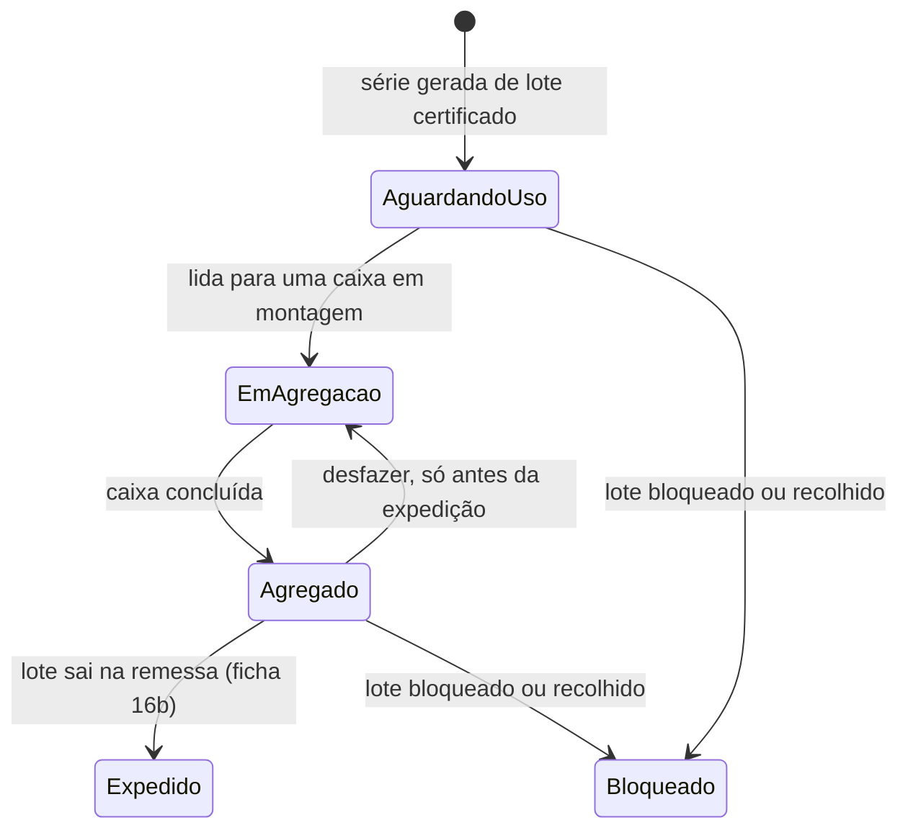

# Passo 3, fluxo 16a: identificar a embalagem do lote (etiqueta, bula digital, número de série opcional e caixas)

*Como ler: **laranja** = o sistema confere (trava); **vermelho** = bloqueio; **verde** = resultado. Clique na imagem para ampliar.*

*Coluna "Onde no sistema": o caminho no sistema atual (legado), no formato **Módulo › Menu › Tela**. Onde diz "tela nova", a tela não existe hoje e será criada.*

> **Em uma frase:** cada embalagem do lote precisa trazer **quem é o produto e o lote** (registro, lote, data de fabricação, validade) e um **código quadrado que leva à bula digital**. Dar um **número de série único a cada caixinha** e **juntá-las em caixas** deixou de ser exigência da ANVISA e fica como **recurso opcional** do iLabs.
>
> **Exemplo do dia a dia (ilustrativo, os números são inventados):** o lote 123 tem 10.000 caixinhas. Todas saem com a etiqueta do lote e o código da bula digital. Se a empresa quiser **seguir cada caixinha**, liga o número de série; o sistema então gera 10.000 números, nem um a mais, nem repetido.
>
> **Por que importa:** a etiqueta errada (dados de outra empresa, lote que não foi liberado) é um problema de rotulagem e de segurança do paciente. O número de série só ajuda a recolher **uma caixinha** em vez do lote inteiro, e agora é escolha da empresa.
>
> *Palavra que não conhece? Veja o documento "Glossário" (grupo "Para começar" da lista do estudo). Aqui: **IUM** era o Identificador Único de Medicamento (um número por embalagem); **agregação** é juntar embalagens em caixas, com código próprio; **SNCM** é o sistema central da ANVISA; **bula digital** é a bula que se abre por um código de barras quadrado; **DataMatrix** é esse código de barras quadrado.*

**Análise de 22/11/2026, reescrita depois que a norma mudou. Rascunho para validação do responsável.** Primeira das duas fichas da **Rastreabilidade** (a [16b](fluxo-16b-eventos-e-declaracao.md) é o mapa de distribuição). **A versão anterior desta ficha descrevia o modelo antigo (IUM com número de série obrigatório); ele deixou de ser exigência.**

## A situação da norma (o que mudou)
- **Lido no texto da Lei 14.338/2022 e da Lei 11.903/2009 atual** (Câmara dos Deputados; a página avisa que não substitui o Diário Oficial): as embalagens recebem **identificação específica** com, no mínimo, **número de registro, número do lote ou partida, data de validade** e **código de barras bidimensional que leva à bula digital** (art. 3º, §1º). O mapa de distribuição e as embalagens trazem **lote, data de fabricação e validade** (art. 3º-A, §1º). As bulas digitais ficam em **endereços autorizados pela ANVISA** (art. 3º, §3º), e a **bula impressa continua obrigatória** (art. 3º, §4º).
- **A RDC 157/2017 consta como revogada** na base de legislação da ANVISA (página impressa pelo responsável em 22/11/2026). O texto dela, lido, é a **referência histórica** do número de série: **GTIN, registro, código serial de até 20 caracteres, validade e lote**, nessa ordem; serial **nunca repetido** na mesma apresentação; DataMatrix.
- **Conferir:** o número e a data do ato que a revogou (a base diz "RDC 886 de 10/07/2024"; a RDC 886 de 26/06/2024 do Diário Oficial é outra, de dispositivos médicos); o status da IN 19/2017 e da IN 100/2021; se há **regulamentação nova** e o **cronograma** da lei (art. 2º da Lei 14.338/2022). **Não li** a RDC 71/2009 (rotulagem), que a RDC 157 citava para o rótulo.

## 1. O caminho, em uma linha
**Buscar o lote embalado e certificado** → **etiqueta com registro, lote, fabricação, validade e código da bula digital** → *(opcional)* **gerar o número de série de cada embalagem** → *(opcional)* **montar as caixas** → **desfazer só antes de expedir**.

### A situação do número de série e da caixa (quando a empresa usa)

No legado a série **não acompanha a situação do lote**, e a caixa pode ser desfeita mesmo depois de expedida. No iLabs a situação é **uma só, guardada e conferida pelo banco**.

## 2. Etapa a etapa

| # | Etapa | Obrigatório? | Onde no sistema (legado) | Quem faz | O que entra | O banco garante (iLabs) | Falha do legado |
|---|---|---|---|---|---|---|---|
| 1 | **Buscar o lote embalado** | **Sim** | **Rastreabilidade** › Geração de IUM | Rastreabilidade | Produto, lote, data de fabricação, validade, registro, total embalado | A lista traz **só lote certificado pela Pessoa Delegada** e **não bloqueado**; os dados **vêm do lote**, não da tela | A lista vinha das produções "liberadas" pela Produção, **sem a certificação** (`RN001`, `RN002`, ponto 3, arts. 8º XV e 14 VII); lote, validade, registro e GTIN eram **reenviados pela tela** (`RN003`) |
| 2 | **Dados da embalagem** | **Sim** | Etiqueta do IUM | Rastreabilidade | Registro, lote, **data de fabricação**, validade, **endereço da bula digital** | A etiqueta só sai com **todos os dados obrigatórios**; o endereço da bula digital é **um dado do produto, em endereço autorizado** | O legado imprimia o código do IUM; **não encontrei** código de bula digital nem data de fabricação na etiqueta (a confirmar na tela) |
| 3 | **Imprimir a etiqueta** | **Sim** | **Rastreabilidade** › Etiqueta do IUM | Rastreabilidade | — | Etiqueta com **os dados da empresa titular, vindos do cadastro** | Endereço, CNPJ, farmacêutico responsável e SAC **de outra empresa, escritos no código** (`RN009`, `RN010`, ponto 4) |
| 4 | **Gerar o número de série** | **Opcional** (parâmetro da empresa) | **Rastreabilidade** › Geração de IUM | Rastreabilidade | **Quantidade** de séries | **Quantidade até o total embalado**, somando as gerações anteriores; série **única em todo o banco** (índice único); formato configurável, **com o da RDC 157/2017 como referência** | Quantidade só precisava ser maior que zero; **série de 13 dígitos sorteados, conferida só dentro da mesma geração**; **ordem do IUM diferente da RDC 157** (`RN004` a `RN007`, pontos 1, 2 e 7) |
| 5 | **Montar a caixa (agregação)** | **Opcional** | **Rastreabilidade** › Agregação | Rastreabilidade | Séries e/ou outras caixas | **Cada série e cada caixa em uma só caixa**; não agrega a si mesma; série de lote **bloqueado** não entra | Não repetia série nem caixa em outra caixa; a situação do lote **não era conferida** (`RN011`, `RN012`) |
| 6 | **Dar o código da caixa** | **Opcional** | Automático | Automático | — | Código com **prefixo GS1 da empresa**, sequência **sem reaproveitar** número excluído, dígito verificador | **Prefixo de exemplo fixado no código**; sequência podia **reaproveitar código** (`RN014`, ponto 5) |
| 7 | **Concluir a caixa** | **Opcional** | Mesma tela | Rastreabilidade | — | Caixa **concluída**, séries **agregadas**, **assinadas**, com histórico | Salvar deixava "em processo"; concluir, "concluída" (`RN013`) |
| 8 | **Desfazer a caixa** | **Opcional** | Mesma tela | Rastreabilidade e Qualidade | **Justificativa** | **Só antes da expedição**; **com motivo e assinatura** | **Desfazia sem conferir se já houve expedição** e sem motivo (`RN015`, ponto 6) |

## 3. O que este fluxo exige de cada cadastro global

| Cadastro (passo 1) | O que o fluxo precisa que ele guarde |
|---|---|
| **Empresa titular do registro** | **CNPJ, endereço, telefone do SAC e farmacêutico responsável (com número no conselho)** para a etiqueta; **prefixo GS1** só se usar caixas |
| **Produto acabado (ficha 14b)** | **Número do registro**, **composição**, **endereço da bula digital** (autorizado pela ANVISA) e, se usar série, o **GTIN** |
| **Lote (Estoque)** | **Certificação da Pessoa Delegada**, **data de fabricação**, **validade**, **situação** (liberado, bloqueado, recolhido) e **total embalado** |
| **Parâmetro da empresa** (novo) | **Usa número de série por embalagem?** **Usa caixas com código?** (por produto ou por empresa; padrão: **desligado**) |
| **Profissional e função** | Quem **emite a etiqueta**, **gera série** e **desfaz caixa**: funções separadas, com assinatura |
| **Notificações (serviço comum)** | Aviso de **etiqueta com dado faltando**, de **série acima do embalado** e de **caixa desfeita** |

## 4. Os registros que nascem no fluxo (não são cadastros)
Etiqueta impressa (com os dados e a versão da bula digital) · *(opcional)* série de cada embalagem · *(opcional)* caixa e as séries dela · histórico.

## 5. O que muda nos documentos anteriores
- **Roteiro de implantação:** na etapa 3, a **empresa titular** com os dados da etiqueta e o **endereço da bula digital** de cada produto; o **prefixo GS1** e o **formato do número de série** só se a empresa ligar o recurso. Na etapa 9, o ensaio inclui **etiqueta com os dados da empresa certa** e **lote não certificado sem etiqueta**; e, se o recurso estiver ligado, **gerar série acima do embalado** (recusado) e **desfazer caixa já expedida** (recusado).
- **Ficha 14c (liberação do lote):** a **certificação da Pessoa Delegada** é pré-condição da etiqueta.
- **Ficha 14d (registro de lote):** o **total embalado** e a **data de fabricação** do lote vêm do caderno.
- **Ficha 16b (mapa de distribuição):** a **expedição** alimenta o mapa; a caixa expedida não se desfaz.

## 6. Pontos a validar com a área (decisões de produto a registrar)
1. **Série por embalagem:** a empresa do cliente quer **seguir cada caixinha** (recurso opcional) ou só o lote? Padrão proposto: **desligado**.
2. **Formato da série**, se ligado: usar a ordem da RDC 157/2017 (GTIN, registro, serial até 20 caracteres, validade, lote) como referência, ou outro?
3. **Bula digital:** onde o cliente hospeda e **qual endereço a ANVISA autorizou** (art. 3º, §3º)?
4. **Etiqueta:** quem é a **empresa titular** em cada produto e **quem é o farmacêutico responsável** na etiqueta?
5. **Caixas:** o cliente usa caixas com código próprio (prefixo GS1)? Qual é o prefixo?
6. **Rotulagem:** o que a **RDC 71/2009** e a regulamentação atual exigem na etiqueta, além do que a lei lista? (Texto **não lido**.)
7. **Regulamentação nova** da Lei 14.338/2022 e o seu **cronograma**: já existe? Muda o que a embalagem traz?
8. **Pessoa Delegada:** a certificação do lote **acontece antes** da etiqueta, hoje? Quem faz?
