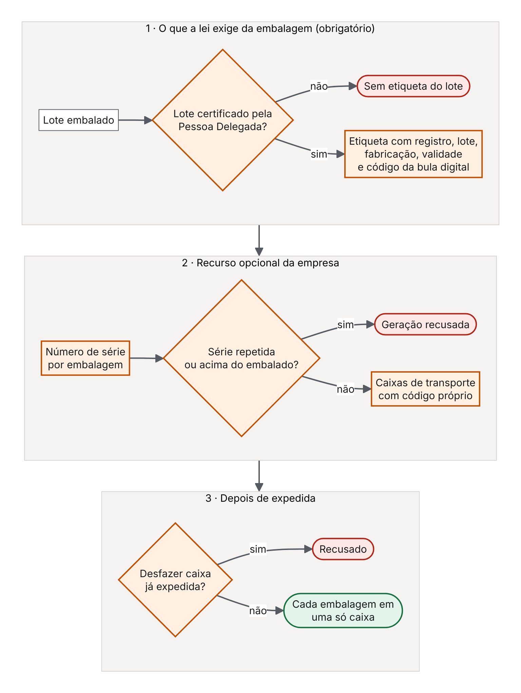

# Passo 3, fluxo 16a: dar uma identidade a cada embalagem e juntá-las em caixas (geração do IUM e agregação, Rastreabilidade)

*Como ler: **laranja** = o sistema confere (trava); **vermelho** = bloqueio; **verde** = resultado. Clique na imagem para ampliar.*

*Coluna "Onde no sistema": o caminho no sistema atual (legado), no formato **Módulo › Menu › Tela**. Onde diz "tela nova", a tela não existe hoje e será criada.*

> **Em uma frase:** cada caixinha de remédio recebe um **número único** (o IUM), impresso na etiqueta como um código de barras quadrado, e as caixinhas são **agrupadas** em caixas maiores, que também têm código.
>
> **Exemplo do dia a dia (ilustrativo, os números são inventados):** um lote tem 10.000 caixinhas. O sistema gera 10.000 números, nem um a mais, nem repetido, imprime as etiquetas e depois junta 50 caixinhas numa caixa de transporte, que ganha o seu próprio código.
>
> **Por que importa:** com o número único, dá para seguir **cada caixinha** até o paciente e recolher só a que tem problema. Se o número se repetir, ou se nascer de um lote que ainda não foi liberado, a rastreabilidade perde o valor.
>
> *Palavra que não conhece? Veja a documento "Glossário" (grupo "Para começar" da lista do estudo). Aqui: **IUM** (Identificador Único de Medicamento) é o número que identifica uma embalagem; **agregação** é juntar embalagens em caixas, com código próprio; **SNCM** (Sistema Nacional de Controle de Medicamentos) é o sistema da ANVISA que recebe o registro desses números; **GTIN** é o código de barras do produto; **DataMatrix** é o código de barras quadrado da etiqueta.*

**Análise de 21/11/2026. Rascunho para validação do responsável.** Primeira das duas fichas da **Rastreabilidade** (a 16b será eventos e declaração à ANVISA). Este fluxo é a base da outra: sem IUM correto, nenhum evento tem valor.

**Fontes (todas no repositório do legado):** o fluxo "Geração de IUM e agregação" (`8.rastreabilidade/fluxos/geracao-ium-agregacao.md`, lido do código, regras `RN001` a `RN015`) e o inventário de telas da Rastreabilidade (casos `CT-RAS-017` a `029`). **O que não fiz:** não li as telas uma a uma. **Nada deste fluxo foi testado na tela; tudo vem só do código.** As normas da RDC 658/2022 (arts. 8º XV, 14 VII, 124 e 344 a 347) foram conferidas no texto. **A regra do identificador único e do SNCM (Lei 11.903/2009 e a regulamentação da ANVISA) não está no repositório:** o formato do IUM e a obrigação de declarar ficam como pontos a validar com Assuntos Regulatórios.

> **Confirmado em 22/11/2026 com o texto da lei: o modelo de rastreabilidade mudou em 2022.** O que foi **lido** (Lei 14.338/2022 e Lei 11.903/2009 na redação atual, reprodução da Câmara dos Deputados do Diário Oficial; e notícia da ANVISA de 23/05/2022):
> - A Lei 11.903/2009 continua criando o **Sistema Nacional de Controle de Medicamentos (SNCM)** e manda que as embalagens recebam **identificação específica** com, no mínimo: **número de registro, número do lote ou partida, validade** e **código de barras bidimensional que leva à bula digital** (art. 3º, §1º).
> - **O detentor do registro deve ter um sistema que gere o "mapa de distribuição"**: quantidades comercializadas e distribuídas **para cada lote** e os **destinatários das remessas**. O mapa e as embalagens trazem **lote, data de fabricação e validade** (art. 3º-A).
> - A Lei 14.338/2022 **revogou** o inciso II do §1º do art. 3º e os arts. 4º, 4º-A e 5º (na redação original de 2009, o art. 4º dizia que a ANVISA implantaria e coordenaria o SNCM). A adoção segue o **cronograma da regulamentação** da autoridade sanitária, e as demais etapas do mapa vêm em até 12 meses depois dela.
> - A ANVISA informou que **suspendeu o contrato de desenvolvimento do SNCM porque a Lei 14.338/2022 "alterou o modelo para a rastreabilidade de medicamentos"** (23/05/2022).
>
> **Ainda não lido:** a regulamentação em vigor (a RDC 157/2017 aparece como revogada pela RDC 886/2024, segundo resumo de busca; o texto não foi lido) e o cronograma. **O que isso muda nesta ficha:** o texto da lei **não exige**, por si só, número de série único por embalagem nem a **declaração de cada evento à ANVISA**. Exige o **mapa de distribuição por lote e destinatário** e a **identificação da embalagem com lote, validade e bula digital**. Até a regulamentação dizer o contrário, o número de série por caixa e a declaração passam a ser **recurso do iLabs, ligável por empresa**, e não obrigação confirmada. **Continua valendo** o que a RDC 658/2022 pede para o recolhimento (arts. 344 a 347) e o defeito de **a tela dizer "enviado" sem ter enviado**, que é registro falso (art. 124).

## 1. O caminho, em uma linha
**Buscar a produção liberada** → **gerar os IUM** (um por embalagem) → **imprimir a etiqueta** → **agregar em caixas** (montar, concluir) → ou **desfazer** a caixa.

### A situação do IUM e da caixa

No legado o IUM nasce "aguardando uso" e **não acompanha a situação do lote**, e a caixa pode ser desfeita mesmo depois de expedida. No iLabs a situação é **uma só, guardada e conferida pelo banco**.

## 2. Etapa a etapa

| # | Etapa | Onde no sistema (legado) | Quem faz | Exige antes | O que entra | O banco garante (iLabs) | Falha do legado |
|---|---|---|---|---|---|---|---|
| 1 | **Buscar o lote embalado** | **Rastreabilidade** › Geração de IUM | Rastreabilidade | Produção **finalizada** e lote **certificado pela Pessoa Delegada** ([ficha 14c](fluxo-14c-autorizacao-inicio-final.md), [ficha 15b](fluxo-15b-cotacao-requisicao-reserva.md)) | Produto, lote, validade, registro, GTIN, quantidade embalada | A lista traz **só lote certificado** e **não bloqueado**; os dados **vêm do lote**, não da tela | A lista traz as produções "liberadas" pela Produção, **sem a certificação da Pessoa Delegada** (`RN001`, `RN002`, ponto 3, arts. 8º XV e 14 VII); lote, validade, registro e GTIN são **reenviados pela tela** (`RN003`) |
| 2 | **Gerar os IUM** | Mesma tela | Rastreabilidade | Lote escolhido | **Quantidade** de IUM | **Quantidade até o total embalado** do lote, **somando as gerações anteriores**; **um aviso e uma recusa** para gerar de novo sem motivo | A quantidade só precisa ser maior que zero: **pode gerar mais IUM do que embalagens**; **gerar de novo para o mesmo lote** é possível, sem aviso (`RN004`, `RN005`, ponto 2) |
| 3 | **Compor o número** | Automático | Automático | — | Registro, série, validade, lote, GTIN | Número de série **único em todo o banco** (índice único), no **formato exigido pelo SNCM** | Série de **13 dígitos sorteados**, conferida **só dentro da mesma geração**, **sem índice único**: pode repetir (`RN006`, ponto 1); formato **a validar** (`RN007`, ponto 7) |
| 4 | **Registrar o nascimento** | Automático | Automático | — | Quem e quando | IUM nasce **aguardando uso**, com **quem e quando pelo servidor** e **trilha de auditoria** | Já gravava quem e quando (`RN008`) |
| 5 | **Imprimir a etiqueta** | **Rastreabilidade** › Etiqueta do IUM (pela pesquisa e pela geração) | Rastreabilidade | IUM gerado | — | Etiqueta com **os dados da empresa titular, vindos do cadastro**, e o código **DataMatrix** | Endereço, CNPJ, farmacêutico responsável e SAC **de outra empresa, escritos no código** (`RN009`, `RN010`, ponto 4) |
| 6 | **Montar a caixa (agregação)** | **Rastreabilidade** › Agregação | Rastreabilidade | IUM aguardando uso | IUM e/ou outras caixas | **Cada IUM e cada caixa em uma só caixa**; não agrega a si mesma; IUM de lote **bloqueado** não entra | Exige ao menos um IUM ou caixa; **não repete** IUM nem caixa em outra caixa (`RN011`, `RN012`); a situação do lote **não é conferida** |
| 7 | **Dar o código da caixa** | Automático | Automático | — | — | Código com **prefixo GS1 da empresa**, sequência **sem reaproveitar** número excluído, e dígito verificador | O prefixo é **um valor de exemplo fixado no código**; a sequência parte da maior caixa não excluída, e **pode reaproveitar código** (`RN014`, ponto 5) |
| 8 | **Concluir a caixa** | Mesma tela | Rastreabilidade | Caixa montada | — | Caixa **concluída** e IUM **agregados**, **assinados**, com histórico | Salvar deixa "em processo"; concluir deixa "concluída"; os IUM, "agregados" (`RN013`) |
| 9 | **Desfazer a caixa** | Mesma tela | Rastreabilidade e Qualidade | Caixa concluída | **Justificativa** | **Só antes da expedição**; **com motivo e assinatura**; **a caixa já declarada como enviada nunca se desfaz** | **Desfaz sem conferir se já houve evento** de embalagem, transporte ou entrega, e **sem pedir motivo** (`RN015`, ponto 6) |

## 3. O que este fluxo exige de cada cadastro global

| Cadastro (passo 1) | O que o fluxo precisa que ele guarde |
|---|---|
| **Empresa titular do registro** | **CNPJ, endereço, telefone do SAC e farmacêutico responsável (com número no conselho)** para a etiqueta; **prefixo GS1** para o código das caixas |
| **Produto acabado (ficha 14b)** | **GTIN**, **número do registro**, **composição** e a **quantidade embalada** de cada lote |
| **Lote (Estoque)** | **Certificação da Pessoa Delegada**, **situação** (liberado, bloqueado, recolhido) e **total embalado**, que limita os IUM |
| **Formato do IUM** (novo) | O padrão do SNCM, **definido por Assuntos Regulatórios** e guardado fora do código |
| **Profissional e função** | Quem **gera** IUM, **monta** e **desfaz** caixa: funções separadas, com assinatura |
| **Notificações (serviço comum)** | Aviso de **IUM de lote bloqueado**, de **geração acima do embalado** e de **caixa desfeita** |

## 4. Os registros que nascem no fluxo (não são cadastros)
IUM (um por embalagem) · etiqueta impressa · agregação (caixa) e os IUM dela · situação de cada IUM com data e usuário · histórico.

## 5. O que muda nos documentos anteriores
- **Roteiro de implantação:** na etapa 3, a **empresa titular do registro** com os dados da etiqueta e o **prefixo GS1**; na etapa 1, as funções de **gerar IUM** e **desfazer caixa**; na etapa 9, o ensaio fecha a corrente do lote: **gerar mais IUM do que o embalado** (recusado), **gerar IUM de lote bloqueado** (recusado), **etiqueta com os dados da empresa certa** e **desfazer caixa já expedida** (recusado).
- **Ficha 14c (liberação do lote):** a **certificação da Pessoa Delegada** passa a ser pré-condição **também** da geração do IUM.
- **Ficha 14d (registro de lote):** o **total embalado** do lote vem do caderno, e **limita** os IUM.
- **Ficha 15b e 15c (Comercial):** o lote **bloqueado** ou **recolhido** impede a venda **e** impede novos IUM.
- **Ficha 16b (eventos):** o evento de entrega só aceita IUM **agregado ou aguardando uso** e de lote **liberado**.

## 6. Pontos a validar com a área (não consegui tirar do código)
1. **Obrigação:** a empresa precisa declarar ao SNCM? Desde quando e para quais produtos? **A Lei 11.903/2009 e a regulamentação não estão no repositório:** pedir a Assuntos Regulatórios.
2. **Formato do IUM:** o padrão atual (registro, série, validade, lote e GTIN, sem separadores) é o que o SNCM exige?
3. **Série:** 13 dígitos sorteados é aceitável, ou o sistema deve gerar em sequência?
4. **Quantidade:** pode gerar IUM de reserva (perdas na linha de embalagem)? Quanto?
5. **Etiqueta:** quem é a **empresa titular** em cada produto? Quem é o **farmacêutico responsável** na etiqueta e quem o troca?
6. **Prefixo GS1:** qual é o da empresa? Onde fica guardado?
7. **Desfazer caixa:** em que situações se desfaz uma caixa? O que acontece com a declaração, se já foi feita?
8. **Pessoa Delegada:** a certificação do lote **acontece antes** de gerar o IUM, hoje? Quem faz?
