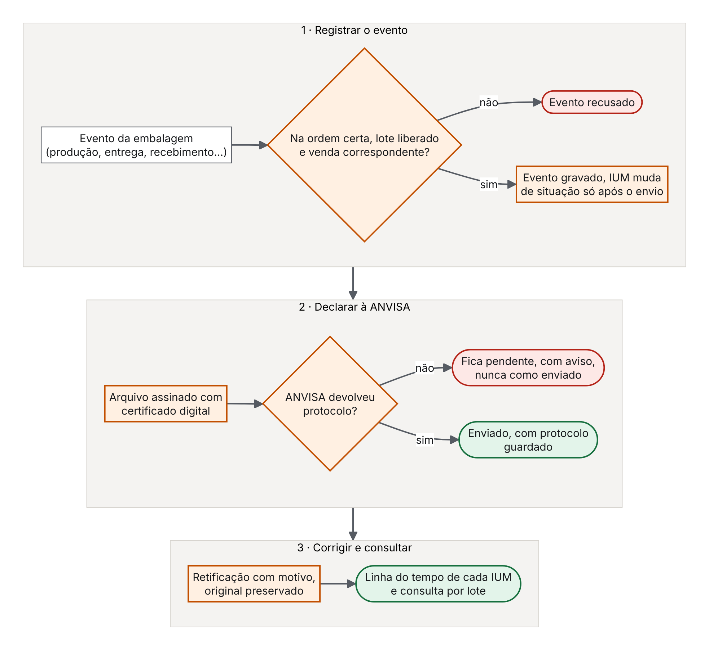
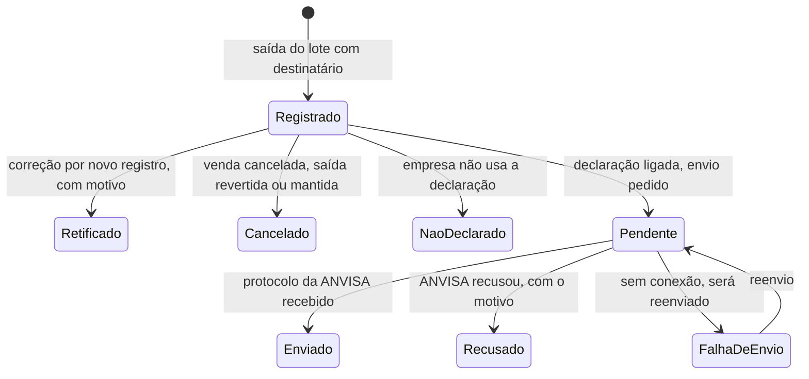

# Passo 3, fluxo 16b: saber para onde foi cada lote (mapa de distribuição e declaração opcional de eventos, Rastreabilidade)

*Como ler: **laranja** = o sistema confere (trava); **vermelho** = bloqueio; **verde** = resultado. Clique na imagem para ampliar.*

*Coluna "Onde no sistema": o caminho no sistema atual (legado), no formato **Módulo › Menu › Tela**. Onde diz "tela nova", a tela não existe hoje e será criada.*

> **Em uma frase:** a empresa que tem o registro do remédio precisa de um **sistema que diga, para cada lote, quanto foi vendido e distribuído e para quem foi** (o **mapa de distribuição**). Avisar a ANVISA de **cada evento** de cada caixinha, como se fazia no modelo antigo, deixou de ser exigência confirmada e fica como **recurso opcional**.
>
> **Exemplo do dia a dia (ilustrativo, os números são inventados):** o lote 123 teve um problema. A empresa digita o número do lote e vê, em segundos, as 4 vendas e as 4 remessas: cliente, endereço, quantidade e data. Se uma fatura foi cancelada **depois** de o material sair, essa saída continua aparecendo.
>
> **Por que importa:** é isto que a lei exige da empresa, e é o que permite **recolher só o lote com problema**, sem esconder nenhum cliente. O legado tinha a consulta fora do menu, exigia período e **escondia as vendas canceladas**.
>
> *Palavra que não conhece? Veja o documento "Glossário" (grupo "Para começar" da lista do estudo). Aqui: **mapa de distribuição** é o relatório por lote com as quantidades e os destinatários; **recolhimento** é tirar do mercado um lote já vendido; **evento** é um fato da vida da embalagem (entrega, recebimento, finalização); **protocolo** é o recibo que a ANVISA devolve; **certificado digital** é a assinatura eletrônica de quem envia.*

**Análise de 22/11/2026, reescrita depois que a norma mudou. Rascunho para validação do responsável.** Última das duas fichas da **Rastreabilidade** (a [16a](fluxo-16a-ium-e-agregacao.md) é a identificação da embalagem). **A versão anterior desta ficha descrevia a declaração de eventos ao banco central como obrigação; esse regime deixou de ser exigência.**

## A situação da norma (o que mudou)
- **Lido no texto da Lei 14.338/2022 e da Lei 11.903/2009 atual:** o detentor de registro **deve possuir sistema que permita a elaboração de mapa de distribuição de medicamentos**, com os **quantitativos comercializados e distribuídos para cada lote** e os **destinatários das remessas**; o mapa traz **lote, data de fabricação e validade** (art. 3º-A). A lei revogou os artigos que tratavam da implantação do sistema central pela ANVISA (arts. 4º, 4º-A e 5º) e a adoção segue o **cronograma da regulamentação** (art. 2º da Lei 14.338/2022).
- **A RDC 157/2017 consta como revogada** na base de legislação da ANVISA. Ela exigia a comunicação de cada evento em até 3 dias úteis, com retificação por novo evento e **vedada a alteração** do que foi comunicado (arts. 12 e 13); isso é a **referência histórica** do recurso opcional.
- **Lido nas Perguntas e Respostas da ANVISA sobre a RDC 430/2020 (atualizadas em 16/11/2022):** no **recolhimento** (RDC 625/2022, arts. 10 a 12), o distribuidor entrega ao detentor do registro o **mapa de distribuição em até 48 horas**, com **registro, princípio ativo, apresentação, lotes, nota fiscal, quantidade adquirida e remanescente, quantidade distribuída a cada estabelecimento e assinaturas**; e há **simulação anual de recolhimento** (art. 30, §2º). **O iLabs precisa guardar esses dados em cada saída** e poder **montar esse mapa**. O texto integral da RDC 430 e da RDC 625 **não foi lido**.
- **Conferir:** o número e a data do ato revogador; IN 19/2017 e IN 100/2021; **regulamentação nova do mapa** e cronograma.
- **Continua valendo (RDC 658/2022):** os registros de distribuição ficam **prontamente disponíveis** para quem faz o recolhimento e trazem informação suficiente sobre os clientes abastecidos (arts. 346 e 347); a capacidade de **recolher a qualquer momento** (art. 345); registros **rastreáveis**, alteração **assinada e datada** com o original legível (arts. 124 e 125); **nenhum lote vendido** antes da certificação da Pessoa Delegada (arts. 8º XV e 14 VII).

## 1. O caminho, em uma linha
**Venda ou remessa de um lote** → **registro por lote** (quantidade e destinatário) → **mapa de distribuição** e **consulta do lote** (recolhimento) → *(opcional)* **declaração de eventos com protocolo** → **retificar** sem apagar.

### A situação do registro de distribuição e da declaração

No legado o evento só era "Enviado" ou "Falha no envio", e **"Enviado" era marcado sem a ANVISA ter respondido**. No iLabs o registro de distribuição **nunca se apaga**, e a declaração, se ligada, **só vira "Enviado" com o protocolo**.

## 2. Etapa a etapa

| # | Etapa | Obrigatório? | Onde no sistema (legado) | Quem faz | O que entra | O banco garante (iLabs) | Falha do legado |
|---|---|---|---|---|---|---|---|
| 1 | **Registrar a distribuição de cada saída** | **Sim** | **Comercial** › Faturamento › Fatura ([ficha 15c](fluxo-15c-fatura-remessa-cancelamento.md)); **Estoque** › Remessa | Automático | Lote, quantidade, **destinatário e endereço da época**, data | **Todo lote que sai** (venda, remessa, devolução ao fornecedor, amostra) **gera um registro por lote**, **só de lote certificado, liberado e não recolhido**, e de **cliente autorizado** | A remessa da fatura **não gerava** evento; **nada ligava a entrega à venda** nem à situação do lote (`RN006`, `RN007`, `RN018`, pontos 4 e 6) |
| 2 | **Guardar o endereço e o destinatário** | **Sim** | Fatura ([ficha 15a](fluxo-15a-cliente-e-cadastros.md)) | Automático | Cópia do endereço de entrega | **Cópia do endereço na saída**: mudar ou inativar o cadastro **não mexe no registro antigo** | A fatura **apontava** para o cadastro, sem cópia (ficha 15a) |
| 3 | **Gerar o mapa de distribuição** | **Sim** | **Comercial** › RV07 Produtos Faturados (fora do menu) | Qualidade, Assuntos Regulatórios | Lote, período (opcional) | **Mapa por lote:** quantidades comercializadas e distribuídas, **destinatários**, **lote, data de fabricação e validade**, **número da nota fiscal** e **quantidade por estabelecimento** (o conteúdo do mapa de recolhimento da RDC 625/2022, art. 10); **no menu**; **sem exigir período** | O RV07 estava **fora do menu**, **exigia período** e **ignorava faturas canceladas**; não trazia **endereço** nem o número da remessa (ficha 15c, `RN017` a `RN021`) |
| 4 | **Consultar para onde foi o lote (recolhimento)** | **Sim** | Mesmo relatório | Qualidade | Lote | **"Para quem foi o lote X"** com **toda saída**, inclusive de **fatura cancelada cuja remessa já saiu**, com **cliente, endereço, remessa, quantidade e data**; disponível **na hora** | Vendas canceladas sumiam do relatório (arts. 345 a 347, ficha 15c) |
| 5 | **Retificar um registro** | **Sim** | Eventos (lista) › Retificação | Qualidade | Tipo (invalidar ou substituir), **motivo** | **Motivo obrigatório**, **original preservado e ligado ao substituto**, **assinatura**, histórico que não se apaga | Guardava o original, mas **não exigia o motivo** (`RN019`, `RN020`) |
| 5a | **Simular o recolhimento uma vez por ano** | **Recurso previsto pela ANVISA** (a confirmar o alcance para o fabricante) | Qualidade | Lote escolhido (o de maior criticidade) | Simulação com as unidades **em estoque e já vendidas**, usando o mapa | **Simulação registrada, com o tempo de resposta e os destinatários;** aviso quando passa um ano sem simular | Não existe no legado (Perguntas e Respostas da RDC 430/2020, art. 30, §2º) |
| 6 | **Guardar os registros** | **Sim** | — | Automático | — | **Guarda mínima:** a do art. 127 da RDC 658/2022 para a documentação do lote (**um ano após a validade ou cinco anos após a certificação, o que for maior**); prazo próprio da norma de distribuição **a confirmar** | Sem prazo de guarda no legado |
| 7 | **Declarar eventos à ANVISA** | **Opcional** (parâmetro da empresa; **desligado por padrão**) | **Rastreabilidade** › Evento Produção, Embalagem Transporte, Entrega, Recebimento, Finalização | Rastreabilidade | Evento, partes (CNPJ, razão social, endereço), tipo | Evento **só na ordem certa**; arquivo **assinado com certificado digital** da empresa (**segredo, nunca em arquivo**); **protocolo guardado**; **recusa guarda o motivo**; **falha vai para a fila e é reenviada** | O envio **era simulado** (sempre "erro de conexão"), caía numa fila que **nenhum serviço lia**, e a tela dizia **"envio efetuado com sucesso"** sem ler a resposta; **não havia certificado nem endereço do serviço** (`RN009` a `RN012`, pontos 1 e 2, art. 124) |
| 8 | **Mudar a situação só depois do envio** | **Opcional** | Automático | Automático | — | A situação da série **só muda depois da resposta** da ANVISA | A tela **marcava antes de enviar**; se o envio falhava, ficavam "enviadas" (`RN008`, `RN013`, ponto 3) |
| 9 | **Guardar o registro de cada envio** | **Opcional** | Tabela de registro dos envios | Automático | XML, situação, protocolo | Cada tentativa com **situação, protocolo, data e quem**, **que não se apaga** | A situação **não era gravada**; entregas e recebimentos **gravados duas vezes** (`RN014`, `RN015`) |
| 10 | **Consultar a vida da embalagem** | **Opcional** | Pesquisa de IUM › Linha do tempo | Qualidade | Série ou lote | **Linha do tempo** com data, usuário e protocolo | Existia, com data e usuário (`RN021`); sem protocolo |

## 3. O que este fluxo exige de cada cadastro global

| Cadastro (passo 1) | O que o fluxo precisa que ele guarde |
|---|---|
| **Cliente e endereço (ficha 15a)** | Cliente **autorizado**; **cópia do endereço** em cada saída |
| **Lote (Estoque)** | **Certificação**, **situação** (liberado, bloqueado, recolhido), **data de fabricação** e **validade** |
| **Venda e remessa (fichas 15c e 9)** | **Lote, quantidade e destinatário** de cada saída, **inclusive cancelada com material já saído** |
| **Parâmetro da empresa** (novo) | **Declara eventos à ANVISA?** (padrão: **desligado**); **tipos de evento** e **certificado digital** (por variável de ambiente, nunca no código), **só se ligar** |
| **Profissional e função** | Quem **consulta o mapa**, **retifica** registro e, se ligado, **envia e reenvia** evento: funções separadas, com assinatura |
| **Notificações (serviço comum)** | Aviso de **registro com dado faltando** e, se ligado, de **envio recusado ou com falha** e **certificado vencendo** |

## 4. Os registros que nascem no fluxo (não são cadastros)
Registro de distribuição por lote e destinatário · retificação · *(opcional)* evento, registro de cada envio com protocolo e fila de reenvio · histórico.

## 5. O que muda nos documentos anteriores
- **Roteiro de implantação:** na etapa 1, a função de **consultar o mapa** e **retificar** registro; na etapa 9, o ensaio fecha a corrente do lote: **saída de lote não certificado** (recusada), **fatura cancelada com remessa já saída** (continua no mapa) e **a consulta "para quem foi o lote X"** com endereço. A **declaração de eventos** só entra na implantação **se o cliente ligar o recurso** (certificado digital por variável de ambiente).
- **Fichas 15b e 15c (Comercial):** cada venda e cada remessa **grava o registro de distribuição por lote e destinatário**.
- **Ficha 9 (remessa e expedição):** a remessa do Estoque grava o mesmo registro.
- **Ficha 16a (identificação da embalagem):** a caixa expedida não se desfaz.
- **Passo 4 (recolhimento):** a **consulta do lote** é o ponto de partida do recolhimento (art. 345).

## 6. Pontos a validar com a área (decisões de produto a registrar)
1. **Regulamentação nova** do mapa de distribuição (Lei 14.338/2022, art. 3º-A): já existe? Define **formato, periodicidade** ou **envio à ANVISA**? **Não li** nenhuma.
2. **Declaração de eventos:** o cliente quer ligar o recurso opcional? Quais eventos? **Padrão proposto: desligado.**
3. **Ato revogador da RDC 157/2017:** número e data corretos, e se a **IN 19/2017** e a **IN 100/2021** também caíram.
4. **Prazo de guarda** do mapa e dos registros de distribuição: o do art. 127 da RDC 658/2022 basta, ou a norma de distribuição (RDC 430/2020, **não lida**) fixa outro?
5. **Saídas que entram no mapa:** além de venda, entram **doação, amostra, devolução ao fornecedor e transferência entre unidades**?
6. **Quem consulta** o mapa e em quanto tempo precisa responder a um recolhimento.
7. **Retificação:** quem pode retificar e o que vale como motivo?
8. **Duas telas de evento do legado** (Rastreabilidade e Estoque): se o recurso for ligado, **um só caminho**?
