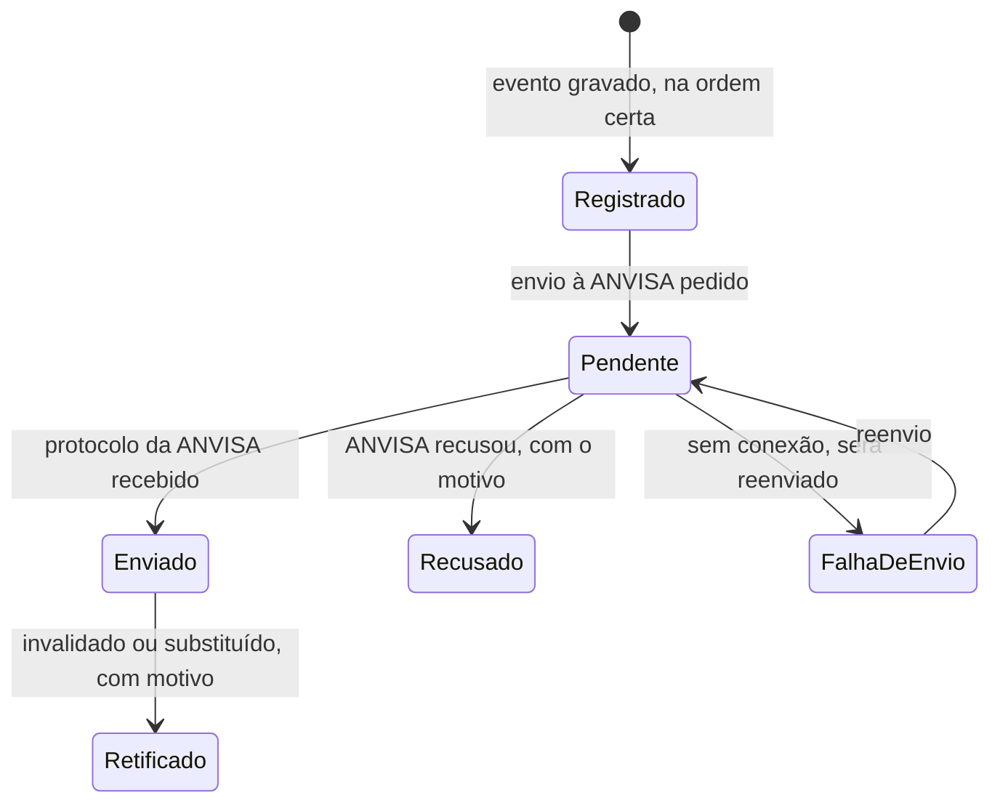

# Passo 3, fluxo 16b: registrar a vida de cada embalagem e declará-la à ANVISA (eventos e declaração, Rastreabilidade)

*Como ler: **laranja** = o sistema confere (trava); **vermelho** = bloqueio; **verde** = resultado. Clique na imagem para ampliar.*

*Coluna "Onde no sistema": o caminho no sistema atual (legado), no formato **Módulo › Menu › Tela**. Onde diz "tela nova", a tela não existe hoje e será criada.*

> **Em uma frase:** cada vez que uma embalagem muda de mãos (sai da fábrica, chega a um cliente, é vendida ao paciente ou descartada), o sistema registra um **evento**, e a empresa deveria **avisar a ANVISA** de cada um, com um arquivo assinado digitalmente.
>
> **Exemplo do dia a dia (ilustrativo, os números são inventados):** o lote foi entregue a uma distribuidora. O sistema registra "entrega", envia o aviso à ANVISA e guarda o **protocolo** que ela devolve, como um recibo. Se o aviso falhar, a tela precisa dizer que **falhou**, e não que deu certo.
>
> **Por que importa:** é o último elo da corrente. Se a empresa é obrigada a declarar e o sistema só finge que declarou, ela descumpre a obrigação sem saber. E uma tela que afirma "enviado com sucesso" quando nada foi enviado é um **registro falso**.
>
> *Palavra que não conhece? Veja a aba "24 · Glossário" desta página. Aqui: **evento** é um fato da vida da embalagem (produção, entrega, recebimento, finalização); **protocolo** é o número de recibo que a ANVISA devolve; **certificado digital** é a assinatura eletrônica que prova quem enviou; **retificar** é corrigir um evento já enviado, sem apagar o original.*

**Análise de 21/11/2026. Rascunho para validação do responsável.** Última das duas fichas da **Rastreabilidade** (a [16a](fluxo-16a-ium-e-agregacao.md) foi a geração do IUM e a agregação).

**Fontes (todas no repositório do legado):** o fluxo "Eventos e declaração à ANVISA" (`8.rastreabilidade/fluxos/eventos-declaracao-anvisa.md`, lido do código, regras `RN001` a `RN021`) e o inventário de telas da Rastreabilidade (casos `CT-RAS-001` a `016`). **O que não fiz:** não li as telas uma a uma. **Nada deste fluxo foi testado na tela; tudo vem só do código.** As normas (RDC 658/2022, arts. 8º XV, 124 e 344 a 347, e o Guia 33/2020, item 9.3.2.3) foram conferidas no texto. **A obrigação de declarar ao SNCM (Lei 11.903/2009 e a regulamentação) não está no repositório:** ficam como pontos a validar com Assuntos Regulatórios o que declarar, quando e em que formato.

## 1. O caminho, em uma linha
**Registrar o evento** (produção, embalagem e transporte, entrega, recebimento ou finalização) → **enviar à ANVISA** (arquivo assinado) → **receber o protocolo** → se preciso, **retificar** → **consultar a linha do tempo**.

### A situação do evento

No legado o evento só era "Enviado" ou "Falha no envio", e **"Enviado" era marcado sem a ANVISA ter respondido**. No iLabs a situação é **uma só, guardada e conferida pelo banco**, e **só vira "Enviado" com o protocolo**.

## 2. Etapa a etapa

| # | Etapa | Onde no sistema (legado) | Quem faz | Exige antes | O que entra | O banco garante (iLabs) | Falha do legado |
|---|---|---|---|---|---|---|---|
| 1 | **Registrar a produção** | **Rastreabilidade** › Evento Produção | Rastreabilidade | IUM gerado de lote certificado ([ficha 16a](fluxo-16a-ium-e-agregacao.md)) | IUM | Só IUM **aguardando uso** e de lote **liberado** | Aceita o IUM não finalizado e não agregado; a situação do lote **não é conferida** (`RN001`, `RN007`, ponto 6) |
| 2 | **Registrar embalagem e transporte** | Evento Embalagem Transporte | Rastreabilidade | Caixa concluída | Código da caixa | Só **caixa concluída**, conferida pelo validador de agregação | Confere a agregação pelo código (`RN001`) |
| 3 | **Registrar a entrega** | Evento Entrega (e **Estoque** › Remessa › Evento ANVISA) | Rastreabilidade, Estoque | Produção declarada; **venda no Comercial** ([ficha 15c](fluxo-15c-fatura-remessa-cancelamento.md)) | Tipo (venda, transferência, doação, devolução, recolhimento, amostra), remetente, destinatário, transportadora | **Só depois da produção declarada**; o destinatário **precisa ter a fatura e a remessa** correspondentes; o mesmo IUM **não entra duas vezes** | **A ordem dos eventos não é conferida**; **nada liga a entrega à venda**; a remessa da fatura **não gera** evento (`RN002`, `RN005`, `RN006`, `RN018`, pontos 4 e 6); o mesmo IUM não repete (`RN001`) |
| 4 | **Registrar o recebimento** | Evento Recebimento | Rastreabilidade | Entrega declarada | Tipo (compra, transferência, doação, devolução, recolhimento, amostra), partes | Só **depois da entrega** do mesmo IUM; partes **do cadastro** | Mesma falta de ordem e de ligação com a venda (`RN002`, `RN004`, `RN005`) |
| 5 | **Registrar a finalização** | Evento Finalização | Rastreabilidade | IUM entregue | Tipo (dispensação, baixa, extravio, perda, descarte) | Só **IUM que existe e foi entregue**; **nunca cria IUM** | Digitar um código inexistente **cria um IUM "externo"**, sem conferência (`RN003`, ponto 5) |
| 6 | **Mudar a situação do IUM** | Automático | Automático | Evento registrado | — | A situação do IUM **só muda depois** da resposta da ANVISA | A tela **marca os IUM antes de enviar**; se o envio falha, **continuam como enviados** (`RN008`, `RN013`, ponto 3) |
| 7 | **Montar e assinar o arquivo** | Microsserviço da Rastreabilidade | Automático | Evento registrado | Evento | Arquivo **assinado com certificado digital** da empresa, guardado | **Não há certificado, assinatura nem endereço do serviço da ANVISA no código** (`RN012`) |
| 8 | **Enviar e receber o protocolo** | Microsserviço e serviço do Windows | Automático | Arquivo assinado | — | **Protocolo guardado** com cada evento; **recusa guarda o motivo**; **falha vai para a fila e é reenviada** | O envio **é simulado** ("erro de conexão" sempre) e cai numa fila que **nenhum serviço lê**; a tela mostra **"envio efetuado com sucesso"** sem ler a resposta; o Estoque faz o mesmo (`RN009` a `RN011`, `RN017`, pontos 1 e 2, art. 124) |
| 9 | **Guardar o registro de cada envio** | Tabela de registro dos envios | Automático | Envio feito | XML, situação, protocolo | Cada tentativa com **situação, protocolo, data e quem**, **que não se apaga** | A situação **não é gravada** (coluna vazia); entregas e recebimentos **gravados duas vezes** (`RN014`, `RN015`) |
| 10 | **Retificar um evento** | Eventos (lista) › Retificação | Rastreabilidade e Qualidade | Evento enviado | Tipo (invalidar ou substituir), **motivo** | **Motivo obrigatório**, **original preservado e ligado ao substituto**, **assinatura** | Guarda o original, mas **não exige o motivo** (`RN019`, `RN020`) |
| 11 | **Consultar a vida da embalagem** | Pesquisa de IUM › Linha do tempo | Qualidade, Assuntos Regulatórios | — | IUM, lote ou cliente | **Linha do tempo** com data, usuário e protocolo; **consulta por lote** que lista toda venda (ficha 15c) | A linha do tempo existe, com data e usuário (`RN021`); não traz protocolo |

## 3. O que este fluxo exige de cada cadastro global

| Cadastro (passo 1) | O que o fluxo precisa que ele guarde |
|---|---|
| **Empresa titular e certificado digital** | **CNPJ**, **certificado digital** com validade e **endereço do serviço da ANVISA**, ambos **por variável de ambiente, nunca no código** |
| **Pessoa jurídica (remetente, destinatário, transportadora)** | CNPJ, razão social, endereço, município, estado e país; **papel** (cliente, transportadora) |
| **IUM e caixa (ficha 16a)** | **Situação** conferida a cada evento; **ordem** produção → entrega → recebimento → finalização |
| **Venda (ficha 15c)** | **Fatura e remessa** que **sustentam** cada evento de entrega |
| **Lote (Estoque)** | **Situação** (liberado, bloqueado, recolhido); lote **recolhido** gera evento do tipo recolhimento |
| **Tipos de evento** (novo) | Lista dos tipos **definida por Assuntos Regulatórios**, fora do código |
| **Profissional e função** | Quem **registra**, **reenvia** e **retifica**: funções separadas, com assinatura |
| **Notificações (serviço comum)** | Aviso de **envio recusado ou com falha**, **pendência parada** e **certificado vencendo** |

## 4. Os registros que nascem no fluxo (não são cadastros)
Evento (um por tipo e IUM) · registro de cada envio com protocolo · retificação · linha do tempo do IUM · fila de reenvio.

## 5. O que muda nos documentos anteriores
- **Roteiro de implantação:** na etapa 3, o **certificado digital e o endereço do serviço da ANVISA** (por variável de ambiente) e os **tipos de evento**; na etapa 1, as funções de **registrar, reenviar e retificar** evento; na etapa 9, o ensaio fecha a corrente do lote: **entrega sem venda** (recusada), **evento fora de ordem** (recusado), **envio que falha** (fica pendente, com aviso, nunca como enviado) e **retificação sem motivo** (recusada).
- **Ficha 15c (fatura):** a remessa gerada pela fatura **cria o evento de entrega**; a consulta do lote traz o **protocolo**.
- **Ficha 9 (remessa e expedição):** a remessa do Estoque e a tela de evento da Rastreabilidade passam a ser **um só caminho**.
- **Ficha 16a (IUM e agregação):** a caixa **declarada como enviada** não se desfaz.
- **Fichas de recolhimento (passo 4):** o evento do tipo **recolhimento** nasce do lote recolhido.

## 6. Pontos a validar com a área (não consegui tirar do código)
1. **Obrigação:** a empresa precisa declarar ao SNCM? Quais eventos, em que prazo, a partir de quando? **A Lei 11.903/2009 e a regulamentação não estão no repositório.**
2. **Hoje, como a empresa declara?** Existe outro sistema, planilha ou portal da ANVISA usado fora do LabMedSys?
3. **Certificado digital:** quem o guarda e renova? Há um por empresa ou por pessoa?
4. **Ordem dos eventos:** a ANVISA recusa entrega de IUM não ativado. Qual é a **ordem exata** e o que ela recusa?
5. **Venda e entrega:** todo evento de entrega do tipo venda precisa de uma fatura? E os tipos doação, amostra e transferência?
6. **Retificação:** quem pode retificar e em que prazo? O que a ANVISA aceita como motivo?
7. **Duas telas de evento (Rastreabilidade e Estoque):** qual a empresa usa e quem faz?
8. **Fila e reenvio:** quanto tempo um evento pode ficar pendente até alguém ser avisado?
