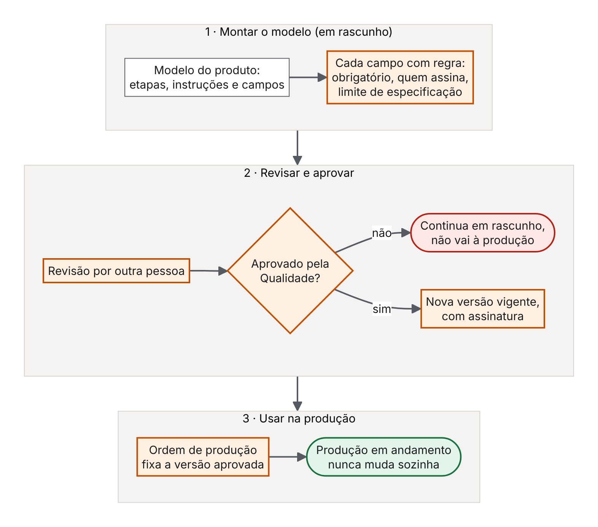
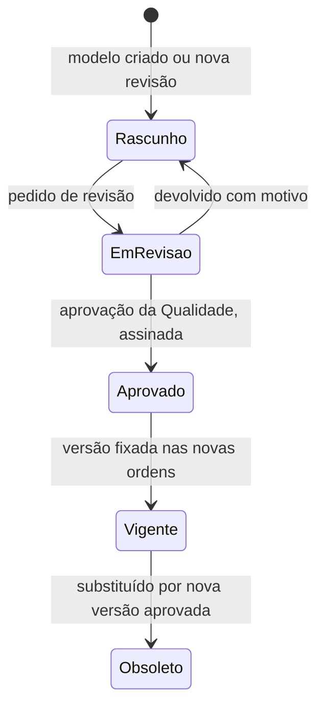

# Passo 3, fluxo 17: montar o modelo do caderno de lote (montagem do modelo, OPE)

*Como ler: **laranja** = o sistema confere (trava); **vermelho** = bloqueio; **verde** = resultado. Clique na imagem para ampliar.*

*Coluna "Onde no sistema": o caminho no sistema atual (legado), no formato **Módulo › Menu › Tela**. Onde diz "tela nova", a tela não existe hoje e será criada.*

> **Em uma frase:** o **modelo** é o formulário em branco que o operador preenche durante a fabricação de um lote (as etapas, as instruções, os campos, quem assina e o que trava a etapa). A OPE é a ferramenta onde esse formulário é **montado**.
>
> **Exemplo do dia a dia (ilustrativo, os números são inventados):** para um comprimido, o modelo diz "etapa 3: compressão; campo: peso médio, obrigatório, entre 195 e 205 mg, assinado pelo supervisor". Se alguém troca "obrigatório" por "opcional" sem ninguém aprovar, o próximo lote deixa de exigir essa conferência.
>
> **Por que importa:** o modelo é, na prática, as **instruções de fabricação** do produto. A norma exige que elas sejam **aprovadas** e que qualquer mudança só valha depois de aprovada. Quem controla o modelo controla o que o operador é obrigado a conferir.
>
> *Palavra que não conhece? Veja o documento "Glossário" (grupo "Para começar" da lista do estudo). Aqui: **OPE** no Gerador quer dizer **o modelo**; na Produção, **OPE** é a **ordem de produção** de um lote (as duas coisas têm o mesmo nome no legado); **etapa** e **subetapa** são os passos da fabricação; **controle em processo** é a conferência que libera a etapa seguinte; **XML** é o arquivo em que o modelo é guardado e enviado.*

**Análise de 21/11/2026. Rascunho para validação do responsável.** Última ficha da lista de fluxos do legado. O módulo OPE é pequeno: uma só ficha. Ela fecha o que a Produção usa: a [14b](fluxo-14b-produto-formula-ordem.md) trouxe o modelo para a ordem e a [14d](fluxo-14d-registro-de-lote.md), o registro de lote que o operador preenche.

**Fontes (todas no repositório do legado):** o fluxo "Montagem do modelo do registro de lote" (`9.ope/fluxos/montagem-do-modelo.md`, lido do código, regras `RN001` a `RN031` e as dificuldades de uso `U1` a `U13`) e o inventário de telas da OPE (casos `CT-OPE-001` a `020`). **O que não fiz:** não li as telas uma a uma. **Nada deste fluxo foi testado na tela** (16 telas: 15 "não testadas" e 1 protótipo); **tudo vem só do código.** As normas (RDC 658/2022, arts. 119, 125, 133 a 135, 176, 177 e 198) foram conferidas no texto.

## 1. O caminho, em uma linha
**Criar o modelo do produto** → **etapas e subetapas** → **instrução e campos** → **regras de cada campo** (obrigatório, quem assina, validações, cálculos) → **controle em processo e final da produção** → **revisar e aprovar** → **levar à ordem de produção**.

### A situação do modelo

No legado **não existe nenhuma dessas situações**: cada ajuste é gravado na hora no modelo em uso, a revisão fica sempre "1" e não há aprovação nem histórico. No iLabs a situação é **uma só, guardada e conferida pelo banco**, e **só um modelo aprovado** vai para uma ordem de produção.

## 2. Etapa a etapa

| # | Etapa | Onde no sistema (legado) | Quem faz | Exige antes | O que entra | O banco garante (iLabs) | Falha do legado |
|---|---|---|---|---|---|---|---|
| 1 | **Criar o modelo do produto** | **OPE** › Gerador de OPE (lista e cadastro) | Produção ou Garantia da Qualidade | Produto ativo ([ficha 14b](fluxo-14b-produto-formula-ordem.md)) | Produto, descrição | **Um só modelo vigente por produto**; nasce em **rascunho**, com **revisão numerada** | Nasce com **revisão "1" que nunca muda**; **nada impede dois modelos para o mesmo produto** (a confirmar); **não há exclusão** (`RN001` a `RN005`, ponto 1) |
| 2 | **Montar etapas e subetapas** | **OPE** › Configurar Etapa e Configurar *(subetapa)* | Produção | Modelo em rascunho | Número, nome, ordem; marcações da subetapa (pede análise ao CQ, finalização, reconciliação, liberação, envio de arquivo, permissão para entrar) | Etapa só **excluída em rascunho** e **sem uso** no controle em processo; **toda marcação conferida em toda gravação** | A exclusão da etapa **apaga as subetapas e campos**, sem conferir o uso no controle em processo (`RN006`, `RN007`, `RN008`); as abas só aparecem **depois de salvar** (`RN009`, `U6`) |
| 3 | **Escrever a instrução e criar os campos** | **OPE** › Configurar *(subetapa)*, aba Gerador Html | Produção | Subetapa criada | Texto da instrução; campos | **Botão "inserir campo"** com **nome amigável** ("Peso médio"); **apagar um campo com uso** (validação, cálculo, controle) **é recusado**, com aviso | O campo nasce **digitando `{0}` no texto**, vira nome técnico `{E1S2_CAMPO3}`; **apagar o código do campo apaga o campo e a configuração**, sem aviso e sem conferir quem depende dele (`RN010` a `RN013`, `U1`, `U2`, `U3`, ponto 2) |
| 4 | **Configurar cada campo** | **OPE** › Configurar Campos (e Selecionar Permissões, Selecionar Insumos) | Produção, Qualidade | Campo criado | Tipo, máscara, obrigatório, desabilitado, tamanho; **quem preenche**; **quem assina**; preenchimento automático; ligação com o insumo e a pesagem | **Quem preenche e quem assina** são duas escolhas **separadas e explicadas**; **a regra de obrigatório e assinatura é conferida pelo banco** quando o operador salva o registro | Duas configurações parecidas ("Permissão para Acessar o campo" e "Função Profissional") **que a tela não explica**; a regra do campo **é conferida na tela do operador** (`RN014` a `RN017`, `RN019`, `U5`, ponto 3) |
| 5 | **Tratar o que é específico do produto** | Campo "Classe do Produto" | Produção, desenvolvimento | Campo criado | Classe | **Nenhum comportamento por nome de produto no código**: o que é do produto vira **configuração** | A lista traz **só três nomes de programa** (`DIAZEPAM`, `Glibenclamida_OP`, `Glibenclamida_OPE`); produto novo **não tem classe** (`RN018`, `U4`, ponto 5) |
| 6 | **Definir validações e cálculos** | **OPE** › Configurar *(subetapa)*, abas Funções de Validação e Fórmulas de Cálculo | Produção, Qualidade | Campos configurados | Validações (data, comparação entre campos, obrigatório condicional); fórmulas; parâmetros de entrada | **Limite de especificação (mínimo e máximo) como dado do campo**; fórmula **conferida antes de salvar** e **recalculada pelo banco** | **Não há validação contra valor fixo**: só se compara com outro campo (`RN020` a `RN023`, ponto 4, art. 198) |
| 7 | **Definir o controle em processo e o final da produção** | **OPE** › Configurar Validações de mudança de Etapa/Subetapa e Finalizar Produção | Produção, Qualidade | Etapas e campos | Qual subetapa libera a próxima; campos da **data final** e da **quantidade produzida** | **Controle conferido na hora de avançar a etapa**; controle em uso **não se exclui**; campos de data e quantidade **obrigatórios** | O controle só indica a subetapa completa, **sem critério de resultado**; a tela "Finalizar Produção" tem o **mesmo nome** da tela da Produção, com outra função (`RN024`, `RN025`) |
| 8 | **Reaproveitar subetapas-padrão** | **OPE** › Modelos e Modelo | Produção | Modelo em rascunho | Subetapa-padrão | Aplicar **mostra o que será substituído** e **guarda o anterior**; o modelo-padrão tem **versão** | Aplicar **substitui texto e campos sem aviso**; copia só o texto e os campos (**a confirmar** se as validações e cálculos vêm); é uma cópia sem vínculo (`RN026`, `RN027`) |
| 9 | **Conferir** | **OPE** › Visualizar XML e Imprimir | Produção, Qualidade | Modelo montado | — | Visualizar **como o operador verá** e imprimir com **versão, data e quem** | Visualizar e imprimir existem, **sem versão nem situação** no papel (`RN028`) |
| 10 | **Enviar arquivo e baixar** | **OPE** › Gerador de OPE (baixar) e Upload | Produção | Modelo | Arquivo | **Enviar substitui só um rascunho**, **do mesmo produto**, **guardando a versão anterior**; erro **com motivo claro** | **Substitui o modelo inteiro**, sem conferir o produto e sem guardar o anterior; erro só "Error" (`RN029`, `RN030`, ponto 2) |
| 11 | **Revisar e aprovar** *(nova)* | Tela nova | Outra pessoa da Produção; Qualidade | Modelo conferido | Revisão, decisão, assinatura | **Revisão por pessoa diferente de quem montou**; **aprovação da Qualidade, assinada**; **versão numerada**; **histórico que não se apaga** | **Não existe**: cada ajuste altera o modelo em uso (`RN002`, ponto 1, arts. 133 a 135, 176 e 177) |
| 12 | **Levar à ordem de produção** | **Produção** › Cadastro Ordem de Produção ([ficha 14b](fluxo-14b-produto-formula-ordem.md)) | Produção | Modelo aprovado | — | A ordem **fixa a versão aprovada**; **produção em andamento nunca muda** com a edição do modelo | Não há envio direto: o arquivo baixado é **anexado à mão** na ordem, e **o registro lê o modelo a cada abertura** (`RN031`, `CT-OPE-018`) |

## 3. O que este fluxo exige de cada cadastro global

| Cadastro (passo 1) | O que o fluxo precisa que ele guarde |
|---|---|
| **Produto acabado (ficha 14b)** | Um **modelo vigente** por produto; **limites de especificação** do produto (mínimo e máximo) |
| **Profissional e função (passo 1)** | Funções de **montar**, **revisar**, **aprovar** o modelo e as funções que **assinam cada campo**; **a Qualidade aprova** |
| **Insumo e pesagem (Estoque)** | Ligação do campo ao **insumo** e aos dados da **pesagem** (lacre, tara, lote, peso líquido) |
| **Ambiente e equipamento** | Listas que o campo pode **trazer sozinho** |
| **Documento controlado (ficha 12a)** | O modelo como **documento com versão, revisão e aprovação** (mesmo ciclo do documento) |
| **Mudança (ficha 13c)** | A **mudança aprovada** que sustenta uma nova versão do modelo |
| **Classe do produto** | Deixa de ser nome de programa: o que é do produto vira **configuração** |
| **Notificações (serviço comum)** | Aviso de **modelo aguardando revisão**, de **versão aprovada** e de **ordem em andamento com versão antiga** |

## 4. Os registros que nascem no fluxo (não são cadastros)
Modelo (com versão) · etapas, subetapas e campos · regras, validações e cálculos · revisão e aprovação · histórico · arquivo do modelo.

## 5. O que muda nos documentos anteriores
- **Roteiro de implantação:** na etapa 1, as funções de **montar**, **revisar** e **aprovar** o modelo; na etapa 3, os **limites de especificação** do produto; na etapa 9, o ensaio inclui **montar e aprovar um modelo**, **tentar levar um modelo não aprovado à ordem** (recusado), **apagar um campo com uso** (recusado) e **alterar o modelo com uma produção em andamento** (a produção não muda).
- **Ficha 14b (produto, fórmula e ordem):** a ordem **fixa a versão aprovada** do modelo, em vez de anexar o arquivo à mão.
- **Ficha 14d (registro de lote):** a **regra do campo** (obrigatório, assinatura, limite) é conferida **pelo banco** quando o operador salva.
- **Ficha 12a (ciclo do documento):** o modelo segue o **mesmo ciclo** (rascunho, revisão, aprovação, vigente, obsoleto).
- **Ficha 13c (mudanças):** **mudar o modelo** de um produto em fabricação é uma **mudança** a avaliar.

## 6. Pontos a validar com a área (não consegui tirar do código)
1. **Quem monta os modelos hoje:** foi o fornecedor ou a empresa? A área consegue montar um novo sem programador?
2. **Quem aprova o modelo:** Produção, Qualidade ou as duas? Hoje há **aprovação em papel** antes de o modelo entrar?
3. **Mudança do modelo:** o que acontece com uma produção **em andamento** quando o modelo muda? Deve ficar travada na versão antiga?
4. **Limite de especificação:** onde estão o mínimo e o máximo do produto hoje (no modelo, na fórmula, em outro documento)?
5. **Classe do produto:** o que os três nomes de programa fazem, e **quantos produtos** precisam de comportamento próprio?
6. **Dois modelos para o mesmo produto:** existe hoje? É intencional (por exemplo, uma revisão em teste)?
7. **Duas configurações de "quem pode":** qual a diferença na prática entre "Permissão para Acessar o campo" e "Função Profissional"?
8. **Subetapas-padrão:** quais a empresa usa? Devem acompanhar **uma versão** quando mudarem?
9. **Dificuldade de uso (`U1` a `U13`):** qual o treinamento que um usuário da área precisa hoje para criar um campo?
