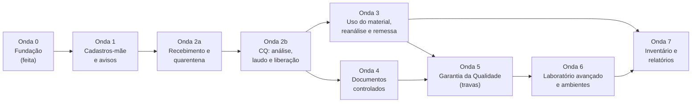

# Roadmap de telas do iLabs: quais telas, em que ordem e por quê

**Estudo de 18/11/2026.** Rascunho para validação do responsável. Nada aqui foi construído: é a proposta de ordem de construção, com os motivos, para discutir e corrigir antes de começar a próxima etapa.

**Para quem é:** quem conduz a homologação e a construção (analista de negócio), a Qualidade e quem decide escopo. Escrito sem jargão; os termos próprios estão explicados onde aparecem.

**Planilha de apoio:** [`telas-do-legado-para-o-novo.csv`](telas-do-legado-para-o-novo.csv) classifica **cada uma das 248 telas** do legado (o que vira no iLabs, em qual onda e por quê). Abra no Excel (separador ponto e vírgula).

---

## 1. Em dez linhas

1. O cliente é o **IVB** e a versão dele tem **cinco módulos**: Principal, Estoque, Controle da Qualidade (CQ), Garantia da Qualidade (GQ) e Controle de Documentos. **Produção, OPE, Comercial e Rastreabilidade ficam fora** desta versão (reunião de 12/11).
2. O legado tem **248 telas** nesses cinco módulos. **Copiar tudo seria um erro:** 86 telas se fundem em outras, 13 se eliminam (duplicadas, vazias, técnicas) e 15 dependem da Produção. O iLabs precisa de **cerca de 84 telas novas**, mais as 15 que já existem.
3. **O lote é o centro do sistema.** Um lote tem **uma única situação** (quarentena, em análise, aprovado, reprovado, retido…) e todos os módulos obedecem a ela. Isso precisa existir **no banco antes** das telas de Estoque e CQ. É a decisão de desenho mais importante do roadmap.
4. A **aprovação com assinatura eletrônica** (laudo, documento, mudança, desvio, treinamento) é a mesma peça em todos os módulos. Constrói-se **uma vez** e cada onda a usa. No legado essa exigência do edital está como **"Não atende"**.
5. A ordem certa **não é "um módulo inteiro por vez"**. Estoque e CQ não fecham sozinhos: o recebimento só termina quando o CQ emite o laudo. A primeira entrega de valor é uma **fatia ponta a ponta**: receber um material, ele ficar em quarentena, o CQ analisar e assinar o laudo, e o lote ser liberado ou barrado sozinho.
6. A **Garantia da Qualidade do legado é um arquivo de registros**: nada do que ela decide bloqueia lote, ordem ou pessoa. No novo, ela se constrói pelas **travas** (por exemplo, "desvio aberto retém o lote"), não pelas 69 telas.
7. **Reclamação e recolhimento não existem no legado**, mas a norma exige (arts. 319 a 360). Entram no roadmap como construção nova, na GQ.
8. A saída da Produção deixa **cinco lacunas** que precisam de decisão suas (seção 7): como entra o produto acabado, quem certifica o lote para venda, pesagem e balanças, registro do produto, e a lista de clientes no recolhimento.
9. **35 telas do legado não podem ser classificadas sem uma resposta** (Kits, Compras, Assuntos Regulatórios, fiscal, siglas que ninguém explicou). A seção 7 diz **em que onda cada decisão é necessária**, para você decidir no momento certo e não tudo agora.
10. Proponho **8 ondas** (0 a 7). A 0 já está feita. A próxima é a 1, e a mais crítica e maior é a 2 (dividida em 2a e 2b).

---

## 2. Como o estudo foi feito, e os limites dele

**Fontes lidas (repositório do legado, que não muda mais):**
- escopo do IVB e a aderência ao **edital** (12 requisitos);
- o **mapa do processo fabril** (16 etapas e onde a corrente quebra) e o **mapa de integrações** (21 setas entre módulos);
- o **modelo ideal** (situação única do lote e 11 travas) e o **diagnóstico de conformidade** (38 temas da RDC 658/2022 e do Guia 33/2020, com a lista "o que corrigir primeiro");
- os **inventários de telas** dos cinco módulos (nome, situação, defeitos) e a lista dos **fluxos documentados** (23 fluxos nos cinco módulos);
- a ata da reunião de 12/11 sobre Estoque e CQ.

**No iLabs:** o menu, as rotas e os cadastros já construídos, o modelo de dados e as decisões registradas (`docs/decisoes.md`, `docs/principal/`).

**Outros repositórios:** `iLabPharma-Novo` é uma modernização direta de telas do Principal (login, locais, perfis, graus de contaminação, centros de custo), sem menu novo; `LabMedSys-Nova-Geracao` é um esqueleto vazio. Não mudam o roadmap.

**O que este estudo NÃO fez (e você deve saber):**
- Não li os 23 fluxos nem as páginas de tela uma a uma: usei os nomes e as situações dos inventários, os resumos dos fluxos, o mapa de integrações e o diagnóstico. A classificação de cada tela é **minha proposta**, e as 35 marcadas "Perguntar antes" são exatamente as que eu não consigo decidir lendo.
- Não estimei horas nem datas. Sem uma medida de velocidade da equipe, qualquer data seria chute. Dou o **tamanho relativo** de cada onda (número de telas novas e de peças de plataforma).
- Não avaliei a versão "nova" que o fornecedor/desenvolvimento testa (a do mesmo legado com ferramentas atualizadas): ela não é o iLabs.

---

## 3. Os achados que mudam o roadmap (visão crítica)

### 3.1 Não copiar 248 telas

| O que acontece com as telas do legado | Telas |
|---|---|
| Já feitas no iLabs | 15 |
| **Construir** (tela própria) | 68 |
| **Construir como cadastro simples** (o motor genérico de cadastros do iLabs resolve) | 16 |
| **Fundir** em outra tela do novo | 86 |
| Eliminar (duplicada, vazia, técnica) | 13 |
| Adiar / fora do escopo do IVB | 15 |
| **Perguntar antes de decidir** | 35 |
| **Total** | **248** |

O número de telas novas a construir (68 + 16 = **84**) é um terço do que o legado tem. Exemplos: as **14 telas de Desvios** viram cerca de 6; as 8 de Documento (com duplicatas) viram 4; os 28 cadastros do Estoque viram 12 (muitos são listas pequenas); os **25 relatórios** viram 4.

### 3.2 O lote e a situação única vêm antes das telas

No legado, a situação do lote fica no Estoque, o CQ não a muda sozinho (alguém clica "Atualizar" no Estoque) e as travas de quarentena e de lote vencido estão desligadas. A reunião de 12/11 confirmou que o usuário acha o botão "Atualizar" sem sentido. No iLabs a situação tem de ser **uma regra do banco** e o laudo assinado a muda na hora. Se fizermos as telas de Estoque e de CQ antes, vamos refazê-las. **Por isso a Onda 2 começa pelo modelo do lote, não pelas telas.**

### 3.3 A assinatura eletrônica é uma peça, não uma tela

Laudo do CQ, aprovação de documento, mudança, desvio, conclusão de treinamento, revalidação e justificativa de inventário usam o mesmo mecanismo: **quem fez não aprova, a aprovação é de quem tem a função, assinada com senha, com motivo e registro imutável** (edital 1.3). Construir isso em cada módulo geraria sete versões diferentes. Proposta: **uma peça de plataforma** (fluxo de aprovação com assinatura), feita na Onda 2 com o laudo como primeiro uso.

### 3.4 Estoque e CQ são uma onda só

O mapa de integrações mostra que o Estoque conversa com seis módulos e o recebimento só termina quando o CQ emite o laudo. Tentar fechar "o Estoque" e depois "o CQ" obriga a construir um laudo falso no meio. A fatia correta é **Recebimento → Quarentena → Amostragem → Análise → Laudo → Liberação** (Onda 2), do começo ao fim.

### 3.5 A qualificação de fornecedor sobe para antes do recebimento

O legado tem a avaliação de fornecedor em **três lugares** (Estoque, CQ e GQ) e nenhuma bloqueia o recebimento. Você já decidiu (06/11) que **o recebimento bloqueia fornecedor não qualificado** e que a avaliação mora na GQ. Isso puxa uma **versão mínima da qualificação** (fornecedor, material aprovado, situação, validade) para a Onda 2, mesmo sendo "da GQ". A avaliação de desempenho periódica fica para a Onda 5.

### 3.6 A GQ se constrói por travas, e começa depois

A GQ tem 69 telas, 22 delas protótipos (só desenho). Nenhuma das 45 com lógica funciona sem defeito. O que a norma pede é que as decisões da GQ **travem** os outros módulos. Por isso ela entra **depois** de existir o lote e a situação (para o desvio reter o lote) e os documentos (para a mudança gerar nova versão e o treinamento se ligar ao procedimento).

### 3.7 Reclamação e recolhimento: construir do zero

O legado não tem. A norma dedica um capítulo inteiro (arts. 319 a 360). Para listar "para quem foi cada lote", o iLabs **usará as Remessas do Estoque** (o Comercial e a Rastreabilidade ficam fora). Isso exige que a **Remessa seja construída com o destinatário e o endereço da data da remessa** desde a Onda 3.

### 3.8 O que a saída da Produção quebra (lacunas)

| # | Lacuna | Por que dói | Decisão (D) |
|---|---|---|---|
| 1 | Como o **produto acabado** entra no Estoque | No legado só entra de ordem de produção (e o edital 2.3 pede rastreabilidade total) | D1 |
| 2 | Quem **certifica o lote para venda** (Pessoa Delegada) | Trava 4: nada é liberado sem ela | D1 |
| 3 | **Pesagem e balanças** (edital 3.5, "a definir") | Depende da Produção e do protocolo das balanças | D9 |
| 4 | **Registro do produto na ANVISA** e treinamento antes de produzir | As travas 6 e 7 existem para a Produção | D10 |
| 5 | **Clientes no recolhimento** | Vem do Comercial | resolvida com as Remessas |

### 3.9 Edital: dois requisitos ainda não têm definição

O edital 2.2 (**pontos críticos de controle**) e o 2.1 (**ensaio biológico**) estão "não verificado": ninguém da área explicou o que são. Não dá para planejar telas para eles. Entram como decisão D8, necessária antes da Onda 6.

---

## 4. Critérios de ordenação

Cada tela entra numa onda por cinco critérios, nesta ordem de peso:

1. **Dependência:** o que precisa existir antes (cadastro antes de operação, operação antes de decisão).
2. **Peso na norma e no edital:** o que a RDC 658/2022 e os 12 requisitos do edital cobram com mais força e onde o legado mais falha (o diagnóstico lista os 11 pontos "corrigir primeiro").
3. **Risco de retrabalho:** o que, se feito cedo demais, será refeito (por isso a situação do lote vem antes das telas).
4. **Valor demonstrável:** cada onda termina numa **fatia que dá para mostrar e testar ponta a ponta**, com os casos de teste do legado servindo de aceite.
5. **Custo:** cadastros simples saem rápido pelo motor genérico; entram juntos, na onda em que alguém os usa, e não antes.

**Regra de ouro:** não se constrói tela que ninguém usa ainda. Cadastro de Pontos de água só entra quando o CQ for coletar água.

---

## 5. O roadmap em ondas

Ondas 3 e 4 não dependem uma da outra: podem ser feitas em qualquer ordem ou em paralelo, se houver gente. Proponho a 3 antes da 4 porque a 3 completa a corrente do material, que é a que o edital mais cobra.

### Resumo das ondas

| Onda | O que o IVB consegue fazer no fim | Telas novas | Peças de plataforma | Edital | Travas |
|---|---|---|---|---|---|
| **0 Fundação** (feita) | Entrar com segurança, ter perfis, profissionais, estrutura, histórico imutável, assinatura (consulta), base de conhecimento | 15 prontas | já existem | 1.1, 1.2 | — |
| **1 Cadastros-mãe e avisos** | Cadastrar fornecedores, almoxarifados e endereços, materiais (com lote, validade, quarentena e reanálise); receber avisos de prazo | 8 | Central de Notificações (avisos de prazo) | 3.1 | — |
| **2a Recebimento e quarentena** | Receber um material com inspeção obrigatória; fornecedor não qualificado e lote vencido são recusados; o lote entra em quarentena e abre a análise sozinho | ~9 | **Situação única do lote**; numeração do lote; etiquetas | 3.1 a 3.4 | 1, 5 |
| **2b CQ: análise, laudo e liberação** | O CQ define regras, colhe a amostra, registra a análise e **emite o laudo assinado por quem não fez a análise**; o lote muda de situação na hora; amostra de retenção guardada | ~11 | **Fluxo de aprovação com assinatura eletrônica** | 1.3, 2.1, 3.2 | 2 |
| **3 Uso do material** | Pedir, separar (lote que vence primeiro), dar saída, devolver, movimentar, reanalisar com agenda, **remeter** (só lote aprovado) | 9 | Histórico completo do lote | 2.3 (parte), 3.3 | 1 |
| **4 Documentos controlados** | Elaborar, revisar, aprovar com assinatura, vigorar, distribuir cópias controladas, retirar o obsoleto | 10 | usa o fluxo de aprovação | 1.1, 1.3 | — |
| **5 Garantia da Qualidade** | Desvio e CAPA que **retêm o lote**, mudança aprovada, treinamento (vencido bloqueia), autoinspeção, qualificação de fornecedor completa, **reclamação e recolhimento** | 20 | usa tudo acima | 1.1, 2.3 | 3, 6, 8, 11 |
| **6 Laboratório avançado e ambientes** | Estabilidade, água e ambiente, métodos validados, equipamentos e calibração, resultado fora de especificação | 15 | — | 2.1 (completo), 2.2 | 9, 10 |
| **7 Inventário e relatórios** | Inventário rotativo, análise de estoque e os 4 relatórios consolidados | 2 + 4 relatórios | — | — | — |
| **Fora do escopo / adiar** | Produção, OPE, Comercial, Rastreabilidade (e as telas do Estoque que dependem da Produção) | — | — | 2.2, 3.5 (parte) | 4, 7, 9 (parte) |

*"Telas novas" conta a planilha (classes Construir e Construir como cadastro simples). Cada tela fundida entra dentro de uma tela nova da mesma onda.*

### Onda 0: Fundação (feita)

Já existe: entrada com bloqueio e segundo fator, perfis e permissões conferidas no servidor, contas de usuário com validade, **profissionais** (ficha completa, exportar e imprimir com registro), funções profissionais, grupos, estrutura organizacional, centros de custo, **unidades de medida**, registro de acessos, assinatura eletrônica (consulta), base de conhecimento (documentos e busca), auditoria imutável.

**O que falta fechar da Onda 0** (pequeno, mas bloqueia a 2b): confirmar que a **assinatura eletrônica** já grava "quem, quando, significado" e que dá para pedi-la de dentro de qualquer ação. O banco tem a tabela de assinaturas; a **tela e o comportamento "pedir senha ao aprovar"** é a peça da Onda 2b.

### Onda 1: Cadastros-mãe e avisos (8 telas)

| Tela nova | Substitui no legado | Observação |
|---|---|---|
| Pessoas jurídicas (com papéis) | Pessoa jurídica | Fornecedor, fabricante, transportadora, cliente. A tabela já existe no banco |
| Almoxarifados e endereços (árvore) | Almoxarifado, Local de Armazenagem, Rua, Coluna, Andar, Endereço do Estoque, Local físico (7 telas) | Uma árvore em vez de sete listas. A sigla do local entra no número do lote |
| Materiais | Item | Lote, validade, quarentena obrigatória para matéria-prima, reanálise visível, controlado. Tabela já existe |
| Classificação do material | Grupo, Subgrupo, Classe, Classificação (4 telas) | Uma árvore |
| Condições de armazenagem | Condição de Armazenagem | Cadastro simples |
| Conversão de unidades | Conversão de Unidade | Cadastro simples |
| Configuração da Plataforma | Configuração, Parâmetros do Estoque | Parâmetros por empresa, hoje no código |
| Central de Notificações | 5 telas de notificação | Avisos de prazo (reanálise, documento, treinamento, validade) |

Dependem de decisão antes desta onda: **D11** (fiscal: NCM e natureza da operação), **D12** (o que são SJB e Nível de Segurança) e **D6** (controlados, Portaria 344).

### Onda 2a: Recebimento e quarentena (~9 telas)

**Antes das telas:** o **modelo do lote e a situação única** no banco, com testes. É o que impede o "Endereçamento diz sucesso e não grava" (a falha mais grave do Estoque no legado, DV-EST-016).

| Tela nova | Substitui | Regra que nasce no banco |
|---|---|---|
| Qualificação de fornecedor (mínima) | Avaliação do Fornecedor ×3 | O recebimento **recusa** fornecedor não qualificado para aquele material |
| Recebimento (entrada, conferência da nota, endereçamento) | Recebimento, Conferência, Endereçamento, entradas por nota | Quem cadastra não autoriza; **grava tudo ou nada**; recusa lote vencido; abre a solicitação de análise sozinho |
| Inspeção do veículo e da entrega | Checklist de Inspeção Veicular | **Obrigatório**, com resposta a cada pergunta (edital 3.4); veículo reprovado não recebe |
| Entrada avulsa | Entrada de Material - Outras | Mesma regra do recebimento; candidata ao caminho do produto acabado (D1) |
| Situação do lote (quarentena, aprovado, reprovado, retido) | Movimentação de Quarentena | Trava 1: lote em quarentena não sai |
| Consulta de disponibilidade | 4 telas de disponibilidade | Uma só, por item, lote e local |
| Histórico do lote | Histórico do Lote | Situação, análise, laudo, movimentos, quem e quando (edital 1.1) |
| Etiquetas | Etiquetas (identificação e quarentena) | Saem do CQ, como na reunião de 12/11 |
| Amostras de retenção, referência e estabilidade | Menu Regulatório (3 telas) | Prazo mínimo de guarda, trava de saída (art. 14, VIII) |

### Onda 2b: CQ, laudo e liberação (~11 telas)

| Tela nova | Substitui |
|---|---|
| Regras de amostragem e regras de análise (especificação por material) | Regra Amostragem, Regra de Análise |
| Solicitação de análise (nasce do recebimento) | Solicitação de Análise, Priorização |
| Programação de amostragem | Programação de Amostragem, Verificação de Amostragens |
| Amostragens pendentes e consulta | Amostragens Pendentes (+ visão de administrador), Consultar Amostragem |
| Programação e registro da análise | Programação de Análise, Consultar Análise Programada (+ administrador) |
| **Laudo** (aprovador ≠ analista, assinatura eletrônica) | Emissão Laudo Final |
| Etiquetas do CQ | Gerar Etiqueta |
| Motivos do CQ | Motivos |

**O que muda em relação ao legado:** some o botão "Atualizar resultado" do Estoque, porque o laudo assinado muda a situação do lote na hora (trava 2); o analista que fez o teste **não pode** aprovar o laudo; as "visões de administrador" viram **permissões**, não telas.

**Ao fim da 2b o IVB tem o primeiro ciclo completo** e é o momento de uma **demonstração e um teste de aceite com os casos do legado** (Recebimento e Quarentena; Solicitação, Análise e Laudo).

### Onda 3: Uso do material (9 telas)

Solicitação de material (com aprovação), atendimento e separação (**o lote que vence primeiro**), saída de material (lote em quarentena nem aparece, como pediram em 12/11), movimentação interna (destino completo; saldo conferido), devolução, **remessa** (só lote aprovado; guarda destinatário e endereço da data), agenda de reanálise (prazo e aviso), revalidação de lote, classificação de reanálise. Mais os relatórios da qualidade do estoque (reprovado, quarentena, reanálise).

### Onda 4: Documentos controlados (10 telas)

Tipos de documento, elaboração, revisão, aprovação com assinatura, vigência (a data de efetividade; vale só depois do treinamento quando exigido), nova revisão, obsolescência, consulta (só a vigente), cópias controladas, documentos externos, modelos. As 17 telas do legado viram ~10 porque Pré-aprovação, Aprovação e Vigência existem **duplicadas** no legado.

### Onda 5: Garantia da Qualidade (20 telas)

| Fluxo | Telas novas | Trava que liga ao resto |
|---|---|---|
| **Desvio e CAPA** (14 legado → ~6) | registro e triagem, classificação, investigação e causa raiz, plano de ação, execução e monitoramento, eficácia | **Desvio aberto retém o lote** (trava 3). CAPA obrigatória em desvio crítico |
| **Treinamento** (8 → ~5) | cadastro, programação, matriz, conclusão assinada, acompanhamento | Quem não está treinado no método **não executa a análise** (adaptação da trava 6 ao escopo do IVB) |
| **Controle de mudanças** (8 → ~4) | solicitação, avaliação pelas áreas, plano e execução, encerramento e eficácia | Mudança aprovada gera **nova versão** do documento e da especificação (trava 8) |
| **Autoinspeção e auditoria** (7 → ~4) | roteiro, programação, registro, avaliação | Não conformidade vira desvio |
| **Qualificação de fornecedor completa** | desempenho periódico | fecha a trava 5 com revisão periódica |
| **Reclamação e recolhimento** (**novo**) | reclamação, recolhimento | Retém e recolhe lotes; lista de destinatários vem das Remessas |

Fica dependente de **D10**: Assuntos Regulatórios (7 telas), que só fazem sentido se houver produto registrado no IVB.

### Onda 6: Laboratório avançado e ambientes (15 telas)

Equipamentos, instrumentos e categorias; **calibração e qualificação**; **métodos analíticos validados**; estabilidade (regra, acompanhamento, conclusão); água e ambiente (coletas, programação, pontos de água, ambientes, grau de contaminação); **resultado fora de especificação** abre investigação (trava 10); reagentes e padrões (o legado não tem). Completa o edital 2.1 (**o legado só cobre "parcial, só código"**). Depende de **D7** (CQ do IVB faz água e ambiente?) e **D8** (CCP e ensaio biológico).

### Onda 7: Inventário e relatórios (2 telas + 4 relatórios)

Inventário rotativo (**quem conta não ajusta**; justificativa e ajuste por outra pessoa), análise de estoque, e os **4 relatórios consolidados** no lugar de 25: movimentação, situação do estoque, qualidade do estoque, consumo e inventário.

---

## 6. O que NÃO construir agora

| Grupo | Telas | Por quê |
|---|---|---|
| **Eliminar** | 13 | Duplicadas (verificação de amostragem 2ª versão, aprovação e vigência duplicadas), vazias (relatório de liberação pelo CQ), técnicas (Microservices, gerador de telas, página de teste), cópias das telas do Principal dentro do Estoque, Grupo Perfil da GQ (segunda camada de acesso) |
| **Adiar: dependem da Produção** | 15 | Solicitação, entrada e devolução "da Produção", Central de Pesagem, Utensílios, Utilidades, Linhas de produção, mudança de produto, lote piloto |
| **Adiar: financeiro** | Contas contábil, gerencial, financeira, corrente, Banco, Demonstrativo financeiro | Não é BPF (decidido em 06/11: um cadastro de contas com tipo, quando houver financeiro) |
| **Perguntar antes** | 35 | Seção 7 |

---

## 7. Decisões em aberto, e em que onda cada uma é necessária

A regra é **decidir no momento certo**: nenhuma delas precisa ser respondida hoje, exceto as que travam a Onda 1 e a 2.

| # | Pergunta | Necessária antes da | O que eu proponho (a confirmar) |
|---|---|---|---|
| **D1** | **Produto acabado sem Produção:** como entra no Estoque e quem o certifica para venda? | **Onda 2a** | Entrada avulsa de produto acabado com lote, validade e **número da ordem informado**, e a **certificação pela Pessoa Delegada** (trava 4). Não construir Produção |
| **D11** | Recebimento por **nota fiscal**: NCM, natureza da operação e dados fiscais fazem parte do IVB? | **Onda 1** | Se não, o recebimento é pelo documento do fornecedor e a nota fica como anexo |
| **D12** | O que são **SJB** e **Nível de Segurança** (cadastros do Estoque que ninguém explicou)? | **Onda 1** | Entender antes de refazer; o SJB aparece na regra do lote e do NEB |
| **D6** | O IVB trabalha com **substâncias controladas** (Portaria 344)? | **Onda 1** | Se sim, o cadastro de material já nasce com a marca e entra um relatório próprio |
| **D14** | Os relatórios mensais **RM03 (vendas)** e **RM14 (insumos)** são exigência regulatória? | Onda 3 | Confirmar com a área; RM03 depende de venda |
| **D4** | **Compras** (Curva ABC, Pedido de Compra, Aquisição) entram no IVB? | Onda 3 | O edital não cita; adiar |
| **D5** | **Kits** (6 telas e 5 relatórios) entram no IVB? | Onda 3 | O edital não cita; adiar |
| **D3** | **Documentos (Onda 4) antes da Onda 3?** | Onda 3 | Depois, mas dá para inverter sem custo se a Qualidade preferir |
| **D10** | **Registro do produto na ANVISA** e revisão periódica do produto (11 telas) entram? | Onda 5 | Só se houver produto próprio no IVB; adiar |
| **D7** | O CQ do IVB faz **água e ambiente**? | Onda 6 | Se sim, entram ambientes, pontos de água e coletas |
| **D8** | O que são os **CCP** do edital (2.2) e há **ensaio biológico** (2.1)? | Onda 6 | Pedir ao IVB a definição |
| **D9** | **Balanças** da Central de Pesagem (edital 3.5): protocolo? | adiada | Depende da Produção; manter "a definir" |
| **D13** | Mais de uma **planta/filial** no IVB? | Onda 1 | Preparar a árvore para várias plantas (já é a decisão de 06/11) |

---

## 8. Cobertura do edital e das travas

| Edital | Situação no legado | Onda que resolve | Observação |
|---|---|---|---|
| 1.1 Trilha de auditoria | Parcial | 0 e cada onda | Um só formato, com motivo; histórico do excluído consultável |
| 1.2 Acesso por papéis | Parcial | 0 e cada onda | Permissão conferida no servidor em toda gravação |
| **1.3 Assinatura eletrônica** | **Não atende** | **2b** (peça) e usos nas 4, 5, 3 | Primeira entrega é o laudo |
| 1.4 Confiabilidade | Parcial | cada onda | Gravar tudo ou nada; data e hora do servidor |
| 2.1 Análises físico-químicas e biológicas | Parcial (só código) | 2b e **6** | Biológico depende de D8 |
| 2.2 CCP | Não verificado | adiada | Depende de D8 e da Produção |
| **2.3 Rastreabilidade total** | **Não atende** | 2a, 3 (parcial) | **Total só com Produção**: o IVB terá rastreabilidade do material até a remessa |
| 3.1 Insumos com recursos farmacêuticos | Parcial | 1 e 2a | |
| 3.2 Quarentena automática | Parcial | 2a e 2b | A recepção abre a análise; o laudo libera |
| 3.3 Lote e validade | Parcial | 2a e 3 | Recusa lote vencido; agenda de reanálise |
| 3.4 Checklist de inspeção | Parcial | 2a | Obrigatório |
| 3.5 Balanças | Não verificado | adiada | Depende da Produção |

| Trava (modelo ideal) | Onda | Observação |
|---|---|---|
| 1 Situação única do lote | 2a | |
| 2 Laudo muda a situação na hora | 2b | |
| 3 Desvio retém o lote | 5 | |
| 4 Liberação para venda pela Pessoa Delegada | 2b ou adiada | Depende de D1 |
| 5 Só fornecedor qualificado | 2a (mínima) e 5 | |
| 6 Só pessoa treinada | 5 | Adaptada ao CQ (método) |
| 7 Só produto com registro válido | adiada | Depende de D10 e da Produção |
| 8 Mudança aprovada com versão | 5 | Precisa da Onda 4 |
| 9 Água e sala reprovadas bloqueiam | 6 (parte de CQ) | A parte da Produção fica adiada |
| 10 Fora de especificação abre investigação | 6 | |
| 11 Reclamação e recolhimento | 5 | Usa as Remessas da Onda 3 |

---

## 9. Riscos do roadmap

| # | Risco | O que fazer |
|---|---|---|
| 1 | **A Onda 2 é a maior e a mais crítica** (≈20 telas e 3 peças de plataforma). Se atrasar, tudo atrasa | Dividida em 2a e 2b, cada uma com demonstração; modelo do lote e testes do banco **primeiro** |
| 2 | **Velocidade desconhecida:** não há medida do ritmo da equipe nem do tamanho real de uma tela | Medir nas Ondas 1 e 2a (as telas do Profissional servem de referência) e só então prometer datas |
| 3 | **Expectativa do cliente de 5 módulos "completos"** (248 telas) | Mostrar a planilha: o novo entrega os mesmos fluxos com ~100 telas, e os fluxos é que se comparam, não as telas |
| 4 | **Rastreabilidade total (edital 2.3) depende de módulos fora de escopo** | Combinar com o IVB, por escrito, o que "total" significa nesta versão |
| 5 | **Decisões travando ondas** | A seção 7 diz quando cada uma é necessária; pedir D1, D6, D11, D12 e D13 antes da Onda 1 |
| 6 | **Regra de negócio só no front** (defeito recorrente do legado) | Cada tela nasce com a regra no banco e o teste do banco antes (já é regra do projeto) |
| 7 | **Defeitos do legado perdidos** | Os 23 fluxos e os casos de teste do legado viram os **testes de aceite** de cada onda |

---

## 10. Próximos passos propostos

1. **Você valida este estudo** (ondas, ordem e as classificações da planilha) e responde D1, D6, D11, D12 e D13.
2. Eu transformo a **Onda 1** em um plano detalhado: tela a tela, com os requisitos do legado de cada uma (citando os defeitos de origem) e os testes de aceite.
3. Em paralelo, desenho a **peça "situação única do lote"** (modelo de dados e regras) para a Onda 2a, para você validar **antes** de qualquer tela.
4. Definimos juntos o que é "**pronto**" de uma onda: telas construídas, regra no banco testada, casos do legado aprovados e demonstração feita.

---

## 11. Anexo: método e números

- **Telas do legado classificadas:** 248 (Principal 32; Estoque 105, entre as 99 do menu, as de fora do menu e os agrupamentos; CQ 25; GQ 69, sendo 67 do inventário mais 2 construções novas; Documentos 17).
- **Classe das telas:** F já feito · C construir · CS cadastro simples · FU fundir · E eliminar · A adiar · P perguntar.
- **Ondas:** 0 a 7 (`-` = não entra no roadmap).
- **A planilha é a fonte:** mudar uma classificação é editar a linha. Os números deste documento saem da contagem da planilha em 18/11/2026.
